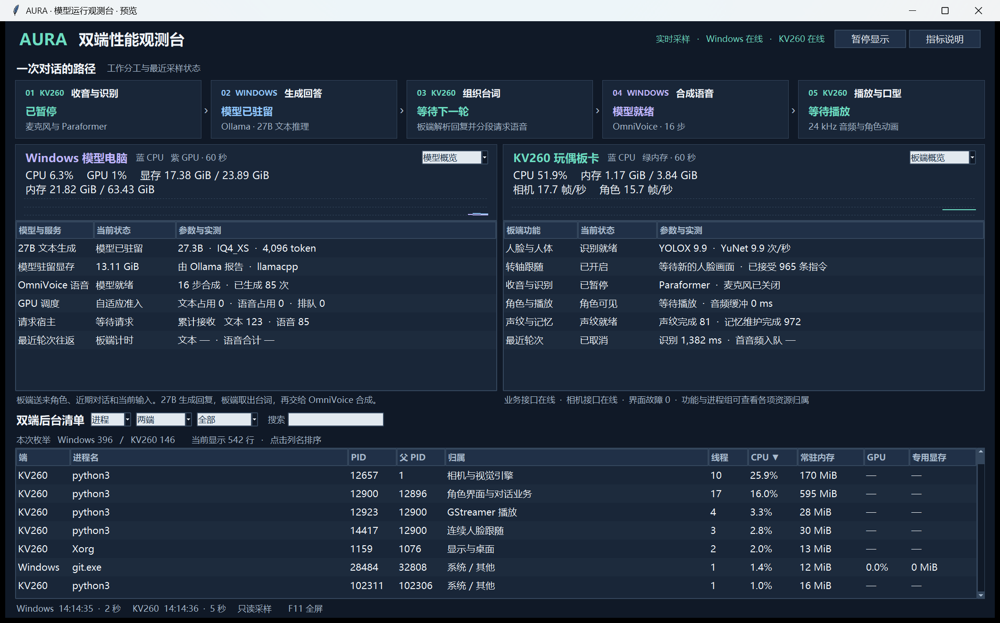
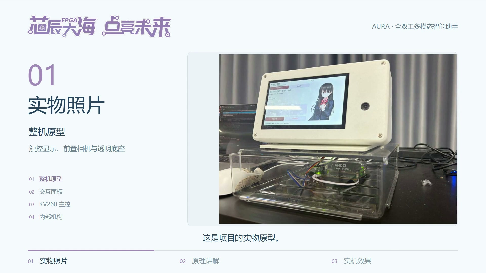

# AUAR · 雪妃 — KV260 工程

基于 AMD Kria KV260 的视觉感知、语音交互与转轴控制工程。本仓库汇集正式源码交付、读取时的板端公开快照，以及 Windows / Ubuntu 两侧已核对的工程源码、FPGA/IP、构建脚本、依赖和资源索引。

**评审与复现入口：** [正式源码](projects/current/README.md) · [技术说明](projects/current/report/design_report.md) · [构建验证记录](projects/current/report/validation_summary.md) · [板端安装说明](projects/current/board/readme.md) · [模型与离线资源](https://github.com/MeetyouTT/AUAR-KV260/releases)

**性能监控：** [AURA 双端性能监视器](tools/performance_monitor/README.md) 同屏查看 Windows 模型服务与 KV260 板卡的 CPU、内存、进程、服务，以及可取得的 GPU、视觉与界面指标；包含源码、启动器、检查和 SSH 配置示例。

[](tools/performance_monitor/README.md#界面截图)

*历史运行截图，指标为截屏时的采样值。*

## 项目介绍视频

通过 1 分 08 秒视频了解 AURA 的实物原型、采集与对话触发、板端处理、LLM/TTS 调用，以及视觉与转轴协同。

[](https://raw.githubusercontent.com/MeetyouTT/AUAR-KV260/main/media/videos/aura-introduction-68s.mp4)

**[▶ 播放项目介绍视频（1:08）](https://raw.githubusercontent.com/MeetyouTT/AUAR-KV260/main/media/videos/aura-introduction-68s.mp4)** · [查看视频文件](media/videos/aura-introduction-68s.mp4) · [媒体说明](media/README.md)

1920×1080 · 60 fps · H.264 / AAC

## 工程目录

| 目录 | 内容 |
|---|---|
| [projects/current](projects/current) | 2026-11-03 正式源码交付，1,687 个文件，与最终 RAR 内容逐文件 SHA256 一致；含软件、FPGA、RTL 仿真、比赛 Skill、构建入口与报告。 |
| [projects/2026-11-02](projects/2026-11-02) | 2026-11-02 交付工程，1,977 个文件，保留原布局、固件、模型和校验入口。 |
| [projects/board_current](projects/board_current) | 本次读取时的板端启动配置与 380 项公开组件，共 381 个文件，组件 SHA 与当时启动清单匹配。 |
| [source_archive](source_archive) | 补充源码、工程输入、原生库/SDK 输入、依赖、参考资料与已取件的板端公开文件。 |
| [inventory](inventory) | 文件 SHA256、原路径对应关系、Linux 链接记录和分卷资源索引。 |
| [tools/snapshot_tools.py](tools/snapshot_tools.py) | 完整性核验及原始目录布局恢复工具，Python 3.8+。 |
| [tools/performance_monitor](tools/performance_monitor) | Windows + KV260 双端性能监视器，含同屏看板、只读采样、启动脚本、检查与配置示例，Python 3.9+。 |

`projects/current` 以正式启动清单 `9a4f06da6035f62d1fafad1af71f61553b9e8656e62ef9b9a628adff0edabc15` 为交付基线；`projects/board_current` 的读取快照启动 SHA 为 `69080f9877565d346329c8c3004071102349ca9f7d6779819004cf8ca405dfe3`。二者代表各自记录的版本，分别保存。

## 下载与文件校验

工程大文件使用 Git LFS。完整下载还需获取 Releases 中的模型与离线资源分卷。

```sh
git clone https://github.com/MeetyouTT/AUAR-KV260.git
cd AUAR-KV260
git lfs install
git lfs pull
```

使用下载工具从 [Releases](https://github.com/MeetyouTT/AUAR-KV260/releases) 获取分卷，自动放入仓库旁的 `release_assets` 目录并逐卷检查 SHA256，然后执行完整性校验：

```sh
python -B tools/download_release_assets.py --out ../release_assets
python -B tools/snapshot_tools.py verify --assets ../release_assets
```

也可以手动下载 Release 中的 `release_assets_index.json` 与分卷，按索引的 `path` 恢复子目录。各原文件的大小、整文件 SHA256 和分卷 SHA256 见 [release_payloads.jsonl](inventory/release_payloads.jsonl)。

校验涵盖仓库中 189,716 个工程文件实体、585,898 条已收录原路径映射、两份原交付校验清单、380 项板端组件，以及 17 组资源的 41 个分卷和整文件 SHA256。源码实体共 18,875,283,128 字节；分卷资源共 32,305,841,562 字节，每卷最多 1 GiB。

只检查 Git/LFS 文件时可执行以下命令；该模式跳过分卷实体校验。

```sh
python -B tools/snapshot_tools.py verify --repo-only
```

## 构建与复现

正式工程使用 Ubuntu 与 Vivado / Vitis 2022.2。完整命令、环境路径、固件导出、模型准备、原生库交叉编译及板端安装步骤见 [正式源码 README](projects/current/README.md)。框架与硬件复现入口为 [build/reproduce.py](projects/current/build/reproduce.py)。

工程内的 [构建验证摘要](projects/current/report/validation_summary.md) 记录对应版本实际执行的 XSim、综合实现、固件、软件、原生库及模型验证。仿真、文件核验、历史采样和实板验收各按其原始记录引用。

## 恢复原始布局

相同内容按 SHA256 保留规范副本，所有已收录的原始路径均有对应记录。先查看计划，再恢复到全新输出目录：

```sh
python -B tools/snapshot_tools.py restore --source-id delivery_20261103 --out ../auar-source-restored --plan
python -B tools/snapshot_tools.py restore --source-id delivery_20261103 --out ../auar-source-restored --assets ../release_assets
```

可用来源 ID 为 `delivery_20261103`、`delivery_20261102`、`board_snapshot_home`、`board_system`、`windows_e`、`ubuntu_home`、`board_home`、`external_models`。恢复 Ubuntu 原始布局应使用区分大小写的 Linux 文件系统；规范副本在 Windows 上已分别保存，大小写不同的原件不会互相覆盖。

[source_links.jsonl](inventory/source_links.jsonl) 记录 Linux 链接。恢复工具会重建已覆盖、且目标位于输出目录内的链接；外部系统链接保留原始记录。

## 收录范围与许可

本仓库提供清单中已核对、已收录的工程快照。私人身份/录音/数据库、凭证、不可移植环境缓存、未完成下载、未核对归档、未分类条目、部分历史部署及不可读目录的审计记录保留在本地，未计入本仓库可恢复范围。

各原项目及第三方组件的著作权与许可声明随原文件保存。正式交付的权利说明见 [license](projects/current/license) 和 [third_party_notices.md](projects/current/third_party_notices.md)；其他来源沿用各子目录中的许可文本。
