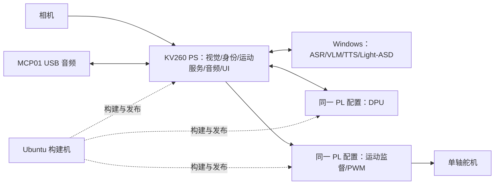

# 2026-10-03：AURA 架构与运行环境审查

## 结论

当前方案的职责划分能够继续采用：KV260 PS 负责相机、视觉/身份、唯一运动服务、USB 录放音和界面；PL 集成 DPU 与自研运动监督/PWM；Windows 运行首版 ASR/VLM/TTS/Light-ASD；Ubuntu 构建硬件、系统、模型和板端应用。

本轮重新检查原方案、执行手册、实际 RTL、运行时源码和原始资源/时序报告。确认 DFX manager 仍有共享状态并发缺口和父设计删除时的清理缺口；完整运动硬件的集成余量、正式接口文件与完整应用实现仍未闭合。相机、音频、显示、模型与 ARM64 应用依赖属于尚未取得验收证据的部分。

本次为静态审查，未运行项目测试或连接 KV260。结论限定于 ZIP 与本机可见工程；其他成员电脑上的实现未取得。

## 架构构成及现状

上图表示目标方案。已有证据覆盖官方 DPU 推理、M3 最小寄存器与 DPU 在同配置中的有限板测，以及修复版运行时持久化后的启动/原图推理。M3 只包含 IP_ID、ABI_VERSION、BUILD_ID、SCRATCH；完整运动监督/PWM、相机到随动、完整问答、身份与实时说话人链尚未取得交付证据。最新冷启动记录显示当次激活的是官方 benchmark，M3 候选未激活；历史 M3 板测不能代替当前启动状态。

依据：[最新启动记录](/home/ghmd/kv260-fs-repair-reboot-20261003/POST_REPAIR_BOOT_REPORT.md)、[M3 板测](/home/ghmd/kv260-m3-boardtest-20261002/M3_BOARD_REPORT.md)、[M3 实际 RTL](/home/ghmd/kv260-m3-axilite-20261002/rtl/aura_m3_regs.v:122)。

## 1. 已确认源码缺陷：DFX manager 共享状态没有完整同步

**触发条件：**客户端请求 LIST_PACKAGE 扫描固件目录，同时后台 inotify 线程处理固件目录创建、删除或移动事件。

- 主请求线程在 `process_dfx_req()` 的 LIST_PACKAGE 分支调用 `listAccelerators()`；该函数先执行 `firmware_dir_walk()`，随后直接遍历 `base_designs`。
- 活跃入口 `dfx_init()` 创建 `threadFunc`，初始化完成后该后台线程继续处理目录事件，读写同一批 `active_watch`、`base_designs` 和子包信息。
- `watch_lock` 只覆盖 `add_to_watch()` 和 `remove_watch()` 的部分写入；`get_watch()`、`path_to_watch()`、`wd_to_pathname()` 未锁定读取且返回共享数组内部指针。`base_designs` 的扫描、修改和删除也没有统一同步。

这些路径可以并发执行，现有锁不能保证读取到完整、一致的状态。应统一共享状态的所有权/锁与快照接口，避免跨解锁边界使用内部指针。当前并发回归主要覆盖多个线程重复登记同一个 watch，未覆盖列包与目录事件并发。此项已从代码确认，未在本次板端复现。

依据：[LIST_PACKAGE 调用](/home/ghmd/kv260-dfx-manager-repair-20261002/sources/dfx-mgr-patched/example/sys/linux/dfx-mgrd.c:94)、[扫描与遍历](/home/ghmd/kv260-dfx-manager-repair-20261002/sources/dfx-mgr-patched/src/daemon_helper.c:480)、[未同步读取](/home/ghmd/kv260-dfx-manager-repair-20261002/sources/dfx-mgr-patched/src/daemon_helper.c:589)、[后台事件处理](/home/ghmd/kv260-dfx-manager-repair-20261002/sources/dfx-mgr-patched/src/daemon_helper.c:954)、[活跃线程入口](/home/ghmd/kv260-dfx-manager-repair-20261002/sources/dfx-mgr-patched/src/daemon_helper.c:1055)。持久化包中的 watch 修复补丁与已检查工程的补丁 SHA-256 一致。

## 2. 已确认源码缺陷：删除父设计只清理首个子包

`remove_base_design(..., is_base=1)` 遍历 `accel_list`，遇到首个非空项后清空该项并 `break`，之后把父设计标记为空。循环内调用的还是 `remove_watch(path)`，其中 `path` 是父设计路径，并未逐项传入子包路径。

当一个父设计含多个子包并被删除/移出时，这个函数没有完整清理全部子项和其监视。其他 inotify 事件可能清理部分项目，但该函数自身未提供完整清理保证；后续复用父槽位可能继承残留元数据。应逐项处理全部子包/监视，并定义活动设计被移除时的生命周期。此项为静态控制流缺陷，本次没有执行热更新复现。

依据：[父设计清理循环](/home/ghmd/kv260-dfx-manager-repair-20261002/sources/dfx-mgr-patched/src/daemon_helper.c:787)、[父目录移动事件调用](/home/ghmd/kv260-dfx-manager-repair-20261002/sources/dfx-mgr-patched/src/daemon_helper.c:1003)。

## 3. 硬件集成风险：完整运动 IP 的布局和时序尚未证明

本轮直接核对最终 routed 原始报告：setup WNS 和 hold WHS 均为 `+0.009 ns`，失败端点为 0；CLB site 占用 `99.45%`，LUT 使用 `60.23%`、FF `56.70%`、URAM `87.50%`。这说明现有 M3 设计达到了该次内部时序要求，同时布局已很分散、最差时序裕量很小。CLB site 占用率不能当作 LUT 用尽，也不能用剩余 LUT 比例保证完整 motion 一定能完成实现。

此外，参考设计仍有 7 个输入和 9 个输出缺 I/O delay 声明，完整外部约束覆盖没有通过。PWM/停止引脚尚未进入现有 M3。应先冻结实际相机/显示/音频路径和必要平台模块，再评估完整 motion 的资源与约束，执行新一次联合实现。对确实不需要的参考视频/音频模块，可在核对依赖后评估精简；本轮不据此直接删除模块。

当前是完整静态 PL，Pblock 和可重配置 cell 均为 0。DPU 与 motion 必须进入同一份最终硬件配置；下一阶段不能把单独 PWM 全位流作为与现有 DPU 自动共存的插件。

依据：[原始时序](/home/ghmd/kv260-m3-axilite-20261002/evidence/postroute/timing_summary.rpt:156)、[原始资源](/home/ghmd/kv260-m3-axilite-20261002/evidence/postroute/utilization.rpt:77)、[约束与静态集成说明](/home/ghmd/kv260-m3-axilite-20261002/M3_BUILD_REPORT.md:103)。

## 4. 集成缺口：七份接口合同仍主要是文档约定

四份手册要求 I01—I07：平台清单、运动 ABI、相机/轨迹、身份、交互、ASD 建议、运行状态。ZIP 的 `aura_fpga/contracts/` 当前只包含设计模板 `platform_manifest.json`，未发现其余正式 schema、运动寄存器 YAML 及生成定义。`AMD_Smart/plan/active/` 也为空，完整应用实现尚未纳入统一工程。

M3 的 `0x0c` 是 SCRATCH，而旧框架运动草案的 `0x0c` 是 CONTROL。它们是不同阶段的合同，需独立核验 IP/ABI/构建身份。直接把旧运动偏移套到 M3 不会得到期望的运动控制行为。下一步要冻结实际运动 ABI，再从一个机器可读源生成 RTL/C/Python 定义；相机、交互与 ASD 的 schema、错误码、代次/时间域也要同步落成文件。

当前模板仍包含旧 `audio_base_address/audio_abi_version`，并以 null/false 标记平台未知状态。模板本身明确标为设计草案；应建立实际运行清单并记录当前已验证硬件/系统/模型/哈希、证据引用与当前取消的 audio_doa 范围，避免自动化脚本误把模板当现状。

依据：[七份合同约定](/home/ghmd/kv260-project-readiness-20261003/source_documents/项目/方案/AURA_三人执行总包_2026-10-02/03_C负责人_视听交互主机模型与板端界面执行手册.md:370)、[现有 M3 合同](/home/ghmd/kv260-m3-axilite-20261002/docs/M3_REGISTER_CONTRACT.md:7)、ZIP 内 `项目/aura_fpga/docs/fpga_framework.md` 第 5.5 节、[平台模板](/home/ghmd/kv260-project-readiness-20261003/source_documents/项目/aura_fpga/contracts/platform_manifest.json:45)。

## 5. 实现缺口：产品功能链需要从小链交付继续推进

可见项目文件以方案、框架、历史排错和平台证据为主。本机尚未取得完整 camera_service、vision_identity_service、motion_service、interaction_service、音频/UI 与 Windows 模型服务的源码和统一运行入口。其他成员可能另有实现，当前结论仅限已取得的资料。

三人先分别交可运行小链：A 完整运动逻辑与访问库；B 真实相机→人体模型→轨迹；C MCP01 实录/实播、实际屏幕状态显示、固定音频/图片的 Windows 问答。再共同集成。现有 ResNet18 单图/FPS 证据不能替代人体检测、人脸模型、多人 ASD 或整机帧龄/延迟测量。

依据：[项目开工条件核对](/home/ghmd/kv260-project-readiness-20261003/PROJECT_READINESS_REVIEW.md)、[M3 功能边界](/home/ghmd/kv260-m3-axilite-20261002/rtl/aura_m3_regs.v:122)。

## 6. 环境验证缺口：板端和主机的软件/外设配置未全部冻结

KV260 的运行系统是 ARM64 PetaLinux，Ubuntu 是构建机，Windows 是模型主机。OpenCV/NumPy/UI/音频库及原生扩展、匹配 SDK/sysroot、实际相机格式、显示驱动、MCP01 输入/输出格式、人体/人脸 xmodel、Windows GPU/显存与模型耗时，都需要实际清单与输出。已安装 Vivado/Vitis/PetaLinux 和官方模型通过，只覆盖平台层。

当前手册已经正确规定唯一相机源、唯一运动写入者、有界媒体队列、同一板端时间域、真实声画同步、取消旧 generation 以及网络断连降级。这些安排应保持并由实际接口和测试实现。IDLE 持续采集供 ASD 在 C03 中仍是可选表述；若目标包含待机时自动找说话人，需要明确冻结后台采集与播报抑制策略。

沿用 2022.2 工具可作为固定兼容路线；本地赛题指南允许其他版本并要求解释和可复现，不应仅凭版本号把环境判为错误。需要冻结实际工具、平台、运行库和模型的匹配关系。

依据：[板端依赖/交接约定](/home/ghmd/kv260-project-readiness-20261003/source_documents/项目/方案/AURA_三人执行总包_2026-10-02/03_C负责人_视听交互主机模型与板端界面执行手册.md:359)、[音频策略](/home/ghmd/kv260-project-readiness-20261003/source_documents/项目/方案/AURA_三人执行总包_2026-10-02/03_C负责人_视听交互主机模型与板端界面执行手册.md:567)、[赛题指南转录](/home/ghmd/kv260-project-readiness-20261003/competition_guide.txt:879)。

## 建议推进顺序

1. 收齐 A/B/C 已有代码，建立唯一工程入口和实际平台清单，冻结 I01—I07。保留 ZIP 作原始资料和追溯。
2. 在独立候选中处理 DFX 的共享状态同步和删除清理缺口，并增加针对列包/目录事件/多子包删除的验证；之后再考虑板端替换。
3. B/C 并行交真实视觉小链和音频/问答/UI 小链，固定模型与 ARM64 依赖。
4. A 完成 PWM/监督逻辑和约束，在同一 DPU 平台上重新联合实现并评估资源/时序；无动力波形验收后进入小范围真实随动。
5. 接入板端身份和声画同步 ASD，最后以统一 release 验收并发负载、冷启动和独立复现。

本次新增本审查日志；原 ZIP、方案、工程源码和板端均未修改。检查方式为文件/目录盘点、方案与实测报告对照、RTL/C 源码静态阅读、原始时序/资源报告核对及两份现有补丁的摘要对比。
