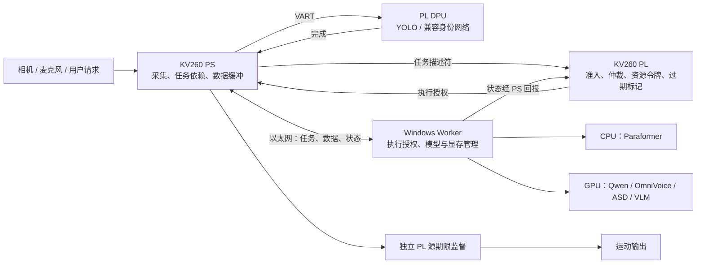

# AURA：FPGA 统一调度、Windows–KV260 网线协同与模型加速调研

日期：2026-10-12。性质：外部研究、源码核查与拟议实现；不是已实现、板测或性能验收。用户本轮明确要求研究“所有模型的调度放在 FPGA，并通过网线协同 Windows”。因此本报告把 **PL 决定任务准入与执行次序**列为设计目标，覆盖板端和主机模型。

## 1. 结论与项目边界

建议采用：**KV260 PL 硬件调度器 + PS 执行代理 + Windows 模型执行代理 + 常驻模型 + 千兆以太网任务/数据通道**。PL 管理各执行资源的任务资格、次序和有效性；DPU 执行兼容的视觉网络，Windows CPU/GPU 执行语音、大语言模型和未来的视觉语言模型。

这里有三种可分别验证的收益：

1. 调度收益：减少模型争抢、长队列、无用的过期计算与显存反复装卸，改善尾延迟、服务机会和视觉时效。
2. 计算收益：DPU 视觉推理；Windows 模型自身的内核、精度、缓存与执行方式优化。
3. 通信收益：就近处理图像、传裁剪/特征、常连接、二进制数据、有界队列和流水传输。

PL 调度器不增加 GPU 算力，也不能通过普通网线直接执行 Windows 的 CUDA 内核。把它做成全局模型调度器是可实现的工程方向，但不应预先承诺比软件调度更快：新增 PS–PL 和网络握手可能抵消仲裁开销下降，须设置同策略的软件对照。

本轮没有找到可直接部署在“原生 Windows + 当前 KV260 位流 + 全部现有模型”上的完整开源系统。查到的部件足够支持分步实现，适配工作及当前限制见下文。

## 2. 已核对的项目起点

先按项目规则查阅 ZIP 入口、相关方案和最新记录；较新的实际证据更新旧方案状态。本轮还重新查看 `SingleCuScheduler`、实际相机服务、Windows 对话入口和启动器。

| 项目项 | 当前证据 | 对方案的影响 |
| --- | --- | --- |
| KV260 | 单个 B4096 DPU CU；现有 PetaLinux/Vivado/Vitis 2022.2 路线 | 首版只有一个 DPU 执行令牌，不能套用三 DPU 核实验结论 |
| 实际视觉链 | YOLOX-Nano + ARM ByteTrack 已有板端证据 | 复用相机及 DPU 唯一所有者；禁止新服务绕过队列争抢 |
| 软件调度 | `board/fusion/scheduler.py` 只覆盖 detection/identity；`ui_camera_service.py` 直接创建 DpuYoloX | 全模型注册、Windows 资源状态和 PL 仲裁尚待接入 |
| 身份 | YuNet/SFace CPU 参考链；第二个 DPU 身份模型未验收 | 先完成业务，DPU 模型量化/编译/指纹/精度单独验收 |
| Windows 对话 | 用户先前报告 14B；10 月 11 日交接默认是 Qwen3 4B 快速配置 | 两者是运行配置/基线的区别；本轮未查询在线模型，也未改默认 |
| 最新语音 | CPU Paraformer INT8、2 线程；OmniVoice GPU FP16、SDPA、16 步 | 保留已接受声线和模型，先统一资源入口，再做独立加速对照 |
| Windows 接口 | 对话服务默认绑定 127.0.0.1；接受包启动器使用 8766；当前 LLM 请求 `stream: false` | 网线接入需要显式 LAN 地址与协议适配；流式输出也需要改代码 |
| Light-ASD / VLM | ASD 尚未完整接入；真正 VLM 后端未确认 | 列为可注册候选，不计作已部署模型；文本 Qwen 不能直接当 VLM |
| PL 执行监督 | 已有相对租约基础；源绝对期限未完成 | 新调度 IP 与最终输出许可是两个模块，可共享明确的时间域 |

本地依据：[最新语音核验](/home/ghmd/AMD_Smart/logs/daily/2026-10-12-LATEST-VOICE-FILES-REVIEW.md)、[实际跟踪验收](/home/ghmd/aura-board-tracking-20261011/REAL_TRACKING_ACCEPTANCE_REPORT.md)、[论文接入方案](/home/ghmd/AMD_Smart/reviews/2026-10-12-PAPER-ALGORITHM-INTEGRATION.md)、[现有调度代码](/home/ghmd/Win共享文件/共享文件夹/aura/board/fusion/scheduler.py)。

## 3. 查到的论文与开源实现

Google Scholar 页面本次未能读取；转而核对作者论文、出版方全文、官方文档和原作者 GitHub。以下“有代码”与“可直接用于 KV260”分别判断。

| 来源 | 查到的具体内容 | 在 AURA 中的用途与边界 |
| --- | --- | --- |
| **RTAS 2026：Time-Predictable Acceleration of Deep Neural Networks on FPGA SoCs with Multi-Core DPUs**：[论文](https://retis.santannapisa.it/~giorgio/paps/2026/Aromolo-RTAS26.pdf)、[作者实验包](https://zenodo.org/records/19366892) | ZCU102 三 DPU 核，模型分块、块边界调度、内存流量预算及响应时间分析；实验环境包含 PetaLinux 2022.2 | 最相关的 DPU 调度参考。当前单核先做完整任务调度；只有出现无法接受的阻塞，再研究分块。作者实验包已下载检查，见下一节 |
| **A New FPGA-Based Task Scheduler for Real-Time Systems**，Electronics 2023：[全文](https://mdpi-res.com/d_attachment/electronics/electronics-12-01870/article_deploy/electronics-12-01870.pdf) | 在 FPGA 中实现 EDF、任务表及就绪/等待等队列，是给 CPU 的调度协处理器 | 用于 PL 任务表、比较器和状态机设计；不是神经网络执行器。本轮未核实到作者公开 RTL，不能写成下载即用 |
| **ARTICo³**：[作者 GitHub](https://github.com/des-cei/artico3) | 有 VHDL IP、Linux runtime/driver、演示；按槽动态部分重配置、复制加速器 | 可读真实硬件/软件接口。引入完整框架会改变现有位流与工具链集成，不作为首版依赖；切换兼容 xmodel 不要求每次重配置 PL |
| **NVIDIA Triton Rate Limiter**：[官方文档](https://docs.nvidia.com/deeplearning/triton-inference-server/user-guide/docs/user_guide/rate_limiter.html)、[源码](https://github.com/triton-inference-server/core) | 跨模型按资源数量与优先级准入，执行完成后归还资源 | 借鉴 Windows GPU 执行令牌与容量合同。Triton 只管理其接入模型，不能自动管控独立 Ollama/OmniVoice 进程；首版可在现有原生 Windows 服务实现同类资源门 |
| **GLITCHES**，HPEC 2024：[作者全文](https://nicsefc.ee.tsinghua.edu.cn/nics_file/pdf/f05fe322-6f06-47e9-b3c2-18aaa8cec4ae.pdf) | GPU prefill + U280 FPGA decode；主机调度；PCIe 搬运 KV cache | 确实研究 GPU–FPGA 联合 LLM。FPGA 性能来自周期准确模拟器，八卡系统是仿真；以太网扩展列为未来工作。不能据此声称已有 KV260 网线 Qwen 加速实测 |
| **Coyote / RoPeerTo**：[作者 GitHub](https://github.com/fpgasystems/Coyote) | 真实开放 FPGA shell、运行时、100G RDMA/TCP、GPU–FPGA 数据互通方向 | 数据中心 Alveo/Linux 路线；支持列表无 KV260。适合作为未来换硬件的参考，普通 KV260 千兆口不直接获得这些能力 |
| **llama.cpp RPC**：[官方实现说明](https://github.com/ggml-org/llama.cpp/blob/master/tools/rpc/README.md) | 通过 TCP/RDMA 暴露远端 ggml 计算设备，有权重缓存 | 能做跨机器 LLM 推理；本轮未找到其现成 KV260 DPU 后端。仅在板上运行 RPC server 通常只暴露可用 CPU 后端，不能写成使用了 PL |
| **OmniVoice FlashInfer**：[模型作者实现](https://github.com/k2-fsa/OmniVoice#flashinfer-acceleration)、[具体适配源码](https://github.com/k2-fsa/OmniVoice/blob/master/omnivoice/models/omnivoice_flashinfer.py) | 官方已有融合算子、CFG 组织优化及可选 CUDA graph 的入口 | 当前 TTS 最直接的新计算优化候选；官方测试硬件/步数不同，且 FlashInfer 官方安装要求 Linux，需另建 WSL2/Linux 候选环境验证 |

### 3.1 RTAS 2026 实验包：已检查到具体文件

归档：[完整 ZIP](/home/ghmd/AMD_Smart/data/research/2026-10-12-fpga-scheduling/rtas26-artifact-19366892.zip)、[校验清单](/home/ghmd/AMD_Smart/data/research/2026-10-12-fpga-scheduling/manifest.json)。

包大小 16,180,438 字节，109 个条目，ZIP CRC 检查通过；MD5 与发布页一致：`b39d2dd6139f95b95bb07403fed37e4b`。SHA-256：`b389b9076429a0a08b87eb5ecbb4a6db603f45280a5c0dba2f15af2419146cea`。

| 包内位置 | 已确认作用 | 接入时需要处理 |
| --- | --- | --- |
| `scheduler/scheduler_process.py` | Python 选择 ready task；VART `execute_async` / `wait` 运行一个 chunk；块内原子执行 | 这是 PS 软件调度，不能当 PL RTL；当前 AURA 需要把选任务/准入逻辑实现为硬件 |
| `scheduler/scheduler_baseline_process.py` | 基线调度与响应时间/超期记录入口 | 仅作对照参考，未在本项目执行验证 |
| `models/RESNET18/{2,3,4}/` 等 | 多种网络的分块、量化、编译脚本 | 不包含 AURA 已适配的 YOLOX/身份分块；切分后要重新量化校准、编译和测完整开销 |
| `schedulability/rta.py`、`rta_fifo.py`、`RT.py` 等 | 任务分配、响应时间分析、基线与分块方案比较 | 输入须换成本板模型的成本和任务假设；原数据不能作为 KV260 结果 |

两个具体移植点：作者调度排序使用任务 period，适合其任务设置；不能直接称为 AURA 的动态源期限 EDF。作者多核分配依赖创建 dummy runner 推进轮转次序，移植前必须确认 VART 行为，当前单 CU 不需要这套多核技巧。

归档中未发现 `.v/.sv/.vhd/.vhdl` 文件；README 说明板端复现实验当时向评审提供预配置板的远程访问。因此公开包不等于包含完整 FPGA 工程。包内 MIT LICENSE 已保存，读取源码未运行第三方脚本。[README](/home/ghmd/AMD_Smart/data/research/2026-10-12-fpga-scheduling/reference-excerpts/artifact/README.md)、[调度源码](/home/ghmd/AMD_Smart/data/research/2026-10-12-fpga-scheduling/reference-excerpts/artifact/scheduler/scheduler_process.py)。

## 4. 全模型的执行位置与依赖

建议只将实际启用模型注册为可运行实例。14B 与 4B 是候选配置；历史 TTS/分类模型不必同时常驻。模型描述符与模型权重分开管理。

| 任务 | 首版计算位置 | 调度方式 | 加速或下一步 |
| --- | --- | --- | --- |
| YOLOX-Nano 人体检测 | KV260 DPU | PL 授予 DPU0 令牌；PS 唯一 VART worker 执行 | 已有实测基础；只保留最新待处理帧，补完整时序与源帧龄 |
| ByteTrack、目标管理 | KV260 ARM | 跟随检测结果的本地轻量阶段，可登记/观测成本 | 复用 NumPy 适配，减少拷贝；无需往返 Windows |
| YuNet、SFace | KV260 ARM 起步 | 目标/人脸质量达标后触发；CPU 资源池单独限流 | 跑通身份业务；另行编译验收轻量 DPU 特征模型 |
| 第二个身份特征网络 | KV260 DPU，待实现 | 与 YOLO 共用 DPU0，期限准入与服务预算 | 获得真实多模型竞争数据，不拿 CPU 调用冒充 DPU 模型 |
| Paraformer INT8 ASR | Windows CPU | 音频就绪后请求 CPU_ASR 令牌 | 保留现有两线程基线；量化/线程调整以识别质量与整链成本评价 |
| Qwen 14B / 4B | Windows GPU | ASR/文本输入就绪后请求 WIN_GPU 令牌 | 测量实际 GPU 驻留、上下文、首 token 与尾延迟；不默认替换用户模型 |
| OmniVoice TTS | Windows GPU | 回复文本就绪后请求 WIN_GPU 令牌 | 保留 16 步声线基线；候选 FlashInfer + CUDA graph 独立对照 |
| Light-ASD | Windows 起步，待验证 CPU/GPU 后端 | 同期音视频窗口就绪后请求相应令牌，过期窗口拒用 | 先作者模型离线验证，再做裁剪/窗口/并发优化 |
| 真正 VLM | Windows GPU，待选型 | 用户提问触发，绑定所问图像，设置业务期限 | 先确定模型、显存和图像预处理，不默认每帧推理 |
| 运动输出监督 | KV260 PL | 独立硬件判断有效期、停止和输出许可 | 不排在普通模型队列里等待；断网时仍能按规则撤销输出 |



任务图示例：音频采集→ASR→LLM→TTS→播放，与相机→检测→跟踪并行；身份和 ASD 按事件触发。用同一个任务模型管理这些阶段，但每种任务有自己的期限、输入生命周期和失败处理。

## 5. PL 调度器怎样控制 Windows 模型

### 5.1 最小硬件范围

第一版建议 16 或 32 个任务槽、参数化资源池、任务扫描/比较状态机、AXI-Lite 提交与完成队列。由综合/实现决定频率和资源占用，不提前许诺 LUT 数或两周期响应。现有联合设计时序余量很小，新增 IP 必须重新联合实现。

PL 存储模型编号和任务元数据，模型权重留在各自计算端。PS 处理模型注册、数据引用、复杂依赖和成本更新，PL 对就绪候选完成实际准入和选择。所有正式 worker 必须等待 PL grant；保留绕过入口就不能声称完成了统一调度。

建议描述符：

```text
job_id, model_id, backend_id, session_epoch, target_generation,
source_ref, payload_ref, ready, criticality,
deadline_pl, exec_budget, remaining_chain_budget, resource_mask,
model_version, cancel_generation
```

`payload_ref` 是 PS/Windows 缓冲索引，不是跨机可直接解引用的内存地址。不同后端只有经过验证的实现才能互换；不能因为一个 GPU 忙就把任意 Qwen job 指派给 DPU。

### 5.2 选择规则

这是 AURA 拟议策略，不是已证明最优的论文算法：

1. 先检查依赖、任务/目标代次、模型就绪状态和资源令牌；已取消或失效输入直接拒绝。
2. 针对每个可用执行资源选择任务；不同资源允许同时运行，避免一条全局串行队列。
3. 以估计执行成本、传输/提交开销和剩余链路预算检查能否赶上该任务期限。
4. 同类就绪任务按截止时间排序；视觉基本服务和身份/语音服务采用明确预算，记录饥饿和最长等待。
5. 运动许可到期和停止由独立监督模块处理，不受模型队列堵塞影响。

可用于原型的准入形式：

```text
estimated_finish = now + dispatch_and_transfer_budget
                       + current_execution_budget
                       + remaining_chain_budget + margin
admit if estimated_finish <= deadline and resource_available
```

DPU 身份任务另保留“随后检测和提交”的成本，避免身份运行期间耗尽位置证据剩余有效期。CPU/GPU/网络成本受负载影响；实测分位数或最大观测值加余量是估计，不能称为严格 WCET。

检测/ASD 支持 latest-only 或失效窗口淘汰；身份登记、用户问题和已接受业务请求必须返回完成、取消、超期或过载状态，不能静默覆盖。

### 5.3 远端执行协议

```text
REGISTER/CAPACITY → SUBMIT → GRANT → ACCEPTED → STARTED → DONE/FAILED
                                      ↘ CANCEL_REQUEST → CANCEL_ACK
```

Windows worker 上报模型驻留、资源容量和 epoch；接到有效授权后才调用 Ollama、OmniVoice 等后端。完成报告携带同一 job_id、模型版本、输出引用和本机阶段耗时。重传通过 job_id 去重；重连不能重复播放旧音频。

**失效结果与资源释放必须分开：**PL 判定任务到期后可以立即禁止消费结果，但正在执行的 GPU/DPU 不会因此自动停止。收到完成/停止确认才归还执行令牌；连接丢失则将资源标为 UNKNOWN/BUSY，重连核对执行状态。不能仅因心跳超时就假定 GPU 空闲，再派发第二份任务。

首版完整 DPU 推理和 Windows 模型调用都按不可抢占处理。分块 DPU、逐 token 的 LLM 暂停、分段 TTS 都需要具体后端支持及单独测量，不能由 PL 单方面获得。

### 5.4 让“全模型调度”真正覆盖语音链

现有整条语音流程需要暴露 ASR、LLM、TTS 三个阶段的就绪/开始/完成事件。如果只授权一个“对话请求”，随后 Windows 自行安排全部模型，只能称为对话任务级调度。

每阶段授权会增加网络往返。因此授权粒度采用完整模型调用或经过验证的 chunk；不为每个 token 走一次网线。音频上传 Windows 一次后留在当地，ASR 文本与 LLM/TTS 中间数据用引用衔接，回板端的是状态和最终可消费结果。

初始资源容量可设 DPU0=1、WIN_GPU=1、CPU_ASR=1 个作业；这是保守对照配置，并非最佳性能结论。GPU 作业令牌只限制同时执行，**并不释放常驻模型显存**；必须另外核算常驻权重、KV cache、工作区与系统保留空间。多模型放不下时执行明确的驻留计划并记录加载成本。是否允许 Qwen 与 TTS/ASD 重叠，须由显存和 P95/P99 对照决定。

Windows GPU 全调用互斥时，LLM 尚未完成就不能同时启动 GPU TTS。要获得这种流水，需验证并发容量，或后端支持明确的暂停/归还令牌点。

### 5.5 时间与实时性

PS/PL 采用明确且可校验的单调时间映射。Windows 的单调时钟与板端不能直接相减；跨机用请求 ID、各机局部耗时以及板端往返测量，若要计算单向时延，须建立带误差边界的同步。

任务发到 Windows 时可携带剩余预算，并在板端按统一期限复核返回结果。仅在 Windows 收包时重新开始原始全额 TTL，会错误延长输入有效期。普通 Windows 调度、TCP、GPU 调用以及 PS 代理仍有不确定性；PL 仲裁有界不等于整条远端推理获得硬实时保证。

## 6. 一根网线怎么接、传什么、怎样产生收益

### 6.1 连接和服务

首版走 KV260 Linux 网络栈，由 PS 转交任务描述符给 PL；没有必要先在 PL 实现 TCP/IP。Windows 与 KV260 可直连或接同一千兆交换机。地址使用已确认的现网配置；若独立配置链路，`192.168.50.10/24` 和 `.20/24` 仅是示例，先排除网段冲突。

接入顺序：

1. 确认双方网卡协商速率、双向吞吐和空闲/图像负载下 RTT；不要只检查能 ping 通。
2. 现有 Windows 对话服务显式绑定其 LAN IP，板端连接该地址。8766 是交接包对话端口，浏览器 UI 不因此成为模型 worker。
3. 新增版本化 worker 合同，包含模型注册、任务授权、完成和取消；为 PCM/图像增加明确的数据接口。现有 `/dialogue` 不能未经适配就接收所有二进制模型输入。
4. 控制消息和大块音视频使用不同连接及发送队列，二进制传载荷；保留持久连接。应用层限制大载荷积压，分开连接本身不保证网络优先级。
5. Ollama 可继续只监听 Windows 本机，worker 在本地调用它。板端只需要访问受控 worker 入口，不必直接访问每个模型服务器。

Windows UI 发起的请求也必须进入同一资源入口，才能避免 UI 与板端争抢 GPU。界面展示可继续本地工作。

### 6.2 千兆链路的硬限制

AMD 标明 KV260 有一个 10/100/1000 Mb/s 接口和 4 GB DDR。[官方产品简报](https://www.amd.com/content/dam/amd/en/documents/products/som/kria/k26/kv260-product-brief.pdf)。

以下由尺寸计算，采用十进制 MB，忽略协议、排队、内存拷贝和软件开销，**不是实测**：

| 数据 | 带宽或体积 | 1 Gb/s 理想串行发送时间 / 判断 |
| --- | --- | --- |
| 16 kHz、单声道、PCM16 | 32 KB/s = 0.256 Mb/s | 语音本身带宽很小；先关注采集结束、推理和播放队列 |
| 640×480、BGR8，一帧 | 0.9216 MB | 至少 7.37 ms；30 fps 为 221.18 Mb/s |
| 1920×1080、BGR8，一帧 | 6.2208 MB | 至少 49.77 ms；30 fps 为 1492.99 Mb/s，超过链路上限 |
| 224×224 灰度裁剪，25 fps | 每路 10.04 Mb/s | 4 路约 40.14 Mb/s；仅作计算示例，不代表已选 ASD 输入规格 |

图像压缩后大小取决于场景和质量，应实测编码耗时、码率和模型精度。音视频同步不能因为只传小裁剪就省略：每个窗口仍需源时间、帧号、轨迹代次和采样信息。

### 6.3 当前硬件适合的三种协同方式

**方式 A：板端视觉就近计算。** 摄像头帧在板端完成 YOLO、跟踪及可用的身份处理，Windows 收到人物状态、合格裁剪或低频提问图像。节省完整图像上传、Windows 的重复视觉计算和 GPU 竞争；不会直接改变 Qwen 单 token 内核速度。

**方式 B：Windows 整模型远程服务。** 板端发音频，Windows 运行 ASR→LLM→TTS，返回音频/字幕/表情信息；ASD 收同步的人脸序列和音频。模型常驻计算端，不随每个请求发送权重。ASR、LLM、TTS 中间数据留在 Windows，调度器仅接收元数据和状态。

**方式 C：Windows 将适合 DPU 的完整视觉子任务卸载给板端。** worker 提交输入与 model_id，经 PL 授权后由 VART 执行，结果返回。前提是当前 DPU 已有兼容、校验过的 xmodel，且传输、等待与板端计算总和小于 Windows 上对应任务成本。高优先级本地相机任务的服务也必须维持。

对于方式 C，按相同模型质量比较：

```text
T_remote = T_pack + T_upload + T_queue + T_board_infer
                     + T_download + T_unpack
加速条件：T_remote < T_windows_local
```

若一帧 VGA 原图仅单向传输的物理下界就有 7.37 ms，Windows 同任务已只需几毫秒，那么通过这条网线卸载的延迟收益很难成立。若数据原本来自板端相机，省掉整帧传输则是另一种成本结构，必须分开测。

### 6.4 不作为现阶段主线的路线

- **逐层或逐算子把 Qwen 在 GPU 和 KV260 间来回切分：**没有现成 DPU Transformer 后端，通信与中间张量搬运需专门设计。14B 权重仅按 4 bit 理想打包就约 7 GB，已超过板端 4 GB DDR，尚未计入量化元数据、KV cache、操作系统和其他模型；流式外存也不会自动解决吞吐问题。
- **直接照搬 GLITCHES：**目标 U280 有 HBM、专用 LLM 引擎和 PCIe 路径；论文结果有明确仿真边界。本项目只能借鉴任务阶段拆分思想，不能套用其速度数字。[原论文](https://nicsefc.ee.tsinghua.edu.cn/nics_file/pdf/f05fe322-6f06-47e9-b3c2-18aaa8cec4ae.pdf)。
- **直接照搬 100G RDMA shell：**Coyote 当前面向 Alveo/Linux，硬件端口、内存和驱动不同；KV260 千兆网卡不会因安装库就具备同等路径。[Coyote](https://github.com/fpgasystems/Coyote)。
- **先做动态部分重配置轮流装全部模型：**当前 DPU 上不同兼容模型是指令/权重的切换；每次换模型重刷位流会引入额外问题。DPR 只在确需多个不同专用硬件内核且有独立资源评估后研究。[ARTICo³](https://github.com/des-cei/artico3)。

## 7. Windows 模型自身怎么加速

### 7.1 先统一显存和执行入口

在 worker 中分别记录常驻显存、作业额外显存、CPU 线程、输入大小/上下文和延迟分布。Qwen、OmniVoice、ASD、VLM 共用一张 GPU 时，分别启动多个常驻服务并不意味着它们可以任意并行。

第一组对照为 WIN_GPU=1 与经显存核算允许的并发组合，关注首声、P95/P99、检测时效和模型质量。作业长短、声线、输入上下文固定，不通过删掉用户需求来制造加速数字。

Ollama 提供 `keep_alive`、`OLLAMA_NUM_PARALLEL`、`OLLAMA_MAX_LOADED_MODELS` 和队列控制；上下文与并发共同影响内存。它们只管理 Ollama 内部资源，跨进程的 GPU 资源门由统一 worker 负责。当前交接已经使用 30 分钟驻留、2048 上下文、120 token 输出等优化，不把这些列为本轮新增收益。[Ollama 官方说明](https://docs.ollama.com/faq)。

### 7.2 OmniVoice：有明确源码的优先候选

官方提供 `omnivoice/models/omnivoice_flashinfer.py`，入口是 `apply_flashinfer(model, enable_cuda_graph=True)`。官方表中 H100、FP16、32 步、batch=1 的平均 RTF 从 0.0899 降至 0.0367，约 2.4 倍；这是作者特定测试的 TTS 指标，不能当作本机整条语音链加速比。[OmniVoice 官方实现与基准](https://github.com/k2-fsa/OmniVoice#flashinfer-acceleration)。

本项目是 RTX 5060 Ti、16 步、原生 Windows 已接受基线，硬件、步数和运行环境均不同。FlashInfer 官方当前安装文档明确列出 Linux；OmniVoice README 的固定版本示例又与 FlashInfer 当前文档版本不同，因此不能直接在现有环境执行一个不锁版本的升级命令。[FlashInfer 安装条件](https://docs.flashinfer.ai/installation.html)。

验证路径：

1. 保存当前模型、声线参考、代码与环境清单，保留原生 Windows 基线。
2. 若采用这条优化，另建 WSL2/Linux 环境，按 OmniVoice 对应提交核对 FlashInfer、PyTorch/CUDA、GPU 架构及具体算子支持；能 import 不代表全部算子可运行。
3. 在该环境先跑未优化版本，再跑 FlashInfer、再加 CUDA graph，避免把环境迁移收益算成内核收益。
4. 同参考音频、文本集合、16 步和输出格式，测冷/热启动、首音频、总合成时间、显存、识别一致性与人工音质。
5. 最后跨网线播放，检查原声线、取消和实际听到声音的时间。收益成立后再接入统一 worker。

本轮没有在 RTX 5060 Ti 上安装或执行此路径；它是有官方实现的优先实验，不是已确认兼容或提速。

### 7.3 流水和传输优化

录音可按固定小块发送，例如 20–40 ms PCM 块，让上传与采集重叠；现有离线 ASR 仍可能要等待录音结束，这不等于已改为流式识别。TTS 返回可播放块也要求其生成/封装接口支持，不能只修改 WebSocket 参数。

现有 LLM 请求是 `stream: false` 且返回结构化 JSON。实现首句播报，需要增量文本解析、完整句边界、表情/动作合同与取消代次；不能把半个 JSON 直接送入 TTS。Qwen/TTS 若共用单一不可抢占 GPU 令牌，先完成 LLM 再生成第一句是可行基线；真正重叠生成另做并发或协作暂停实验。

K/V cache 量化和 Flash Attention 可作为 Qwen 显存优化候选，但须按实际 Ollama 版本/后端确认，并验证中文理解、专名记忆及长上下文质量。减少显存不保证在当前短上下文下降低延迟。[Ollama 参数说明](https://docs.ollama.com/faq)。

## 8. 与现有论文方向怎样结合

可表述为“**感知有效期约束下，面向 FPGA–GPU 协同系统的多模型任务准入与硬件执行监督**”。是否扩大论文题目取决于最终完成的实验范围。

各部分对应关系：

- 已有误差/信息时效方法生成视觉任务的源期限；身份、ASD、语音保留各自业务时间含义。
- PL 仲裁使用期限、资源状态和实测成本选择任务，并阻止已失效工作获得新的执行许可。
- PS 与 Windows worker 执行任务、回报状态；晚到结果继续按源引用与代次复核。
- 独立 PL 监督决定运动输出是否仍被新鲜观测授权。调度忙、Windows 卡顿或网络断开都不应延长旧观测许可。

EDF、DPU 分块、资源令牌和 ByteTrack 等已有方法应明确归属；“把队列搬到 FPGA”本身不能预定为创新。可检验的问题是：在相同模型和误差要求下，跨资源准入与有效期合同是否改善视觉有效服务、交互尾延迟和身份服务机会，PL 位置是否带来可测的额外价值。

## 9. 实现顺序与验收

| 步骤 | 具体交付 | 验收条件 |
| --- | --- | --- |
| M0：画像与合同 | 实际在线模型/版本、显存/执行成本、网络测量、任务描述符、资源表 | 区分 14B 当前配置与 4B 基线；标出未接 ASD/VLM；量出各阶段瓶颈 |
| M1：全模型软件对照 | PS 全局任务入口、Windows 分阶段 worker、唯一 DPU owner；相同策略的软件仲裁 | YOLO 持续运行时完成板端录音→ASR→LLM→TTS→实际播放；每一模型调用有任务日志和取消结果 |
| M2：PL 仲裁原型 | 16/32 槽、资源池、准入、选择、完成、epoch/取消；同事件序列的软件参考模型 | 仿真与回放决策一致；重复/迟到/超期/断连不会重复执行或错误释放资源 |
| M3：联合上板 | 新 IP + DPU + 源期限监督；ABI、PS 驱动与工件清单 | 综合/布局布线/约束/时序通过；同工作负载比较软件/PL；保持当前视觉与界面功能 |
| M4：选定计算优化 | 第二 DPU 身份模型；或 OmniVoice FlashInfer 独立实验；图像载荷优化 | 分别报告质量、显存、P50/P95/P99 与通信开销，不混合多个变化归因 |
| M5：论文与整机 | 混合负载、过载、取消、重连、长稳和消融结果 | 无虚构倍数；记录拒绝/丢弃/超期及完成率，保持既有实验定义 |

**下一步最具体的工作是 M0/M1：建立完整模型资源表和分阶段执行合同，跑通带统一任务日志的板端↔Windows 真链。**软件仲裁在这里作为 PL 的参考实现与性能对照；M2/M3 才是“决策实际发生在 PL”的交付。

### 9.1 单独增加调度位置/加速消融

以下 H 组用于本次全局协同设计，不覆盖现有 G0–G5（有效期、调度策略、监督位置）的定义。

| 组别 | 条件 | 比较目的 |
| --- | --- | --- |
| H0 | 当前服务组织方式，固定输入/模型 | 原始整链基线 |
| H1 | 统一 worker、同一准入策略在 PS 执行 | 衡量统一任务入口与策略整体收益 |
| H2 | 保持 H1 的策略与负载，仲裁迁至 PL | 隔离 PL 仲裁及跨界调用成本 |
| H3 | H2 上只改载荷、队列/传输组织 | 隔离通信优化 |
| H4 | H3 上仅启用一个模型计算优化 | 隔离内核/模型后端优化 |

至少包含：视觉独立负载；视觉+身份；视觉+ASR/LLM/TTS；再加 ASD/用户看图；突发与取消；网络短断/重连；Windows GPU 忙或 worker 重启。未来尚未实现的模型不能用 mock 结果计入真实模型收益。

每组记录源采集→消费的帧龄、推理纯耗时、排队/传输/提交耗时、首 token、首音频、实际播放、身份最长等待、截止违约、结果拒用、任务完成率、资源占用，以及 PL LUT/FF/BRAM/DSP/WNS。P99 要有足够样本并报告样本量/分布；交接包一两次语音测试不能当 P99。

先固定同一模型和质量；4B/14B、不同量化/步数属于不同配置，另列质量–延迟对照。不能只通过大量丢弃请求改善剩余样本的延迟。

## 10. 本轮产物与验证范围

完成：论文和官方源码检索、项目接口复核、RTAS 实验包下载/哈希/CRC/目录核验、调度源码关键路径阅读、网络数量级计算、本文设计和日记。

未完成且未声称完成：第三方包执行、模型推理复现、RTL 编写/仿真/综合、Windows 环境变更、LAN 性能实测、KV260 上板或机械动作。原有运行代码和配置未修改。

实验包首次下载在沙箱内连接失败；按环境权限机制在沙箱外重试后成功，归档校验已通过。没有遗留下载阻塞。
