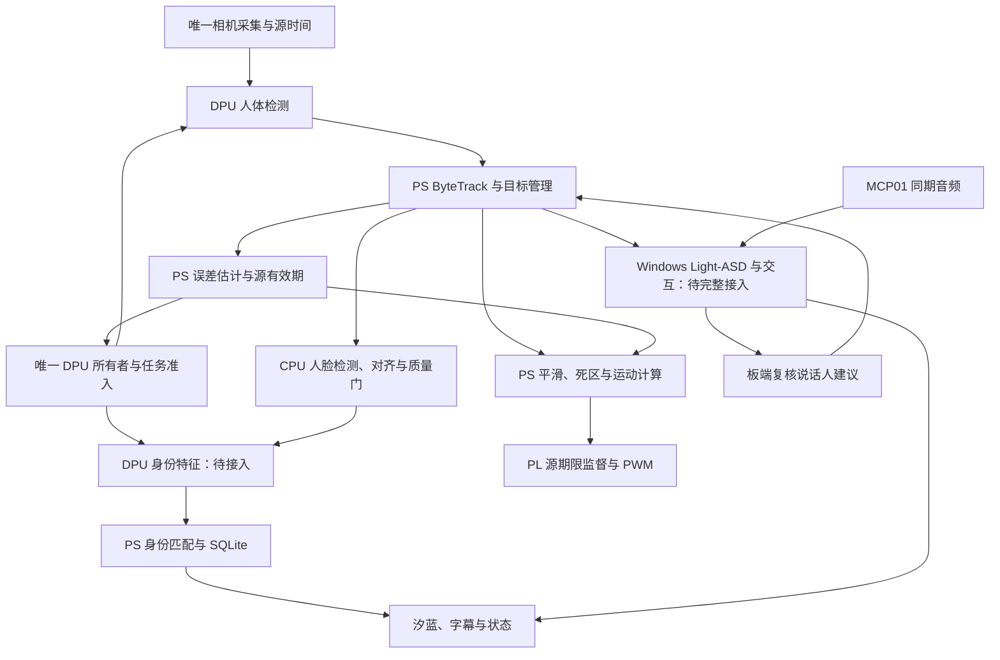

# AURA：论文与算法接入整机的实施建议

日期：2026-10-12。性质：基于已有方案和实际代码的接入建议，不是已实现或已验收状态。人员采用最新安排：A 负责视觉与 FPGA；不重新分派 B/C。

## 1. 项目主线和当前起点

沿用 10 月 7 日方向：**控制误差约束下的可变感知有效期调度与 FPGA 执行监督**。

研究问题：单 CU DPU 的检测和身份请求竞争时，如何维持位置证据质量、身份服务机会，并使迟到/重复的旧观测不能继续授权运动？

最新起点：YOLOX-Nano + ByteTrack 已在独立相机/UI 服务上板，真人原生选择和短时保持有证据；身份尚无第二个 DPU 模型。`FreshnessPolicy`、`SingleCuScheduler` 已有软件实现，但当前实际 `ui_camera_service.py` 直接使用 `DpuYoloX`，未接这两项统一策略。`application.py` 使用它们，统一 KV260 配置仍未完成。已有 VSRV 板测为相对租约；源绝对期限尚未实现为最终 PL。Windows 语音基线已接受且当前 Ubuntu 清单文件核验通过，板端跨机器链尚待接入。

## 2. 方法落点与接入标准

| 方法/文献方向 | 接入位置 | 现在如何加入 | 验收与表述 |
| --- | --- | --- | --- |
| ByteTrack | KV260 ARM，YOLO 输出之后 | 复用已部署 NumPy 适配，保留高/低分关联、真实 dt、轨迹代次；补规范移动/交叉/遮挡数据 | 算法采用与平台适配；标注轨迹测 ID 切换/IDF1/失跟，不套用作者 MOT17 成绩 |
| MobileFaceNets / ArcFace | 板端身份特征链 | 先接已有 YuNet/SFace CPU 身份业务；另行选可编译身份特征模型做 DPU 第二任务 | MobileFaceNet 是候选；ArcFace 是训练方法；SFace 不能写成两者的复现 |
| 人脸质量筛选与缓存 | 对齐、识别触发和 SQLite 前后 | 真实脸尺寸/清晰度/姿态/归属门；缓存绑定目标代次、特征模型和库版本 | 登记、陌生、歧义、重返、删除与错认；先做工程质量规则，MagFace 另作可选对照 |
| EMA / One Euro | 目标位置至控制请求之间，PS | 先固定 EMA 基线，同轨迹回放比较 One Euro；记录实际 dt 与引入的滞后 | 衡量抖动和跟随滞后；平滑位置不能替代新观测或给旧图续期 |
| AoI/VoI、误差与信息时效 | `board/fusion/freshness.py` | 采集并标定误差增长参数，固定期限基线后接可变期限 | 项目工程模型，不是原文系统证明；独立误差与服务覆盖验证 |
| 多任务推理调度 | `board/fusion/scheduler.py`、真实 DPU 所有者 | 第二模型先单测，再同服务常驻交替；按源期限和完整任务成本准入 | 不可抢占完整任务；当前成本规则不是原论文 MDP/MGF 复现；测身份等待和检测时效 |
| RTA / Neural Simplex / FPGA 实时监控 | 唯一运动服务、`hardware/rtl/visual_servo.sv` | 新 ABI、PS/PL 时间映射、源绝对截止与不可续期、停止/恢复 | 借鉴独立监督；不声称完整动力学安全过滤或 RTLola 编译器复现 |
| Light-ASD | Windows 同期声音/连续脸片段服务 | 用作者权重先做真实离线片段，再接有界音视频窗口与轨迹归属 | 两人交替/同时说话、静音、画外声；误选、拒判和耗时一起报告 |
| Streaming ASD / LoCoNet | 主机窗口和板端选人策略 | 首版做窗口/积压控制、时间保持与竞争规则；完整网络复现作为独立任务 | 普通有界队列/滞回不能写成完整 Streaming ASD 或 LoCoNet 网络复现 |
| SATAY / H2PIPE / TAPA / FILM-QNN / NAF / 剪枝 / hls4ml | 后续模型或硬件优化 | 取得整链画像后按真实瓶颈选一个；另建独立基准和集成路径 | 当前主线的可选优化。模型缩小不等于固定 DPU LUT/DSP 自动减少 |

## 3. 运行架构与接口



身份完整业务可先用 CPU SFace 跑通，再替换特征后端。只有第二个真实 DPU 模型运行并参加同 CU 实验后，才可称为共享 DPU 多模型验证。

跨模块最少携带：`camera_epoch`、`frame_id`、源采集时间及时间域、`track_id`、`track_generation`、观测引用、截止时间、模型/数据库版本。主机交互另带请求/会话/音频代次；ASD 返回窗口引用和候选轨迹键。

三个时效用途分别处理：位置证据授权运动；身份缓存用于称呼和业务；音视频窗口用于说话人归属。姓名或主机旧建议不能延长位置许可。主机建议通过当前目标复核后，动作仍取该目标的最新真实观测。

## 4. 按依赖推进的七个交付

### P1 真实视觉基线与测量入口

复用当前相机/UI、YOLO、ByteTrack；在单个采集者之下引入统一观测输出，避免启动第二个相机或争抢 DPU 的独立进程。统一框架可以消费该服务，或让同一个正式视觉服务承接它；迁移以现有预览、目标和设置继续通过为条件。

记录 capture/dequeue、入队、推理起止、关联、消费和运动提交时刻，串联源帧与轨迹代次。时间戳如果来自驱动出队，标明语义和缓冲不确定性，不写成曝光时刻。

固定相机先采集静止、慢移、快移、转向、遮挡、双人交叉、离开重返；划分校准和测试片段。最后再补相机转动条件，固定机位数据不能代表整机运动误差。

**交付：**统一真实观测接口、规范跟踪结果、原始时序日志和数据清单。此项是当前第一项工作。

### P2 CPU 身份业务与第二 DPU 模型

先接轨迹→合格人脸→五点对齐→SFace→SQLite，验收登记、UNKNOWN/AMBIGUOUS、重返和删除。阈值从校准数据确定，按人划分独立测试。

独立取得 DPU 候选特征模型的原权重、量化/编译输入、真实架构指纹及来源；完成固定图输出、浮点/INT8质量和板端完整调用成本检查。确认与现有 DPU 配置兼容后，再纳入唯一推理服务。不能仅把 CPU SFace 放入 scheduler.run("identity") 就声称身份已用 DPU。

**交付：**可使用的身份业务，加上独立验收的第二模型。第二模型适配失败时继续 CPU 业务，并如实保留主调度实验的缺口。

### P3 固定期限与按成本准入基线

让当前真实服务调用统一有效期与任务准入策略，先保持经校准的固定期限。第二模型和检测共用一个 DPU 所有者，首版整次推理不可抢占。检测只留最新待处理帧；登记等业务请求明确完成或拒绝，不能被静默覆盖。

使用实测的完整调用、预后处理、等待和提交成本估计；保留预算超出、延后次数与请求到达时间。观测最大值加余量是估计，不是 WCET 证明。补身份最长等待和服务完成率，避免持续饿死身份。

**交付：**同服务两模型交替运行，以及固定期限下可重复的性能基线。

### P4 校准可变有效期

沿用现有候选工程模型：

```text
U(dt) = u0 + (abs(v_hat) + delta_v) * dt + 0.5 * a_b * dt^2
T_valid = 在 U(dt) <= e_allow 且 dt <= T_cap 下允许的最大时长
deadline_source = t_capture + T_valid
```

标定初始误差、速度误差余量、加速度项和允许误差。相机转动、模糊、遮挡、关联歧义、时间异常分别处理。平滑导致的滞后须计入评价；不能只用被平滑压小的速度就宣称更长许可可靠。同一源观测重复消费只保留或缩短原期限。

**交付：**冻结参数/版本、独立测试误差覆盖和固定/可变策略的结果；不能先预填提升比例。

### P5 PL 源期限监督

更新实际 ABI 和唯一访问库：观测引用、源截止、会话/恢复代次、目标代次、序号、原子提交与错误状态。对 PS 单调时间和 PL 计数进行保守映射，记录误差、回绕和复位行为。PL 比较映射后的绝对期限，不在每次 COMMIT 重装完整源寿命。

仿真/数字板测覆盖：已过期的新提交、同观测新序号、重放、半写、目标切换、时间复位、STOP/到期与提交冲突、PS 暂停与相机冻帧。新 RTL 必须与 DPU 重新联合实现，检查最终时序/资源/约束，不能直接沿用旧位流验收。

**交付：**新版 RTL/ABI/驱动、联合工件和源期限波形。数字输出撤销与机械停止另验，机构继续等待 3D 模型。

### P6 语音、说话人和真实业务接入

并行复用已接受 Windows 语音：板端录音→主机 ASR/对话/TTS→板端声音/字幕/口型与取消。现有主机启动器默认回环地址和本机端口，统一配置与主机协议/地址需显式适配；不能只将 disabled 改为 enabled 就认为 LAN 链路完成。

Light-ASD 先跑真实离线同期声音/脸片段，固定权重和预处理；再接实时有界窗口、声画偏移和漂移测量。返回分数绑定窗口及轨迹代次，由板端当前目标服务复核；同时说话和画外声允许拒判。

**交付：**真实语音交互及说话人建议；看图问答需要实际视觉语言后端，现有文本 Qwen 不能自动算 VLM。

### P7 六组实验、整机与论文交付

沿用当前 `config/experiments.json` 的定义，不改组别含义：

| 组别 | 有效期 | 调度 | 源期限监督 |
| --- | --- | --- | --- |
| G0 | 固定 | 检测优先 | 软件 |
| G1 | 固定 | 检测优先 | PL |
| G2 | 可变 | 检测优先 | PL |
| G3 | 固定 | 期限准入 | PL |
| G4 | 可变 | 期限准入 | 软件 |
| G5 | 可变 | 期限准入 | PL |

先做 G0/G1/G5 确认测量链，再补 G2/G3/G4 分离有效期、调度和监督位置贡献。各组保持同模型/硬件、输入、身份请求序列及误差标准；固定期限先在独立校准数据上调好。软件组仍保留基础输出保护；故障注入先用仿真或无动力数字验证。

报告：位置证据误差、有效服务覆盖、身份最长等待/完成率、源帧龄与任务 P50/P95/P99、过期输出事件、PL/全设计资源和时序。跟踪另报 ID 切换，身份另报错认/拒认，ASD另报误选/拒判，语音另报首声和取消延迟。仅提高预览 FPS 不足以证明主方法有效。

统一最终 release 后补冷启动、长稳、外设/网络异常恢复与正式机构测试。若没有最终机械数据，论文只报告图像位置证据和数字输出层结果，不写成已验证的机械闭环性能。

## 5. 用户补充：所有模型的统一调度与 FPGA 分工

用户随后提醒“不是还有个所有模型的调度么，FPFA”。此前正文重点展开检测/身份共享 DPU；完整项目还需要显式规划覆盖所有实际启用模型的任务编排。下述是建议的扩展范围，不表示已存在完整全局调度器，也不表示用户要求把 Windows 模型全部迁入 PL。

| 调度层 | 覆盖任务 | 运行位置与职责 | 当前状态 |
| --- | --- | --- | --- |
| 全局任务编排 | 检测、身份、ASR、对话/看图、TTS、ASD | 板端/主机服务协同；跟踪依赖、请求归属、取消、期限、队列与资源状态 | 多个子链已有基础，尚无完整通用模型注册、统一队列及资源管理验收 |
| 板端 DPU 调度 | 已兼容当前 DPU 的检测和身份等网络 | PS 唯一推理所有者选择下一任务，PL DPU 执行计算 | SingleCuScheduler 只覆盖 detection/identity 软件成本规则，第二模型和真实接入未完成 |
| 主机模型资源调度 | Paraformer、Qwen、OmniVoice、Light-ASD 以及未来真实 VLM | Windows 按依赖/CPU/GPU/显存状态处理请求，与视觉并行 | 已有语音链路；ASD/VLM及统一资源调度未验收 |
| FPGA 执行监督 | 源观测期限和运动命令 | 独立 PL 计时、校验、输出许可与停止 | 相对租约基础已有限板测，新绝对源期限待完成 |

全局任务记录建议包括 model_id、执行后端、输入引用、依赖、优先级、截止、成本估计、请求/目标代次、取消和资源需求。ASR→对话→TTS 按依赖推进，视觉可并行；ASD 同期窗口单独计时。不同任务的业务截止分别定义，不能把语音回答等所有任务都套用位置证据的短有效期。统一管理主机请求不能称为主机模型已在 FPGA 推理。

如果进一步选择**将任务准入/仲裁逻辑做成 PL 电路**，应增加独立工作包：PS 投递任务元数据→PL 返回准入/选择结果→PS 的 VART 运行时提交推理→PS 回报完成。先验证握手、成本估计、故障退出及相对软件调度的收益，再决定联合实现；PL 选任务不自动等于它可以直接调用 Windows 模型或任意抢占当前 DPU 网络。现行方案将调度策略放在 PS，本轮不将其改写成已授权/已完成的硬件调度器。

下一步的具体成果应增加：完整模型/任务清单、执行后端与依赖图、统一任务合同、分别面向 DPU 与主机的调度接口，以及所有模型并发/取消/过载下的测试。主创新仍以可重复的 DPU 时效实验和最终 PL 许可为基础；如新增硬件仲裁，则补专门的软件/PL调度对照。

## 6. 写作与可复用交付

报告按“应用与资源约束→已有方法→AURA 有效期/准入/监督设计→实现→公平对照与消融→失败和边界”组织。ByteTrack、身份网络与 Light-ASD 写为所采用方法；候选公式和跨层合同写为本项目设计；性能提升以本项目数据为依据。调度失败或可变策略无收益也保留，不预设结论。

三个既定包随开发提炼：command-guard-validation 对应 P5 故障验证；perception-freshness-benchmark 对应 P1/P4/P7 日志与指标；async-result-validation 对应 P6 取消/迟到/换目标。需有可执行入口、黄金样例、真实失败修复及非作者复用，当前框架 README 不算完成。

## 7. 依据与本轮验证范围

本地依据：[论文对照](/home/ghmd/aura-shared-review-20261008/PAPER_PROJECT_MAPPING.md)、[单一创新方向](/home/ghmd/Win共享文件/output/aura_single_innovation_direction_20261007.md)、[多模型核查](/home/ghmd/AMD_Smart/logs/daily/2026-10-11-MULTI-MODEL-SCHEDULING-RESEARCH.md)、[最新跟踪](/home/ghmd/aura-board-tracking-20261011/REAL_TRACKING_ACCEPTANCE_REPORT.md)、[最新语音核验](/home/ghmd/AMD_Smart/logs/daily/2026-10-12-LATEST-VOICE-FILES-REVIEW.md)。

重新查看的一手来源：[ByteTrack 作者实现](https://github.com/FoundationVision/ByteTrack)、[Light-ASD 作者实现与权重](https://github.com/Junhua-Liao/Light-ASD)、[AoI/VoI 原论文](https://arxiv.org/abs/1903.05356)、[RTA 教程](https://arxiv.org/abs/2110.03506)、[多任务计算通信调度](https://arxiv.org/abs/2501.04231)、[MobileFaceNets 原论文](https://arxiv.org/abs/1804.07573)、[One Euro 作者说明](https://gery.casiez.net/1euro/)。本轮阅读这些摘要/作者说明，不声称完整逐篇复现。

第二份报告的六项硬件优化沿用已有本地核查，本轮没有重新审计其全部最新源码。原近期 deep-research 附件仍未确认定位，因此依据现有两份核查报告设计；不能宣称已完整覆盖未取得的原始附件。

本轮只核对资料与源码、形成建议；未修改运行代码/配置，未运行算法回归、模型推理、板测或机构动作。
