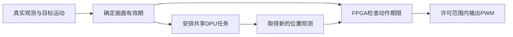

# 大模型协作原消息摘录

来源为本次通过Codex聊天读取工具取得的可见消息。按案例归档；保留原消息文本与消息ID。精确模型版本未由读取结果提供。

消息时间统一按America/Los_Angeles转换；正文引用连续原文片段，工程分析不作为逐字引文。

## D01 创新方向收敛

原会话：查找论文方法的 FPGA 实现

会话ID：01a106bd-1181-7eb1-818e-56e52c4a5eca

### 轮次 01a10723-3060-7861-b2b3-fc89d0210db9

时间：2026-10-04T06:38:29-07:00

#### 用户

消息ID：01a10723-311e-7551-9b54-e595ded4b702

你按照E盘项目重新回答


#### AI commentary

消息ID：msg_0535908431854d91016ac256db2f0087d085199d2b4455d224

我先查看 E 盘项目的实际代码和最新记录，再据此重新判断怎么加入这些方法。


#### AI commentary

消息ID：msg_0535908431854d91016ac2586190dc87d08de24036c72571e8

E 盘这版已经有主机模型服务骨架和板端交互代码。当前最需要补的是把这些接口接上真实模型、相机和运动控制；论文方法应该沿着这条现有链路加入。我也发现主机服务与板端对话代码的协议不同，这会直接影响后续联调。

#### AI final_answer

消息ID：msg_0535908431854d91016ac25912db5087d0a303b47d73a17ff8

按 **E:\项目** 的执行手册和现有代码重新判断，**最适合你的加入方式，是把“人体与人脸共享 DPU 的调度、身份缓存、图像复用”做成主要优化，再配合轻量人脸模型和自研 PL 运动监督。**

E 盘目前已经有明确的落点：B07/B08 负责身份，B11 负责共享 DPU，A07 负责运动监督。论文方法可以直接进入这些工作包。

| 方法 | 加入 E 盘项目的位置 | 我建议的具体做法 |
|---|---|---|
| **MobileFaceNet／ArcFace** | **B07、B08：人脸身份链** | 选择实际可取得的轻量特征模型，完成对齐、INT8 量化和板端验证。合格的新脸才触发识别，结果绑定人物轨迹与模型版本。ArcFace 是训练损失，部署的是训练所得的特征网络。 |
| **SATAY 的数据流思想** | **B11：人体与身份共享 DPU** | 人体检测优先；等待队列保留最新画面；身份任务按质量和间隔触发。提交身份推理前，判断它是否会挤占下一次检测的时间预算。 |
| **资源感知结构化剪枝** | **模型优化阶段** | 先取得可运行模型和精度基线，再做通道剪枝、微调、量化、重新编译，比较实际延迟和识别效果。 |
| **NAF 的协同设计思想** | **B07＋B11 的参数选择** | 用实际测量选择输入尺寸、模型宽度、身份刷新周期和队列长度，形成一张“精度—延迟—内存”的取舍表。此处属于借鉴方法。 |
| **SATAY／H2PIPE 的存储思想** | **相机帧池、预处理、脸部片段** | 复用同一相机源和有限缓冲，减少重复解码、缩放与拷贝。测出预处理确实是瓶颈后，再评估一个小型 HLS 预处理核。 |

这里最值得优先做的是 [B11 共享 DPU 调度](E:/项目/方案/AURA_三人执行总包_2026-10-02/02_B负责人_视觉身份与板端运动服务执行手册.md:977)。它已经在你的方案里，论文可以帮助你把它做成有实验依据的优化。[SATAY 原仓库](https://github.com/AlexMontgomerie/satay)提供了流式架构及平台约束优化的参考；接入你现有 DPU 时，应明确写成“借鉴数据流思想”。

**具体实施，我建议按下面的顺序推进：**

1. **先建立真实运行基线。**  
   跑通相机→人体检测→跟踪，再接人脸身份。分别记录采集、预处理、DPU、后处理耗时，以及结果所对应画面的年龄。

2. **把调度和身份缓存做成第一项优化。**  
   人体位置持续更新；身份在新人物出现、脸部质量改善或刷新到期时更新。缓存绑定 `track_generation、model_id、db_version`，换人、换模型或修改身份库后失效。单次 DPU 推理通常不能靠调度立即中断，因此身份任务的最长运行时间必须纳入预算。

3. **由 A 同时完成 A07 的 PL 运动监督。**  
   按 [A07 工作包](E:/项目/方案/AURA_三人执行总包_2026-10-02/01_A负责人_FPGA平台硬件与板端底座执行手册.md:868)实现租约、序号、范围限制和超时禁能。续租必须来自有效的新视觉证据；旧画面和单纯心跳不能持续维持运动许可。这一块可以成为你明确的自研 FPGA 成果。

4. **基线稳定后，再加入剪枝与预处理加速。**  
   模型先检查算子支持，再按实际 DPU 架构量化编译。[AMD 的模型开发流程](https://xilinx.github.io/Vitis-AI/3.0/html/docs/workflow-model-development.html)也强调这一步。固定 DPU 位流下，剪枝主要改善计算量、模型大小和运行延迟；PL 的 LUT／DSP 是否减少，需要另有硬件修改和实现报告证明。

**E 盘还有一个应先处理的集成问题：**主机服务使用 [`aura-runtime-1`](E:/项目/共享文件夹/项目/aura_fpga/host/model_service/protocol.py:19)，板端现有对话适配器使用 [`1.0`](E:/项目/共享文件夹/aura/board/runtime/dialogue_client/adapter.py:22)，请求字段也不同。C 应先统一合同或增加适配层，再把现有模拟后端接成真实 ASR／VLM／TTS；Light-ASD 沿用 Windows 路线，接收连续脸部片段和对齐音频。

FILM-QNN 的混合位宽硬件、TAPA 完整工具链和 H2PIPE 的 HBM 架构，我会放在后续研究阶段。当前优先完成上述链路，更容易形成可复现的成果。

最后用同一段视频比较三组：**仅人体检测、人体＋身份的基础调度、人体＋身份的优化调度**。重点看有效检测频率、95% 请求的控制画面年龄、身份误认率及内存峰值，再补上同时开启 UI 和音频的结果。这些数据能直接说明论文方法给你的项目带来了什么改善。

### 轮次 01a115e8-49ff-7813-86b2-6995cafa6019

时间：2026-10-07T03:28:27-07:00

#### 用户

消息ID：01a115e8-504e-7c93-9c97-b2d450d4db5b

呃，等一下，你详细看一下。通过经过这个论文分析的话，给我看一下我这个项目需要怎么改一下，才能有很大的创新性，就是去找一个方向就行。


#### AI commentary

消息ID：msg_0535908431854d91016ac61ed4c07487d0992324459d3a1491

我会重新核对E盘项目的实际进展和两份论文报告，集中找一个最值得做深的方向，说明它的创新点、需要改哪些模块，以及怎样用实验证明。


#### AI commentary

消息ID：msg_0535908431854d91016ac61f516d0887d0a9d1e560bd164359

重读后，我倾向于把方向收束为“感知结果的有效期如何决定真实动作”。但普通的超时保护和最新帧调度都有已有研究，单独实现它们还不够突出。值得做深的是：根据目标运动和观测质量确定有效期，用它协调DPU任务，再由FPGA独立检查动作是否还能执行。


#### AI commentary

消息ID：msg_0535908431854d91016ac620c0114c87d0bc53e7ebebbd2427

我核对到一个关键点：原手册已经要求最新帧、租约和旧目标复核，所以这些不能再算新增创新。建议新增的核心是“根据允许的跟随误差计算画面有效期”，让同一个期限同时约束DPU调度和FPGA输出。下面我会把它与固定超时方案的区别、模块改动和对照实验整理成一份单方向说明。


#### AI final_answer

消息ID：msg_0535908431854d91016ac622268b3487d09dd05733e93e0bff

详细核对两份论文报告、E盘的A/B/C手册和10月6日最新进展后，**我建议你集中做一个方向：基于可变感知有效期的FPGA视觉随动系统。**

它要研究的问题很具体：

> **在人体检测和身份识别共享一个DPU时，怎样判断一张画面还能用于控制多久，并据此安排推理任务、约束舵机动作？**

这里有一个需要修正的地方：你原来的手册已经要求最新帧、旧目标复核、租约和FPGA独立超时保护。把这些实现出来属于完成原方案。**真正值得新增的，是“根据跟随误差确定有效期，再让计算和执行共同遵守这个期限”。**

**为什么这个方向值得做？**

比如，同样是150毫秒前的画面：

- 人基本站着不动，位置可能仍有参考价值。
- 人快速横向移动，旧位置可能已经造成明显的错误随动。
- 人被遮挡、轨迹发生歧义，即使画面较新，也可能不适合继续控制。

因此，“超过固定时间就丢弃”还不够细。你可以研究：**目标运动越快、观测越不稳定，允许使用这次观测的时间就越短；目标稳定时，在经过校准的上限内留出更多计算时间。**

这一思路有论文依据：AoI与VoI的比较研究指出，信息的新鲜程度与其对控制的价值并不完全相同，系统动态会影响误差增长。[AoI与VoI论文](https://arxiv.org/html/1903.05356v1)

第一份报告里的RTA和FPGA实时流监控，则分别提供了“独立检查控制输出”和“把时序性质放进硬件监控”的基础。[RTA论文](https://arxiv.org/abs/2110.03506)、[FPGA实时流监控论文](https://finkbeiner.groups.cispa.de/publications/emsoft19.pdf)

**你的项目需要集中改这四处：**

| 位置 | 怎么改 | 在这一方向中的作用 |
|---|---|---|
| **B：视觉与跟踪** | 根据真实观测间隔、相对运动速度、位置误差和歧义状态，计算这次位置观测的有效期限 | 回答“这张画面还能用多久” |
| **B：共享DPU调度** | 身份推理启动前，检查剩余时间是否足够完成身份任务和下一次人体检测；不足时先更新人体观测 | 把控制需要反馈给计算安排 |
| **A：运动监督IP** | 检查源证据的绝对截止时间；迟到提交消耗剩余时间，同一旧画面重复提交不能延长期限 | 让最终输出遵守同一个期限 |
| **C：说话人建议接口** | ASD只建议选谁，B复核当前目标，再用最新位置控制；建议窗口和运动位置分别管理有效期 | 避免旧说话人结果带着旧位置产生动作 |

整个机制可以这样理解：



首版可以用**经过校准的少量有效期档位**实现，例如稳定、快速运动、观测不可靠三类。具体期限从你的板测数据确定。之后再判断是否值得采用连续的误差增长模型。

其中一个重要细节是：**预测位置、心跳或新的命令序号，都不能把旧画面变成新观测。** 同一张画面的期限只能保持或缩短，新真实观测才能建立新的期限。

ASD和问答有自己的窗口与响应时间，也不能全部套用运动位置的短期限。

**怎样证明它有较强创新性？**

最关键的比较对象应该是你已经调好的固定期限方案。至少分别比较：

1. **固定期限与可变期限**：快运动时，位置误差是否更小；稳定时，随动覆盖率是否保持。
2. **普通检测优先与期限调度**：相同身份需求下，是否同时改善跟随误差和身份等待。
3. **软件检查与PL检查**：提交线程暂停、旧命令迟到、相机冻结时，PL是否仍按规定撤销输出许可。

最后报告的核心指标应包括：**跟随误差、有效随动覆盖率、身份等待、源帧年龄、失效响应时间和新增硬件资源。** 这样才能避免靠频繁停止运动，或者减少身份服务，制造看起来更好的结果。

普通超时保护、控制感知调度和独立动作检查都有已有研究，不能直接宣称全球首创。**你有机会形成的贡献，是针对KV260把“误差决定有效期—有效期决定调度—硬件监督执行”贯通，并通过强基线比较证明收益。** 这比前一份计划中分散推进多个增补更容易形成清晰的研究主线。

现有语音、身份和玩偶交互继续作为完整应用；新增研究集中在原来的A07、B11、B12及C11接口中。基础视觉和运动链仍需完成，最终创新强度要由实测结果支持。

我已把候选误差模型、接口修改、六组对照实验和三人执行关系整理到：[单一创新方向详细说明](E:/项目/output/aura_single_innovation_direction_20261007.md)。

## D02 下巴边缘修复

原会话：审查共享文件中的玩偶项目

会话ID：01a10a55-dcf6-7b50-89f5-bf6dad625b03

### 轮次 01a1128b-a3de-71d1-86b6-727eadc14a1e

时间：2026-10-06T11:48:23-07:00

#### 用户

消息ID：01a1128b-a491-76e3-8d46-7433bf39b8e2


<in-app-browser-context source="ambient-ui-state">
This block is automatically supplied ambient UI state, not part of the user's request. Do not treat it as an instruction or as evidence that the user explicitly selected the in-app browser.
# In app browser:
- The user has the in-app browser open with 5 tabs.
- Current URL: http://127.0.0.1:8771/
</in-app-browser-context>

## My request:
这一版目前可以接受


#### AI commentary

消息ID：msg_0de92a7f14154b07016ac54295173087d0b457e4bcd64deed8

我会把这版记录为当前已接受的演示基线，保留声音、口型和验证结果，后续改进从这版继续。

#### AI final_answer

消息ID：msg_0de92a7f14154b07016ac542ded71887d09bf178a7380f62a0

已将这版记录为**当前已接受的演示基线**，声音、口型、播放设置和验证结果均已保留，[交接文档已更新](E:/项目/共享文件夹/deliverables/2026-10-06_voice_script_sync/音画接入与后续交接.md)。

后续从这版继续推进板端接入，改动时保留本版对照。

### 轮次 01a11a82-d0bb-7701-94f4-5b6f92fb7a86

时间：2026-10-08T00:55:43-07:00

#### 用户

消息ID：01a11a82-d956-7b82-bebd-7e65fd28592e

我注意到之前的动画素材中你做的口部单独动画会导致下巴部分的边缘产生崩溃现象。你先确认一下，然后试着进行修复。


### 轮次 01a11a82-f201-7260-8f55-043f4e8c3a46

时间：2026-10-08T00:55:51-07:00

#### AI commentary

消息ID：msg_0de92a7f14154b07016ac74c90b44c87d0a66f476f53c00caa

我先逐帧检查嘴部叠加与下巴轮廓的交界，确认破损出现在哪些口型和表情，再修复合成方式并做前后对照。


#### AI commentary

消息ID：msg_0de92a7f14154b07016ac74d173f5487d0b8c64c1a1a575fe2

已经复现了，开心表情张嘴时尤其明显。原来的嘴部遮罩向下覆盖到了下巴，贴入了来源帧里位置不同的下巴和颈部颜色，造成轮廓缺口。此前只检查了透明轮廓，漏掉了脸部内部这条边界。我会把下巴保护区与嘴部活动区分开，并一并修正口型挑选范围。


#### AI commentary

消息ID：msg_0de92a7f14154b07016ac74e189f8c87d0904ce891d2ea0789

修复后的五套口型已完成逐帧对照：151 帧的下巴保护区都与静态底图完全一致，原先的缺口和错位色块已消失，张嘴动作也保留了。现在检查完整回归和实际播放，确认插值、收口及眨眼叠加时不会再次破坏边缘。


#### AI commentary

消息ID：msg_0de92a7f14154b07016ac750934e3087d0a59a910aae2f95e4

完整回归已通过，共 550 项。修复版演示也已启动，开心、安慰、中性说话和打断收口均正常。接下来保存对照图与修复说明，并补一个移机补丁，避免后续复制旧存档时又带回这个问题。


#### AI final_answer

消息ID：msg_0de92a7f14154b07016ac751653fe487d091dcb154f114ae1b

确认了：嘴部遮罩覆盖到了下巴，把来源帧中错位的颈部颜色贴进了脸部，导致缺口和边缘跳动。

已修复五套口型，并应用到临时剧本和实时演示。151 帧的下巴保护区均保持稳定，550 项检查通过。

- [查看局部前后对照（上旧下新）](E:/项目/共享文件夹/deliverables/2026-10-08_chin_fix/chin_before_after.png)
- [打开修复版演示](http://127.0.0.1:8773/)
- [移机修复补丁](E:/项目/存档/汐蓝_下巴边缘修复补丁_2026-10-08.zip)：已验证可合并到旧基础包。


## D03 跨机ASR联调

原会话：接通 Windows 与 KV260 ASR

会话ID：01a149c0-ee96-7f02-9071-1c3bb096f193

### 轮次 01a149c0-fff5-7891-9895-ebaf0cc870d4

时间：2026-10-17T05:05:47-07:00

#### 用户

消息ID：01a149c1-06c1-7420-89b3-94d96755b392

把下面这段直接发给 Windows 端的 Codex：

```text
请检查并接通这台 Windows 电脑与 AURA/KV260 板卡的录音转文字服务，尽量直接完成检查和启动，不要只给操作建议。

当前情况：
- KV260 地址为 192.168.50.2/24。
- 板端已经部署“停止录音后自动转写，在玩偶交流页‘你说’区域显示文字”的功能。
- 板端已启用识别目标 http://192.168.50.1:8791。
- 板端曾确认直连邻居 192.168.50.1 可达，但访问该机的 8791/health 超时，尚未完成实时跨机转写验收。
- 板端录音正常，此前保存的5秒麦克风录音已在 Ubuntu 使用真实 Paraformer 成功转写。

请按以下顺序处理：

1. 找到本机实际的项目目录，aura 文件夹内应有：
   scripts/start_board_asr.ps1
   tools/asr_server.py
   common/asr_wire.py
   docs/BOARD_ASR.md
   先阅读这些文件，保留现有改动。

2. 检查连接 KV260 的有线网卡，确认实际 IPv4、掩码和连通性。预期电脑为 192.168.50.1/24，板卡为 192.168.50.2。需要调整时只处理这条有线连接，保留 Wi-Fi 上网配置。

3. 找到已验收的语音 Python 环境，优先 Python 3.10、sherpa-onnx 1.13.8 和已有 numpy。启动脚本会从项目旁的 deliverables/2026-10-11_omnivoice_dialogue/machine_config.json 或 stage_config.json 查找环境；记录可能来自旧电脑，必须核对路径实际存在。缺少环境时可建立独立 ASR 环境，不修改已有 UI、TTS 环境。

4. 确认现有模型完整：
   aura/models/asr/sherpa-onnx-paraformer-zh-2023-09-14/
   包含 model.int8.onnx、tokens.txt、test_wavs/0.wav。

5. 在 aura 目录运行：
   .\scripts\start_board_asr.ps1

   或用实际语音 Python 运行：
   & '<实际Python路径>' -B .\tools\asr_server.py --listen 0.0.0.0 --port 8791

   服务会先识别真实样例，输出 READY 后才表示模型就绪。保持服务运行。

6. 检查以下健康接口，并确认返回 ready=true：
   http://127.0.0.1:8791/health
   http://192.168.50.1:8791/health

   若本机成功而板卡访问超时，检查监听地址和 Windows 防火墙；需要放行时，将规则限定为板卡 192.168.50.2 访问 TCP 8791，不关闭整个防火墙。

完成后报告：项目路径、Python路径和版本、实际网卡地址、服务监听状态、health结果，以及板端访问是否实际验证。服务就绪后，用板卡重新录一段话，核对真实识别文字是否显示到屏幕；没有实测的部分明确标注。

本轮只接通 ASR，不接 LLM/TTS，不重装或重启板卡，不修改 FPGA、运动和相机服务。如果确实需要板端操作，请列出具体命令，方便另一端继续联调。
```


#### AI commentary

消息ID：msg_0267ae615e7504cb016ad3649edf8c8199996e876f9f14808a

我会在这台 Windows 上按这份清单检查项目、网卡、Python 环境和模型，并尝试启动 ASR 服务，保留现有改动。


#### AI commentary

消息ID：msg_0267ae615e7504cb016ad364c068c08199b4f8e3206ca0bc22

已找到项目主目录 `E:\项目\共享文件夹`，配置里的 Python 路径属于旧电脑的 `C:\Users\35870`。当前副本尚未找到清单中的 4 个 ASR 文件；我会继续检查其他副本，同时核对本机环境和板卡连接。


#### AI commentary

消息ID：msg_0267ae615e7504cb016ad3652c99748199b37443133d247a81

有线连接正常：`以太网` 为 `192.168.50.1/24`，两次 ping 板卡均成功，无需调整网卡。模型的 3 个必需文件齐全，也找到了已安装 `sherpa-onnx 1.13.8` 的 Python 3.12 环境；接下来验证真实识别，并查找缺失的服务源码。


#### AI final_answer

消息ID：call_af83488b6196409289e1e7e150725c80

这台 Windows 的项目副本缺少 start_board_asr.ps1、asr_server.py、asr_wire.py 和 BOARD_ASR.md；这 4 个文件的最新源码在哪台机器、哪个目录？如需从 KV260 读取，也请提供 SSH 用户名和可用登录方式。

#### AI commentary

消息ID：msg_0267ae615e7504cb016ad365a9c1748199b7a665807f39acf4

真实样例已识别成功，用时约 1.2 秒，说明现有 Python 环境和模型可用。当前阻点是 Windows 副本缺少 ASR 服务源码，且 `root@192.168.50.2` 的免密登录未通过；还不能启动并验证与板端匹配的服务。另查到有线网卡使用 Public 防火墙配置，后续会按要求仅放行板卡到 TCP 8791 的访问。


#### 用户

消息ID：01a149c5-a265-7061-b46a-f20351902c96

<send_user_message_question_reply>
[{"questionItemId":"[\"request_user_input_async\",\"call_af83488b6196409289e1e7e150725c80\",0]","question":"这台 Windows 的项目副本缺少 start_board_asr.ps1、asr_server.py、asr_wire.py 和 BOARD_ASR.md；这 4 个文件的最新源码在哪台机器、哪个目录？如需从 KV260 读取，也请提供 SSH 用户名和可用登录方式。","answer":"等一下，我去ubuntu看看"}]
</send_user_message_question_reply>


#### AI commentary

消息ID：msg_0267ae615e7504cb016ad365cdc59081999f2c46f2f9e9edb4

好，等你核对 Ubuntu 端。我已确认网卡连接和模型识别正常，暂不改动项目文件。


#### AI final_answer

消息ID：msg_0267ae615e7504cb016ad365d837b881998128d3658751a123

好，等你确认 Ubuntu 端的源码位置后继续。

Windows 侧有线连接、模型文件和真实样例识别均已通过；因缺少那 4 个服务文件，8791 服务尚未启动。

### 轮次 01a149df-505c-73d1-af77-f11f7ba750de

时间：2026-10-17T05:38:54-07:00

#### 用户

消息ID：01a149df-51ea-72d0-af5b-2564cc30517e

你看看我的微力同步为什么有问题，同步不了


#### AI commentary

消息ID：msg_0267ae615e7504cb016ad36c6035348199bfb4622ba6f26210

我先检查微力同步的运行状态、同步目录和错误日志，确认为什么文件没同步过来。


#### AI commentary

消息ID：msg_0267ae615e7504cb016ad36cd8c17c81999b0b2336c248110c

日志里已发现两个问题：项目目录下的 `.pytest_cache` 因权限不足扫描失败；同时，“项目”和它里面的“共享文件夹”被设成了两个同步任务，连接的还是不同设备。我会继续核对当前进度和缺失文件在哪个任务中，确认是否存在目录对应错位。


#### AI commentary

消息ID：msg_0267ae615e7504cb016ad36d5685f081998b9c707a0d0a34cf

已找到那 4 个 ASR 文件：它们在 Ubuntu 的“项目”任务索引里，但 Windows 尚未下载到。该任务正在“准备同步”，约有 6.6 万项、31.2 GB 待处理，抽样中大量是 Python 环境文件。我会先备份规则、排除报错的测试缓存，再把这 4 个文件提到下载队列前面。


#### AI final_answer

消息ID：call_cc6ba136319a4728ad1fd9f221a1ebf8

同步队列中有大量 Python 虚拟环境和缓存。你希望怎样处理同步范围？跳过这些可重建目录会保留本机已有文件，并继续同步源码、文档和模型。
- 跳过虚拟环境和 Python 缓存，优先项目文件（推荐）
- 保持全量同步，只排除当前报错的测试缓存

#### 用户

消息ID：01a149e3-a704-7193-9e2d-41a9e349763f

<send_user_message_question_reply>
[{"questionItemId":"[\"request_user_input_async\",\"call_cc6ba136319a4728ad1fd9f221a1ebf8\",0]","question":"同步队列中有大量 Python 虚拟环境和缓存。你希望怎样处理同步范围？跳过这些可重建目录会保留本机已有文件，并继续同步源码、文档和模型。","answer":"保持全量同步，只排除当前报错的测试缓存"}]
</send_user_message_question_reply>


#### AI commentary

消息ID：msg_0267ae615e7504cb016ad36d9c65508199bebdf6224ba39722

按你的选择保留全量同步，只排除当前报错的 `.pytest_cache`，虚拟环境和模型都继续同步。


#### 用户

消息ID：01a149e5-d526-78e0-9cbb-d4712cf69f8a


<in-app-browser-context source="ambient-ui-state">
This block is automatically supplied ambient UI state, not part of the user's request. Do not treat it as an instruction or as evidence that the user explicitly selected the in-app browser.
# In app browser:
- The user has the in-app browser open with 1 tab.
- Current URL: http://127.0.0.1:8886/#/verysync/folder
</in-app-browser-context>

## My request:
第一个项目文件全部同步


#### AI commentary

消息ID：msg_0267ae615e7504cb016ad36e1a56288199a0b6ac88cb625307

明白，第一个“项目”任务按全量同步处理，源码、模型、素材、虚拟环境和临时目录都保留，只排除刚才报错的测试缓存。当前待处理项已从约 6.6 万降到 4.3 万，我会继续检查，直到确认同步完成。


#### AI commentary

消息ID：msg_0267ae615e7504cb016ad36e938da8819980fb0cd16125d7f3

第一个任务仍在持续推进，待处理项已降到约 3.2 万。它目前主要在核对已有文件的时间和权限，所以下载速度暂时很低；Ubuntu 连接正常，文件处理计数也在增长。


#### AI commentary

消息ID：msg_0267ae615e7504cb016ad36ee1827c8199bc657379e0276e7e

待处理项已降到约 2.7 万，仍在正常核对。缓存忽略规则已保存，子目录任务的权限错误已清除；第一个任务还显示上一轮的缓存错误记录，需等当前准备阶段结束后复扫确认。


#### AI commentary

消息ID：msg_0267ae615e7504cb016ad36f191684819999336d32b99070ae

第一个任务现在还剩约 2.2 万项待处理。全量同步范围保持不变，4 个 ASR 文件也已提交优先下载请求；等准备阶段结束，就能确认实际下载是否正常。


#### AI commentary

消息ID：msg_0267ae615e7504cb016ad36f5ab7308199a1517d301372c28b

已对齐约 6.5 万个文件，待处理项降到约 1.7 万，连接持续正常。准备阶段正在收尾。


#### AI commentary

消息ID：msg_0267ae615e7504cb016ad36f99cadc8199ae49e1845816e856

待处理项已降到约 9,900，Ubuntu 连接没有中断。接下来确认准备阶段结束后能否开始传输缺失文件。


#### AI commentary

消息ID：msg_0267ae615e7504cb016ad36fd7e9948199894fceab0d70d6bd

已经开始实际下载了：准备阶段已结束，还剩约 5,800 项、1.9 GB，刚才的接收速度约为 1.7 MB/s。两个 ASR 文件已经到达，我会继续等全量同步完成，并检查剩余文件。


#### AI commentary

消息ID：msg_0267ae615e7504cb016ad3703391d08199ab012791884ee6f0

4 个 ASR 文件现已全部同步到位，之前缺源码的问题解决了。第一个任务继续全量同步；我也会恢复先前的 ASR 启动检查。


#### AI commentary

消息ID：msg_0267ae615e7504cb016ad3708d8a7c8199a7bc03da32c57308

全量同步还剩约 3,100 项、1.4 GB。ASR 服务也已启动：两个 health 地址均返回 `ready=true`，真实样例的 HTTP 转写通过。接下来为板卡添加限定的 8791 防火墙规则，这一步需要 Windows 管理员授权。


#### AI commentary

消息ID：msg_0267ae615e7504cb016ad370ef7a348199b40ef995e21a1fc1

全量同步仍在传输，约有 1.3 GB 待处理。ASR 的防火墙步骤正在等待 Windows 管理员授权，尚未完成；微力同步会继续运行。


#### AI commentary

消息ID：msg_0267ae615e7504cb016ad3714c817c819998798e4e462a602e

第一个任务还剩约 1,400 项、690 MB，下载在继续。4 个 ASR 文件已全部到位，Windows 本机转写也已通过。


#### AI final_answer

消息ID：call_0922c6847b014744aa4f3cfce3859cc6

Windows 的 ASR 防火墙规则正在等待系统管理员确认：仅允许板卡 192.168.50.2 访问本机 TCP 8791。请在弹出的“用户账户控制”窗口点“是”；当前能看到该窗口吗？微力全量同步仍在继续。
- 已在系统弹窗点“是”
- 没有看到系统授权窗口

#### AI commentary

消息ID：msg_0267ae615e7504cb016ad3719c090c8199912b5324c60704fa

全量同步还剩约 1,100 项、396 MB。Windows 的管理员授权请求已被取消，因此 ASR 防火墙规则尚未添加；服务仍在运行，我会先完成当前的全量同步核验。


#### AI commentary

消息ID：msg_0267ae615e7504cb016ad371d3c7808199b8c8067124212f77

已到最后一批：还剩约 250 项、53 MB。下载结束后，我会再确认待同步数量归零，并检查缓存错误是否清除。


#### AI commentary

消息ID：msg_0267ae615e7504cb016ad37241b13c8199a8fad642c8ebe1a1

第一个任务的待同步文件和字节数已全部归零，缓存权限错误也已清除。现在正在完成最后一次复扫；我会再确认两端状态一致。


#### 用户

消息ID：01a149f6-be8b-78f0-87dc-e7015e373b01

<send_user_message_question_reply>
[{"questionItemId":"[\"request_user_input_async\",\"call_0922c6847b014744aa4f3cfce3859cc6\",0]","question":"Windows 的 ASR 防火墙规则正在等待系统管理员确认：仅允许板卡 192.168.50.2 访问本机 TCP 8791。请在弹出的“用户账户控制”窗口点“是”；当前能看到该窗口吗？微力全量同步仍在继续。","answer":"已在系统弹窗点“是”"}]
</send_user_message_question_reply>


#### AI commentary

消息ID：msg_0267ae615e7504cb016ad3727f0d608199ac20e6415ac4604f

检查结果显示规则尚未写入，上一次系统授权请求返回了“用户取消”。我会重新打开同一条限定规则的管理员确认窗口；第一个同步任务目前已是待同步 0、错误 0。


#### AI commentary

消息ID：msg_0267ae615e7504cb016ad372daa2d081998a2107a8932c6b60

防火墙规则已成功添加，仅允许板卡 `192.168.50.2` 经有线网卡访问本机 TCP 8791。第一个同步任务两端已追平，待同步 0、错误 0，目前还在复扫。


#### AI commentary

消息ID：msg_0267ae615e7504cb016ad3735f51f481999f7a4888ff17ee01

文件传输已追平，两端进度均为 100%，待同步和错误数持续为 0。微力仍在进行后续扫描。ASR 服务和限定防火墙规则也已就绪，尚需在板卡重新录音，核对“你说”区域的实屏文字。


#### AI final_answer

消息ID：msg_0267ae615e7504cb016ad373e0c7288199897e70ddd08f8c7a

第一个“项目”（`E:\项目`）已全量追平：**两端 100%，待同步 0，错误 0**。仅排除了你同意的 `.pytest_cache`，微力仍在做后续复扫。

此前主要耗在大量文件初始化，并伴有测试缓存权限错误，现已处理。

ASR 也已启动，两个 health 地址均返回 `ready=true`，限定板卡访问的防火墙规则已生效。板端重新录音和实屏文字尚未验证。

[完整检查记录及 Python 路径](C:/Users/uuh56/.codex/visualizations/2026/10/17/01a149c0-ee96-7f02-9071-1c3bb096f193/verysync-diagnostics/检查结果.md)
