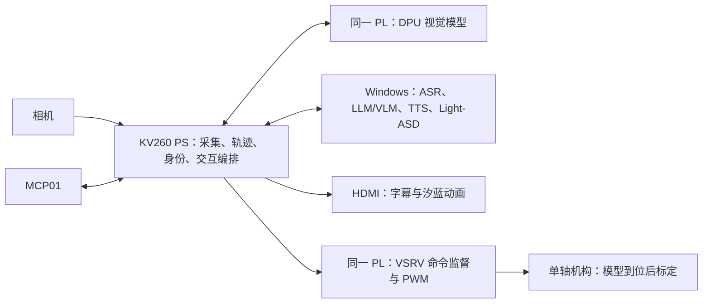

# AURA / 汐蓝整机框架评估

日期：2026-10-08 本地日期。性质：结合有效方案、现有源码和最新实测进行架构评估；建议不代表已实现。本轮没有连接硬件、修改运行配置或新增设备测试。

## 最新计划补充与优先级修正

用户追问最新计划后，重新定位并完整阅读 `/home/ghmd/Win共享文件/方案/aura_junior_project_framework_20261008.md`，同时完整阅读 10 月 7 日单一创新方向，并阅读技能包方案的范围与实施/交付部分。初次评估漏读这两份较新的整体框架/创新方向，之前使用 10 月 4 日创新计划和旧执行手册不足以代表最新研究主线。

最新主线是“控制误差约束下的可变感知有效期调度与 FPGA 执行监督”：由真实观测和经校准的误差增长确定位置证据期限，以剩余期限安排单 CU DPU 的检测/身份任务，再由 PL 监督最终输出。轻量身份是应用基础，剪枝不再决定主创新成立。L1 固定期限视觉运动基线、L2 身份/媒体/交互、L3 可变期限及调度对照、L4 三包及发布是验收次序，既定完整功能仍保留。

因此近期优先补齐实际项目 DPU 视觉模型、轨迹/源时间记录和固定期限数字基线；MCP01 与板端 UI 作为 C 线并行。用户已明确机械等待 3D 模型，不能因计划书要求 L1 就重开机构测试；在此期间先做无需机构的模型、跟踪、日志、身份及数字验证，正式机械关卡仍待验收。

新版计划第 3 节只回收到历史 M3/共享源码，不覆盖 Ubuntu 已有 CPU 视觉、SFace 图片参考链、DPU+VSRV 共存及有限视觉命令板测。实施目标按新计划，实际状态按最新证据；不照搬计划中的历史“待实现”，也不把已通过的有限板测升级为完整 L1/L3。

## 判断

总体框架适合保留：KV260 PS 管传感输入、视觉后处理、身份、交互、播放和 UI；PL 的 DPU 承担实际适配的视觉推理，自研 VSRV 管命令监督/PWM；Windows 承担首版 ASR、LLM/VLM、TTS 和 Light-ASD；Ubuntu 负责构建、测试与发布。分工支持团队开发，也利用了已有成果。

完整范围对三人团队较大，需要按可运行的整机链逐步交付。当前已经有电脑端语音动画和板端视觉/控制两个成果链，但真实媒体、目标归属和交互事件尚未完全贯通。主风险是集成、延迟和发布完整性，而不是算法名字不够多。

## 目标运行结构

上图是目标架构；当前实时 YuNet 仍为 CPU 实现，图文问答、Light-ASD、身份业务及真实 MCP01 整机验收不能画成已完成。Ubuntu 是构建角色，不作为演示运行时依赖。

## 已有设计应保留

1. 一个相机采集者，共享带帧编号与源时间的画面；慢消费者不阻塞新观察。
2. 一个正式运动写入者，独立 FPGA 租约、范围/速率限制和 STOP。模型主机提供证据或建议，板端复核后执行。
3. 预训练模型和本队业务逻辑分开；登记模板、特征模型、临时轨迹、说话人是不同对象。
4. 使用现有 FSM/EventBus/Validator、音频样本时钟、局部眼口层与请求代次失效机制。交互、动画和运动状态域保持各自职责，通过事件关联。
5. 首版按键半双工，减少播放声音干扰录音和对话结束判定的复杂度。身份或 ASD 暂时未知时，基础单人/手动对象交互仍可验证。

## 优先补强的五个点

### 1. 统一一轮交互的归属

由板端交互编排维护当前会话、请求代次、目标轨迹及其代次、使用的图像/音频引用和期限。视觉持续更新；一次问答绑定当时的目标与媒体。取消、换目标、相机重连、板卡重启分别失效对应旧结果。跨机器 monotonic 时间不能直接相减。

现有接口有 `aura-runtime-1` 的完整媒体/目标骨架和 `1.0` 的文字/动画对话适配器。建议冻结整机内部上下文，以显式适配层连接现有演示；不丢弃音频/画面归属，也不因接入把已有动画链重写。当前 `scene_state` schema 仍较小，需要与真实轨迹/身份合同对齐。

### 2. 保证实际视觉任务体现 DPU 的作用

当前 CPU YuNet 可继续作为对照与备选，但正式项目需要实际兼容的视觉模型进入 DPU，并记录 CPU/DPU 的执行边界、同图输出、精度和负载性能。ResNet18 分类基线不能替代项目视觉任务完成。

先测检测单独运行，再加入低频身份、UI、音频和主机请求。调度优先保证新观察，身份以独立周期和质量门进入；保留有界队列及最新帧策略。收益用帧龄 P95、检测更新间隔、身份刷新延迟和内存峰值证明。

AMD 文档明确 DPU 仅支持部分算子和排列，并要求模型编译匹配目标 arch.json，故不以“有 ONNX”推断“能跑 DPU”。参考：[Vitis AI 3.0 模型开发流程](https://xilinx.github.io/Vitis-AI/3.0/html/docs/workflow-model-development.html)。

### 3. 把语音响应延迟作为整机指标

四段当前汐蓝新名缓存的首次非流式生成记录约 10.92～26.68 秒。缓存命中播放与新台词首次生成分别测量；固定音色正确、动画流畅不自动意味着对话等待时间可接受。

建议先测录音结束至首段可听声音的完整时间，拆分 ASR、问答、TTS 等待与网络/播放；保持合成异步、生成期间 UI 可用及取消有效。常用固定语句保留校验缓存。再比较预热、短回复、分句或后端流式输出；收益需在当前模型/环境测得，不能套用模型发布页延迟。官方路线参考：[Qwen3-TTS](https://github.com/QwenLM/Qwen3-TTS)。

### 4. 按整机链推进范围

基础整机交付先验证单人出现、按键说话、主机回答、板端字幕/汐蓝播放、取消和断连；机械暂缓不阻塞此链。随后增加已登记用户识别、多人目标管理、图文问答和视觉说话人。完整目标保留，验收分阶段。

Light-ASD 需要同期连续人脸视频与声音，不宜将实时 ASD、完整视觉身份、全部主机模型和机构调参同时作为第一次整机联调前置。其首版先用录制片段验收再上线，参考：[作者实现](https://github.com/Junhua-Liao/Light-ASD)。精细音素口型、复杂语音打断/AEC、双轴或新网络训练后续由实际需求决定。

### 5. 发布要能表达同一个版本

当前同步过程出现缺件和不同阶段源码组合。正式运行应冻结源码、硬件包、模型、配置、素材和协议；一键启动配合实际 readiness 探针，而不只看进程或开关。整体日志串联同一请求、轨迹、媒体和硬件结果。

移机包已验证有效，不代表当前共享目录已同步完整；Win/Ubuntu/板卡三个来源的既有成绩保留其平台标签。先做小范围发布包验收，再做长时并发、冷启动和他人复现。

## 对本项目贡献的建议

本队工作可围绕实际视觉推理调度、有效源证据到 FPGA 租约的衔接、受监督运动、异步请求归属和真实角色交互呈现。采用现成模型是合理工程选择；创新或优化成立需要同条件对照，不能用论文名称、模型数量、漂亮界面或测试项数代替收益证据。

对于 FPGA 项目，建议同时展示可观察的应用闭环、DPU 实际模型执行和自研 RTL 的异常行为。单纯 PWM 功能之外，租约、序号、代次、状态回读与拒绝规则已经是可继续验证的本队实现；系统/资源/性能方面仍需最终负载实验。

## 当前建议

保留框架，按最新计划优先补齐实际 DPU 视觉模型与固定期限基线：相机真实帧→DPU 项目检测→轨迹及源证据→受监督命令。机械等模型到位，先验证模型/记录/数字部分。C 线并行打通真实板端录放音、统一会话、主机回答/固定声线、板端播放与动画。身份与可变期限研究分关卡加入；无需为等待机构再创建一套电脑端演示框架。
