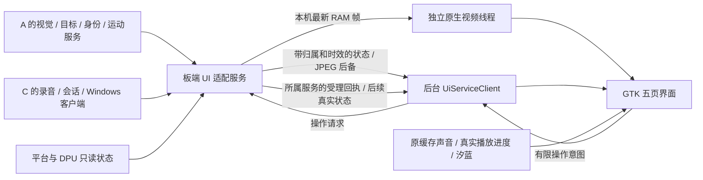

# KV260 触屏界面与后续功能接入

2026-10-11 最新：[ByteTrack 人体跟踪](BOARD_TRACKING.md) 已接实时相机；设备页沿用“选择目标”对话框，手动目标失跟后清除。程序/合同测试已通过，本轮原生放大/返回通过；镜头朝天花板，真人手动选目标及新手指验收仍待完成。

更新：2026-10-11。本次按现有项目资料完善 GTK3 板端入口，并完成相机预览卡顿修复。软件实现、原生屏幕操作、实物触控和真实算法接入分别记录。最新板端结果见 [本轮报告](/home/ghmd/aura-board-ui-design-20261009/UI_DESIGN_REPORT.md)。

同日最新：[YOLOX-Nano 人体检测](BOARD_YOLO.md) 已通过 DPU 接入真实相机，互动及放大页显示人数/人体框/置信度，底栏显示实际 DPU 状态。126 项主机、68 项板端软件测试通过，同轮预览约 12.34→12.66 fps；最终真人入镜检出 1 人，已核对同源相机图与实际快照。多人精度和现场手动选目标仍待验收。最新证据见 [YOLO 接入报告](/home/ghmd/aura-board-yolo-20261011/YOLO_INTEGRATION_REPORT.md)。

## 1. 依据与范围

| 依据 | 本次对应实现 |
| --- | --- |
| ZIP `项目/README.md` 与无声源定位完整方案 | 沿用 MCP01 USB 音频、板端界面、Windows 模型；不加入声学 DOA |
| C 执行手册 C08、§6.7、§6.8 | 交互、目标、身份、运动、主机分别显示；旧结果不过屏；登记以所属服务事务为准 |
| C04、C07、C12 | 可配置连接、后台请求、有界队列、超时与取消、状态刷新与诊断 |
| [10 月 8 日整体框架](../../../方案/aura_junior_project_framework_20261008.md) | 继续复用汐蓝，并与板端媒体和整机事件接口分开交付 |
| [当前分工](CURRENT_ASSIGNMENT_AND_BOARD_UI.md)及用户最新决定 | A 负责视觉/FPGA；机构等待 3D 模型；本轮完善 UI 和接口 |
| [原布局 ADR](ADR_显示口径与三区布局.md)、实际板端日志 | 1024×600、保留左右分区与人物取景，采用已经运行的 GTK3 后端 |

原 ADR 的 `left_inner.video.height=300` 是较早的无触屏导航原型布局。本次 GTK 触屏变体采用五页导航，互动预览高度为 148；由新增 [触屏布局合同](../ui/board_touch_layout.json) 驱动。外部三区、右侧 423×516 玩偶框、腰部以上取景和 80px 空预留位继续采用 [原几何合同](../ui/ui_layout_spec.json)。本次没有修改 Qt/LVGL 原型或重新生成素材。

## 2. 屏幕页面

| 页签 | 内容 | 当前可用程度 |
| --- | --- | --- |
| 互动 | 当前画面及放大查看、人数/目标/身份、识别文本、可滚动回答、实际阶段耗时、开始/停止录音、当前图问答、取消 | 已接本地 DPU YOLOX-Nano 人体服务；语音/问答未接入时禁用相应按钮 |
| 演示 | 四段现有缓存声线、暂停/继续、打断、重新开始、保存画面 | 复用此前已上板的缓存播放器；标为本地演示 |
| 设备 | 相机、视觉、目标、身份、运动、主机、音频、触屏、有线网络；选择目标、登记/删除、刷新、诊断 | 音量/触屏/网线等只读探测；其余由服务快照提供。USB 枚举不等于视觉推理就绪 |
| 连接 | 板端服务 IPv4、端口、屏幕数字键盘、保存并连接、断开、连接及主机状态 | 配置独立持久化；无服务时明确提示未连接 |
| 设置 | 音量、静音、全屏、省电动画、恢复默认 | 沿用已验证的异步 MCP01 播放音量控制 |

导航按钮高 48px，主要操作按钮高 56～64px。长回答使用滚动文本区，目标和单行状态省略显示，完整原因保留在提示/诊断中。设备的“待接入”使用中性色，异常独立显示。底栏的 DPU 和 PL 状态各有来源，不根据“视觉就绪”或“运动禁能”推断硬件就绪。屏幕 FPS 是当前 GUI 刷新速率，不是相机或 DPU 性能。

IPv4/端口和身份称呼提供原生触屏键盘；称呼键盘支持数字、英文/拼音及 `-_`，系统输入法或外接键盘可输入中文。身份功能未接入时不能打开登记/删除流程。删除须选择当前身份并再次确认；登记必须提交当前目标生命周期与用户确认。

## 3. 接入结构



本次实现的是 **UI 客户端、适配合同和本地相机预览适配服务**。[相机服务](BOARD_CAMERA_UI.md) 使用 `127.0.0.1:8790`，当前显式选择 DPU YOLOX-Nano 并复用 A 的固定 IoU 关联；未来聚合服务接管时需交接相机、端口和推理锁。基础配置初始关闭，实际连接设置由 `avatar_service_settings.json` 保存；本板已连接该真实服务。这不是 Windows ASR/VLM/TTS 服务；已有 `aura-runtime-1` 媒体合同与历史 `1.0` 文字 WebSocket 均不能直接当作此接口。接入者将 I03/I04/I05/I07 状态转换到适配合同，不改原合同编号。

界面不重新打开相机，不直接写身份数据库，也不访问运动寄存器。相机仍由唯一采集者拥有；登记/删除由身份服务提交事务；目标和运动操作仍由所属服务复核。真实 PCM 返回和口型同步还需接入现有媒体交付门与播放器，不能用状态 `SPEAKING` 代替实际音频播放。

## 4. HTTP 合同

| 方向 | 入口 | 数据与限制 |
| --- | --- | --- |
| 服务 → UI | `GET /v1/ui/status` | [快照 schema](../common/schemas/board_ui_snapshot.schema.json)，JSON ≤128 KiB |
| 服务 → UI | `GET /v1/ui/preview.jpg?camera_epoch=…&frame_id=…` | JPEG ≤256 KiB、≤1920×1080；响应头须回传 `X-Aura-Boot-Id`、`X-Aura-Camera-Epoch`、`X-Aura-Frame-Id` |
| UI → 服务 | `POST /v1/ui/commands` | [操作 schema](../common/schemas/board_ui_command.schema.json) |
| 服务 → UI | 操作 POST 的 JSON 响应 | [受理回执 schema](../common/schemas/board_ui_ack.schema.json)；受理不是完成 |

协议版本为 `aura-ui-1`。快照至少包含 `board_boot_id/service_epoch/sequence/observed_mono_ms/ttl_ms/source_kind/context/modules/capabilities`。`source_kind` 必须是 `actual` 或 `fixture`，测试源会在界面持续标注。模块允许部分提供，缺少的模块显示“待接入”。

`modules` 分别支持 `interaction/camera/vision/npu/pl/target/identity/motion/host/audio`。枚举由 [ui_contract.py](../board/interaction/ui_contract.py) 及生成 schema 固定。目标使用 `(camera_epoch, track_id, track_generation)`；身份操作还绑定 `db_version`。

快照时间采用**当前 KV260 的 monotonic 毫秒**。默认示例有效期 2500ms，允许 100～5000ms；重复序号不能刷新源期限。板端启动不同、状态倒序、已退休服务代次、过期或协议错误均拒绝，连接失败即隐藏旧状态并禁用依赖操作。Windows 本机时间不能直接填入板端绝对时间；适配服务应通过已有板端客户端记录本轮归属、剩余期限和源时间。适配者还必须对各模块的原始输入做独立时效判断，不能用新心跳给旧视觉证据续期。

通用 JPEG 路径只显示与快照引用和响应头同时匹配的图像，超过 1500ms 隐藏；本机原生路径绑定同一启动/服务/相机代次，独立消费更新的 RAM 帧，250ms 过期清屏。UI 不从设备枚举推导相机画面有效。`ask_frame` 请求绑定当前有效帧引用，未来开放前还须复核显示引用和服务实际可取得的帧一致。

## 5. 操作、取消与事务

| `action` | 参数 | 所属服务需完成的工作 |
| --- | --- | --- |
| `record_start` / `record_stop` | `{}` | MCP01 实际录音/停止、样本与格式、真实状态 |
| `ask_frame` | `frame` 引用，由 UI 客户端加入 | 取得当前快照副本并进入已有会话/媒体流程 |
| `cancel` | `{}` | 废止本轮、真实停止录放、取消模型或丢弃迟到结果 |
| `target_select` | `target` 生命周期键 | 复核仍可见、当前代次及目标策略 |
| `identity_enroll` | `target/display_name/confirmed:true` | 质量检查、授权、事务提交；成功后发布真实身份状态 |
| `identity_delete` | `person_id/db_version/confirmed:true` | 当前版本事务删除并废止缓存 |
| `motion_disarm` | `{}` | 预留给唯一运动服务的禁能请求；本轮未提供屏幕运动操作按钮 |

`capabilities` 只有对应服务具备真实能力时才置为 `true`。录放音和本地演示互斥；UI 的开始/停止采用点击切换，属于首版按键半双工操作。接口不提供 ARM、PWM、直接转角、寄存器写或清故障命令。

操作包绑定 `board_boot_id/service_epoch/command_id/ui_epoch/ui_generation/snapshot_sequence/context`，由板端时钟给出 2500ms 发送/回执期限。后台最多等待四条意图，保留十六条回执；网络超时 1.5s，不在 GTK 绘制线程等待。实际处理者仍须在提交事务/执行前再次检查期限、能力、会话、目标和库版本，并用 `command_id` 去重。

受理回执只显示“请求已受理，等待服务状态更新”。身份成功必须等服务真实提交后发布状态；网络丢失回执显示结果待确认，不能假定操作未执行并自动重发。取消先停止本地缓存播放，再请求所属服务取消；旧 UI 意图与迟到回执被丢弃。同一已取消上下文的迟到字幕被抑制，直到有效新上下文到来。远端实际停录/停声仍需接入者实现和验收。

## 6. 配置和本机调试

默认配置：[config/board_ui_services.json](../config/board_ui_services.json)。用户连接设置单独保存到运行目录的 `avatar_service_settings.json`，音量等仍在 `avatar_user_settings.json`。服务只接受 IPv4 地址及 1024～65535 端口；界面不会把主机地址拼入 shell 命令。

已有本机 `127.0.0.1:8783/api/state` 增加 `ui_runtime` 和 `ui_pages`；`POST /api/command` 保留原 Origin/Host 限制并支持：

```json
{"type":"ui_page","page":"devices"}
```

```json
{"type":"ui_service_config","values":{"enabled":true,"host":"127.0.0.1","port":8790}}
```

```json
{"type":"service_action","action":"record_start","params":{}}
```

```json
{"type":"event","event":"cancel"}
```

其他新增命令为 `ui_refresh` 和 `preview_open`（打开可返回的大画面）。普通取消与运动停止不同；上述取消不会使能运动、清除运动故障或操作 PL。GTK 实例的后台状态请求间隔为 100ms，不在界面线程做网络请求。本机真实相机可声明 `camera.preview_transport="aura-local-bgr-1"`，使独立视频线程直接读取当前 RAM 帧并绘入原生 X11 窗口；帧协议、时效和 JPEG 后备路径见 [相机说明](BOARD_CAMERA_UI.md)。

[board_avatar_worker.py](../tools/board_avatar_worker.py) 独立持有本地演示控制器、音频时钟采样、人物合成/缩放和浏览器 JPEG 编码，只发布最新画面。GTK 主循环按 33ms 配置读取结果，更新触屏控件；视频由独立 GStreamer 流线程刷新，省电只改变后台动画间隔。演示操作最多等待四条，2.5s 过期，取消/重置废止之前排队任务和未发布帧。`demo` 命令返回 `queued:true/command_id`，实际语音 job 和处理结果在 `avatar_renderer.command_results` 中确认；排队成功不等于已经发声。视频 `ui_runtime.preview_metrics` 报告原生 sink 入口的计数/近两秒频率及采集出队至入口的帧龄，不能用 GUI 刷新频率代替视频帧率，也不等于物理面板端到端延迟。当前图问答若以后开放，还须确保已显示的帧引用与所提交帧一致。

## 7. 接入次序与验收边界

本机 `save_evidence` 现在返回 `queued:true/diagnostic_id/report`，表示保存任务已排队。GTK 只采集控件几何，缓存 JPEG、X11 截图和 JSON 写盘在唯一后台任务完成；重复点击复用当前任务，保留最近 2000 条样本。客户端通过 `/api/state` 的 `diagnostic_job.state` 等待 `COMPLETE` 或 `FAILED`，报告文件原子提交。排队回执不能当作保存成功；启动器在正常停止时有界等待诊断完成。

1. A 提供相机预览副本、轨迹生命周期、身份事务 API、运动及 DPU/PL 的只读状态；映射到各自模块，不占用第二个相机采集实例。
2. C 将真实 MCP01 录音/停止、会话请求、Windows 模型健康和取消结果接入适配服务，再开放对应能力。
3. 真实 ASR/VLM/TTS 继续采用原媒体合同与校验门，完成 PCM 播放、实际进度及字幕/汐蓝同步后再验收真实问答。
4. 重新测试手指逐页操作、错误/断线/过期、取消停声与同板视觉并发。接口测试、原生窗口指针测试不代替真实录音、算法或全部手指验收。

项目源码入口：[board_avatar_gtk.py](../tools/board_avatar_gtk.py)、[ui_contract.py](../board/interaction/ui_contract.py)、[ui_services.py](../board/interaction/ui_services.py)、[回归测试](../tests/framework/test_board_ui_services.py)。

GTK 尺寸请求是最小尺寸，实际主题/字体仍需实屏核对；本次同时记录实际窗口和控件几何。[GTK 官方尺寸说明](https://docs.gtk.org/gtk3/method.Widget.set_size_request.html)。后台 HTTP 实现采用标准库，可显式关闭代理和拒绝重定向。[Python 3.9 urllib 文档](https://docs.python.org/3.9/library/urllib.request.html)。
