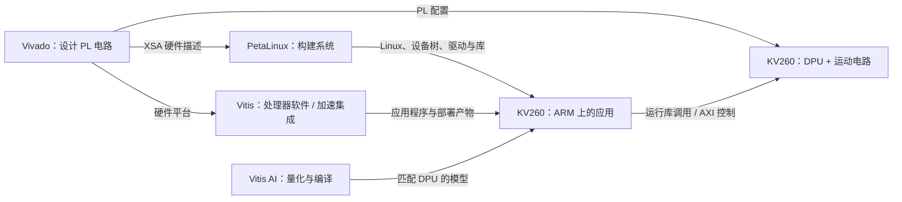

# AMD 四工具：整体入门与 KV260 学习路线

日期：2026-10-02。适合对象：希望整体理解 Vivado、Vitis、Vitis AI、PetaLinux 的初学者。示例采用本项目的 AURA / KV260：视觉识别、单水平轴运动、USB 录放音和交互。

建议学习顺序：**数字电路与编程基础 → Vivado → Vitis 的嵌入式软件流程 → PetaLinux → Vitis AI 的示例与模型部署 → 联合工程。** 各阶段通过小实验后再深入；工具的使用与基础知识可以穿插进行。

## 1. 先看懂你正在开发什么

KV260 使用 Kria K26 SOM，属于 Zynq UltraScale+ MPSoC 平台。理解本项目时，先抓住两个部分：

- **PS，处理系统**：包含 ARM 处理器及相关外设。本项目在这里运行 Linux、相机采集、视觉应用、运动服务和界面。
- **PL，可编程逻辑**：配置成数字电路。本项目希望在这里运行 DPU 和自研运动控制逻辑。

ARM 执行编译后的软件指令；PL 根据配置后的电路结构处理信号。比如软件可以算出“目标在画面右侧”，PL 中的 PWM 电路则按时钟持续产生控制脉冲。两者通常通过 AXI 互连交换控制和数据。

**DPU** 是本项目采用的神经网络推理加速 IP。它被集成到 PL 电路中；ARM 上的应用通过运行库提交任务，DPU 执行可支持的网络计算。AMD 的旧版 Vitis AI 文档明确覆盖 KV260，并允许通过 Vivado 或 Vitis 流程集成 DPU。参考：[Vitis AI 3.0 总览](https://xilinx.github.io/Vitis-AI/3.0/html/index.html)、[DPU 与系统集成](https://xilinx.github.io/Vitis-AI/3.0/html/docs/workflow-system-integration.html)。

这里的硬件 **IP** 指可复用的电路模块。例如 AXI GPIO、DPU、自研运动 IP；网络配置里的 IP 地址是另一个概念。

## 2. 四个工具分别负责什么

| 工具 | 主要解决的问题 | 常见输入与输出 | 本项目中的例子 |
|---|---|---|---|
| Vivado | FPGA 里要有哪些电路，如何连接，并满足资源和时序要求 | RTL、IP、约束 → 位流、硬件描述、实现报告 | 集成 DPU、AXI 控制口、运动寄存器和 PWM |
| Vitis | 为处理器开发软件；在加速流程中构建和连接硬件加速应用 | 硬件平台、C/C++ → ARM 程序；加速流程还涉及 XO、XCLBIN 等 | 用 C 程序读写外设；现有参考工程用 Vitis link 集成 DPU |
| PetaLinux | 根据平台构建与定制嵌入式 Linux 系统 | 硬件描述、BSP、配置、配方 → 启动组件、内核、设备树、根文件系统、SDK | 让 KV260 的 Linux 认识外设，并提供应用需要的系统和库 |
| Vitis AI | 把神经网络模型部署到目标 AI 加速器 | 模型、校准数据、目标 DPU 架构 → 量化/编译模型及应用部署 | 将人体检测模型编译为匹配 DPU 的 XMODEL，通过 VART 推理 |

对应官方入口：[Vivado UG910 2022.2](https://docs.amd.com/r/2022.2-English/ug910-vivado-getting-started)、[Vitis 嵌入式开发 UG1400 2022.2](https://docs.amd.com/r/2022.2-English/ug1400-vitis-embedded)、[PetaLinux UG1144 2022.2](https://www.xilinx.com/support/documents/sw_manuals/xilinx2022_2/ug1144-petalinux-tools-reference-guide.pdf)、[Vitis AI 模型开发](https://xilinx.github.io/Vitis-AI/3.0/html/docs/workflow-model-development.html)。

### Vivado：把设计落实成电路

先写 Verilog/SystemVerilog 描述逻辑，或连接已有 IP，再做仿真、综合、实现和位流生成。

- **仿真**：用输入激励检查功能，例如 PWM 周期是否正确。
- **综合**：把可综合的设计转换成逻辑资源和连接关系。
- **实现**：把逻辑放到器件的具体位置并完成布线。
- **时序分析**：检查信号传播时间是否满足时钟等约束。
- **位流生成与加载**：生成并加载 PL 配置。

仿真通过能支持功能正确性；实现报告用于检查实际资源与时序。需要分别掌握这两类证据。参考：[Vivado 仿真 UG900](https://docs.amd.com/r/2022.2-English/ug900-vivado-logic-simulation)、[设计分析与时序收敛 UG906](https://docs.amd.com/r/2022.2-English/ug906-vivado-design-analysis)。

### Vitis：先学处理器软件，再理解加速平台

Vitis 的范围比较大。入门时，先选“嵌入式软件开发”：从硬件描述创建平台，选择处理器与软件域，编译和调试一个 C 程序。软件域可以是裸机、FreeRTOS 或 Linux，具体选择由工程决定。参考：[UG1400](https://docs.amd.com/r/2022.2-English/ug1400-vitis-embedded)。

**裸机** 表示程序直接在处理器上运行，没有 Linux 这样的操作系统管理进程。裸机小实验有助于看清寄存器访问，但本项目的正式应用目标是 Linux。

本项目还有 Vitis 的加速平台流程：平台描述、DPU 的 XO、连接配置等经过链接和打包，得到部署产物。这个过程中会调用 Vivado 完成实际硬件工作。看到 Vitis 构建目录里有 Vivado 工程，是工具协作的表现。已有学习材料可结合 [2022.2 KV260 benchmark 官方参考目录](https://github.com/Xilinx/kria-vitis-platforms/tree/xlnx_rel_v2022.2/kv260/overlays/examples/benchmark) 和项目自己的构建报告来读。

**Vitis HLS** 用适合综合的 C/C++ 描述生成硬件。普通 C/C++ 的 ARM 编译流程与 HLS 流程具有不同的运行方式和约束。先掌握嵌入式软件与 RTL，随后再选一个小算法学习 HLS。

### PetaLinux：在开发机上制作板端系统

PetaLinux 是开发机上的系统构建工具，底层采用 Yocto 等构建机制。板上运行的是它生成或对应发布的 Linux 系统。

最先需要理解三个组成部分：**内核**负责操作系统和驱动；**设备树**描述硬件设备、地址、中断等信息；**根文件系统**提供用户程序、库和配置文件。随后再学启动组件、应用配方和 SDK。

硬件中新加一个 AXI 外设后，系统可能需要新的设备树描述及访问方式。设备树描述设备，驱动和应用按这个描述使用设备；实际电路由 PL 配置决定。参考：[UG1144 第 3—5、8、10—11 章](https://www.xilinx.com/support/documents/sw_manuals/xilinx2022_2/ug1144-petalinux-tools-reference-guide.pdf)。

### Vitis AI：模型准备和板端调用分开学习

本项目的旧版 DPU 路线可以分成两段：

1. 开发机准备模型：检查算子支持、校准与量化、按实际 DPU 架构编译。
2. 板端执行模型：ARM 应用准备输入，通过 VART 调用 DPU，然后处理输出。

**量化**把浮点权重和激活转换成适合目标计算的低精度表示，例如 INT8，需要验证精度变化。**编译**把量化模型映射到目标 DPU 的计算与指令结构。**推理**是使用已准备好的模型处理新输入。模型训练可以在 PyTorch/TensorFlow 等环境完成。参考：[Vitis AI 3.0 模型开发流程](https://xilinx.github.io/Vitis-AI/3.0/html/docs/workflow-model-development.html)。

## 3. 用“识别人并转向对方”串起四个工具

一次实际运行可以按下面的顺序理解：

1. Linux 中的相机服务取得一帧图像。
2. ARM 程序做缩放、颜色转换、归一化等预处理。
3. 应用通过 VART 把符合模型输入格式的数据交给 DPU。
4. DPU 执行被分配到它的网络计算。
5. ARM 程序做检测框解码、筛选、跟踪和目标选择。
6. 运动服务把目标位置转换成有明确单位和有效期的控制请求。
7. ARM 通过约定的寄存器访问方式把请求交给运动 IP。
8. 运动 IP 检查请求，并生成 PWM 或进入停止状态。

Vivado 对应 DPU 和运动电路；Vitis 对应处理器软件学习及当前参考平台的加速集成；PetaLinux 对应系统和硬件描述；Vitis AI 对应模型编译和推理接口。

图中是职责关系。实际发布包怎样组织、由哪个入口加载，继续采用已选参考工程的规则。

## 4. 遇到这些文件时，先知道它们装的是什么

| 文件或名称 | 初学者应掌握的含义 |
|---|---|
| `.v` / `.sv` | 电路描述源码；部分内容也可能仅用于仿真 |
| `.xdc` | 时钟、引脚、电气属性和时序等约束 |
| `.bit` / 对应 `.bit.bin` | PL 配置及其部署格式；加载入口决定需要哪一种格式 |
| `.xsa` | 导出的硬件平台信息；可包含位流，供软件和系统流程使用 |
| `.elf` | 编译链接后的软件可执行文件；还要核对处理器架构和运行环境 |
| `.dtb` / `.dtbo` | 编译后的设备树 / 设备树覆盖描述 |
| `arch.json` | 告诉模型编译器实际目标 DPU 架构 |
| `.xmodel` | 模型表示；本项目部署时使用匹配目标 DPU 的编译模型 |
| `.xpfm` | Vitis 平台描述，关联硬件与软件平台资源 |
| `.xo` | 加速流程中打包的硬件内核对象 |
| `.xclbin` | 加速部署包或运行时元数据容器；具体内容与平台流程有关 |

记忆优先级：先分清 **位流配置电路、XSA 描述硬件、ELF 执行软件、XMODEL 提供模型**。再理解系统描述与平台打包。

模型编译要使用正确的 `arch.json`，更换目标 DPU 架构可能需要重新编译模型。修改 JSON 字段不会改变实际硬件。参考：[Vitis AI 模型编译说明](https://xilinx.github.io/Vitis-AI/3.0/html/docs/workflow-model-development.html)。

## 5. 适合你的七阶段学习安排

下面是练习时间估计，合计约 **90—150 小时**，不含长时间构建等待。每天约 2 小时，可以按约 8—10 周安排，再根据基础和实验结果调整。阶段完成标准比日期更重要。

### 阶段 1：补齐基础，20—36 小时

**数字电路与 Verilog**：组合逻辑、触发器、时钟、复位、位宽、有符号数、阻塞/非阻塞赋值、模块连接、计数器、FSM、testbench。

**C/Python**：C 的指针、数组、位操作、编译链接；Python 的数组和图像处理。**Linux**：目录、文件、权限、串口、SSH、进程和日志。

项目里已有 [Verilog 两周学习计划，36 小时](Verilog两周学习计划_36小时.md) 和 [HDLBits 基础到 Adder3 笔记](HDLBits_学习笔记_基础到Adder3.md)，可以直接沿用。已有文件反映学习材料范围，具体掌握程度由练习确认。

**小实验**：先仿真已学过的加法器，再写带复位和使能的计数器，最后实现简化 PWM。

**完成标准**：自己预测几拍输出；解释复位和更新时机；用 testbench 比较预期结果；能够测出 PWM 周期及高电平宽度。

### 阶段 2：Vivado，从源码走到报告，12—18 小时

先学新建工程、选择正确器件、添加设计与仿真源码、设置顶层、运行行为仿真和看波形。之后学综合、实现、时钟约束、资源报告和时序报告。

**小实验**：把一个计数器或简化 PWM 完整走过仿真、综合和实现。随后打开当前 KV260 参考工程，识别 PS、AXI、时钟、复位、DPU 和地址分配的位置。

**完成标准**：能解释每个步骤的输入、输出；知道 LUT、FF、BRAM、DSP 大致表示什么；能找到关键告警、WNS/TNS 及约束缺口。评估时序时，同时核对时钟和约束是否完整、setup/hold 是否满足。

**先读**：[UG910](https://docs.amd.com/r/2022.2-English/ug910-vivado-getting-started) 的工程和 IDE 部分、[UG900](https://docs.amd.com/r/2022.2-English/ug900-vivado-logic-simulation) 的行为仿真与波形部分；报告分析再查 [UG906](https://docs.amd.com/r/2022.2-English/ug906-vivado-design-analysis)。

### 阶段 3：Vitis，让 ARM 使用硬件，10—16 小时

掌握 XSA、平台、处理器、软件域和 BSP。BSP 是与平台对应的驱动和库支持。理解 C 程序如何编译、链接、下载和调试，以及基地址加偏移怎样定位寄存器。

**小实验**：按适配 KV260 的教学流程创建 Hello World，查看串口输出；随后用已知的 AXI 外设完成一次寄存器读取和写回验证。实践使用独立教学工程或备用测试环境。

裸机练习可学习 `Xil_In32`、`Xil_Out32` 等接口。正式 Linux 应用根据平台采用驱动、UIO 或约定的运行时接口，分别学习权限、映射与访问范围。

**完成标准**：能把“硬件中的寄存器”对应到“软件中的地址、偏移、读写行为”；知道裸机程序与 Linux 程序需要不同运行环境。

**先读**：[UG1400](https://docs.amd.com/r/2022.2-English/ug1400-vitis-embedded) 中 Creating a Platform Project from XSA、Standalone Domain、Hello World、Debugging。

### 阶段 4：PetaLinux，让系统认识平台，12—20 小时

先在现有官方系统上练习登录、传文件、运行应用和查看日志，再学习参考系统的构建。了解 BSP、XSA 导入、内核配置、根文件系统、设备树、应用配方和交叉编译 SDK。

**交叉编译**是在开发机上生成供另一种处理器或目标系统执行的程序。SDK 中的编译器、头文件和库要对应板端系统；sysroot 可以理解为供编译链接使用的目标系统文件集合。

**小实验**：用匹配 SDK 编译一个打印版本信息的小应用，在板上运行；将应用加入独立系统构建副本，验证重启后仍可使用。然后按平台规定方式描述和访问一个简单 AXI 外设。

**完成标准**：可以解释内核、设备树、根文件系统各自负责什么；能区分编译失败、启动失败、驱动未识别和应用缺库；找到具体组件的错误日志。

**先读**：[UG1144](https://www.xilinx.com/support/documents/sw_manuals/xilinx2022_2/ug1144-petalinux-tools-reference-guide.pdf) 第 3—5 章，再根据实验读第 8 章和 SDK 相关内容。

### 阶段 5：Vitis AI，先理解已能运行的推理，8—12 小时

从匹配现有平台的 ResNet18 固定图片示例开始。学习输入尺寸、颜色顺序、布局、预处理、量化缩放、输出含义和 VART 调用。

**小实验**：固定图片、模型、程序和运行时，重复推理；记录输入输出，并确认实际调用 DPU。再分别记录预处理、推理、后处理时间。

**完成标准**：能沿着代码找到输入张量准备、DPU 任务提交、等待完成和输出解释；知道分类模型和检测模型具有不同输出与后处理；分别记录精度、推理时间和整条应用链的时间。

**先读**：[Vitis AI 3.0 总览](https://xilinx.github.io/Vitis-AI/3.0/html/index.html) 中 Model Deployment、VART 和 Library，再对照所用示例代码。

### 阶段 6：Vitis AI，自己完成量化与编译，12—20 小时

从工具链明确支持、容易建立正确性基线的小模型开始。学习算子支持检查、FP32 基线、代表性校准数据、量化精度评估、架构选择和 XMODEL 编译。

**小实验**：在开发机运行浮点模型并保存结果；按所用版本流程量化；使用实际 DPU 架构编译；在板端用相同评估输入运行并比较精度。校准样本用于确定量化参数，评估样本用于检查效果，两者用途要明确。

**完成标准**：能解释校准数据为什么影响量化；识别模型中的 DPU/CPU 执行部分；定位模型目标不匹配、算子不支持和预后处理错误；有量化前后精度及延迟对照。

**先读**：[Vitis AI 3.0 Developing a Model](https://xilinx.github.io/Vitis-AI/3.0/html/docs/workflow-model-development.html) 的 Quantization 与 Model Compilation。依照实际 Docker、框架和版本的示例执行。

### 阶段 7：联合工程，16—24 小时

第一项共同目标是：**同一次有效 PL 配置下，DPU 正确推理，ARM 能读取自研 IP 的 ID 和版本。**

实施顺序是：确认已有候选 DPU 包的板端对照结果；确定可修改的参考平台位置；加入最小 AXI-Lite 寄存器；核对地址、时钟、复位和资源；构建匹配部署包；验证寄存器访问与 DPU 共存；再扩展 PWM、命令有效期和停止/恢复行为。

**小实验**：实现 `IP_ID`、`VERSION` 和普通测试寄存器，读固定值、写入再读回，并运行固定图片推理。接着用仿真及实测波形确认运动控制行为，再接入视觉目标请求。

**完成标准**：有可重复的构建与运行入口、版本清单、同配置共存日志、资源和时序报告、PWM/命令验证记录。

## 6. 结合当前项目，学习从哪些成果接续

项目的 [当前现状三人分工](../方案/AURA_当前现状三人分工_2026-10-02.md) 和 [DPU 4.1 构建报告](../方案/三人分工依据_2026-10-02/DPU41_BUILD_REPORT.md) 记录了：已有官方系统推理历史证据；2022.2 官方参考构建完成；独立 DPU 4.1 候选包已完成主机构建与准备，板端加载和推理仍待验证。这里引用的是已有报告内容。

因此，理解现有工程与完成自己的小实验可以同时推进。先沿构建日志查清每个工具生成了什么，随后在教学副本中练习修改。

最新版 A 负责人手册还记录候选工程的 **CLB site 占用 99.50%、setup WNS +0.001 ns**。CLB site 占用是具体放置资源指标，不能直接当作所有资源均占用 99.50%。这一工程背景使资源、布局和时序报告特别值得学习；新增运动 IP 的可实现性仍需通过联合设计验证。参考：[A 负责人执行手册，第 1 章](../方案/AURA_三人执行总包_2026-10-02/01_A负责人_FPGA平台硬件与板端底座执行手册.md)。

当前范围采用 USB MCP01 录放音与视觉说话人判断。双 I2S 麦、声学方向计算和 `audio_doa_ip` 已从本版删除，学习与练习采用现行任务范围。

## 7. 版本和开发位置先固定

本项目资料采用 **Vivado/Vitis/PetaLinux 2022.2** 路线。学习时使用这套工程对应的文档、IP、镜像和运行组件。UG1144 2022.2 明确要求对应 Vivado 2022.2 导出的硬件设计。Vitis AI、DPU IP 和板端运行库具有各自版本号，需要分别核对。参考：[UG1144 安装要求，第 10—11 页](https://www.xilinx.com/support/documents/sw_manuals/xilinx2022_2/ug1144-petalinux-tools-reference-guide.pdf)。

**DPU 4.1 表示 DPU IP 的版本。** 本项目报告使用来自 Vitis AI 3.0 对应归档的 DPU 4.1；AI 工具链版本与 DPU IP 版本不能由同一个数字推定。实际 VART、XRT 和模型目标以所用环境与发布包为准。

截至本次核对，AMD 当前 Vitis AI Developer Hub 的最新公开支持路线重点是 Versal AI Edge 与其 Gen 2，并单列旧版 DPU 文档。KV260 的现有 DPU 工程应采用对应旧版资料作为学习起点。参考：[AMD Vitis AI Developer Hub](https://www.amd.com/en/developer/resources/vitis-ai.html)。

| 位置 | 学习时做什么 |
|---|---|
| Windows 开发机 | 编辑代码、Verilog 小实验、文档与项目管理；按现有安排使用已装工具 |
| Ubuntu 构建机 | 当前平台的 Vivado/Vitis 构建、PetaLinux、匹配的 Vitis AI 模型开发环境 |
| KV260 | 加载部署包，运行 ARM/Linux 应用、调用 DPU、验证 PL 外设 |

PetaLinux 2022.2 的官方支持构建环境列出的是相应版本的 Linux 系统，例如 Ubuntu 20.04/20.04.x。沿用已工作的构建环境；如需重新准备，先核对该版本安装要求。板端 PetaLinux 与主机 Ubuntu 的版本用途不同。参考：[UG1144 安装环境](https://www.xilinx.com/support/documents/sw_manuals/xilinx2022_2/ug1144-petalinux-tools-reference-guide.pdf)。

## 8. 改动后，判断需要重新生成什么

| 改动 | 通常需要检查或更新的部分 |
|---|---|
| Python 业务逻辑、C/C++ 应用 | 应用及依赖；C/C++ 按目标系统重新编译链接 |
| 模型权重或网络结构 | 算子支持、量化、编译模型与精度/性能验证 |
| DPU 架构或配置 | 硬件、架构描述、模型目标，以及相关运行时和部署包的匹配 |
| AXI 地址、中断或外设连接 | PL、导出的硬件描述、设备树和软件访问配置 |
| 系统包、内核选项、驱动 | 对应 PetaLinux 组件、SDK/依赖和系统验证 |
| PWM 逻辑或引脚 | RTL 仿真、约束、实现及实际输出验证；接口变化时同步软件 |

实际重建范围依赖当前参考流程。保留每次改动的输入、输出和版本，有助于判断问题来自哪一层。

## 9. 每次学习的做法与今天的第一步

每次约两小时，可采用：20 分钟复习概念、20 分钟查对应文档、70 分钟完成一个小实验、10 分钟记录结果。碰到构建等待，可并行阅读波形、源码和报告。

今天先做三件事：

1. 画出“ARM/PS、PL/DPU、运动 IP、Linux 应用”的连接，并标出四个工具各自负责的部分。
2. 将笔记中的 Adder3 或另一道已经理解的组合逻辑题放入 Vivado，添加 testbench，检查正常输入及进位边界。
3. 根据现有工程资料建立版本表，分别记 Vivado、Vitis、PetaLinux、DPU IP、Vitis AI、VART/XRT、模型和参考源码；未核实的字段留空并注明来源。

接下来沿用已有 Verilog 两周计划，重点补上时序逻辑、计数器、状态机和 testbench。进入系统集成前，完成一次“软件读写硬件寄存器”的小实验。

每个实验结束保存五项：**目标、输入/版本、步骤、实际结果、失败原因及修正**。对照教程操作后，再从空白重做一次；通过独立重做检验掌握程度。

## 10. 入门后的深入方向

| 方向 | 后续深入内容 | 对项目的价值 |
|---|---|---|
| Vivado | AXI-Lite、CDC、复位、时序约束、ILA、IP 封装、Tcl 构建 | 稳定实现并调试自研运动 IP |
| Vitis | Linux 应用调试、交叉编译、链接；平台/XO/link 流程；适当的 HLS 实验 | 理解现有 DPU 集成流程及应用与硬件的关系 |
| PetaLinux | 设备树与驱动、Yocto 配方、SDK/sysroot、服务管理、版本固定 | 形成可复现的板端底座 |
| Vitis AI | 算子支持、量化误差、CPU/DPU 分工、模型适配、性能分析 | 把真实检测/身份模型可靠部署到板端 |

逐步以自己的实验回答：电路怎样由代码生成，程序怎样访问电路，Linux 怎样认识设备，模型怎样调用 DPU。能够完整解释并复现这四条关系，就是进入深入学习的起点。

## 11. 视频清单：观察工具操作，再迁移到 KV260

2026-10-02 补充。视频依据公开视频页面、作者介绍与章节目录筛选。下面标明同板与其他板卡课程，以及推荐观看部分；实际跟做采用本项目的 2022.2 工具和匹配平台。

### 11.1 推荐观看顺序

| 顺序 | 视频 / 课程与作者 | 建议观察什么 | 在 KV260 上怎样使用 |
|---|---|---|---|
| 1 | [KV260 硬件开发流程：Vivado、Vitis、PetaLinux 怎样配合](https://www.bilibili.com/video/BV1dQ4y1D7CH/)；吃猫粮的耗子 | 看清工程输入、导出文件和各工具之间的交接；页面列出的时长为 16:10 | 同板的旧版流程介绍；看完画自己的工具关系图 |
| 2 | [正点原子：ZYNQ FPGA 开发篇](https://www.bilibili.com/video/BV1XU4y1M7nw/)；正点原子官方 | 先看 4.1—4.3 的 Vivado 使用、6.1—6.2 的仿真；随后看第 7 章时序约束 | 配套启明星 V2，先用通用操作做加法器/计数器仿真；本地工程选自己的器件和平台 |
| 3 | [KV260 的 Vivado 官方工程是什么样子](https://www.bilibili.com/video/BV1e34y1m7i7/)；吃猫粮的耗子 | 观察 KV260 参考工程的结构、模块连接与平台设置 | 对照自己的 2022.2 参考工程逐项定位 PS、AXI、时钟、复位和 DPU 的集成位置 |
| 4 | [正点原子：嵌入式 Vitis 软件开发篇](https://www.bilibili.com/video/BV1Et421H75m/)；正点原子官方 | 先看第 1 讲与 2.4—2.6：MPSoC 最小系统及 Hello World 软件；随后学习 GPIO/AXI 外设访问 | 课程包含 ZYNQ 和 MPSoC，优先选择 MPSoC 内容；用 KV260 的硬件描述、处理器与外设配置建立教学工程 |
| 5 | [创建一个 Vitis 加速平台：KV260](https://www.bilibili.com/video/BV1DF411Y73a/)；吃猫粮的耗子 | 观察硬件导出信息如何进入 Vitis，以及平台怎样组织 | 同板的旧版教程；结合现有构建来源理解 XSA、平台和加速链接，使用自己的 2022.2 工程 |
| 6 | [ALINX MPSoC：PetaLinux 定制 Linux 系统](https://www.bilibili.com/video/BV1qd4y1o7C9/)；ALINX 官方 | 先看合集第 1、2、3、7 项：系统定制、加入应用、交叉编译、Vitis Linux 应用；寄存器访问再看第 18 项 | 配套 ALINX MPSoC 开发板，介绍中工具为 2020.1；在 KV260 上替换为匹配的 BSP/XSA、SDK 和设备树 |
| 7 | [ALINX MPSoC：Vitis AI 开发流程](https://www.bilibili.com/video/BV1iR4y1k7wn/)；ALINX 官方 | 学习模型开发与部署的整体操作流程；同合集可补简介、Docker 与推理示例 | 通用 MPSoC 教程；学习步骤，实际模型准备使用项目匹配的 Vitis AI 版本与 DPU 架构 |
| 8 | [KV260 上部署 YOLO：VVAS 模型部署指南](https://www.bilibili.com/video/BV1YP4y1G7Bn/)；吃猫粮的耗子 | 观察检测模型如何接入视频应用；页面列出的时长为 1:04:33 | 同板的旧版 VVAS 路线；用于理解视频链路，是否采用 VVAS 由当前项目设计决定 |

补充按需观看：

- [KV260 从上电到启动 Jupyter](https://www.bilibili.com/video/BV1Gb4y1a76u/)：适合观察板卡上手流程；当前工程是否使用 Jupyter 取决于镜像和运行入口，登录与示例以当前平台说明为准。
- [Vitis AI 应用开发：AI Library 简介](https://www.bilibili.com/video/BV1W44y1V7GD/)：补充理解高层推理 API，页面列出的时长为 15:54。
- [KV260：从 Ubuntu 应用到 Yocto/PetaLinux](https://www.youtube.com/watch?v=aMUCKocarpk)：Kestrel Omnitech 的英文同板视频，介绍应用与系统构建环境的衔接，作为 PetaLinux 部分的补充。

### 11.2 视频中的流程怎样对应到你自己的板子

**Vivado**：在自己的工程中重复新建、添加源码、仿真和查看报告的操作。板卡选择、PS/DDR 配置、时钟和引脚约束采用 KV260 来源。其他开发板的 LED 引脚和 XDC 无法仅凭课程名称推定适合 KV260。

**Vitis**：先区分“ARM 嵌入式软件”和“Vitis 加速平台”。Hello World 练习教处理器软件；KV260 平台创建视频教硬件与加速应用的组织。使用自己的 XSA、处理器和软件域，记录实际寄存器地址。

**PetaLinux**：按相同顺序理解创建、导入硬件、配置、构建和应用部署。输入改为匹配版本的 KV260 平台与 BSP，启动方式沿用当前系统方案。官方 UG1144 2022.2 要求使用对应 Vivado 2022.2 的硬件设计：[版本要求与操作参考](https://www.xilinx.com/support/documents/sw_manuals/xilinx2022_2/ug1144-petalinux-tools-reference-guide.pdf)。

**Vitis AI**：将视频中的模型、预处理、运行库调用和后处理分别找出来。先用当前匹配平台的 ResNet18 固定图片验证，再准备自己的模型。模型编译使用真实目标 DPU 的 `arch.json`，具体算子、量化与编译按对应版本说明核对：[Vitis AI 3.0 模型开发与编译](https://xilinx.github.io/Vitis-AI/3.0/html/docs/workflow-model-development.html)。

2022.2 的平台学习配套入口：[AMD/Xilinx Vitis Tutorials 的 KV260 平台目录](https://github.com/Xilinx/Vitis-Tutorials/tree/2022.2/Vitis_Platform_Creation/Design_Tutorials/01-Edge-KV260)。它用于对照平台创建；本项目的具体 DPU 配置、部署格式和集成修改仍以现有冻结参考及构建报告为准。

### 11.3 五个具体练习

1. **只做仿真**：在 Vivado 中新建自己的工程，将已掌握的加法器、计数器或简化 PWM 加入，建立 testbench 并核对波形。保存源码和结果。
2. **观察自己的平台**：打开 2022.2 KV260 参考，画出 PS、AXI、时钟、复位和 DPU 的关系。列出 XSA、XO、BIT、XCLBIN、设备树和模型各自对应的用途。
3. **让程序在板上运行**：用匹配的 SDK 编译一个小型 Linux 应用，在现有 KV260 系统上运行，记录编译环境与板端输出。裸机 Hello World 可以作为独立教学练习。
4. **读写最小外设**：在教学平台中增加 ID、VERSION 和测试寄存器，构建配套硬件/系统描述，使用明确的访问方式读取并验证写回。基地址从本次工程取得。
5. **证明共同运行**：在同一次有效配置下读取自研寄存器，并运行匹配 DPU 的固定图片推理；随后才加入运动控制和实时相机链。

看每个操作时记录四项：**输入是什么、点了什么/执行了什么、生成了什么、如何证明结果正确**。视频暂停后先自己完成，结束后关掉视频独立重复，记录与教程不同的地方及修改依据。

## 12. YouTube 视频清单

2026-10-02 补充。清单依据公开视频标题、简介及官方/作者课程目录筛选。推荐顺序为工具基础、KV260 平台、处理器软件、Linux 系统、AI 模型部署；实际跟做沿用本项目的 Vivado/Vitis/PetaLinux 2022.2 基线。英文视频可以结合自动字幕和工具界面观察，字幕中的专有名词再对照文档。

### 12.1 四个工具的入门视频

| 顺序 | 工具 / 视频与作者 | 建议观察什么 | KV260 实践及适配 |
|---|---|---|---|
| 1 | Vivado：[Step-by-Step Guide to Vivado Simulation: From Design to Verification](https://www.youtube.com/watch?v=pPoG1nbIxAw)；Anmaya，2023 | 建立工程、testbench、行为仿真、波形分析与调试 | 先用自己的加法器/计数器练习，完成电脑端仿真 |
| 2 | Vivado / KV260：[How to display kria kv260 Vision AI Starter Kit board interfaces in vivado?](https://www.youtube.com/watch?v=T8PqXgYUPwY)；Nielfotech，2022 | 观察 KV260 板卡接口如何显示在 Vivado 中 | 用于熟悉板卡接口和工程设置，再对照自己的 2022.2 参考平台；该视频范围是接口显示 |
| 3 | Vitis 概览：[Vitis Introduction for Embedded Software Development](https://www.youtube.com/watch?v=PpcKrI1fBpk)；AMD 官方开发者入口推荐 | 理解 Vitis 在嵌入式软件开发中的位置 | 先理解硬件描述、软件平台与处理器应用之间的关系 |
| 4 | Vitis 实操：[Xillinx Vitis Introduction — Hello World with Vitis](https://www.youtube.com/watch?v=LU9hP7KLDgE)；Vipin Kizheppatt，2021 | 从 Vitis 入门到 Hello World 程序 | 用 KV260 自己的 XSA、处理器和软件域建立独立教学工程；这是旧版教程，具体版本和板卡不能由标题推定 |
| 5 | PetaLinux：[ZYNQ Ultrascale+ and PetaLinux (part 05): SPI, I2C and GPIO interfaces (Building PetaLinux)](https://www.youtube.com/watch?v=s0JlMqe9Ang)；Mohammad S. Sadri | 观察 Linux 系统构建操作，以及硬件工程与系统构建的衔接 | 配套 ZCU102；跟做时使用 KV260 的匹配 BSP/XSA、设备树和启动方案。作者注明配套设计源码需捐赠获取 |
| 6 | Vitis AI：XUP 的 [Introduction](https://www.youtube.com/watch?v=D1xepeBiJfo) → [Deep Learning Processor Unit](https://www.youtube.com/watch?v=eUgiAcfgyz4) → [Quantizer](https://www.youtube.com/watch?v=bjXHoERqYjU) → [Compiler](https://www.youtube.com/watch?v=mPBv39wTrqs) | 理解 DPU、量化与模型编译分别做什么 | 属于基础讲解，先建立概念，再用本项目匹配平台的 ResNet18 做固定图片实验；编译目标取真实 DPU 架构 |

官方/作者目录可用于核对视频出处与上下文：[AMD Vitis Developer Hub](https://www.amd.com/en/developer/resources/vitis.html)、[Sadri 的 Zynq UltraScale+ / PetaLinux 课程目录](https://googoolia.com/zynq_course.html)、[XUP Vitis AI 视频目录](https://xilinx.github.io/xup-vitis-ai-tutorial/presentations.html)。XUP 配套实验有 AWS F1 内容，KV260 实验应采用 MPSoC/KV260 的匹配流程。

### 12.2 KV260 同板视频

- [Xilinx Demonstration of the Out-of-the-Box Experience with the Kria KV260 Starter Kit](https://www.youtube.com/watch?v=XwSvCLU6ZgU)：Edge AI and Vision Alliance，2021；由 Xilinx 的 Karan Kantharia 演示开发板和 Smart Camera 的上手流程。适合作为整体预览，认识连接和运行结果。
- [AMD Xilinx Kria KV260 Vision AI Starter Kit: Taking an app from Ubuntu to Yocto/PetaLinux](https://www.youtube.com/watch?v=aMUCKocarpk)：Kestrel Omnitech Inc.，2023；观察 Ubuntu 应用转到 Yocto/PetaLinux 环境的过程，包含板上构建应用和 Smart Camera 测试。用于理解应用与系统环境的关系；完整主机端系统构建操作另看上面的 Sadri 课程。
- [YOLOv5 on KRIA KV260 — Quantization, Compilation & Edge AI Deployment with Vitis AI](https://www.youtube.com/watch?v=vi2XgS4sPvo)：Deep knowledge，2026；作为进阶参考。视频简介列出 YOLOv5 适配、量化、`vai_c_xir` 编译、DPU 子图检查和推理部署。观看时记录其实际工具版本、模型修改与目标架构，确认匹配后再迁移代码；先完成自己的 ResNet18 实验。

### 12.3 按需补充的深入视频

- Vivado 硬件与 XSA：[ZYNQ Ultrascale+ and PetaLinux (part 07): Folder structure, Vivado Projects](https://www.youtube.com/watch?v=iJAVGT9olYo)。Sadri 课程使用 ZCU104/ZedBoard，讲解硬件结构以及 BIT/XSA 生成；适合观察硬件怎样交给后续软件工具。
- PetaLinux 设备树与内核：[ZYNQ Ultrascale+ and PetaLinux (part 17): Customizing Linux kernel and devicetree](https://www.youtube.com/watch?v=WyVLb0ykaF4)。学会基本构建后观看，结合自己的外设和设备树做练习。
- 新版 Vitis 界面：[Getting Started with Vitis Unified IDE for Embedded Design](https://www.youtube.com/watch?v=pDA1JZg7J-8)。AMD 官方，2025；介绍新 IDE、平台、Hello World 与板卡连接。用于认识新版界面；本项目 2022.2 中的菜单、工程组织与操作入口需要按旧版文档对照。
- KV260 AI 应用案例：[LogicTronix YouTube 频道](https://www.youtube.com/channel/UC1pUUzFausRcaEXKgx7u14w)。作者的 KV260 页面链接了该频道；按 KV260/DPU 主题选看，并逐项确认示例版本。

### 12.4 看完后的最小成果

1. Vivado 仿真：自己的 testbench 能检查加法器或计数器结果，能够解释关键波形。
2. KV260 工程：在现有参考工程中找到 PS、AXI、时钟、复位，知道导出的 XSA 将给谁使用。
3. Vitis 软件：在独立教学平台上看到 Hello World 输出；记录使用的处理器、软件域、串口和运行方式。
4. Linux 系统：理解匹配硬件导入、系统配置、构建及启动的顺序；在自己的 KV260 环境运行小应用并记录输出。
5. AI 部署：在匹配 DPU 与运行库的环境里完成固定图片推理，能够说明量化模型、编译模型和目标 DPU 的关系，再扩展到 YOLO。

每次只完成一个成果。先照视频观察和操作，再独立重复；遇到不同界面时，记录视频版本与本项目版本，依据对应版本文档调整。
