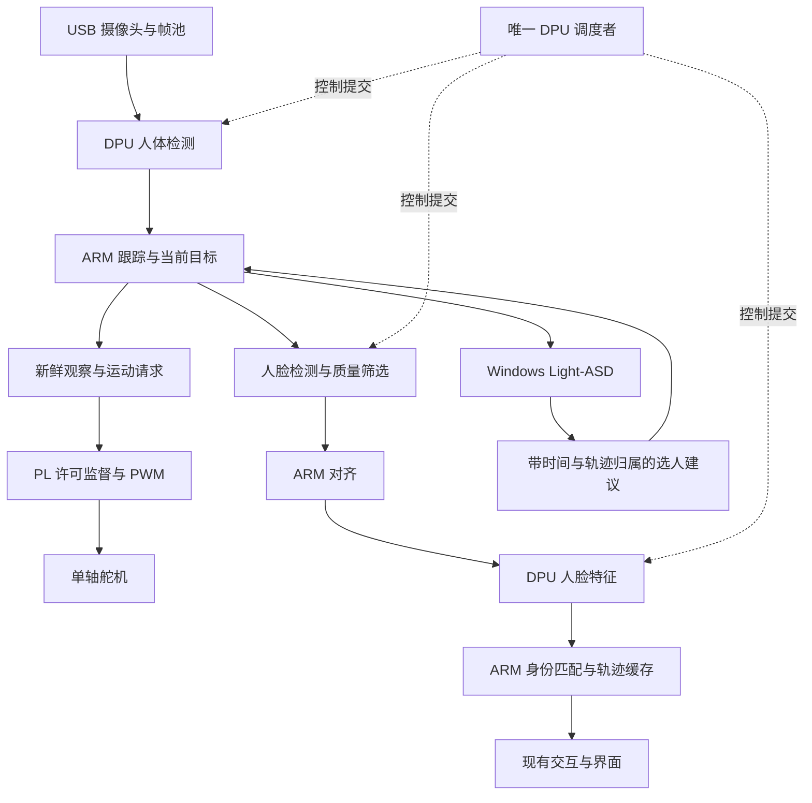

# AURA：论文方法加入项目的实施建议

日期：2026-10-04。性质：结合当前材料的设计建议，尚未实现或板测，不替代团队已经冻结的接口与验收合同。

## 1. 推荐组合与先后顺序

建议把近期工作集中到三个模块：**共享 DPU 的新鲜帧调度、按质量与轨迹触发的人脸身份链、PL 独立运动许可与 PWM**。模型剪枝作为有训练与验证条件时的优化；图像预处理 HLS 在实测确认瓶颈后加入。

第一份报告中的 MobileFaceNets / ArcFace / ByteTrack 为视觉与身份提供候选方法，运行时验证提供监督思想。第二份报告中的资源感知剪枝、SATAY / H2PIPE、NAF / TAPA 分别提供模型、数据流与实现优化的参考。以下组合是 AURA 的工程设计，不能称为完整复现这些论文。

当前判断依据：

- [10月3日后续开发评估](C:/Users/uuh56/Desktop/项目/output/AURA_KV260_后续开发与环境缺项评估_2026-10-03.md)记录 DPU B4096 / 单 CU 基线和 M3 最小 AXI-Lite 联合验证；PWM、运动监督和目标应用仍需验收。
- 同一材料记录 M3 的 LUT 60.23%、CLB site 99.45%、URAM 87.50% 和约 +0.009 ns 时序余量；这些属于历史候选配置证据，新增逻辑是否可放置必须重跑联合实现。
- 最新 B 手册已有 B07/B08 身份、B11 共享 DPU、B12 视觉运动；A 手册已有 A05—A09 原子命令、PWM、租约与联合实现。加入论文方法应落在这些工作包内。
- [共享 aura 仓库](C:/Users/uuh56/Desktop/项目/共享文件夹/aura/README.md)已有 C 岗的 UI、事件、语音和通信代码；它们的存在不代表目标板验收通过。新增视觉结果应经约定接口接入这些消费者。

## 2. 加入后的系统结构

人脸检测的位置先按真实可运行模型确定，可在 ARM 或 DPU；图中的 FACE 不能视为已在 DPU 验收通过。检测、跟踪、身份和运动各有有效性判断，姓名缓存不能用于延长运动许可。

## 3. 模块一：共享 DPU 调度与新鲜帧管理

**位置：**B 负责的相机服务、视觉服务和 B11 调度。现有正式运行只保留一个业务 DPU 入口。

具体做法：

1. 人体检测使用最新有效待处理帧。应用层可只保留一个待处理检测请求；相机仍有受控缓冲池，已被任务引用的图像不能覆写。
2. 身份仅对当前有效目标和合格新脸触发；限制在途任务、人数与最小触发间隔，不把所有人每帧排入全链。
3. 每个任务带源帧、采集时刻、截止时刻和轨迹代次，提交前和返回后均检查期限。来源为驱动出队时间时如实标注，不声称曝光时刻。
4. 首版按已提交任务不可瞬间抢占规划。检测优先决定下一次提交；长人脸任务运行期间仍会阻塞下一次检测。
5. 允许提交身份前，检查其测得服务时间、下一次检测与相关 ARM 工作是否有时间预算；达不到预算时延后身份或选择更轻的模型。
6. 相机重连、DPU 服务重启或轨迹代次变化后清掉旧请求。UI 的最新帧策略不代替推理队列的最新帧策略。

实测中分别记录等待、推理、预后处理和结果帧龄。平均占用初估可使用“各任务触发率 × 平均服务时间”的总和，但低于满载不证明长尾或帧龄达标；P95/P99 和超期率仍需在实际并发中测量。

**论文关系：**参考 SATAY / H2PIPE 对数据流、缓冲和停顿的关注；本模块为应用层调度，不是 SATAY 的逐层硬件流水或 H2PIPE 的 HBM 控制器复现。[SATAY 原文](https://arxiv.org/abs/2309.01587)、[H2PIPE 原文](https://arxiv.org/html/2408.09209v1)

**应展示的对照：**同模型、同输入与同身份策略下，FIFO 顺序处理与丢旧保新的调度对比；加入身份后，人体有效检测率、P95 帧龄和超期率怎样变化。

## 4. 模块二：轻量人脸身份、质量筛选与缓存

**位置：**B07/B08 的板端身份链。MobileFaceNet 可作为优先评估的特征网络候选；ArcFace 提供训练方法或已训练特征网络的来源，不是需要在 FPGA 上实时运行的训练损失。

加入顺序：

1. 取得实际人脸检测、关键点/对齐和特征网络的代码与权重，先建立板端 CPU 的完整参考输出。
2. 核查每个模型的 DPU 算子及图结构，量化并按实际 arch.json 编译。人脸检测和特征网络分别验收，不能将 MobileFaceNet 当作全链实现。
3. 用人脸尺寸、清晰度、曝光、姿态和关键点有效性筛选输入；不合格输入返回可解释状态，避免浪费特征推理和误认。
4. 初次出现、当前目标切换、身份未确认或确认到期时触发识别；身份稳定期间缓存结果，并按固定策略使用合格新证据复核。
5. 缓存绑定 board/camera 代次、track_id + track_generation、模型特征空间与数据库版本。跨人、重建轨迹、换模型或更新身份库时失效；低质量帧不能无限续期。
6. 特征进行维度、有限数、非零范数与归一化检查。陌生人测试必须保留；未知身份可以继续普通交互，不能为认出姓名而放松误认约束。

[KV260 MobileFaceNet 参考仓库](https://github.com/whattflib123/kv260_face_recognition)已有推理与编译参考，但上一轮发现训练定义、原始权重和校准材料不齐，不能据此承诺全链复现。[ArcFace 官方训练实现](https://github.com/deepinsight/insightface/tree/master/recognition/arcface_torch)

**剪枝在这里加入，但放在完整基线之后：**有训练数据和可微调模型时，比较原模型、INT8、实际删除通道并微调后的 INT8。按真实 DPU 并行度和板上延迟选择通道规模，不能只按参数量排序。保持同一位流时，优化的是模型计算与数据需求，已综合的 PL LUT/DSP 不会自动减少。[AMD Vitis AI 3.0 模型开发流程](https://xilinx.github.io/Vitis-AI/3.0/html/docs/workflow-model-development.html)

若暂时没有训练条件，先完成质量触发、缓存与调度实验；不把大规模训练作为单人闭环的前置条件。

## 5. 模块三：把视觉新鲜度接到 PL 运动许可

**位置：**B12 motion_service 与 A05—A09 运动 IP。此模块对应当前项目已经规划的监督职责。

PS 负责验证最新真实观察、目标与图像时刻，PL 负责命令完整性、顺序、剩余租约和最终输出门控。PL 本身不能判断图像语义是否真实；两侧责任需要分别测试。

关键行为：

- 许可期限来自源观察的时刻；不能把推理完成时间重新当成拍摄时间，也不能因程序仍有心跳就续许可。
- B 在提交时计算源观察还剩多少有效时间，再扣除约定的传递预算；没有正的有效预算就不提交运动命令。新硬件接口沿用团队冻结的时间单位与版本。
- A 用 PL 自己的计时器使许可到期；拒绝重复/乱序/旧代次/半写命令时不续租。
- 正常脉宽在 PWM 周期边界更新；角度范围、变化率、停止与恢复按实际标定和六态合同实现。
- 相机停帧、目标失跟、程序退出或许可到期后，执行约定禁能行为；恢复连接不自动重新允许运动。

**对照实验：**冻结相机输入但让程序持续运行；阻塞视觉线程；注入迟到结果；重复提交旧命令；制造不完整提交。关联 frame→job→command→PWM 时间线，检查许可到期和拒绝原因。

记录的是数字许可和 PWM 行为；没有机械反馈时，不能将其等同为真实轴角闭环或机械立即停止证明。位置映射与最终负载行为另做实际验收。

## 6. 后续 HLS 与论文硬件复现如何加入

| 方法 | 在当前项目中的使用方式 | 进入条件 |
|---|---|---|
| SATAY / fpgaConvNet | 研究 YOLO 硬件流水、DDR 缓冲与驱动；近期先落实帧池与模型数据复用 | 已有端到端计时；明确搬运瓶颈 |
| 图像预处理 HLS | 可以评估融合裁剪、缩放、颜色转换的单核；按现平台 DDR / DMA 路径接入 | ARM 预处理确为瓶颈，含传输与拷贝后的端到端收益为正，联合资源/时序通过 |
| hls4ml 资源感知剪枝 | 在独立小模型实验中完整生成原/剪枝 HLS，比较精度与布局布线资源 | 模型、训练数据、工具版本和源分支可取得；不用它的资源公式预测固定 DPU |
| TAPA | 自研多个 HLS 任务并行时评估工具链与布局方法 | 已明确任务划分和 KV260 集成路径；引入工具的收益大于适配成本 |
| FILM-QNN | 阅读混合精度与资源均衡思路，当前实现采用目标 DPU 支持的量化路线 | 若将来开发 W4/W8 自定义计算核，再作为硬件研究 |
| NAF | 按实测选择模型规模、输入尺寸、身份频率和队列配置 | 固定验证集和延迟约束，参数搜索结果可以重复 |
| H2PIPE | 借鉴缓存、FIFO 和存储等待分析 | 只能将适用于 DDR 的部分重新设计；KV260 没有论文要求的 HBM |

模型参数枚举应围绕“满足身份/检测质量与帧龄要求的最低运行负担”选择，不能将所有指标合成未经解释的创新分数。效果来自真实测量，不来自引用论文的原平台成绩。

## 7. 实验矩阵与团队落点

算法实验与运动监督实验分开比较，确保每次变化的原因可解释：

| 实验 | 控制变量 | 主要指标 |
|---|---|---|
| CPU 与 DPU | 同源模型、输入、预后处理与阈值 | 输出一致性、检测/身份质量、推理与整链耗时 |
| FIFO 与最新帧调度 | 同模型、相机/回放负载、人数、身份触发规则 | 有效检测率、P95/P99帧龄、超期与丢弃计数 |
| 每次识别与按质量/轨迹触发 | 固定模型、质量样本与身份测试集 | 身份调用次数、误认/拒认、确认耗时、检测受阻时间 |
| 原模型与量化/剪枝模型 | 同独立验证集与任务要求 | 检测/身份质量、实际 DPU 延迟、数据需求；保持位流时 PL 资源记同值 |
| 运动监督异常注入 | 相同命令序列和硬件时钟参数 | 到期/拒绝/恢复、PWM周期/抖动、旧命令是否重新生效 |
| 可选预处理 HLS | 同分辨率、像素格式、ROI和模型 | 含DMA/拷贝的整链耗时、CPU负载、联合资源与时序 |

每次测试同时记录配置、代码/模型/硬件版本和实际启用服务；显示、音频、网络加入后再做并发测量。FPS 必须说明是模型推理、有效新检测还是预览，不能把同一帧的多次显示计成新的视觉观察。

- **A：**先交付 DPU+PWM/监督的同配置实现、访问库与异常波形，再考虑可选 HLS。固定计时和许可合同，避免热路径大算术。
- **B：**先跑通真实相机的人体检测/跟踪与单人运动请求；再加入人脸检测/特征、质量缓存与 B11 调度；最后评估有数据支持的剪枝。
- **C：**接收当前轨迹、身份和运动状态，复用现有 UI / 事件接口；Light-ASD、ASR/VLM/TTS 继续按当前 Windows 路线集成。ASD 返回选人建议，由 B 复核新鲜度和归属后决定是否运动。

首次交付以“真实新帧→人体检测/跟踪→受许可的单轴运动”为目标；第二次加入目标身份；第三次完成并发调度与对照表。期限、身份更新间隔、最大人数和性能阈值由真实板端数据确定，本建议没有新增已验证的数值承诺。
