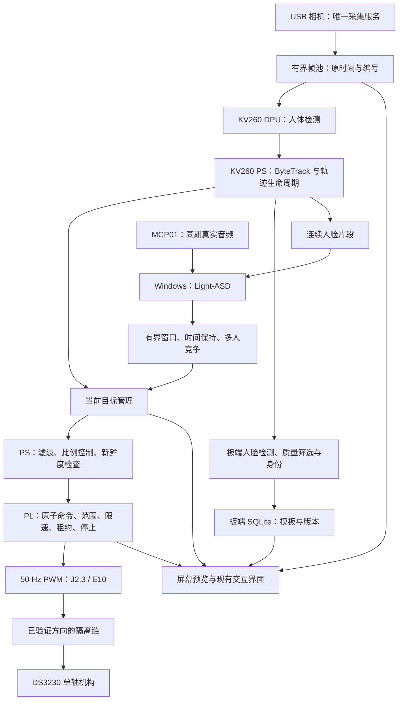

# AURA / KV260：视觉与舵机算法详细实施规划

日期：2026-10-06。性质：依据当前有效计划书和最新实测整理的实施规划；本文不代表完整视觉随动已经实现。原规划阶段只整理资料；后续“两项适配”加入了明确标注的真实编译、仿真和板测更新，详见 [适配验证报告](/home/ghmd/kv260-adaptation-check-20261006/ADAPTATION_REPORT.md)。适配期间未切换板端 FPGA 配置或启动舵机。

## 1. 采用哪份计划，以及当前实际起点

### 1.1 资料优先级

采用用户更正后的“较新有效计划优先”。完整范围以[无声源定位完整实施方案](../方案/AURA_KV260_完整实施方案_无声源定位版_2026-09-30.md)为依据，尤其第 9—11、13、20、25—28 章；具体工作包以[三人执行总包](../方案/AURA_三人执行总包_2026-10-02/)为依据。10 月 4 日[论文方法实施建议](AURA_论文方法加入项目的实施建议_2026-10-04.md)补充模型、缓存、调度和优化候选，不把其中研究建议视为已冻结实现。

已先读取 `/home/ghmd/下载/项目.zip` 的 README 和相关原件，再核对共享版本。完整实施方案与 ZIP 原件逐字节相同；共享的 A/B/C 手册各比 ZIP 版本增加 219 行环境放行说明，采用共享较完整版本。源文件快照、SHA-256 和差异保存在[资料核对目录](/home/ghmd/kv260-vision-motion-plan-20261006/)，其中 `SOURCE_COMPARISON.json` 可复核版本关系。

较新的实际证据覆盖文件中的旧状态：“最小 M3 尚未上板”“摄像头尚未确认”等早期描述已过时。此前[首轮协同建议](视觉舵机协同实施_2026-10-06.md)和[最早计划核对](最早计划书_视觉舵机核对_2026-10-06.md)保留历史，本规划作为本轮接续依据。

### 1.2 已验证与尚未验证

| 内容 | 最新可核验事实 | 当前不能推出的结论 |
|---|---|---|
| USB 相机与屏幕 | 已采到真实图像，全屏预览有连续帧，用户已确认屏幕画面正常 | 人体检测、跟踪、身份和 ASD 已经运行 |
| 采集性能 | 640×480 YUYV 路径通过短时预览；一次两秒计数增加 25 帧 | 请求 30 fps 等于实际稳定 30 fps，或已满足检测频率 |
| 舵机电气/动作 | J2.3 / E10 的静态电平与 PWM 有测试；用户确认 1.4/1.6 ms 往返测试使舵机左右运动 | 任意角度可控、完整行程安全、最终负载标定完成 |
| M3 与 DPU | 同一 M3 配置内身份/SCRATCH 和 ResNet18 推理通过有限板测 | 完整 PWM、运动监督和 DPU 已共存 |
| 当前台架程序 | `aura-pin3-sweep` 固定 50 Hz，1400/1600 μs 各保持 50 帧，有 START/STOP | 它能接收视觉目标角；其脉宽遥测当前是只读参数 |
| 最近板卡启动 | 最近相机证据对应新 boot，活动配置为官方 B4096，sweep inactive | 较早摆动程序此刻仍在运行 |
| 共享业务仓库 | 已有 C 岗 UI、状态、语音与通信代码和主机回归记录 | 这些代码已在最终 KV260/MCP01 全部验收 |

主要证据：[M3 板测报告](/home/ghmd/kv260-m3-boardtest-20261002/M3_BOARD_REPORT.md)、[舵机动作状态](/home/ghmd/kv260-j2-pin3-sweep-e10-20261006/BOARD_TEST_STATUS.md)、[摄像头日志](/home/ghmd/AMD_Smart/logs/daily/2026-10-06-CAMERA-HDMI-CHECK.md)、[FPGA 环境复核](/home/ghmd/AMD_Smart/logs/daily/2026-10-04-FPGA-ENVIRONMENT-REVIEW.md)。这些是各次测试记录，并非本次实时板端查询。

**当前最先要补的是两项并行工作：真实相机的人体检测/跟踪，以及具有可写目标和保护机制的 DPU＋motion 联合硬件。** 相机预览和舵机往返是必要起点，仍需通过接口构成视觉闭环。

## 2. 最终系统和三次交付

第一交付：一个人在画面中左右移动，转轴缓慢跟随，使目标靠近画面中心；遮挡、离开、停帧时停止使用旧观察。

第二交付：多人轨迹稳定，登记用户能在板端识别并重返问候；手动选人或保持当前目标，身份推理不拖慢跟随。

第三交付：两人轮流讲话时，Light-ASD 提供说话证据，经时间保持、多人物竞争和当前轨迹复核后选择交互对象，转轴再使用该人的最新位置跟随；与问答、字幕、玩偶和播放同时运行。



运行位置固定：DPU 负责适配的检测/特征网络，PS 负责采集、预后处理、跟踪、身份事务和控制策略，PL 自研运动 IP 负责最终 PWM 与独立监督。Light-ASD、ASR/VLM/TTS 按当前计划放在 Windows；主机只提出选人建议，不能直接写舵机寄存器。

**机构条件：**若目标是靠图像误差把人移到画面中心，摄像头视轴必须随控制的转轴改变。固定相机仅观察而屏幕单独转动时，需要标定“图像位置→机构指向”的另一种映射，不能套用本闭环并期待图像误差随转动减小。

## 3. 算法选择：采用什么，解决什么问题

| 模块 | 本轮实施路线 | 放置位置 | 冻结条件 |
|---|---|---|---|
| 人体检测 | 固定一份轻量 YOLO 候选和一份兼容备选；不先指定任意最新版 | 网络在 DPU，预后处理在 PS | 实际权重、量化、当前 arch 编译、同图与相机测试通过 |
| 多目标跟踪 | ByteTrack 的高分/低分两阶段关联，处理实际 dt 和轨迹代次 | PS | 遮挡、交叉、离开/重返和镜头运动回放通过 |
| 镜头运动补偿 | 先测 ID 切换；需要时加入背景特征平移/仿射估计与质量门 | PS | 同输入确有改善，CPU 成本不使帧龄超标 |
| 身份识别 | YuNet/SFace 软件参考候选；实际可适配的检测/特征网络逐项移到 DPU | 板端 PS/DPU＋SQLite | 已登记、陌生、重返、删除及模型空间测试通过 |
| 轨迹平滑 | 先用按 dt 的 EMA 建基线，与 One Euro 同回放比较后选一种 | PS | 静止抖动下降，横移跟随延迟可接受 |
| 视觉伺服 | 比例角速度＋居中死区＋角度/速率/单步限制 | PS；PL 再限幅限速 | 极性和小范围标定通过，失跟/冻帧不续许可 |
| 说话人判断 | Light-ASD 作者预训练基线，真实同期音视频输入 | Windows；B 提供脸片段 | 项目两人数据可重复，返回窗口/轨迹归属正确 |
| 在线处理 | 借鉴 Streaming ASD：限制历史/未来上下文、队列和窗口等待 | B/C 软件 | 延迟与内存有界；报告真实未来等待 |
| 目标切换 | 借鉴 LoCoNet：同人时间保持、多人物竞争、切换滞回 | B/C 软件 | 错选、拒判、切换次数和延迟对照成立 |
| 运动监督 | 借鉴 Neural Simplex：高级视觉决策之外设 PL 独立 guard | PS＋PL | 到期、停止、乱序、半写、重启和恢复测试通过 |

四条研究方向是完整方案明确采用的 Light-ASD、Streaming ASD、LoCoNet 和 Neural Simplex。实际网络首版只部署 Light-ASD；另外三项分别落实为调度、上下文策略和命令监督，不表述为完整复现三套研究系统。原计划已删除双麦 GCC-PHAT/声源方向定位。

ByteTrack 的低分关联和 One Euro 的速度相关滤波参数依据已核对[作者跟踪实现](https://github.com/FoundationVision/ByteTrack)与[滤波作者说明](https://gery.casiez.net/1euro/)。研究边界参考[Light-ASD 作者实现](https://github.com/Junhua-Liao/Light-ASD)、[Streaming ASD 原文入口](https://machinelearning.apple.com/research/efficient-streaming-audio-visual)、[LoCoNet 原文](https://arxiv.org/abs/2301.08237)、[Neural Simplex 原文](https://nicolapaoletti.com/assets/papers/NSA_NFM2020.pdf)。论文平台上的成绩不填写为本项目成绩。

## 4. 视觉部分的具体做法

### 4.1 采集服务与帧所有权：B02

1. 固定目前实际使用的一只 USB 摄像头；记录 VID/PID、端口、实际返回格式/帧率、镜头方向。此前已多次换相机，旧型号记录不能直接当当前配置。
2. 640×480 YUYV 作为已有可运行起点，测至少 1000 帧采集频率、抖动和掉帧；再决定是否改格式。显示分辨率 1024×768 与算法原图坐标分开。
3. 正式 `camera_service` 替代当前预览程序对摄像头的独占，显示、检测、截图和脸片段都消费同一帧池；不能同时各开一次 `/dev/video0`。
4. 每帧带 boot、camera_epoch、frame_id、原始采集出队时间、宽高、格式、有效性。没有曝光时钟就写 `driver_dequeue`。
5. 检测待处理请求先采用一个“最新待处理帧”槽；帧池另有明确引用计数/持有上限，不在消费者持有时覆盖内存。慢 UI 丢旧显示帧，不阻塞控制。
6. 相机重连/换模式更新 epoch，撤销旧轨迹、滤波和运动证据，不能自动 ARM。

产出：真实采集探针、短片、模式清单、帧结构和帧池规则。实际板端短时预览通过可复用，无需重复 USB 恢复；持续性、时间语义和单采集服务仍要补。

### 4.2 模型选择、量化与坐标：B01/B03/B04

先盘点已有模型目录中是否有真实权重/xmodel/prototxt、输入输出和目标指纹。目录名或示例名不计可用模型。候选优先来自固定 Vitis AI 3.0 路线，最多主选和一个备选，避免同时移植多个 YOLO。

模型通过路径：`CANDIDATE → REFERENCE_PASS → COMPILED → BOARD_PASS → INTEGRATED_PASS`。每一关附证据，不因文件后缀为 `.xmodel` 就跳过编译和板测。[AMD 3.0 模型开发流程](https://xilinx.github.io/Vitis-AI/3.0/html/docs/workflow-model-development.html)及[固定版本模型库](https://github.com/Xilinx/Vitis-AI/tree/v3.0/model_zoo)作为工具依据，具体主模型仍待真实工件核查。

步骤：固定权重/解码代码→独立校准与测试划分→浮点参考→INT8 量化→按实际 `arch.json` 编译→执行完整 CPU/DPU 子图→同图比较→相机连续测试。颜色、layout、量化缩放、person 类别、NMS、阈值写入模型清单。

使用 letterbox 时保存实际整数 padding 和真实 resize 后的 `sx/sy`。框恢复为原图坐标，例如 `x=(xn-pad_left)/sx`、`y=(yn-pad_top)/sy`，最后裁剪到原图边界；不能拿屏幕上放大后的坐标直接控制。

先保留符合跟踪低分门限的候选，再执行 ByteTrack 关联；上游如果把低分框全部过滤，就失去两阶段关联的意义。

### 4.3 跟踪与当前对象：B05/B12

轨迹保存 `track_id + track_generation`、最近真实观察框、原 frame/time、状态和关联质量。先高分一对一关联，再用低分候选补回合适的未匹配轨迹；新轨迹确认、短时丢失和结束按实际时间处理。

姓名 `person_id` 是可空属性，不能替代轨迹 ID。Kalman 可以帮助关联和短时显示，纯预测框不能刷新真实观测时间，也不能续运动租约。

选人规则：停止/故障/维护优先；人工选中且有效的目标保持；无人工锁定时接受经过复核的可靠 ASD 建议；没有建议时单人可按产品策略选择；多人歧义保持有效当前人或 UNKNOWN。手动选人本身不授权 ARM。

换目标需确认连续性，重置滤波；当前人 LOST 后停止新运动提交。镜头转动引起 ID 切换先统计再补 GMC，不用“指令角”假装实际相机转角。

### 4.4 人脸身份和数据库：B07—B11

身份链：人脸检测/关键点→与人体轨迹关联→尺寸/模糊/曝光/姿态/遮挡质量门→模型规定的对齐→特征归一化→余弦匹配→多帧确认→SQLite。

适配实测更新（2026-10-06）：板端 OpenCV **4.5.2** 缺少 `FaceDetectorYN/FaceRecognizerSF` 高层 API；已通过现有 `cv2.dnn`＋NumPy 实现固定 YuNet 2022mar/SFace 2021dec 参考链，无需升级系统。与官方 OpenCV 4.6 API 对照及 KV260 本机图片测试通过，板端/电脑检测坐标最大差 0.00003052 像素，特征余弦 0.9999999。板端 5 次预热测试完整链中位数约 **396 ms**，所以先用于低频异步身份识别，不能承担每帧 10 Hz 控制反馈；正式 DPU 身份部署与用户数据集精度仍待验收。源码与证据：[适配工作目录](/home/ghmd/kv260-adaptation-check-20261006/README.md)。

特征 `u=f/||f||`，先检查维度、有限值和非零范数。多模板先聚合成每个人的分数，比较**不同人**第一/第二名：第一名过门限且差值过 margin，并满足质量/多帧条件才确认。阈值用独立陌生人测试确定；不直接把官方数据集阈值当本机阈值。

登记需用户同意、唯一稳定轨迹和合格样本；中途换人/取消不提交。删除采用事务，递增 db_version 并废止缓存与在途结果；换特征模型也必须处理 embedding_space。未知身份可以继续普通交互。

YuNet/SFace 为完整软件参考候选；MobileFaceNet/ArcFace 来源及实际可适配人脸网络按 10 月 4 日建议评估，不能用模型系列名代替完整权重。人脸检测和特征网络分别标记 CPU/DPU 执行位置，CPU 基线通过也不能冒充最终 DPU 身份链通过。

## 5. 舵机算法和正式运动接口

### 5.1 先完成方向与脉宽标定

正式 PWM 保留已经取得实测的 **J2.3/E10** 路线，并在新联合硬件 IO 报告中重新核验；不沿用历史 J2.1/H12 图。隔离模块按已确认通道方向连接，源侧和负载侧分别用本侧参考地。隔离后的电平及失电状态还需测，不能把板端电平当隔离输出电平。

首轮从已经观察到动作的 1400/1600 μs 附近小步测试，记录方向、重复性、响应、可用范围和最终负载限制。该范围是台架试验起点，仍不是最终机构已标定安全区。不要直接扩大至附件的 500—2500 μs；1500 μs 也不证明真实机构正好是 90°。

记录 `calib_id`、实际舵机版本、脉宽—指令角映射、软件端点、限速、机构/镜头极性、动力和停止条件。相机/负载/线束改变后重测。没有编码器时软件只报告指令角和脉宽。

### 5.2 统一误差定义，避免 Kp 翻倍

完整方案 §11.5 的分母为 `W`，B12 示例分母为 `W/2`。本轮建议统一采用 B12 的半画面宽归一化，并在配置写入 `error_normalization: half_image_width`：

```text
cx = (x1+x2)/2
e_raw = (cx-W/2)/(W/2)                       # 约 [-1,1]
dt = current_observed_time-previous_observed_time  # 秒
```

旧参数若来自分母 `W` 的定义，迁移时 `Kp_new=Kp_old/2`、`deadband_new=2*deadband_old` 才保持相同物理响应。最终仍由实测调参；本规划不改变原计划源文件。

### 5.3 平滑、死区和比例角速度

先 EMA：`alpha=1-exp(-dt/tau)`，`e_filtered=alpha*e_raw+(1-alpha)*e_previous`；首帧直接初始化。换人、换相机代次或长暂停重置。

同时准备 One Euro 的同回放比较，检查静止抖动、横移滞后、指令反转和居中误差；证明收益后替换 EMA，首版不把两者叠加。

```text
若 dt 非正/过长、目标无真实新观察、epoch 失配：不提交，重置必要状态
否则：
    若 abs(e_filtered) <= deadband：omega = 0
    否则：omega = clip(Kp*e_filtered,-max_rate,+max_rate)
    delta = clip(polarity*omega*dt,-max_step,+max_step)
    theta_request = clip(theta_accepted+delta,theta_min,theta_max)
    复核当前证据期限，提交完整命令
    只有硬件 ACCEPTED，才更新 theta_accepted
```

单位：`Kp` 为度/秒/单位误差，`max_rate` 为度/秒，`max_step` 为度；ABI 采用毫度时集中转换。该控制器把位置误差转为角速度，再按实际 dt 推进指令，不能每帧固定加几度。PL 另限制有效输出变化率，避免 PS 异常大跳变。

用于回放/轻载调参的**建议起点**：死区 0.04（640 宽约 ±12.8 px）、EMA 时间常数 0.10 s、Kp 20°/s、速率上限 20°/s、单步上限 2°、dt 上限 0.25 s。它们不是原计划冻结值或实测成绩，不能直接启动正式运动；角度上下限、极性和脉宽映射必须从实物取得。

例如原始误差 0.5、Kp 20、dt 0.1 s，限幅前拟变化是 1°。方向是否使画面误差减小由 polarity 与机构标定确认。先测方向，再调增益；首版不增加积分/微分或复杂 PID。

### 5.4 运动许可由新观察续期

最后提交前计算：

```text
age = now_board_monotonic-source_observation_time
lease <= min(PL_lease_max, freshness_budget-age-submit_margin)
```

剩余不足合法最小租约就丢弃。`submit_margin` 来自实际提交延迟边界，不能填零假装没有调度延迟。原计划 200—500 ms 是候选租约评估范围，须结合新检测频率、长尾与失效响应重新冻结。

纯算术例：新鲜度预算 350 ms、当前观察已老 80 ms、提交余量 20 ms，则此次租约上限为 250 ms，还须满足 PL 上限。这不是当前板上已经设定的租约。

中心死区内可以对**新有效帧**续同一指令角；相机停止、冻结、跟踪丢失、会话失效则停止续租/按策略 DISARM。即使线程仍运行、有网络心跳或新命令编号，也不能用旧帧续租。硬件独立计时，但不能判断软件伪造的图像语义。

### 5.5 从台架固件变为 DPU＋motion 联合硬件：A04—A12

固定往返固件是动作测试，不是视觉控制接口。正式版在已有 M3 同片基础上增加：完整影子字段、COMMIT、接受/拒绝回读、状态快照、标定/范围/变化率、独立租约、停止锁存、受控恢复和 PWM。

`contracts/motion_regs.yaml` 为唯一 ABI 来源，生成 RTL/C/Python 定义。逻辑字段包括身份/版本/配置、session/epoch/seq、目标毫度、租约、提交、接受/拒绝原因、许可状态和有效脉宽；**本文不分配未经新工程确认的寄存器偏移，也不把旧 M3 的 SCRATCH 当角度寄存器。**

正常脉宽在 20 ms 周期边界更新，异常禁能可优先截断。PWM 常量从实际控制时钟计算，不复制 100 MHz 示例计数。AXI 写成功、命令被接受、PWM 生效、机械到位四件事分开记录。

状态沿计划六态：`DISARMED / NEEDS_REFERENCE / ARMED / TRACKING / AT_LIMIT / FAULT`。上电默认禁能；无编码器时重新确认机构参考。停止释放、清故障、确认参考和 ARM 是不同操作，到期/停止/复位使旧命令失效，恢复通信不自动运动。

**集成风险已有证据：**历史 M3 routed 配置 CLB site 占用 99.45%，setup/hold 最差余量约 +0.009 ns，仍有外部约束缺口。LUT 尚有余量不保证可放置。新增 RTL 后须重新验证整体资源、时序、CDC、DRC、IO 和显示路径；不能引用台架固件的宽裕时序当联合版通过。

引脚适配实测更新（2026-10-06）：旧平台 XDC 把 **E10/J2.3** 分配给 `lrclk_tx`，H12 分配给 `mclk_out_tx`。与正式 PWM 的引脚使用冲突必须在新平台中明确消除。当前 USB 音频方案下，资源候选已断开 E10 的旧 I2S 时钟驱动并复用 OBUF；正式 BD 必须导出 `servo_pwm` 并重新生成匹配的 XSA/HWH/设备树。不能据此断言所有历史电压异常都由该冲突造成。

联合容量验收更新（当地 2026-10-06，UTC 2026-10-07 06:17）：`USB_AUDIO_NO_PL_I2S` 的 **B4096＋单轴 motion** 检查点已完整放置、布线并通过报告验收。最终 WNS +0.001 ns，setup/hold/pulse 失败数均 0，全部 200350 条网络完成；CLB site 13995/14640（95.59%）。总线偏斜最差 slack +2.782 ns，E10 真实 I/O 驱动与 MMCM 分频通过核验，DPU 300/600 MHz 保持不变。原平台未修改，候选未加载到板上。该结果解决单轴容量候选的可行性问题；裕量很小，正式双轴、注册 PWM 输出、六态监督、匹配 BD/XSA/HWH/设备树以及联合板测仍须重新验收。原件见 [最终容量验收](/home/ghmd/kv260-adaptation-check-20261006/evidence/20261007T032807.973571Z-joint-fit/verification.json)。

若联合实现放置/时序不通过，先按实测瓶颈优化 motion 算术/流水和布局；仍不通过时 A/B 评估较小 DPU 等候选，重建平台并重新匹配 arch、模型和性能。换小 DPU不是预先承诺已解决。视觉可继续用明确标记的模拟 motion 接口开发，真实闭环等待联合硬件放行。

## 6. 说话人算法与舵机如何协同

### 6.1 Light-ASD 基线：B06＋C09/C10

取得固定作者代码、权重和输入规则，先用作者样例再用项目录制片段。B 提供逐轨迹连续脸视频，C 提供 MCP01 同期音频并运行模型；不能把单张人脸重复成视频代替嘴部运动。

板端原始音频和视频保留时间域、epoch 和序号，用可见且可闻的同步事件测固定偏移与长期漂移。音频时间从锚点/样本号映射，跨机 monotonic 不直接相减。重采样保留真实时间映射。

返回 session、window_id、track 生命周期、证据起止、原模型分数、质量、对齐版本和模型版本。分数含义按作者模型核对，不自行当作 0—1 概率或套统一阈值。

### 6.2 Streaming 与上下文：C11＋B12

候选窗长 1—2 s、步长 0.2—0.5 s 来自原方案起步建议，须按模型实际时间输入和主机能力评测，不是延迟保证。初始化可限两人，先一个在途窗口和一个最新待处理窗口；连续脸/音频缓冲按最长窗口和传输余量有界。

同轨迹只对新增证据更新分数和持续时间，重叠窗口不重复累计。候选过模型门限、领先当前目标足够 margin 并持续有效时间后才建议切换；双人同时说话、无声、脸被遮挡、对齐失败或差距不足，保持有效当前目标/UNKNOWN。

主机忙或慢返回时丢弃过期窗口，记录 window 等待、网络、排队、推理、返回和策略保持各段时间。分块 Light-ASD 仍可能有未来上下文等待，不称严格因果 Streaming 模型；时间保持/竞争规则是 LoCoNet 思路的项目实现，不称完整 LoCoNet 网络。

按半双工首版，在允许聆听窗口判定；自己播报时不因扬声器声音自动换人。ASR/VLM/TTS 处理不能占住本地检测和运动循环。

### 6.3 对象建议到最新坐标

Windows 返回“建议选择轨迹 A，证据窗口为某时段”，B 复核当前 boot/session、窗口期限、对齐版本、track_id/generation 和实际可见性，再决定是否采用。采用后读取 **A 当前真实观察的位置**，重新初始化滤波并计算运动。

ASD 的过去窗口坐标不直接生成当前舵机角度。人物身份、正在说话分数和可运动许可各有独立状态；识别姓名成功不代表可以续旧观察的运动许可。

## 7. 调度、接口和现有 UI 接入

### 7.1 有限资源调度

沿最新 DPU 证据先按单 CU 规划，由唯一 DPU 调度者接业务任务。优先处理最新人体检测，身份按当前目标、质量与最小间隔触发；不让全部人每帧排完整人脸链。已提交身份 job 首版按不可瞬间抢占处理，必须测它对下一次检测的阻塞。

逐档测人体→跟踪/控制→目标身份→多人身份→显示→音频/网络。记录有效新检测 Hz、P95/P99 帧龄、超期率、CPU/RSS/CMA、DPU 错误、PWM。先降低身份频率/人数、清无价值任务、减少拷贝，之后才按证据优化网络或硬件。

屏幕预览消费最新帧，可单独限制刷新率；检测原图不因 UI 放大成 1024×768。数据库/网络/渲染不能进入运动关键锁。

### 7.2 共用合同

| 合同 | 本阶段要交付的内容 | 负责人 |
|---|---|---|
| I01 平台清单 | 同版系统、硬件 BUILD、DPU 指纹/arch、模型和证据 | A 主持，B/C补录 |
| I02 运动 ABI | 单位/状态/原子性/租约/错误/恢复/快照＋访问库 | A 主写，B评审 |
| I03 相机/轨迹 | frame/epoch/time、原图坐标、真实观测与预测区分、所有权 | B，C消费 |
| I04 身份 | UNKNOWN/KNOWN、模板空间、db_version、登记删除结果 | B |
| I05 交互 | session/request/generation、取消、快照和音频段归属 | C，B评审 |
| I06 ASD 建议 | window/对齐/证据时间/track 生命周期/分数/建议期限 | C，B复核 |
| I07 运行状态 | 相机/检测/身份/运动/主机分项状态、故障和日志关联 | C 汇总，A/B定语义 |

所有跨模块结果保留 release、boot/service epoch 和相关来源。现有 C 仓共用 EventBus 和玩偶状态名，新增检测/目标/运动快照接入它；不要重写已完成动画层。UI 显示“当前目标、身份结果、跟随许可、摄像头/主机状态”，工程调试页面再显示帧龄、指令角、接受序号和拒绝原因。

## 8. 执行顺序、分工与放行条件

下表是从今天现状继续的工作关卡，编号不是固定日历。A/B/C 沿原计划职责，只有一个人实际执行时按同样依赖串行，不能把三人并行预算照搬成单人截止日。

| 关卡 | A：平台/运动 | B：视觉/控制 | C：主机/显示 | 退出条件 |
|---|---|---|---|---|
| G0 事实冻结 | 核最终平台/IO/停止与 ABI 缺口 | 固定相机、盘点真实模型、帧定义 | 确认已有 UI 和音频/主机实际状态 | 同一事实清单，计划/实测分列 |
| G1 真实检测 | 支持实际 DPU/访问环境 | B02—B04：采集、模型、框坐标/原时间 | 消费同一图像流显示框 | 单人/多人/空画面框正确，可回放 |
| G2 跟踪与无动力控制 | A04—A08：合同、仿真、guard/PWM | B05/B12：ID、目标、EMA/P 控制模拟 | 显示对象和拟指令 | 遮挡/换人/旧帧拒绝，控制方向预演 |
| G3 联合平台 | A09/A10/A12：DPU＋motion、库、无动力波形、标定 | 用真实视觉负载验证提交/回读 | 同时开显示，检查状态 | 同一 PL/boot 下 DPU＋正常/到期/停止通过 |
| G4 单人实物跟随 | 小范围方向/最终约束 | B12：静止→慢横移→丢失/冻帧 | UI显示真实许可和对象 | 人左右移能居中，居中不持续抖动，失跟禁能 |
| G5 身份与共享调度 | 检查负载、PWM和资源 | B07—B11：参考/模型、匹配、SQLite、质量触发 | 登记/删除/名字与状态 | 陌生不乱叫名，删除生效，检测帧龄合格 |
| G6 ASD 与多人切换 | 保持同板监督，支持异常测试 | B06/B12：连续脸、建议复核、当前坐标 | C09—C11：Light-ASD、对齐、窗口/上下文 | 两人轮流/同时/无声测试；过期建议不动作 |
| G7 并发与交付 | 硬件/故障/停止/冷启报告 | 精度、跟踪、控制/身份数据 | 真实视听/UI、断连和取消 | 最终负载共存、2h长测、独立复现 |

可并行：A 做联合硬件时，B 完成视觉/回放和模拟接口，C 做 ASD 固定样例与音频输入。真实 G4 必须等 G3 和标定；G6 自动转向必须等 G4＋同步 ASD 基线。身份链和录制数据可提前准备，不堵住首个单人跟随。

**预算口径：**10 月 2 日手册给每人 152 h 工程＋8 h 评审＋4 h 机动，共 164 h；这是参考容量，不是当前确认剩余时数。B01—B05＋B12 原预算合计 68 h，可用现有采集结果扣除已完成子项；A05—A10 为 76 h，另 A12 原预算 16 h，其中台架 PWM/部分动作已完成，但联合硬件/正式监督不能扣为已验收。C09—C11 原预算 34 h，真实音频环境另计对应包。构建等待和有效人时分开记录。

建议继续使用原 R1—R30 的评审方式，在 R7/R14/R21/R28 类节点审查证据与剩余工作；本次不虚构实际截止日或承诺若干天完成。首关完成后按实际依赖、可投入时间和构建结果再排日期。

## 9. 验收指标与对照实验

以下数字来自当前计划的**目标**，尚未取得本次成绩。每项保留版本、样本数、原始数据与失败，不只录一次成功视频。

| 项目 | 目标/检查 | 证据 |
|---|---|---|
| T04 检测 | IoU 0.5 时 precision/recall 目标均≥90%；INT8 F1下降≤3个百分点 | 分工况 TP/FP/FN，浮点/INT8固定对照 |
| T05 更新 | 有效新检测≥10 Hz，至少1000帧 | 区分采集、推理、检测与显示频率 |
| T06 延迟 | 相机出队→命令接受 P95≤200 ms | 同板 monotonic 的原 frame→accepted seq |
| T07 随动 | 左右≥20次，无持续振荡/越界；稳定中心误差P95≤画面宽10% | 视频、轨迹/指令、目标丢失记录 |
| T10 PWM | 标定范围内，空闲/中/高负载各≥1000周期 | 周期/脉宽P95/P99/max与仪器精度 |
| T11 数字停止 | 同步停止→数字禁能目标≤5 ms | 数字波形；动力和机械另测 |
| T12 协议/时效 | ≥100条非法命令拒绝且不续租；冻帧不能绕过 | 半写/乱序/重复/错epoch，冻结/停止/复位各≥10次 |
| T15 多人说话 | ≥30轮两人任务，比较仅视觉与视听 | 正确/错选/UNKNOWN、切换及延迟 |
| T20—23 身份 | 登记20次目标≥18成功；≥3人重返；≥50陌生片段；删除20次 | 分人物/工况与拒认/误认/在途失效 |
| T27/T28/T30 整机 | 最终配置2h；≥3次冷启动；非作者复现 | 全服务负载/内存/异常/恢复/版本 |

重点对照：①固定图浮点与 INT8；②同回放原坐标/EMA/One Euro；③无滞回与有滞回；④仅视觉选人、原 ASD 分数、时间保持、多人物竞争；⑤固定负载 FIFO 回放与最新帧调度；⑥身份每帧执行与质量/轨迹触发。对照拆开改变因素，记录效果和额外延迟。

停止/冻帧/无监督对照只在无动力仿真或受控台架进行，正式负载一直保留必要保护。断 PWM、切断动力、真实机构停止是三个测量，不互相代替。

## 10. 第一轮应该形成的交付件

1. `platform_manifest`、`camera_mode`、`model_manifest`：真实版本、模式、权重/工件哈希、CPU/DPU 分界和证据状态。
2. `camera_service → detector → tracker` 的板端入口；屏幕显示真实框/轨迹，带原 frame/time。
3. 唯一运动 ABI 与访问库；完整 guard/PWM 仿真、联合构建与无动力板测。
4. `servo_calibration`、`motion_config` 和模拟/真实两类控制记录；未知标定项保持 null，启动默认不 ARM。
5. 单人小范围真实闭环的视频与 frame→job→track→command→ACCEPTED→PWM 时间线。
6. 后续身份、ASD、并发和故障各独立通过记录，统一 release 下复验，不把独立模块结果拼接成整机成功。

建议源码按当前仓职责增加 `board/vision/`、`board/motion/` 与相应合同、配置和评估工具；A 在独立硬件工程扩展，C 复用现有 EventBus/UI。目录和函数在此是待实现建议，此次没有创建业务实现或部署服务。

优化项后置：模型剪枝需要真实训练/微调与独立验证；保持位流不变时减少模型计算不自动减少 PL LUT/DSP。预处理 HLS 只在计时证明 PS 搬运/转换是瓶颈且联合资源允许时开展，当前不作为单人闭环前置。

**接下来具体先做：**固定相机及真实人体模型，取得带原时间的检测框；同时冻结运动 ABI并建立联合硬件。先把“看见同一个人→计算受限指令→硬件接受→实物随动”做成一条可复现链，再在这条链上加入身份和说话人算法。

### 后续实测更新：第一版 CPU 人脸预览与物理黑屏排查

电脑 UTC 2026-10-07 06:54（当地 10 月 6 日）：已部署唯一 USB 采集＋CPU YuNet＋基础 IoU 关联＋HDMI 软件叠加，逻辑与参考图在本地/板端通过。它是正式人体检测/ByteTrack 前的独立演示，不替代本规划算法和验收。新程序只显示控制方向，舵机暂停，官方 B4096 保持活动。

板端 X11 framebuffer 有实际摄像头图像、采集/检测/显示计数持续增加；**用户明确报告物理屏幕仍黑，因此显示恢复未通过，不能称现场视觉完成。** 初次 DPMS Off 已唤醒，格式协商错误已修复；进一步发现输出 connected/On、内核扫描开启，但 EDID 长度为 0。重新启用原输出后仍需用户现场确认；当前优先排查屏幕供电/输入和链路同步。

详见 [实时实测报告](/home/ghmd/kv260-realtime-vision-20261007/REALTIME_REPORT.md) 和 [日志](/home/ghmd/AMD_Smart/logs/daily/2026-10-06-REALTIME-VISION-HDMI.md)。人脸画面模糊，左右移动/离开/多人跟踪未验收；没有启用新联合 PL 或真实机械闭环。
