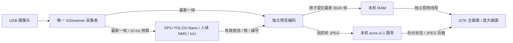

# 板端相机与触屏预览接入

2026-10-17 拔插修复：默认相机现按 USB 身份使用稳定链接 `/dev/v4l/by-id/usb-HD_720P_Webcam_HD_720P_Webcam_20130901-video-index0`。每次启动核对 `0c45:6341`、序列号 `20130901` 和视频索引0，再解析当前实际的 `/dev/videoN`；不会误开元数据节点或改用其他相机。缺少设备时先退出等待，由独立服务每3秒重试，取消原90秒/3次启动限流。每次重连启动新服务/相机代次，旧画面与轨迹不沿用。下文 `/dev/video0` 为早期节点示例，当前板测状态与限制以 [当天记录](/home/ghmd/AMD_Smart/logs/daily/2026-10-17-CAMERA-HOTPLUG.md) 为准。

2026-10-11 后续：[ByteTrack 跟踪与目标选择](BOARD_TRACKING.md) 已替换默认 IoU 关联，保留低分人体候选；当前配置与边界见该说明。下文有关 IoU/126/68 的描述保留初次 YOLO 基线。

依据：用户先要求接入摄像头，2026-10-11 确认预览流畅后要求接入 YOLO；延续 [当前分工](CURRENT_ASSIGNMENT_AND_BOARD_UI.md) 与 [触屏设计](BOARD_TOUCH_UI_DESIGN.md)。当前默认已切换到 [DPU YOLOX-Nano 人体检测](BOARD_YOLO.md)，原 CPU 人脸配置保留作明确回退。最新结果见 [YOLO 接入报告](/home/ghmd/aura-board-yolo-20261011/YOLO_INTEGRATION_REPORT.md)，之前的预览修复见 [原报告](/home/ghmd/aura-board-ui-design-20261009/UI_DESIGN_REPORT.md)。

## 采集和页面

[ui_camera_service.py](../board/vision/ui_camera_service.py) 独占 `/dev/video0`，GStreamer 配置 640×480 YUY2 / 30 fps，转换为 BGR 并统一镜像。采集只保留最新一帧，预览和检测分别消费副本，预览不等待检测。当前检测使用已验证的 DPU YOLOX-Nano（416 输入）、额外人体 NMS 和 A 的固定 IoU 关联，按独立 10 Hz 预算运行；配置频率不是实际出帧率。原 `YuNetCompat`（192 输入）配置可明确回退。GUI 后台读取本机 RAM 最新帧与 HTTP 状态，通用客户端保留 JPEG 副本；均不再次打开摄像头或独立推理。

检测框来自最近一次已完成观测，只有观测源帧年龄小于 250ms 才叠加到当前镜像画面，**并非当前预览帧的同步检测结果**。诊断分别报告采集帧、预览帧及观测帧编号和源年龄；过期框不会因为新视频到达而续期。

“互动”页显示当前预览、估计人数和目标编号；“放大画面”打开 960×550 原生窗口，“返回”关闭。人体框同时显示 `person`、编号与置信度。设备页显示相机/视觉/目标实际状态，底栏显示实际 DPU 状态。编号是本次相机代次内的 IoU 轨迹编号，身份、ByteTrack、PL/运动状态与 Windows 模型仍需单独接入。CPU 回退时显示“人脸”计数，不冒充人体人数。



## 所有权、时效与接口

进程持有 `/run/aura-camera-ui.lock`，打开设备前检查其他 `/proc/*/fd` 的所有者；发现占用即拒绝启动。服务不会结束其他视觉进程。未来 A 的统一视觉服务接管前，先停用本适配器，交接唯一相机和 8790 端口；不要同时运行此前的独立全屏 `realtime_vision.py`。

预览只保存八个 JPEG，每个不超过 256 KiB。采集帧超过 1000ms 后，相机状态失效，预览接口拒绝旧图；检测观测超过 750ms 后，目标失效，选择功能禁用。各帧时间取当前板的 appsink 出队单调时钟，**不声称是曝光时间或物理显示端到端延迟**。没有用新的 HTTP 心跳给冻结的帧续期。GUI 的通用 1500ms 图像门仍保留。

HTTP 使用 [aura-ui-1 合同](BOARD_TOUCH_UI_DESIGN.md)。实时状态源是 `actual`；YOLO 提供 `camera/vision/target/npu`，`vision.count_kind="people"`。CPU 回退提供前三项及 `count_kind="faces"`。仅在有新鲜确认目标时开放 `target_select`；请求绑定启动、服务代次、会话、期限及轨迹生命周期，有限去重，下一帧提交前再复核期限和代次。其余能力均为 false。`GET /health` 提供实际后端、模型 SHA/指纹、采集/检测数量、源年龄、最近推理耗时和错误。

首次接入版将 JPEG 放在检测完成之后，UI 又与耗时的玩偶绘制共用主循环。用户报告卡顿后，实际采样确认相机约 13 Hz、GUI 约 4 Hz、显示源帧年龄约 0.3～0.7s。先将玩偶移到后台后，显示源帧龄中位数降为约 264ms，但视频仍只有约 5 Hz，且状态/取图分步提交产生闪空；该中间版不算问题解决。最终代码采用下面的原生视频路径，实际板测结果见本轮报告。

[后台玩偶渲染器](../tools/board_avatar_worker.py) 单独持有播放控制器、合成和浏览器 JPEG 编码。摄像头画面由 [CameraPreviewWorker](../tools/board_camera_preview.py) 经 GStreamer `appsrc → videoconvert/videoscale → ximagesink` 绘入 GTK DrawingArea 的 X11 子窗口，GTK 不再解码或缩放摄像头图像。视频运行于独立流线程，小画面/放大窗口各有有界队列；GStreamer 1.18 的 appsrc 输入也按 `current-level-bytes` 限制。省电只降低玩偶更新频率，视频仍独立刷新。

本机服务声明 `camera.preview_transport="aura-local-bgr-1"` 后，客户端只在明确启用本机优化、`127.0.0.1`、真实服务源三项同时满足时采用 [RAM 帧传输](../board/vision/local_preview.py)。最新镜像 BGR 帧写在 `/run/aura-camera-ui-<camera_epoch>.frame`，通过私有临时文件加原子替换提交，常驻约 0.9 MiB，仅当前和正在提交的帧。固定头绑定启动/服务/相机代次、帧编号及采集时间；读取者拒绝符号链接、非私有权限、异常长度、异主、倒序、未来和超过 250ms 的帧。帧源停止或服务失联时，由视频线程主动推黑帧，不依赖 GTK 主循环清屏。

HTTP JPEG 副本及八帧有限缓存继续供外部客户端/指定帧请求使用；通用 JPEG 路径在后台解码并使用原生 sink。状态和匹配 JPEG 原子提交到客户端，等待下一帧请求时保留之前仍有效的完整状态，不闪空。GUI 状态轮询为 100ms；原生视频线程直接读最新 RAM 帧，不受该轮询频率限制。`preview_metrics` 的视频计数和帧龄在 native sink 入口采样，不能当作物理面板端到端测量。

## 配置、启动与后续交接

[board_camera_ui.json](../config/board_camera_ui.json) 显式选择 YOLO，固定板上模型/prototxt、原生库、参考图、指纹及 A 的关联源码 SHA。每次启动先核对实时 DPU 架构并跑固定参考图/空白图，再打开相机。`--check` 不打开相机，但会实际使用 DPU，须在此服务停止且推理锁空闲时运行。发布、依赖和回退见 [YOLO 说明](BOARD_YOLO.md)。

```bash
python3 -B board/vision/ui_camera_service.py --check
systemctl status aura-camera-ui.service
```

[服务文件](../scripts/board_camera_ui/aura-camera-ui.service) 与 `aura-avatar-ui.service` 分开管理，后者只监督 GUI/音频。实际安装路径固定于本板缓存运行目录；复制到另一块板前必须重新核验依赖和路径。服务启用不代表整板重启已验收。

后续由统一视觉/会话适配器提供身份事务、MCP01 真实录音、Windows 模型与媒体交付能力。切换采集者时，在板上执行 `systemctl disable --now aura-camera-ui.service`，确认 `/dev/video0` 已释放，再启动接管服务。客户端仍使用同一套时效、归属和能力检查。

## 截图与验收

2026-10-11 YOLO 接入：126 项主机、68 项板端软件测试，固定图 4 人体/空白图 0，实际采集/推理增长、放大/返回及五次诊断通过。同轮预览约 12.34→12.66 fps，120 次采样无空画面；API 帧龄中位数 206.5→174.5ms，原生入口帧龄中位数 74.35→62.32ms。性能采样时镜头朝向桌面；最终 20 秒真人入镜观测检出 1 人，同源图与实际快照相符，检测调用中位数 10.66ms、P95 18.85ms。多人精度仍待验收。以下保留先前 CPU 预览修复记录。

2026-10-11 实际嵌入式预览两次短测约 12.6～15.9 fps，采集出队到视频入口帧龄中位数 76～98ms、P95 115～143ms；原 JPEG/GTK 路径约 3.94 fps。API 状态中的已发布帧龄中位数 450→235ms，包含状态发布滞后。物理面板端到端延迟尚未测量，两个口径不能混用。放大/返回和五次连续诊断未重启 GUI，完整数据见本轮报告。

原生视频每次重置管线后重新绑定 DrawingArea 的 XID，防止另开桌面窗口。主机合成测试将窗口移至非原点位置并核对实际像素，检查相机换代后的绑定与过期黑屏；这项合成测试独立于上述真实相机测量。

目标板 Cairo 1.16 在原 `Gdk.pixbuf_get_from_window` 路径触发断言，曾导致保存诊断时 GUI 退出；失败日志保留在本轮证据目录。新的 [board_screen_capture.py](../tools/board_screen_capture.py) 用独立子进程读取 X11 根窗口，并按实际 RGB565 或 RGB24/32 解码，避免修改 GTK 的缓存表面。屏幕截图包含真实屏幕和已打开的模态窗口。

单元测试覆盖源冻结、过期、换代、有限预览、目标请求归属和去重；原生验收检查真实采集/检测增长、画面刷新、放大/返回、重复诊断及设置保留。参考图测试不替代现场正脸识别；XTest 指针事件不替代手指边缘、多指和连续操作验收。接口 fixture 标注为测试源，不计作真实相机或语音结果。

实现参考：[GStreamer appsink](https://gstreamer.freedesktop.org/documentation/app/appsink.html)、[Xlib 图像读取](https://xorg.freedesktop.org/archive/current/doc/libX11/libX11/libX11.html)。调用属性限定于目标板实际 1.18.5 插件支持的范围。
