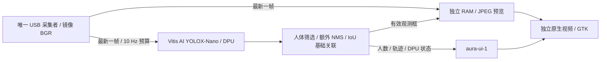

# KV260 YOLO 人体检测接入（2026-10-11）

后续更新：[ByteTrack 跟踪与目标选择](BOARD_TRACKING.md) 已上板，当前配置保留低分候选，使用作者版本 NumPy 适配。下文模型路径、0.3 阈值、IoU 和 126/68 项测试为初次 YOLO 接入基线。

YOLOX-Nano 已接入当前真实摄像头和 GTK 界面，使用板上的 B4096 DPU 推理。互动页及放大画面显示人体框、置信度、轨迹编号和人数；底栏的 DPU 状态来自本轮实际推理。用户确认上一版预览流畅，本轮短测没有发现预览帧率下降。

实测及完整边界见 [接入报告](/home/ghmd/aura-board-yolo-20261011/YOLO_INTEGRATION_REPORT.md)。本轮实现对应原执行手册 B03/B04 的官方人体检测基线；A 按当前用户分工负责视觉与 FPGA。ByteTrack、身份识别、自训练模型、独立量化/编译、统一主服务和整机验收仍有后续工作。

## 当前实现



- [相机服务](../board/vision/ui_camera_service.py) 继续独占 `/dev/video0`，640×480 YUY2，配置采集 30 Hz、检测 10 Hz；配置值不作为实际帧率。
- [DPU 适配器](../board/vision/yolo_dpu.py) 校验模型、prototxt、原生库 SHA、XIR 张量布局和实时 DPU 指纹，再创建推理器。没有自动切换成 CPU 的路径。`/run/aura-person-dpu.lock` 协调本项目的推理实例。
- [C++ 桥接](../board/vision/native/yolox_bridge.cpp) 调用已安装的 Vitis AI 3.0 `YOLOvX`；库负责左上 letterbox、BGR 输入量化、DPU 执行、解码/NMS和恢复原图坐标。`ctypes.CDLL` 调用释放 GIL，GUI/采集不等待推理。
- 本轮只保留 COCO `person` 类。置信度下限 0.3；官方配置 NMS 为 0.65，另用人体 IoU 0.45 去除嵌套重复框，每帧最多 16 个目标。框以原始镜像图的 `xywh` 提供，不再二次缩放。
- 轨迹关联复用 A 已固定 SHA 的几何 IoU 基线。短暂丢失再出现时递增轨迹代次；选择请求在实际提交时重查期限和代次。编号不是人的身份，也不是 ByteTrack。

预览只取最新一帧，不积压检测任务。框只在源帧年龄小于 250ms 时叠加；检测源超过 750ms 后人数和目标失效。推理失败会显示异常并清除目标能力，采集和预览仍可继续；不显示旧框来伪装实时结果。

## 板端固定依赖

| 项目 | 实测值 |
| --- | --- |
| 平台 | PetaLinux 2022.2 / aarch64 / OpenCV 4.5.2 / Vitis AI 3.0 |
| 当前硬件 | `kv260-benchmark-b4096`，1 CU，300 MHz |
| 指纹 | `0x101000056010407`，模型与实时查询一致 |
| 模型 | `/usr/share/vitis_ai_library/models/yolox_nano_pt/yolox_nano_pt.xmodel` |
| 模型 SHA256 | `def64abdeeccbd020cb651913ba907464c1a1786e30ba7d4aa077b601388950a` |
| prototxt SHA256 | `371c5979ac0ec1558455e86459b498cbeaa50852c90b722c31712a84904db7bf` |
| 原生桥接 SHA256 | `14524ca6364f7ecab3464999a1f20271d9f3b13e80684859f6da1573caf6efa8` |
| 输入 / 输出 | INT8 NHWC `[1,416,416,3]` / 三个 85 通道检测头 |

采用板卡预置模型，并保留其实际 SHA；[官方 Vitis AI 3.0 清单](https://github.com/Xilinx/Vitis-AI/blob/v3.0/model_zoo/model-list/pt_yolox-nano_coco_416_416_1G_3.0/model.yaml) 提供对应 KV260 的模型构建。本轮另下载官方包并校验其 MD5 `a13348e3ffd758531989b5dccac3b794`；该包内同名 xmodel 的 SHA 与板上预置文件不同，未替换板上文件，也未把下载包当作已部署模型。

配置入口：[board_camera_ui.json](../config/board_camera_ui.json)。原 CPU YuNet 配置保存在 [board_camera_ui.cpu_yunet.json](../config/board_camera_ui.cpu_yunet.json)，仅供明确回退，不与 YOLO 同时运行。启动器会固定运行文件 SHA，修改配置后必须同步发布启动清单，不能仅覆盖 JSON 后重启。

## 验证和使用

主机 126 项框架测试、目标板 68 项软件测试通过。板端固定参考图最终检出 4 个去重后人体框，黑图 0 个；最初原生输出 6 个候选框，额外人体 NMS 解决该图重复计数。参考图首次 24 次测试的原生检测中位耗时 7.35ms、P95 10.36ms；这是固定图检测耗时，不是实时链路总延迟。

同轮接入前后各 120 次短采样：实际预览约 12.34→12.66 fps，实际检测 9.98 Hz，采集约 12.53 Hz；均无空画面。API 已发布帧龄中位数 206.5→174.5ms；采集出队到原生视频入口帧龄中位数 74.35→62.32ms。后者不是物理屏幕端到端延迟。相机进程 CPU 从 125.8% 降为 65.1%（单核满载为 100%），两个短窗口不足以证明所有场景或长期性能。

实时相机/DPU计数持续增长、放大/返回、连续五次诊断和设置保留通过。最初性能采样画面朝向桌面设备，人数为 0；最终 20 秒真实入镜观测检出 1 人，保存的 [同源相机图](/home/ghmd/aura-board-yolo-20261011/evidence/20261011T120839.771421Z-final/real-positive.jpg) 已人工查看，出现 `person #45 0.75` 人体框。对应实际快照人数为 1、DPU 为 READY，图像引用与快照的相机代次/帧号/采集时间一致。154 个新鲜状态样本中无相机、检测或预览错误，实时检测调用耗时中位数 10.66ms、P95 18.85ms。**多人/遮挡/远距离精度和现场手动目标选择尚未验收**。在互动页点“放大画面”可查看当前结果；人数是检测估计，不能当作身份结果。

在板上只读检查：

```bash
systemctl status aura-camera-ui.service --no-pager
curl http://127.0.0.1:8790/health
```

`ui_camera_service.py --check` 会实际创建 DPU 推理器并跑参考图/空白图，须在此相机服务停止、推理锁空闲时执行。构建原生桥接可使用 [build_yolox.py](../board/vision/native/build_yolox.py)；它要求目标板原生编译器和现有开发库，不安装或更换系统依赖。

统一框架可通过 `board.vision.yolo_dpu:create` 接入现有 `DpuPluginDetector`，使用同一组模型/库 SHA 和指纹配置。当前仍由 UI 相机适配服务拥有相机和本项目 DPU 锁；切换到统一视觉主服务前必须交接资源，不能并开两个采集者。

## 发布和回退

配套更新 `0da0dc7f7289d5b7`，启动版本 `40f5d358d1c0d7ba`。增量部署先校验已有发布/测试目录中复用文件的 SHA，再备份、停止自身两个服务、安装、测试并启动。备份目录为 `/home/root/aura-yolo-20261011/update-0da0dc7f7289d5b7/backup`；工作站工具的 `--phase rollback` 根据本包 SHA 恢复原相机/界面文件及两个服务单元。

[配套更新包](../artifacts/releases/aura-yolo-update-0da0dc7f7289d5b7.zip) 128039 字节，SHA256 `14417489c66bd8aa1a66c819b4ee6e8eff3bc14c14691f0e97df5167d85a21b1`。包含 26 个运行文件及启动/部署辅助文件，依赖原有素材、触摸模块、Vitis AI 库、上述板上模型和 A 的固定关联源码；它不是可写入空卡的完整镜像。旧 217MB 素材运行包没有重建，不可单独用旧包恢复本次版本。

本轮未重启整板、未重新加载 PL、未发舵机命令。两个服务保持开机启用，但本版本冷启动尚未验收；身份、ByteTrack、真实语音链与机构继续单列验收。

实现参考：[AMD YOLOvX 推理源码](https://github.com/Xilinx/Vitis-AI/blob/v3.0/src/vai_library/yolovx/src/yolovx_imp.cpp)、[后处理源码](https://github.com/Xilinx/Vitis-AI/blob/v3.0/src/vai_library/xnnpp/src/yolovx.cpp)、[固定测试图来源与变换](../tests/fixtures/vision/README.md)。
