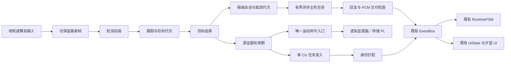

# AURA·汐蓝项目框架

更新：2026-10-09；实现开始于 2026-10-08。主仓是 `Win共享文件/共享文件夹/aura`。本文件描述实际落地的框架；上板结果以项目日志和对应实测报告为准。

当前分工更新：用户明确 **A 负责视觉与 FPGA**。玩偶 UI、口型和播放部署目标为 KV260 PS/Linux，首版语音生成仍由 Windows 模型主机承担。具体边界与并行工作见 [当前分工与玩偶板端部署](CURRENT_ASSIGNMENT_AND_BOARD_UI.md)；旧图册和工作包编号保留来源含义。

完整参赛目标及未完成内容的框图见 [全项目框图与状态页](../report/architecture/index.html)，对应 [官方提交目录](../submission/aura_junior/README.md)。本文仍说明可运行的软件联调子集，不能替代全作品的框图、硬件工件与正式交付。

2026-10-09 后续目录审查见 [结构细分与依据](../report/architecture/structure_detail.html)。现有 `host/model_service/client.py` 是板端客户端，`protocol.py` 为双端共享合同，`board/runtime/audio/selected_voice.py` 是主机模型代码；部署角色须按实际调用判定。目标目录不直接等于 Python 包名，原接口编号按总包 I01–I07 保留。

## 1. 当前可以做什么

项目已具备统一配置、统一启动入口和一个运行时组合入口。模拟输入可以经过检测、跟踪、目标选择、身份匹配、时效计算、任务调度、虚拟运动监督、异步对话和既有 UI 状态。旧汐蓝播放器、素材、声线和演示工具继续保留。

默认联调只需 Python 3.8 或以上的标准库。它使用明确标记的合成输入和模拟模型，不连接相机、音频设备、舵机或 FPGA。真实设备接入有单独入口；当前启动框架始终禁用物理运动。

研究主线是“误差约束下的源证据有效期、单 CU 任务准入、PL 执行监督”。当前完成的是这条主线的软件结构和可检查合同。可变期限参数尚未实测标定，PL 绝对源期限监督尚未实现；模拟通过不能证明硬件独立停止，也不能证明论文指标改善。

## 2. 先跑起来

在主仓打开终端：

```bash
python3 -s tools/aura_project.py doctor
python3 -s tools/aura_project.py demo
python3 -s tools/aura_host.py
python3 -s -m unittest discover -s tests/framework -v
```

Linux 也可以用 `bash tools/run_project.sh`。Windows 双击 `tools/run_project.bat` 会运行完整模拟联调并保留结果窗口；它优先使用仓内 `.venv`，否则使用系统 `python`。Windows 命令行可用：

```powershell
python -s tools/aura_project.py doctor
python -s tools/aura_project.py demo
python -s tools/aura_host.py
python -s -m unittest discover -s tests/framework -v
```

`demo` 写入 `metrics/raw/framework-<唯一编号>/trace.jsonl` 和 `summary.json`，以 `passed` 和每项检查的布尔值判断结果。输出路径重复时拒绝覆盖。`aura_host.py` 检查已有 ASR→VLM→TTS 管线与板端交付门的连接；这里的语音是测试 PCM，尚未执行真实模型或播放。

可变期限联调及记录回放：

```bash
python3 -s tools/aura_project.py --config config/runtime.experiment.sim.json demo
python3 -s tools/aura_project.py replay data/golden/framework_frames.jsonl
python3 -s tools/aura_project.py dialogue --text '你好，汐蓝'
```

全局 `--config` 放在子命令前。配置和模型相对路径以仓根为基准，切换工作目录或搬迁仓库不需要改绝对路径。

## 3. 数据怎样流动



运行时在一个所有者线程内更新场景、跟踪、身份、运动和会话。采集线程只提交最新帧，主机工作线程只提交回复邮箱；工作线程不直接修改 UI 或写运动寄存器。入口为 `board/runtime/application.py:AuraRuntime`。

主机任务有一个执行中的请求、一个等待中的最新请求和有界结果队列。取消会立即使交付资格失效；实际模型任务能否中断取决于后端，旧任务完成后仍必须丢弃旧结果。

## 4. 源码职责

```text
common/                     时钟、配置、帧/目标/证据/命令合同
board/
  vision/                   采集、最新帧槽、检测后端、跟踪适配
  identity/                 SQLite 身份库、特征提取适配
  fusion/                   目标选择、时效、单 CU 调度、说话人结果门
  motion/                   虚拟运动命令与监督器、旧 VSRV 驱动参考
  runtime/                  项目组合、会话、日志；原 FSM 与校验器
  interaction/              原汐蓝 UI、播放器与状态聚合
host/model_service/         异步任务、原三阶段模型管线与媒体合同
hardware/rtl/               原相对租约 VSRV RTL 参考
hardware/platform/          平台来源和能力清单
config/                     四类运行配置、模型/工具/实验/来源清单
models/vision/              已有 YuNet/SFace CPU 参考权重
data/                       合成回放；尚待采集的标定/测试清单
tests/framework/            标准库框架测试
tools/aura_project.py       项目统一入口
tools/aura_host.py          三阶段媒体模拟联调
scripts/package_project.py  源包生成与逐文件 SHA256 校验
metrics/raw/                每次运行生成的新证据
artifacts/releases/         框架源包
```

原件来源见 `config/source_import_manifest.json`。旧视觉核心、YuNet/SFace 适配、VSRV 驱动和 RTL 原样复用；原主机媒体代码仅统一换行。原 `EventBus` 新增可选的同步不留队列模式，默认仍保留原行为，新运行时显式选择不留队列，避免无消费线程时积压。

## 5. 四种配置的实际含义

| 文件 | 用途 | 当前状态 |
|---|---|---|
| `runtime.sim.json` | 固定 250 ms 期限、周期身份任务、模拟运动与文字模型 | 默认可运行 |
| `runtime.experiment.sim.json` | 示例可变期限与期限准入 | 可运行软件联调；参数未标定 |
| `runtime.reference.json` | CPU YuNet / IoU / SFace；运动禁用 | 适配已建；当前系统缺 OpenCV/NumPy，未启动实机 |
| `runtime.kv260.json` | 项目 DPU 检测 / ByteTrack；运动禁用 | 项目 xmodel、指纹、解码器与依赖待接；doctor 报未就绪 |

`doctor` 只检查本地配置、文件、模型哈希和依赖存在性，不打开设备，也不证明运行时 ABI 或推理正确。CPU 参考识别人脸，不能直接代替项目 DPU 人体检测。当前实际运行的跟踪器是 IoU 参考；ByteTrack 只有可选适配入口，尚未安装或上板运行。

需要真实相机时，先在目标环境完成依赖、摄像头和模型确认，停止旧采集程序，再显式运行：

```bash
python3 -s tools/aura_project.py --config config/runtime.reference.json doctor
python3 -s tools/aura_project.py --config config/runtime.reference.json camera --seconds 5
```

新相机适配有进程锁，但旧采集工具没有使用此锁。相机时间戳目前是读取开始时刻，尚不能当作传感器曝光时刻。上面的命令本次未执行。

原仓素材和 PySide6 可用时，可以显式选择 `python tools/aura_project.py ui`，通过 Enter 文字问答、Esc 打断、Space 切换模拟有人/无人。UI 复用原窗口、播放器和状态机；本次只验证状态聚合，没有启动或观测 Qt 窗口，也没有将新框架接成真实音画整机。

## 6. 算法与边界

- **目标证据**：使用 `(clock_domain, camera_epoch, frame_id, track_id, generation)` 归属。摄像头重连和目标重新出现都会更新归属；预测位置不充当新的采集证据。
- **可变有效期**：候选不确定度曲线包含初始误差、速度相关项和二次增长项，在允许误差内求保守整数期限。示例参数只用于联调，必须用独立标定数据冻结后才能用于真实配置。
- **任务调度**：检测/身份通过同一个不可抢占执行锁，身份准入预留自身、下一次检测、其他开销和裕量。耗时使用本机计时记录，超出预算会反映到后续估计；目前没有完成两个真实 DPU 模型共享单 CU 的板测。
- **身份**：只有显式 `consent=True` 才能登记；匹配结果可为已知、未知或模糊。数据库删除/登记更新修订号，旧缓存即时失效。模型 ID 和向量维度隔离，阈值仍待验证集标定。默认模拟库在内存中，不导出真人身份数据。
- **多人选择**：默认单人或手动选择，不自动把最高分说话人当事实。说话人结果必须对应已登记的板端窗口、当前可见且确认的目标代次、阈值和差值。Light-ASD 实际推理尚未接入。
- **运动**：框架只输出归一化图像中心偏差；它不是舵机角度或 PWM 标定。虚拟监督检查会话、恢复代次、序号、目标、来源、范围和期限；同一源重复命令不能延长期限。

虚拟监督器依靠 `runtime.tick()` / `guard.poll()` 才更新停止状态，不能证明 PS 挂起时独立停止。原 RTL 仍为相对租约监督；新的 PL 绝对源期限、跨时钟转换、传感器年龄和机构校准是后续实测工作。`servo_calibration.json` 保持未标定。

## 7. 两条对话合同

1. 原 `1.0` JSON 合同用于文字和场景摘要，可接原 WebSocket 文字服务。新入口复用原语义/策略校验，不发送图像或 PCM，拒绝缺少图像证据的视觉断言和运动控制请求。默认 mock 联调不启动监听端口。
2. 原 `aura-runtime-1` 合同用于明确来源的音频、图像和分段 PCM。通过 `attach_media_backend(callback)` 与 `ask_media(...)` 接入已有三阶段管线；板端检查启动、会话、请求、目标代次、期限回显、段序、PCM 格式/字节数和取消代次。图像 SHA 必须对应提交的字节，帧 ID 与相机代次必须对应当前来源，图像年龄由运行时计算。编码适配负责从对应帧生成图像；图像年龄阈值仍由实际 VLM 后端按冻结策略检查。

媒体返回后保存为 `last_media_response`，真实播放适配尚未接入。只有有效 token 可发送播放开始/结束事件；实际 MCP01 必须在对应适配中使用真实样本进度和停止结果。不同协议不能共用未经转换的消息。

模型服务抽象接口、模拟后端和接入说明见 [主机模型接口](../host/model_service/README.md)。复用文件中的候选模型注释是历史信息；当前声线以主仓最新的汐蓝记录为准，不重新选声线。

## 8. 接下来按这个顺序接真实模块

| 顺序 | 责任 | 需要交付的具体内容 | 验收 |
|---|---|---|---|
| 1 | A：视觉（按用户最新安排） | 项目检测模型、量化/编译记录、SHA、DPU 架构指纹、专用前后处理 | 原图坐标正确；离线样本与板端结果对照 |
| 2 | A：跟踪；身份接口主责待交接确认 | ByteTrack 依赖/API 固定；项目身份模型与阈值、显式登记入口 | 遮挡/离开/重连代次；未知/模糊/删除测试 |
| 3 | C：音频/主机/UI | MCP01 采集和播放、真实 ASR/VLM/现有选定 TTS、媒体传输 | 样本归属、断网、打断、旧回复、真实音画同步 |
| 4 | A：PL | 绝对源期限 ABI/RTL/仿真，平台指纹与部署证据 | 到期、重复旧源、PS 停顿、恢复需要新证据 |
| 5 | A+B：实验 | 分离标定/测试数据，冻结误差界和真实任务耗时，执行 G0–G5 | 相同输入/硬件与独立标注；记录误差、覆盖率、身份等待 |
| 6 | A+B：机构 | 3D 模型到位后才做轴、限位、角度/PWM 和实机控制 | 正负方向、限位、停止、恢复实测 |

`config/experiments.json` 已列出 G0–G5；当前只有 G0/G4 对应的软件联调入口，没有声称完成六组硬件实验。`data/calibration_manifest.json` 与 `test_manifest.json` 目前是待采集清单。

DPU 检测插件须提供 `module:factory`，对象具备 `backend_kind='DPU'`、`verify_runtime()` 和 `detect(CapturedFrame)->Detection[]`；检测坐标回到原图 xywh，分数合法。依赖/哈希/架构不匹配时拒绝启动，没有自动 CPU 替代。

ByteTrack 适配依据 [作者仓库的 byte_tracker.py](https://raw.githubusercontent.com/FoundationVision/ByteTrack/main/yolox/tracker/byte_tracker.py)，传入 Nx5 原图 xyxy+score，并在空帧调用更新。后续安装时需要固定与适配相符的版本并实际验证，不能仅靠导入成功验收。

## 9. 移机与验收记录

```bash
python3 -s scripts/package_project.py build
python3 -s scripts/package_project.py verify artifacts/releases/<生成的源包>.zip
```

默认源包包含框架代码、配置、测试、旧合同、CPU 参考权重和逐文件哈希；不包含现有约 443 MB 的动画素材、个人身份库、原始媒体、运行环境、大型模型、bitstream/overlay 或本机日志。需要复制既有动画素材时可显式加 `--include-assets`，这不补齐真实音频模型和硬件平台。源包是框架移机工件，完整设备交付仍需单独验收。

本次软件验证与尚未验证的项目见 [框架状态](FRAMEWORK_STATUS.md) 和主项目日志 `AMD_Smart/logs/daily/2026-10-09-PROJECT-FRAMEWORK-BUILD.md`。
