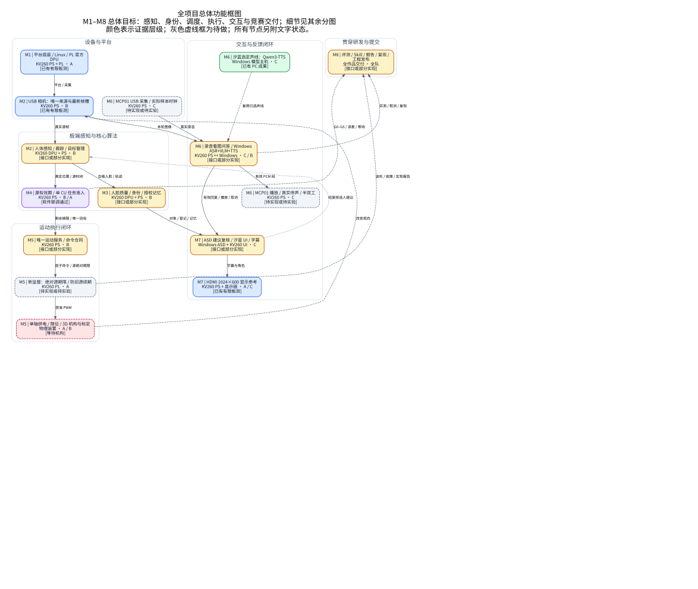
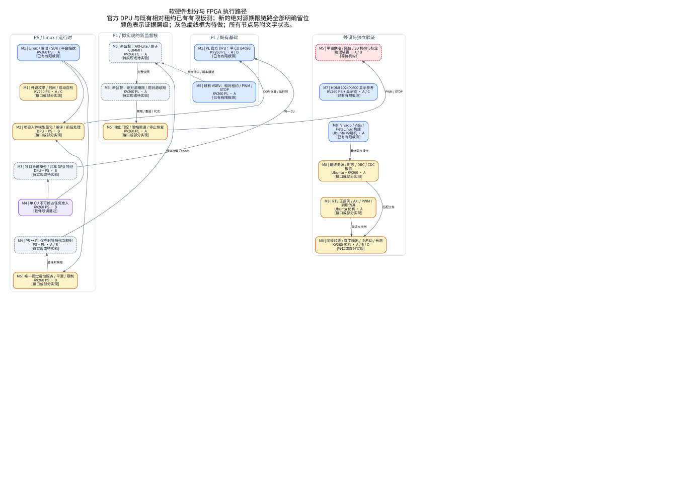
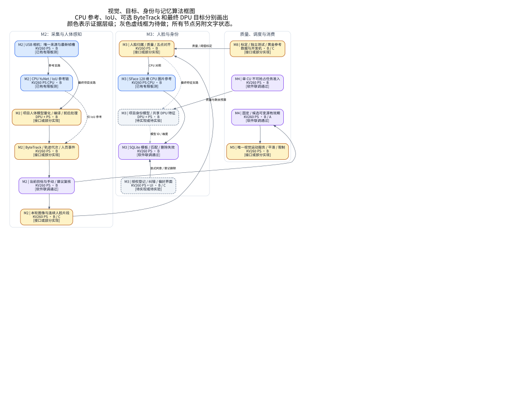
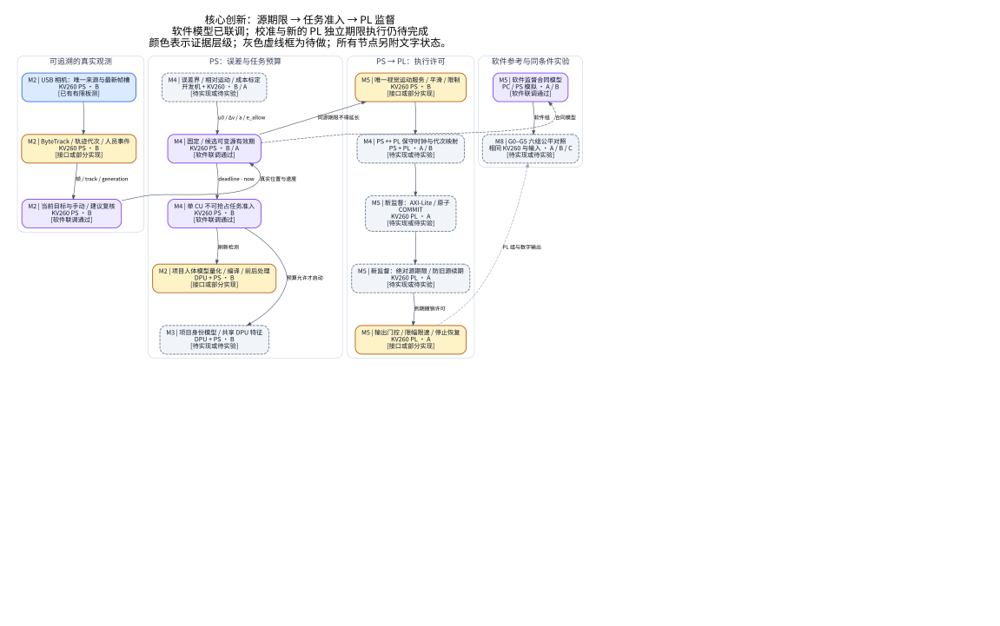
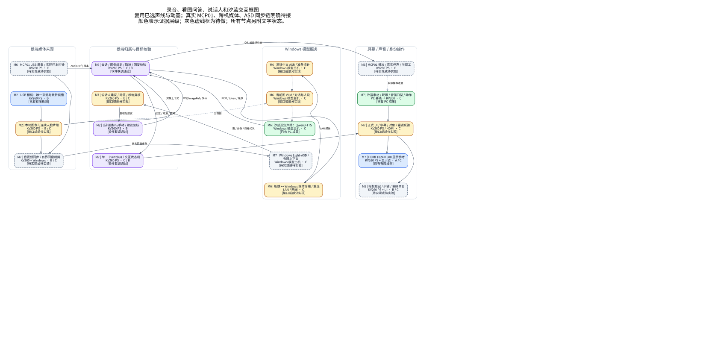
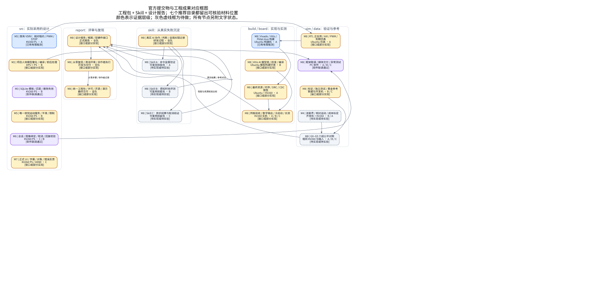
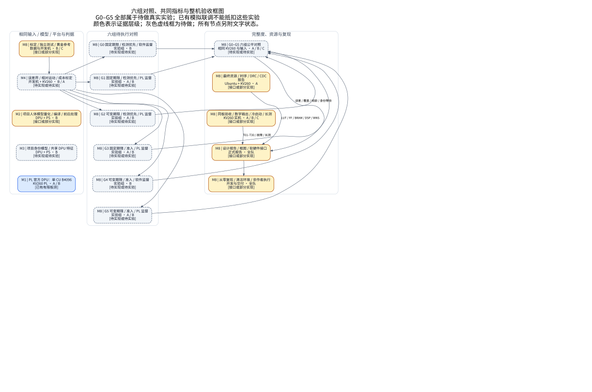
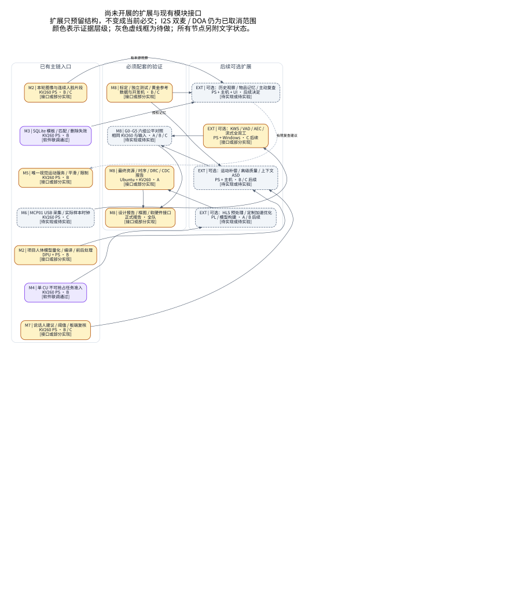

<!-- aura-architecture-generated -->
# AURA·汐蓝完整竞赛框图与提交框架

日期：2026-10-09。范围是初级组自主选题整件作品，包含当前已做与未做内容。图表示最终目标结构，每个框明确证据层级。

入口：[离线图册与可筛选状态](index.html)；[目录细分与依据](structure_detail.html)；[完整结构说明](structure_detail.md)。图册 PDF：`framework_diagrams.pdf`（本机支持合并时生成）。

## 官方依据与范围

以资料包内 AMD 2026 指南 PDF 第 22–25 页 / 第 3.3 节为依据；设计报告第 3.3.5.3 要求功能框图、软硬件划分、接口、优化对照、AI 协作、Skill 与复现。工程包另需源码、验证、综合实现、上板与构建脚本。

[企业赛道入口](https://gitee.com/Vickyiii/fpgachina26-amd)已在线定位；分赛道指南正文抓取失败。本次不推断更晚上传字段、截止日期或报告页数。官方原件在用户资料 ZIP 内，规则与计划来源的哈希见 `provenance.json`，源码与实测引用见 `source_references.json`。

`src/sim/build/board/data/skill/report` 是官方推荐组织；采用其他结构要给目录对照。新提交框架使用英文文件名，旧开发资料保留原件。2022.2 的采用理由须写明并实际复现；不额外要求迁移 PYNQ、HLS 或其他赛道 AI PC。

## 状态图例

| 图中状态 | 实际含义 |
|---|---|
| 已有有限板测 | 引用既有实测；不是本次新板测或最终整机验收 |
| 已有 PC 成果 | 引用 Windows/PC 交付记录；不能替代 KV260 验收 |
| 软件联调通过 | 当前标准库框架测试；真实设备/模型另验 |
| 接口或部分实现 | 已有入口/参考；完整目标尚未完成 |
| 待实现或待实验 | 框图与目录占位，不计为完成功能 |
| 等待机构 | 等待 3D 模型与标定，当前不执行物理动作 |

## 八张框图

### 全项目总体功能框图

M1–M8 总体目标：感知、身份、调度、执行、交互与竞赛交付；细节见其余分图。



可编辑源：`figures/01_system_overview.dot` / `.mmd`；另有 `.png` 与 `.pdf`。

### 软硬件划分与 FPGA 执行路径

官方 DPU 与既有相对租约已有有限板测；新的绝对源期限链路全部明确留位。



可编辑源：`figures/02_ps_pl_hardware.dot` / `.mmd`；另有 `.png` 与 `.pdf`。

### 视觉、目标、身份与记忆算法框图

CPU 参考、IoU、可选 ByteTrack 和最终 DPU 目标分别画出。



可编辑源：`figures/03_vision_identity.dot` / `.mmd`；另有 `.png` 与 `.pdf`。

### 核心创新：源期限 → 任务准入 → PL 监督

软件模型已联调；校准与新的 PL 独立期限执行仍待完成。



可编辑源：`figures/04_freshness_admission_guard.dot` / `.mmd`；另有 `.png` 与 `.pdf`。

### 录音、看图问答、说话人和汐蓝交互框图

复用已选声线与动画；真实 MCP01、跨机媒体、ASD 同步链明确待接。



可编辑源：`figures/05_audio_speaker_avatar.dot` / `.mmd`；另有 `.png` 与 `.pdf`。

### 官方提交物与工程成果对应框图

工程包 + Skill + 设计报告；七个推荐目录都留出可核验材料位置。



可编辑源：`figures/06_submission_evidence.dot` / `.mmd`；另有 `.png` 与 `.pdf`。

### 六组对照、共同指标与整机验收框图

G0–G5 全部属于待做真实实验；已有模拟联调不能抵扣这些实验。



可编辑源：`figures/07_ablation_and_acceptance.dot` / `.mmd`；另有 `.png` 与 `.pdf`。

### 尚未开展的扩展与现有模块接口

扩展只预留结构，不变成当前必交；I2S 双麦 / DOA 仍为已取消范围。



可编辑源：`figures/08_future_extensions.dot` / `.mmd`；另有 `.png` 与 `.pdf`。

## 全部模块的对应位置

| ID | 模块 / 负责人 | 当前层级 | 提交位置 | 待完成内容 |
|---|---|---|---|---|
| M1/platform | Linux / 驱动 / SDK / 平台指纹 / A | 已有有限板测 | `board/firmware/platform` | 最终镜像、精确器件型号、DPU 指纹与统一发布待冻结 |
| M1/dpu | PL 官方 DPU：单 CU B4096 / A / B | 已有有限板测 | `src/platform/dpu_integration` | 历史分类与共存板测已有；项目检测/身份共享负载待验 |
| M1/devices | 外设枚举 / 时间 / 启动自检 / A / C | 接口或部分实现 | `board/scripts/device_diagnostics` | MCP01 实测、统一启动、时基映射与失联恢复待接 |
| M2/camera | USB 相机：唯一来源与最新帧槽 / B | 已有有限板测 | `src/ps/vision/capture` | 原 CPU 相机链已有板测；新框架采集适配未开设备，曝光时间语义待校准 |
| M2/cpu_vision | CPU YuNet / IoU 参考链 / B | 已有有限板测 | `src/ps/vision/cpu_reference` | 它是人脸与 IoU 参考，不能当作人体 DPU 或 ByteTrack 完成 |
| M2/person | 项目人体模型量化 / 编译 / 前后处理 / B | 接口或部分实现 | `src/ps/vision/person_dpu` | 冻结权重、INT8 校准、arch 指纹、专用解码器与精度验证 |
| M2/tracking | ByteTrack / 轨迹代次 / 人员事件 / B | 接口或部分实现 | `src/ps/vision/tracking` | IoU 运行接入已验证；ByteTrack 依赖、实际视频与交叉遮挡待验 |
| M2/target | 当前目标与手动 / 建议复核 / B | 软件联调通过 | `src/ps/fusion/target_manager` | 真实多人规则、身份称呼与轨迹切换整机验收 |
| M2/snapshot | 本轮图像与连续人脸片段 / B / C | 接口或部分实现 | `src/ps/vision/media_windows` | 图像引用门已有；真实编码、连续裁剪、声画归属待接 |
| M3/face | 人脸归属 / 质量 / 五点对齐 / B | 接口或部分实现 | `src/ps/identity/quality_alignment` | CPU 对齐参考已有；多脸归属、姿态/模糊/遮挡质量门待完善 |
| M3/id_cpu | SFace 128 维 CPU 图片参考 / B | 已有有限板测 | `src/ps/identity/cpu_reference` | 既有板端静态图片参考；实时身份应用未验收 |
| M3/id_dpu | 项目身份模型 / 共享 DPU 特征 / B | 待实现或待实验 | `src/ps/identity/dpu_embedding` | MobileFaceNet 等候选尚未冻结；量化、算子分界和共享成本待验 |
| M3/identity | SQLite 模板 / 匹配 / 删除失效 / B | 软件联调通过 | `src/ps/identity/store` | 数据库逻辑已测；真人阈值、重返、实时板端持久化待验 |
| M3/enrollment | 授权登记 / 纠错 / 偏好界面 / B / C | 待实现或待实验 | `src/ui/enrollment_memory` | 显式同意 API 已有；完整操作页、多样本事务、在途个性化失效待接 |
| M4/freshness | 固定 / 候选可变源有效期 / B / A | 软件联调通过 | `src/ps/fusion/freshness` | 示例模型软件通过；独立标定、急变/遮挡失配与真实收益待验 |
| M4/scheduler | 单 CU 不可抢占任务准入 / B | 软件联调通过 | `src/ps/fusion/scheduler` | 软件执行锁已测；两个实际 DPU 模型、并发成本和身份等待待测 |
| M4/calibration | 误差界 / 相对运动 / 成本标定 / B / A | 待实现或待实验 | `data/calibration` | 当前清单为空；相机随动引入的运动及单位需独立校准 |
| M4/clock_map | PS ↔ PL 保守时钟与代次映射 / A / B | 待实现或待实验 | `src/ps/fusion/pl_time_mapping` | 软件时钟域已有；硬件快照、映射误差、回绕和复位合同待实现 |
| M5/motion | 唯一视觉运动服务 / 平滑 / 限制 / B | 接口或部分实现 | `src/ps/motion/service` | 虚拟归一化命令与旧有限随动已有；正式角度/极性/滤波与机构待验 |
| M5/vsrv | 既有 VSRV：相对租约 / PWM / STOP / A | 已有有限板测 | `src/rtl/vsrv_reference` | 有限板测已有；不是新的绝对源期限监督，数字引脚波形仍需测 |
| M5/guard_model | 软件监督合同模型 / A / B | 软件联调通过 | `src/ps/motion/simulation_guard` | 需 tick/poll；不能证明 PS 暂停时 FPGA 独立停止 |
| M5/axi_commit | 新监督：AXI-Lite / 原子 COMMIT / A | 待实现或待实验 | `src/rtl/motion_guard/axi_commit` | 在参考基础实现新字段，冻结 ABI；背压/半写/冲突仿真待做 |
| M5/source_guard | 新监督：绝对源期限 / 防旧源续期 / A | 待实现或待实验 | `src/rtl/motion_guard/source_deadline` | 新 RTL 未实现；同源不续期、PS 暂停、期限边界待仿真和板测 |
| M5/output_gate | 输出门控 / 限幅限速 / 停止恢复 / A | 接口或部分实现 | `src/rtl/motion_guard/output_gate` | 参考逻辑已有；新 ABI 优先级、真实停止输入与示波器验收待做 |
| M5/servo | 单轴供电 / 限位 / 3D 机构与标定 / A / B | 等待机构 | `board/calibration/mechanics` | 既有带电有限动作记录；机构、角度和机械停止验收等 3D 模型 |
| M6/mcp_capture | MCP01 USB 采集 / 实际样本时钟 / C | 待实现或待实验 | `src/ps/audio/mcp01_capture` | 设备身份、实际格式、录音转换、xrun 与并发未实测 |
| M6/media_session | 会话 / 图像绑定 / 取消 / 回复校验 / C / B | 软件联调通过 | `src/ps/runtime/session` | 逻辑与 fixture 通过；真实数据传输和播放消费待接 |
| M6/transport | 板端 ↔ Windows 媒体传输 / 重连 / C | 接口或部分实现 | `src/shared/contracts/interaction` | 文字 1.0 客户端与同进程媒体接口已有；跨机媒体通道未接 |
| M6/asr | 常驻中文 ASR / 准备探针 / C | 接口或部分实现 | `src/host/asr` | 旧后端代码与 fixture 已有；当前项目真实输入的模型验收待做 |
| M6/vlm | 当前图 VLM / 对话与人设 / C | 接口或部分实现 | `src/host/vlm` | 汐蓝人设与文字接口已有；真实看图模型与整机证据待验 |
| M6/tts | 汐蓝选定声线：Qwen3-TTS / C | 已有 PC 成果 | `src/host/tts` | Windows 声线/音强口型已有记录；真实管线和 KV260 播放待接 |
| M6/mcp_play | MCP01 播放 / 真实停声 / 半双工 / C | 待实现或待实验 | `src/ps/audio/mcp01_playback` | 逻辑 token 有效；声卡取消、缓冲清理、首声与半双工待验 |
| M7/av_sync | 音视频同步 / 有界同窗裁剪 / B / C | 待实现或待实验 | `src/ps/fusion/av_windows` | 窗口登记已有；真实偏移/漂移、缺帧与重采样映射待实现 |
| M7/asd | Windows Light-ASD / 有限上下文 / C | 待实现或待实验 | `src/host/asd` | 模型与作者样例、真实同窗输入和两人测试未接 |
| M7/speaker | 说话人建议 / 阈值 / 板端复核 / B / C | 接口或部分实现 | `src/ps/fusion/speaker_context` | 当前窗口归属门已测；持续条件、重叠证据与自动切换整机待做 |
| M7/avatar | 汐蓝素材 / 眨眼 / 音强口型 / 动作 / C | 已有 PC 成果 | `src/ui/avatar` | 既有 Windows 成果；正式板端帧预算和真实样本同步待验 |
| M7/ui | 正式 UI / 字幕 / 对象 / 错误反馈 / C | 接口或部分实现 | `src/ui/views` | Qt/UI 状态接入已有；实屏完整交互及登记界面待验 |
| M7/fsm | 单一 EventBus / 交互状态机 / C / B | 软件联调通过 | `src/ps/runtime/state_machine` | 软件已测；真实异步媒体、失联恢复和整机长测待验 |
| M7/hdmi | HDMI 1024×600 显示参考 / A / C | 已有有限板测 | `board/scripts/display` | 基础桌面/视觉屏幕已有；汐蓝实屏、裁剪与操作待验 |
| M8/rtl_verify | RTL 正反例 / AXI / PWM / 到期仿真 / A | 接口或部分实现 | `sim/rtl` | 参考仿真代码已有；新绝对期限与完整边界仿真待做 |
| M8/software_verify | 框架联调 / 媒体交付 / 异常测试 / A / B / C | 软件联调通过 | `sim/software` | 不能替代设备、真实模型或整机验收 |
| M8/hardware_build | Vivado / Vitis / PetaLinux 构建 / A | 已有有限板测 | `build/scripts/hardware` | 旧源共存工程有构建与板测；最终新监督整体构建和外部约束待补 |
| M8/model_build | Vitis AI 模型锁 / 校准 / 编译 / B | 接口或部分实现 | `build/scripts/models` | 项目检测和身份最终工件未冻结；不拿 ResNet18 当人体结果 |
| M8/implementation | 最终资源 / 时序 / DRC / CDC 报告 / A | 接口或部分实现 | `build/reports` | 历史报告已有；新的绝对源期限联合设计报告待生成 |
| M8/datasets | 标定 / 独立测试 / 黄金参考 / B / C | 接口或部分实现 | `data/reference` | 合成小样已有；真人视频、身份/ASD/语音与标注集待采集 |
| M8/experiments | G0–G5 六组公平对照 / A / B / C | 待实现或待实验 | `data/metrics/experiments` | 当前仅配置与模拟策略联调；六组真实实验未执行 |
| M8/g0 | G0 固定期限 / 检测优先 / 软件监督 / B | 待实现或待实验 | `data/metrics/experiments/g0` | 不是默认模拟 250ms 已完成真实实验 |
| M8/g1 | G1 固定期限 / 检测优先 / PL 监督 / A / B | 待实现或待实验 | `data/metrics/experiments/g1` | 新 PL 未完成，实验未执行 |
| M8/g2 | G2 可变期限 / 检测优先 / PL 监督 / A / B | 待实现或待实验 | `data/metrics/experiments/g2` | 实验未执行 |
| M8/g3 | G3 固定期限 / 准入 / PL 监督 / A / B | 待实现或待实验 | `data/metrics/experiments/g3` | 实验未执行 |
| M8/g4 | G4 可变期限 / 准入 / 软件监督 / B | 待实现或待实验 | `data/metrics/experiments/g4` | 仅对应策略的合成联调已有，不是真实 G4 实验 |
| M8/g5 | G5 可变期限 / 准入 / PL 监督 / A / B | 待实现或待实验 | `data/metrics/experiments/g5` | 实验未执行，不能预填增益 |
| M8/board_verify | 同板验收 / 数字输出 / 冷启动 / 长测 / A / B / C | 接口或部分实现 | `board/results` | 有限模块板测已有；最终两小时、冷启动、媒体和完整流程待验 |
| M8/ai_records | 真实 AI 协作 / 判断 / 自我纠错记录 / 全队 | 接口或部分实现 | `report/llm_collaboration` | 工程日志已有；原始可见对话归档和完整关联需整理，不补造内部推理 |
| M8/skill_a | Skill A：命令监督验证 / A | 待实现或待实验 | `skill/command-guard-validation` | 正式技能说明骨架本次建立；参数化硬件入口、真实失败和外队复用待补 |
| M8/skill_b | Skill B：感知时效评测 / B | 待实现或待实验 | `skill/perception-freshness-benchmark` | 框架日志可作基础；独立分析入口、真实数据和非作者复用待补 |
| M8/skill_c | Skill C：异步结果与取消验证 / C | 待实现或待实验 | `skill/async-result-validation` | 逻辑测试已有；独立包装、替换协议样例、真实停声证据待补 |
| M8/design_report | 设计报告 / 框图 / 软硬件接口 / 全队 | 接口或部分实现 | `report/design_report` | 本次搭建完整报告框架；最终结论和性能/资源数据待填 |
| M8/reproduction | 从零复现 / 清洁环境 / 非作者执行 / 全队 | 接口或部分实现 | `report/reproduction` | 软件源包新目录通过；最终硬件/模型/设备复现和非作者验收待做 |
| M8/release | 统一工程包 / 许可 / 开源 / 演示 / 全队 | 接口或部分实现 | `report/release` | 本次是框架材料；最终工件、许可选择、公开视频、GitHub/Gitee 发布待完成 |
| EXT/observation | 可选：历史观察 / 物品记忆 / 主动复查 / 后续决定 | 待实现或待实验 | `src/ps/extensions/observation_memory` | 历史 P2/P3 扩展，仅画预留接口，不升级为当前必交 |
| EXT/audio_ext | 可选：KWS / VAD / AEC / 流式全双工 / C 后续 | 接口或部分实现 | `src/ps/extensions/streaming_audio` | 旧 KWS/VAD 代码已有；本期先按键半双工，AEC/全双工待评估 |
| EXT/vision_ext | 可选：运动补偿 / 高级质量 / 上下文 ASD / B / C 后续 | 待实现或待实验 | `src/ps/extensions/vision_context` | BoT-SORT/MagFace/LoCoNet 仅后续对照；不能把规则当论文复现 |
| EXT/accel_ext | 可选：HLS 预处理 / 定制加速优化 / A / B 后续 | 待实现或待实验 | `src/rtl/extensions/hls_acceleration` | 剪枝、SATAY/TAPA/FILM-QNN/NAF/H2PIPE 作为论文候选，不列当前主创新必做 |

## 工作包、验收与正式提交对应

- `work_packages.csv`：原三人总包全部 42 项，挂接到当前框图模块；整项放行尚待复核。
- `acceptance_matrix.csv`：当前无声源定位方案全部 T01–T30；目标是内部验收建议，不是官方阈值。T13/T14 保留并明确不适用。
- `requirements_matrix.csv`：r01–r17 对应官方工程包、Skill、报告、版本、开源、命名与条件项。
- `project_file_inventory.csv`：现有主仓文件名/大小清单，排除环境/缓存与本次生成框图。
- `source_references.json`：每个模块的现有来源是否存在、主仓/Ubuntu 位置、小文件 SHA。
- `../../submission/aura_junior/`：七个官方推荐目录、每个模块的 README 与接口说明、未完成工件清单。

## 尚未完成的内容已放在哪里

新 DPU 检测/身份、ByteTrack 实际运行、真实质量/登记页、MCP01 采录播放、跨机媒体、ASD 同窗和模型、新 PL 绝对期限/时钟映射/ABI、仪器波形、机构标定、G0–G5 实验、三项完整 Skill、最终报告/视频/从零复现均已画出并建立目录位置。

当前 CPU 人脸/IoU、SFace 静态参考、DPU+相对租约有限共存、HDMI、汐蓝 PC 素材/声线分别引用已有证据；本次没有重新运行这些板测或 Windows 模型。新运行时的 41 项软件测试属于此前软件框架验证。

机构继续等待 3D 模型。本次只读取资料并生成图、矩阵、说明与目录，没有硬件操作。已有相对租约 RTL 不被标成新的源绝对期限 RTL。

## 维护与导出

```bash
python3 -s scripts/render_submission_architecture.py
```

修改 `report/architecture/architecture.json` 后再导出；这是所有图、模块表和目录接口说明共同的来源。原方案、原源码和实测记录保持可追溯。生成器拒绝覆盖未标记的 Markdown/HTML 文档。
