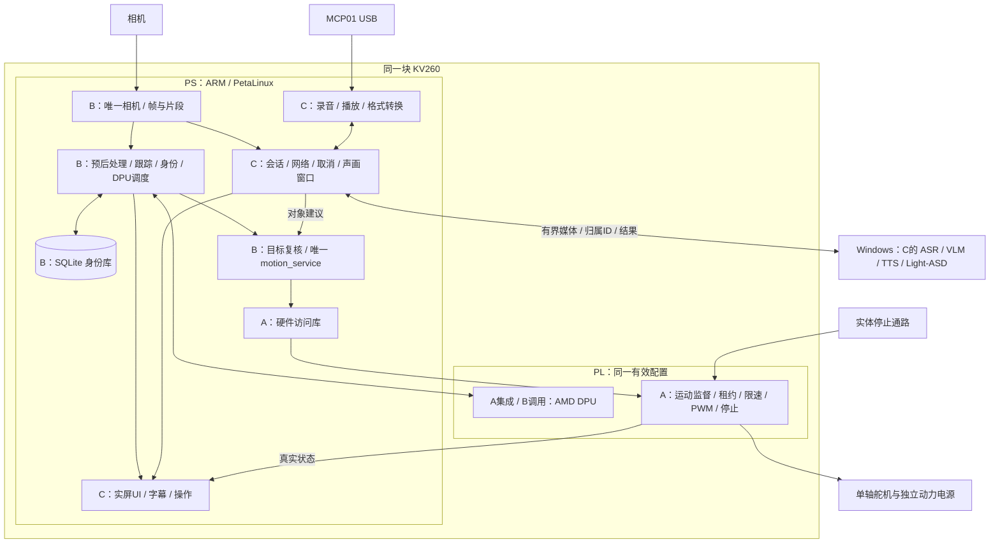

# AURA KV260 共同板端部署与联调速查表

日期：2026-10-02。详细任务、方案及验收见 [三人详细实施书](AURA_KV260_三人详细分工与同板运行实施书_2026-10-02.md)。本表用于现场交接，全部复选框为待核验，不表示本次已上板测试。

**共同部署结果：同一块 KV260、同一套 PetaLinux、同一份 DPU＋motion 联合 PL 配置，同时运行 B 的视觉/身份/运动和 C 的音频/交互/UI。A 提供匹配的硬件/系统/访问库；Windows 提供 ASR/VLM/TTS/Light-ASD，Ubuntu负责构建。**

## 1. 同板数据流



此图表达职责与数据流，不是实际网表/引脚/电路图。实体动力停止还需按电气设计直接处理负载，不能只依赖图中的软件/PL路径。

## 2. 三人各自必须装到板上的内容

| A：底座/硬件 | B：板端视觉/身份/运动 | C：板端交互/音频/界面 |
|---|---|---|
| 匹配Linux/内核/DT/驱动 | 唯一camera_service、图像池 | MCP01唯一录音/播放后端 |
| 同配置DPU＋motion | 人体预处理/xmodel/后处理 | 真格式转换/样本时间/有限缓存 |
| XRT/ZOCL/VART/XIR配套 | 跟踪/生命周期/人物事件 | 按键半双工/对话状态机 |
| IP/ABI/BUILD/arch/加载身份 | 人脸质量/对齐/特征/匹配 | boot/session/request/generation |
| motion访问库/错误/状态快照 | SQLite/登记/删除/db_version | 当前图/音频请求和主机客户端 |
| 时钟/复位/地址/引脚/约束 | 人体与身份DPU调度 | 声画窗口/ASD结果/对象建议 |
| PWM/租约/停止/受控恢复 | 当前目标/唯一motion_service | 本地取消/清播放缓冲/迟到丢弃 |
| 标定/默认禁能/供电停止 | 本轮快照/连续脸接口 | 实屏UI/字幕/玩偶/真实操作 |
| 平台探针/构建加载恢复 | 视觉/身份/运动健康与退出 | 统一启动/自检/停止/日志入口 |

人脸完整身份在板上完成，其中网络子图的 CPU/DPU 位置逐步验收；首版 ASR/VLM/TTS/Light-ASD 模型计算在 Windows，不因此删除对应板端工作。

## 3. P01—P28 板端部署逐项勾选

| 勾选 | 编号/内容 | 主责 | 现场验收 |
|---|---|---|---|
| [ ] | P01 Linux/内核/驱动 | A | OS/内核、启动、真实设备身份 |
| [ ] | P02 DPU | A/B | 实际fingerprint＋固定图推理 |
| [ ] | P03 motion电路 | A | 正常/拒绝/到期/停止/恢复波形 |
| [ ] | P04 同版加载包/DT/地址 | A | 实际加载身份、文件hash与节点对应 |
| [ ] | P05 推理运行库 | A/B | 模型能真实调用、库/硬件/模型匹配 |
| [ ] | P06 访问库 | A/B | read/submit/accepted/rejected/disarm/status |
| [ ] | P07 唯一相机 | B | 连续真实新帧及设备异常 |
| [ ] | P08 图像池/共享接口 | B/C | 慢消费者不读释放帧/不无限积压 |
| [ ] | P09 人体预处理 | B | 颜色/布局/缩放/量化与参考一致 |
| [ ] | P10 人体DPU模型 | B | 同图板端输出、xmodel/arch/hash |
| [ ] | P11 后处理/坐标 | B | 原图框、NMS与实际缩放对应 |
| [ ] | P12 跟踪/生命周期 | B | 交叉/离开/编号复用不串轨迹 |
| [ ] | P13 板端身份链 | B | 实际CPU/DPU边界、KNOWN/UNKNOWN |
| [ ] | P14 SQLite持久化 | B/C | 登记/删除/缓存/重启一致 |
| [ ] | P15 DPU业务调度 | B | 检测优先，身份开启后帧龄有界 |
| [ ] | P16 当前目标 | B/C | 手选/建议/失效/滞回原因可查 |
| [ ] | P17 唯一运动服务 | B/A | 新鲜帧→有效seq→硬件接受 |
| [ ] | P18 本轮快照 | B/C | frame/hash/目标/时间匹配 |
| [ ] | P19 连续脸片段 | B/C | 同人真实连续帧、缺帧/时间可查 |
| [ ] | P20 MCP01录音 | C/A | 真人录音、设备身份/格式正确 |
| [ ] | P21 MCP01播放 | C | 真正出声、进度/结束/停声 |
| [ ] | P22 格式转换 | C | 真重采样，样本数/时长一致 |
| [ ] | P23 声画窗口 | C/B | 同窗同步、alignment/期限有效 |
| [ ] | P24 会话/主机客户端 | C | 当前request/generation、超时/断连 |
| [ ] | P25 对象建议 | C/B | 只建议对象，B最新轨迹再核验 |
| [ ] | P26 实屏UI | C/A/B | 真实听想说/身份/运动/错误/操作 |
| [ ] | P27 启动/恢复/停机 | C/A/B | 分项ready，默认禁能，恢复不复播 |
| [ ] | P28 日志/配置/发布身份 | 三人 | 查一次问答与运动全过程 |

## 4. 六个不得有第二所有者的资源

| 资源 | 所有者 | 其他模块的入口 |
|---|---|---|
| 相机 | B camera_service | 帧/快照/连续片段API |
| 检测/人脸DPU业务 | B 调度 | 获取轨迹/身份结果 |
| 正式运动寄存器 | B motion_service | C目标建议，A受控维护诊断 |
| MCP01 | C音频模块 | 带样本/时间的音频接口 |
| 身份库写入 | B身份服务 | C登记/删除/查询API |
| 平台包/PL切换 | A平台入口 | 三人维护流程，C调用已验证入口 |

UI只消费状态/执行受控操作，主机/VLM不写ARM/PWM，A诊断写入只在正式服务停止的维护模式。

## 5. 首次联调每个人带什么

**A 带：**平台版本、arch/模型目标、实际加载记录；IP/ABI/BUILD读回；访问库；一条正常、一条拒绝、一次到期/停止例子；配置/状态枚举。

**B 带：**真实单帧/快照/连续脸，源时间；轨迹代次和身份API；人体模型对照；唯一motion_service及模拟接口；失跟/旧帧/过期建议例子。

**C 带：**真实MCP01录音/回放；固定主机模型例子；当前request/generation事件；本地取消和迟到丢弃；ASD真实输入/结果；UI/启动入口草案。

统一确认：release/protocol、boot/session/request/generation、frame/camera_epoch、track_generation、db_version、window/alignment、safety_epoch/seq、板端时间域和单位。

## 6. 每次上板启动记录

```text
本次操作者/日期：
SD/系统release/硬件BUILD及SHA256：
实际app/UUID/fingerprint/模型/运行库：
运动IP/ABI/标定/停止状态：
相机身份/模式/camera_epoch/连续帧：
MCP01身份/录放格式/真实样本：
数据库schema/db_version/模型空间：
Windows模型ready/协议/后端：
UI真实屏幕/当前状态：
显式参考确认/ARM结果：
通过/失败/未测/降级项及证据：
```

建议启动：默认禁能→统一平台→B相机/视觉/身份/禁能运动服务→C音频/交互/UI→主机ready→各项功能探针→参考确认/显式ARM→短随动/语音检查。实际服务管理按镜像init机制冻结，不默认已有systemd或现成一键脚本。

## 7. 必须同时运行测的场景

- [ ] 同一PL中DPU推理＋读运动BUILD＋实际PWM。
- [ ] 人体检测＋人脸身份＋SQLite操作，记录帧龄/队列。
- [ ] 相机＋MCP01录放＋实际显示，不掉设备/不误选声卡。
- [ ] VLM长请求期间本地视觉/运动独立更新。
- [ ] ASD与VLM同时运行，窗口/队列有界且过期建议丢弃。
- [ ] 相机冻帧，新cmd_seq不能让旧帧继续续租。
- [ ] motion/视觉进程退出，PL独立到期，重启不自动ARM。
- [ ] 取消后回传旧音频/字幕/动画，不再播放/显示。
- [ ] 两人交叉/track复用，不继承旧名/旧答案/旧目标。
- [ ] 识别在途删除身份，缓存/重启不复活姓名/模板/偏好。
- [ ] 相机/音频重插，换设备代次，不重放旧窗口/请求。
- [ ] 断公网、断Windows/LAN、板端控制退出分别按策略降级。
- [ ] 实体停止在PWM高/低/更新边界测试，数字/动力/机械分别记录。
- [ ] PL重载释放旧Runner/映射，重新查版本/推理/新会话，运动仍禁能。
- [ ] 最终版本2h长测、3次冷启动、新卡、非作者复现。

## 8. 当前不可省略的三项关卡

**第一项：**DPU 4.1候选主机构建完成不等于板测；先原应用与候选同图对照，并验证恢复。

**第二项：**报告中的布局占用高/时序余量小，完整静态配置没有已预留的空RP；先最小共存探针，再扩展motion并重新整体实现。

**第三项：**人脸板端身份、实时ASD、真实声音/屏幕各自要证据；模拟输入、Windows身份和静态照片不能替代对应板端/实时验收。

## 9. 正常停机与异常恢复

正常：B禁能并确认→C取消/停播/停录/废止窗口→停相关服务→一致备份必要库/配置→保存日志→正常关闭。

异常：原模块负责人修具体问题；C显示具体降级；恢复先更新代次/清队列/读当前快照；凡平台、运动服务、位置参考失效，按合同重新确认并显式ARM。松开停止、主机重连和UI重启都不是运动恢复许可。

