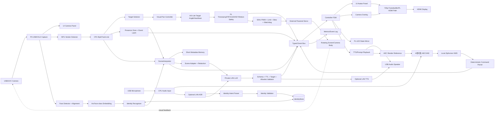

# FMQL30TAI / 雾镜 Lite 一个月技术实施计划

> 版本：V3.4（Windows 11 开发主机、视觉身份记忆与无板先行接口修正版）  
> 计划周期：**2026 年 8 月 31 日—2026 年 9 月 30 日**  
> 项目主线：**Windows 11 主机训练与对话服务 + 板端视觉感知与场景理解 + NPU 人员检测 + 视觉身份登记/重识别 + FPGA 视觉伺服安全控制 + 分屏动态玩偶 + 本地确定性交互 + 合规条件下的局域网自然对话**  
> 目标平台：FMQL30TAI / 雾镜 Lite（FPGA + NPU + CPU）  
> 开发主机：**Windows 11 64-bit、RTX 5090 Laptop GPU；负责训练、模型验证、HTML UI、对话服务和无板卡联调**  
> 板端环境：随 BSP/比赛包提供的 FMQL30TAI AArch64 Linux；其版本与 Windows 主机职责严格分开  
> 软件方案基线：`FMQL30TAI_雾镜Lite_全双工多模态智能语音助手_技术实施计划_中文.md`  
> 硬件依据：`悟净开发板硬件使用手册V1.0_集创赛.pdf`（41 页）
> 算法复核日期：**2026 年 9 月 2 日**；资料优先级：芯片/工具链官方资料 > 模型官方仓库 > 原始论文

---

# 1. 修订目的与核心结论

原计划按照 8 周周期设计，覆盖全双工音频、ASR、TTS、KWS、SER、视觉检测、OCR、时序指代、长期记忆、工具调用、LLM、FPGA Log-Mel 和视频预处理等大量功能。若压缩到一个月，继续按原范围推进，极易出现“模块很多但没有稳定演示闭环”的结果。

本版本将项目冻结为唯一 P0 场景：**展台来访者接待**。若实际参赛展位条件不允许，应在 G0 把“展台”整体替换为“桌面迎宾”，但不得同时保留展台、桌面陪伴、家庭陪伴和通用聊天等多个主要场景。

本版本将项目重新定义为：

> **雾镜 Lite 是一个面向展台来访者接待的“实体版豆包”具身交互终端：设备持续感知来访者，把检测、跟踪、位置关系、视觉身份和近期事件整理为结构化场景状态；用户可通过“这个人叫张三”等自然语言，在本人知情确认和单目标质量检查通过后登记视觉身份。来访者离场后再次出现时，系统通过人脸特征重识别恢复持久 `person_id`，并驱动个性化问候和动态玩偶反馈。板端独立完成目标检测、有限角度转向、安全停止和基础反馈；Windows 11 主机负责首期训练、HTML UI、ASR/LLM/TTS 与身份模型验证，并在赛事规则允许时通过自带私有局域网提供自然对话增强。**

V3.4 采用两个不能混淆的验收模式，并增加一个跨模式共享的视觉身份记忆子系统：

| 模式 | 定位 | 允许依赖 | 断网/外部主机失败时要求 |
|---|---|---|---|
| `CORE_LOCAL` | 竞赛必过核心模式 | 仅板端 NPU/CPU/FPGA、本地 KWS、模板或本地轻量 TTS | 必须完整完成检测、场景事件、跟踪、转向、玩偶、停止和日志 |
| `DIALOGUE_LAN` | “实体版豆包”增强模式 | 自带离线局域网中的 ASR/LLM/TTS 主机；是否上台启用取决于主办方书面确认 | 超时或断链立即降级到 `CORE_LOCAL`，不得阻塞运动和安全线程 |

视觉身份记忆不等于把姓名训练成 YOLO 类别。YOLO 仍只负责 `person` 检测；人脸检测与 ArcFace 类 embedding 模型负责 1:1 验证和 1:N 识别；SQLite 身份库保存 `person_id/name/embedding/model_id/consent/revision`。首期可在 Windows 主机运行，板端迁移必须另过 ICraft 算子、量化、内存、精度和许可 Gate。比赛若不允许外部计算，身份功能不得冒充板端能力，也不得成为 `CORE_LOCAL` 必过依赖。

`CORE_LOCAL` 是评分和安全底座；`DIALOGUE_LAN` 是产品体验主路径，但不能被包装成板端 LLM，也不能替代板端 AI 部署、FPGA 开发和性能证据。首月主线扩展为：

```text
摄像头看到现场
  → NPU 检测 person
  → CPU ByteTrack-Lite 跟踪并保持 track_id
  → Face Detector + Face Alignment + Face Embedding
       ├→ ENROLL：语音命名 + 单脸绑定 + 质量门 + 本人确认 → IdentityStore
       └→ RECOGNIZE：embedding 1:N 比对 + unknown 阈值 + 3/5 帧确认 → person_id
  → Scene Interpreter 形成 SceneState、事件和短时场景记忆
  ├→ Presence Event 分支：进入画面交互区域，按 presence_session 锁存 PERSON_ENTER_PRESENCE
  │                         → 玩偶/文字/提示音
  └→ Pan Control 分支：One Euro 滤波 → IBVS 横向误差 → FPGA 目标角
       → FPGA 生成确定性 PWM、限位、缓启动、watchdog 和急停
       → 底座有限角度转动 → 摄像头反馈新画面 → 目标进入中心死区
  → CORE_LOCAL：本地命令/模板反馈
  → DIALOGUE_LAN：语音文本 + SceneState → LLM 结构化建议
       → 板端 schema/时效/目标/权限校验 → 语音、玩偶与“关注目标”请求
  → 用户通过实体按键或本地关键词取消播报/跟随
```

人员出现事件和旋转控制必须从同一条视觉轨迹并行分支，不能等转动完成后才产生事件。摄像头转动期间，事件按 `presence_session_id` 而不是只按 `track_id` 锁存；短时遮挡导致 track ID 改变时，只要满足时间、位置、面积和运动连续性条件，仍续接同一人员会话，避免重复“退出—进入”。

外接实体指示灯不作为 P0 要求。首月由屏幕玩偶、颜色、文字和语音共同承担主要反馈；同时使用手册确认的 4 路板载 PL LED 做硬件状态镜像。旋转底座不是独立遥控玩具，而是由视觉结果驱动的闭环执行机构，用于证明 NPU、CPU、FPGA 与真实外设之间的异构协同。

本计划中的“完成”必须同时具备 **可运行代码、板端实测结果、原始日志/波形、复现实验步骤和演示证据**。只有功能描述或计划文字、没有实物与数据，不计入最终验收完成项。

## 1.1 V3.4 全项问题—原因—解决方案

| 原问题 | 为什么必须改 | V3.4 解决方案 | 验收方式 |
|---|---|---|---|
| P0 同时写展台、桌面陪伴和现场引导 | 使用对象和痛点不唯一，评委难以判断产品价值 | P0 冻结为“展台来访者接待”；固定区域物体监测移入 P1 | G0 场景卡、用户流程和最终讲解口径一致 |
| 摄像头转动后监控区域跟着画面移动 | 同一人可能因转动或 ID switch 被误判退出/再次进入 | 拆分 `presence_zone`、`tracking_deadzone`、`motor_limit`；增加 `presence_session_id`，人员事件与转向并行 | 100 段回放中转动和短时 ID 变化不造成重复进入 |
| detector 只有泛称，没有具体模型 | 无法回答模型结构、来源、算子和为何适配 | Primary 定为匹配 tag 的最小 ZG YOLO11，优先 YOLO11n；随板 YOLO 为硬回退 | MODEL_CARD、转换日志、仿真/板端对齐 |
| 跟踪仅写 IoU/中心点 | 遮挡和低置信时容易丢 ID，引起底座乱切目标 | ByteTrack-Lite 高/低分两阶段关联；SORT 回退；不加人体外观 ReID；持久姓名由独立人脸 embedding 负责 | 遮挡/多人测试的 ID switch 和恢复率 |
| 检测框抖动直接控制舵机 | 会造成高频左右摆动和噪声 | One Euro 动态滤波 + 一维 IBVS-P + deadzone + slew limit | 无滤波/EMA/One Euro 对比 |
| 板端 P0 同时塞入 AEC、泛化 ASR 和大模型 | 一个月和 1GB PS DDR 风险过高，且会与视觉/UI争用资源 | CORE_LOCAL 使用Zipformer KWS+确定性命令；DIALOGUE_LAN把ASR/LLM/TTS放在自带主机并设许可/安全Gate | 本地KWS测试、LAN模型锁/延迟、断链回退和最终披露一致 |
| 单人范围与 3–4 人排期矛盾 | 会导致所有模块都做不完整 | 8 月 31 日强制冻结 A/B/C 档；B/C 砍 AEC，不砍 NPU/FPGA/安全/证据 | Gate 记录和 P0 清单一致 |
| 只测板卡 12V 功耗 | 舵机独立 5–6V，整机功耗会漏测 | 板卡、舵机分项测量并相加，或使用整机总输入功率计 | 四工况分项与合计原始数据 |
| 急停“保持/释放”没有定论 | 不同策略可能导致跌落、夹伤或持续过流 | 9 月 2 日冻结唯一 `SAFE_ACTION`；急停立即断言，释放/恢复才去抖 | 原始边沿到安全 PWM 波形和故障恢复测试 |
| 屏幕重量可能压在舵机轴上 | 舵机轴承不适合承担整机结构载荷 | 独立转盘/轴承承重，舵机只输出扭矩；扭矩留 ≥2× 余量 | 结构图、计算和 500 个完整左→右→回中循环检查 |
| CPU/NPU 对比允许“等价模型” | 不能证明异构加速来自 NPU，而非模型变小 | 同源模型、同输入、同预后处理、同阈值、同测试集；软件 PWM 只接仪器 | 公平 benchmark manifest |
| UI 验收仍是旧状态 | TRACKING/MOTOR_SAFE 可能做了却没有正式验收 | UI 和 Checklist 同时加入方向、误差、PWM、限位、watchdog、急停原因 | UI-01—08 截图/视频和事件日志 |
| 一个主状态机同时承载交互、运动、网络和健康状态 | `LOCAL`、`MOTOR_SAFE`、`SPEAKING` 会相互覆盖，无法表达真实并发状态 | 拆为 interaction/motion/connectivity/health 四个正交状态机，UI 由优先级合成 | 状态组合测试和 UI-01—08 |
| 一个 `generation_id` 跨音频、视觉和 FPGA | 取消旧语音可能误伤运动命令或安全事件 | 拆为 `audio_generation_id`、`motion_command_seq`、`presence_session_id`、`safety_epoch` | 旧音频取消、运动连续和故障锁存并发测试 |
| FPGA 配置前 PWM 输出和急停可达性未闭环 | 上电毛刺或外壳遮挡板载键可能造成运动风险 | 外部下拉/输出使能门、外部可触及停止键、限流/保险和人工复位 | SAFE-01、SAFE-05、上电示波器波形 |
| 测试 ID 只有区间没有定义 | 需求表无法真正追踪到可执行用例 | 新增正式测试目录、统一模板和逐项通过条件 | `TEST_CASES.md` 与 REQ/证据双向链接 |
| 模型候选已定但权重和回退工件不存在 | 无法保证 9 月 7 日真的能切换 | 9 月 3 日冻结主/备模型的 repo/tag/commit/file/checksum/license，并各跑通板端样本 | `model-lock.json`、LICENSE_MATRIX 和 golden 结果 |
| 视觉数据只有数量，没有标注与隐私协议 | 精度不可复核，连续采集人员还会产生隐私风险 | 增加标注规则、实例数、复核、知情说明、默认不存原视频和删除周期 | DATASET_PROTOCOL、标注抽检与隐私 Checklist |
| 性能条件含“明显改善”“合理解释”等主观词 | 不能形成可重复评分证据 | 冻结线程、频率、温度、预热、采样和量化门槛；把改善改成百分比 | PERF-01—06 原始数据和统计脚本 |
| 场景理解器只存在概念、没有独立模块 | YOLO/Tracker 只能回答“有什么、在哪里”，无法让大模型可靠理解“刚才发生了什么” | 增加 `SceneInterpreter`、`SceneState`、短时事件记忆、指代解析和 stale 检查 | SCENEINT-01—08、schema golden、事件回放 |
| 视觉结果与局域网大模型没有正式合同 | 类别、track ID、时间和动作字段不一致会造成幻觉或错误执行 | 冻结 `scene_state.schema.json`、`llm_action.schema.json`、版本协商和 allowlist | 非法 JSON、过期目标、未知类别和断链故障注入 |
| 大模型可能直接控制舵机 | 生成式模型不可承担确定性运动和安全责任 | LLM 只能提出语义级 `motion_request`；CPU 重新解析目标，FPGA 始终执行限位/watchdog/急停 | LLMSEC-01—06，任何非法角度/PWM/恢复请求均被拒绝 |
| 外接电脑和私有局域网合规性未确认 | 比赛可能不允许外部计算参与核心展示 | 8 月 31 日前向主办方提交书面问题；未获允许时上台只展示 `CORE_LOCAL` | 书面回复、演示模式开关和断网演示 |
| KWS/预录提示的回退与“实体版豆包”目标混淆 | 回退能保住评分闭环，但不能代表自然对话已完成 | 分别记录“竞赛核心通过”和“产品体验降级”，禁止用按钮/模板宣称自由对话 | 两套验收表和最终功能披露一致 |
| 开发主机操作系统和板端 Linux 混写 | Windows 训练环境、板端 AArch64 运行环境和可选 Linux 容器用途不同，混写会导致依赖、路径和构建结论不可复现 | 开发主机冻结为 Windows 11 + RTX 5090 Laptop；Python/Node/HTML/模型训练直接在 Windows 运行，Docker Desktop/WSL2 只为容器服务和未来交叉编译；板端继续使用随 BSP 提供的 Linux | `WINDOWS_HOST_SETUP.md`、环境锁、GPU 冒烟测试、干净 Windows 复现和板端环境矩阵 |
| 只能检测“有人”，不能记住“这个人是谁” | ByteTrack 的 `track_id` 只在短时轨迹内有效，离场后无法恢复姓名，产品仍接近通用视觉聊天 | 增加人脸检测、对齐、ArcFace 类 embedding、IdentityStore、自然语言登记、离场重识别、unknown、删除/纠错和隐私 Gate | IDMEM-01—12；离场 5/30/300 s 回归、陌生人拒识、错名为零的保守门槛 |
| 把姓名直接做成 YOLO 类别 | 容易学习衣服和背景；每新增人员都要重训，无法满足即时记忆 | YOLO 固定检测 `person`；新增人员只写入 embedding gallery，不重训 detector；LLM 只能提出登记意图，不能直接写身份库 | 新增人员登记不触发模型训练；模型文件 checksum 不变，身份库 revision 增加 |
| 人脸数据与姓名属于敏感个人信息 | 错误绑定、未授权保存和照片攻击都会造成高风险 | 登记要求显式确认、单脸/中心区/质量门；默认只保存加密或访问受控的特征模板，不保存原始帧；支持“忘记张三”；不把该功能用于门禁或身份认证 | consent 记录、删除验证、原始帧清理、照片攻击已知限制和隐私审计 |

---

# 2. 一个月最终交付目标

## 2.1 最终演示场景

2026 年 9 月 30 日前，应完成以下可重复演示：

1. 雾镜 Lite 启动并完成 FPGA、NPU、摄像头、音频和显示自检。
2. 屏幕进入横向分屏界面：
   - 左侧约 55%：摄像头实时画面、画面交互区域、检测框和最近事件；
   - 右侧约 45%：玩偶、系统状态、简短文字反馈；
   - 底部状态栏：当前状态、场景事件、网络模式和错误状态。
3. 摄像头运行与本机 ICraft 版本标签匹配、具有诸葛（ZG）配置的最小 YOLO11 变体，优先 `YOLO11n-INT8`；若 9 月 7 日前无法完成转换和板端正确性验证，立即回退到随当前 ICraft/比赛资料提供且已经跑通的最小 YOLO 检测示例。
4. 人员进入代表当前画面可交互范围的 `presence_zone`，NPU 输出 `person` 检测框，CPU 使用 ByteTrack-Lite 完成目标选择和跟踪，并以 `presence_session_id` 完成人员出现会话锁存；不得把该区域宣传为现实地面的固定监控区。
5. `SceneInterpreter` 把当前 tracks、主目标、相对位置、区域状态、运动趋势和最近事件整理成版本化 `SceneState`；默认只保存 metadata，短时原始帧必须显式启用并遵守隐私策略。
6. 用户说“这个人叫张三”时，语言层只生成 `ENROLL_IDENTITY(name=张三,target=current)` 候选；Identity Validator 检查本人确认、当前唯一人脸、中心登记区、清晰度、姿态、遮挡和时间戳后，连续采集 10–20 个合格 embedding，形成持久 `person_id`。未通过任一检查不得写库。
7. 张三离开镜头 5/30/300 s 后重新进入，ByteTrack 可以产生新的 `track_id`，但 Identity Recognizer 应通过 ArcFace 类 embedding 的 1:N 比对、top-1 阈值、top-1/top-2 margin 和连续 3/5 帧确认恢复 `person_id=张三`；证据不足必须输出 `unknown`，不能猜姓名。
8. UI 提供“已登记/识别中/张三/未知/待确认/隐私关闭”状态；系统支持“忘记张三”和“刚才不是张三，是李四”的受控删除/纠错流程。默认不保存登记原始帧，不把人脸识别宣传为门禁或安全认证。
9. CPU 根据目标中心与画面中心的横向偏差生成目标角度；FPGA 完成 50 Hz 舵机 PWM、角度限位、速度限制、看门狗和应急停止。
10. 旋转底座在不超过机械限位的范围内带动上部终端左右转动，使目标回到画面中央；丢失目标后停止或缓慢回中。
11. 左侧目标框和 `presence_zone` 同时高亮；画面中央独立显示 `tracking_deadzone`；右侧玩偶从 `IDLE` 或 `LISTENING` 切换到 `ALERT/TRACKING/ENROLLING/RECOGNIZED`，并显示转向方向、目标偏差、经确认的姓名、场景摘要和安全状态。
12. `CORE_LOCAL` 显示“检测到来访者，开始关注”，并进行不含控制关键词的本地播报；它不依赖局域网主机。
13. 获得赛事许可后，`DIALOGUE_LAN` 将 ASR 文本和裁剪后的 `SceneState` 发给 Windows 11 自带主机；大模型返回通过 schema 的回复文本、有限情绪、avatar 动作和语义级 `motion_request/identity_intent`。板端拒绝任何直接角度、PWM、限位修改、急停清除、无确认身份写入或未知 target 请求。
14. 用户询问“我在哪里”“你为什么转过来”“刚才那个人呢”或“他是不是张三”时，系统只能依据当前场景、短时事件记忆和身份库证据回答；证据不足必须明确返回“不确定/未知”，不得由大模型补造视觉事实或姓名。
15. P0 保证实体按键可以立即停止播报和跟随；本地 Zipformer KWS 使用“雾镜暂停/雾镜跟随/雾镜待机/雾镜回位”等彼此区分的关键词。只有配置 A 档人力并通过 AEC 实测时，才把播放期间任意近端语音打断作为板端承诺。
16. 按下外壳外可直接触及的停止键后，FPGA 在限定时间内进入冻结后的唯一安全脉宽/禁能状态，UI 显示 `MOTOR_SAFE`，且必须人工确认后才能恢复；板载 PL_KEY 只作为开发、自检或并行回退，不得被外壳遮挡后仍宣称为外部急停。
17. 断开外部网络或关闭 Windows 11 主机后，检测、场景理解、跟踪、旋转、人员会话事件、屏幕玩偶、事件日志和模板提醒仍然工作；若身份模型尚未迁入板端，则身份字段明确降级为 `unknown/identity_unavailable`，不得复用旧身份冒充实时识别。
18. 在不同距离、方向和光照下连续执行 20 次 `CORE_LOCAL` 完整流程，至少 18 次无人工干预通过；身份增强另做独立通过率，不与 P0 混算。
19. 若 `DIALOGUE_LAN` 获准进入最终演示，另完成不少于 20 轮场景对话、10 次非法输出注入、10 次断链/恢复和 10 次过期目标测试，不与本地核心通过率混算。

## 2.2 成功定义

本项目只有在以下各项同时满足时才算完成：

| 成功维度 | 完成标准 |
|---|---|
| 功能闭环 | 人员进入区域后，检测、跟踪、转向、画面、玩偶、文字和语音全部联动 |
| 实体执行 | FPGA 驱动有限角度旋转底座；具备限位、缓启动、目标丢失保护、看门狗、外部硬件快速停止和人工恢复 |
| 实时交互 | 用户可以在播报时打断，旧语音不会继续播放 |
| AI 部署 | 至少一个检测模型完成源模型→转换→量化→仿真→板端推理闭环，并有精度和性能对比 |
| 异构部署 | NPU 负责检测，CPU 负责高层策略，FPGA 负责硬实时旋转控制与安全；用对比实验证明划分依据 |
| 场景理解 | 板端生成可复现的 `SceneState`、事件和短时 metadata 记忆，能解析当前目标、相对位置和有限时间指代 |
| 视觉身份记忆 | 在受控登记条件下把自然语言姓名与当前唯一人脸绑定；离场后通过 embedding 恢复持久 `person_id`；不确定时返回 unknown，支持删除和纠错 |
| 语言协同 | `DIALOGUE_LAN` 使用固定 schema 连接外部主机；对话建议经过时效、目标、权限和安全校验后才进入反馈层 |
| 性能证据 | 提供精度、阶段延迟、FPS、CPU/内存、NPU、FPGA 资源、PWM 抖动和空闲/推理/仅旋转/推理+旋转四种工况功耗数据 |
| 可重复性 | 20 次演示通过率不低于 90%，完成至少 4 小时系统稳定性测试与 500 个完整左→右→回中循环 |
| 可复现性 | 从干净环境可重新构建、烧写、部署和复现实验，评分证据可逐项定位 |

## 2.3 评分标准逐项达成矩阵

下表是最终评审的硬门槛。每项必须同时交付“设计说明 + 实现产物 + 实测证据”；证据目录固定为 `evidence/01`—`evidence/08`，避免答辩时临时找材料。

| 评分项 | 本项目对应内容 | 必须提交的证据 | 最终通过条件 |
|---|---|---|---|
| 场景选择与需求分析 | 展台/桌面端智能交互终端主动发现来访者、转向目标并用玩偶和语音反馈；断网仍可工作 | 用户痛点、使用流程、需求优先级、现场照片/视频、与普通聊天助手对比 | 清楚回答“为谁、在何处、解决什么问题”，并体现端侧低延迟、接口灵活和并行处理价值 |
| 系统架构与软硬件划分 | Windows 11 主机负责训练、HTML UI、身份模型验证和 ASR/LLM/TTS；NPU 检测；CPU 跟踪、SceneInterpreter、身份接口、LAN validator和交互；FPGA PWM、安全、时间戳/FIFO/LED/KEY；HDMI/USB/私有LAN外设 | 主机/板端环境矩阵、架构图、Scene/Identity/LLM schema、数据流/时序图、带宽与延迟预算、资源预算、两组基线对比 | 通过 CPU-only vs NPU、Linux 软件 PWM vs FPGA PWM 数据证明异构划分合理；明确身份模型真实运行位置；LAN 关闭后核心仍完整 |
| AI 模型部署与工具链 | 最小 ZG YOLO11（优先 YOLO11n）的源模型、ICraft 转换、INT8 量化、仿真和板端推理；Windows 侧增加可追溯的人脸检测与 ArcFace 类 embedding 模型 | detector/face/embedding 各自的 repo/tag/commit、原模型与 checksum、许可、输入输出、阈值、转换日志、校准集、json/raw、仿真/板端输出、模型卡 | YOLO 稳定板端运行且 INT8 相对 FP32 精度下降不超过 3 个百分点；身份模型完成登记、已知人重识别、陌生人拒识和离场回归；若未迁板必须明确标为 Windows 增强 |
| FPGA 模块开发与集成 | 50 Hz 舵机 PWM、AXI-Lite 寄存器、限位、速度限制、看门狗、外部停止输入、事件 FIFO、时间戳和状态输出 | RTL、testbench、仿真波形、CDC/时序/资源报告、寄存器表、上电默认安全波形、逻辑分析仪波形、软硬件对比 | FPGA 控制真实转轴稳定运行；FPGA PWM 达到绝对抖动门槛，并量化报告相对软件基线的改善；安全断言达到硬阈值 |
| 功能完整性与稳定性 | 摄像头→AI→跟踪→SceneState→目标选择→转向→分屏玩偶→语音→打断；增强链加入“命名→登记→离场→重识别→问候→删除”；获准时另验LAN对话 | CORE_LOCAL 20次演示、Identity/Scene/LLM安全测试、5类场景、故障注入、4 h soak、500次转动、异常恢复视频 | CORE_LOCAL不少于18/20；身份错名不得静默通过；无失控旋转；LAN故障可降级；关键故障可安全停止并恢复或明确降级 |
| 精度、速度与资源分析 | 检测精度/FPS/延迟、端到端延迟、跟踪误差、转向误差、PWM 抖动、CPU/DDR、PL 资源和功耗 | 原始 CSV/JSON、测试脚本、统计方法、P50/P95/P99、对比图表、瓶颈与优化记录 | 数据可复现；至少完成一轮优化前后对比，并解释精度、延迟、资源与功耗取舍 |
| 文档、代码、答辩与协作 | 可构建工程、部署手册、设计决策、问题闭环、团队分工、演示脚本和答辩题库 | README、BUILD/DEPLOY/TEST、ADR、版本清单、贡献表、演示视频、答辩 Q&A | 第三方按文档可完成构建部署；关键决策、问题和成员贡献可追溯 |
| AI 工具效率提升 | AI 用于需求分析、架构评审、代码草案、测试用例、日志分析和文档校对，但由人审核 | `AI_USAGE.md`、关键提示词与输出、采纳/修改/拒绝记录、错误修正、工时前后对比 | 至少 6 个可核验案例，明确 AI 边界、人类审核责任及真实效率提升，不把未验证输出当结论 |

### 2.3.1 两组必须完成的异构对比实验

| 对比 | 基线方案 | 最终方案 | 必测指标 |
|---|---|---|---|
| AI 推理 | **同一源模型、同一输入尺寸、同一预/后处理、同一测试集和阈值**在板端 CPU 上推理 | 同一模型的 INT8 版本在 NPU 上推理 | 单帧 P50/P95、FPS、CPU 占用、内存、整机功耗、输出一致性；不允许使用“等价小模型”代替公平基线 |
| 运动控制 | Linux 用户态软件产生 PWM，仅接逻辑分析仪/示波器，不连接真实舵机负载 | FPGA 计数器产生 PWM，并连接真实舵机，实现限位/watchdog/急停 | 脉宽误差、周期抖动、CPU 高负载下抖动、急停响应、资源占用；软件基线不得驱动机械负载 |

若最终方案没有获得预期提升，仍须保留真实结果并解释原因，禁止只展示最优样本或编造数据。

## 2.4 场景差异化与需求追踪

### 2.4.1 与通用聊天助手的边界

| 对比项 | 通用聊天助手/豆包类产品 | 雾镜 Lite 本项目 |
|---|---|---|
| 主要输入 | 用户主动发起文本、语音或图片对话 | 摄像头连续感知展台来访者，人员进入画面交互区域即建立 presence session |
| 主要输出 | 屏幕或扬声器中的回答 | 屏幕玩偶、检测框、实体旋转、板载 LED、语音和安全状态联动 |
| 实体闭环 | 通常不直接控制本地执行机构 | NPU 检测→CPU 决策→FPGA 安全控制→舵机转向→摄像头反馈 |
| 场景依据 | 可能直接把图片交给云端模型 | 板端 detector/tracker/SceneInterpreter 先形成带时间戳、置信度和来源的场景事实 |
| 语言与动作边界 | 对话模型直接决定回答 | LLM 只生成受限语义建议；板端重新绑定目标并校验，FPGA 永远掌握最终安全边界 |
| 断网能力 | 取决于云服务 | 人员检测、跟随、旋转、KWS、模板播报和急停均可离线 |
| 可验证性 | 回答质量主观性较强 | 检测精度、FPS、转向误差、PWM 抖动、急停和功耗均可测 |
| 项目价值 | 通用内容生成与问答 | 面向展台来访者接待的端侧具身交互终端 |

### 2.4.2 需求—实现—测试—评分闭环

| 需求 ID | 用户需求 | 实现模块 | 测试用例 | 对应证据/评分项 |
|---|---|---|---|---|
| REQ-001 | 人员进入时系统主动发现 | YOLO11n-INT8 + presence_zone | SCENE-01/02/03 | `evidence/01`、`03`；场景/AI |
| REQ-002 | 系统朝用户转动但不来回抖动 | ByteTrack-Lite + One Euro + IBVS | MOTION-01—05 | `evidence/02`、`04`、`06`；架构/FPGA/性能 |
| REQ-003 | 屏幕同时显示摄像头和玩偶反馈 | 720p 分屏 UI + FSM | UI-01—08 | `evidence/05`；完整性 |
| REQ-004 | 用户可立即停止播报和运动 | 外部停止键/实体取消键 + FPGA safety arbiter + Zipformer KWS；PL_KEY 为开发回退 | SAFE-01—08、AUDIO-01—05 | `evidence/04`、`05`；FPGA/稳定性 |
| REQ-005 | 断网仍可工作 | 本地 detector、KWS、规则和模板 | OFFLINE-01—05 | `evidence/05`；完整性 |
| REQ-006 | 评委能看出异构价值 | CPU/NPU、软件/FPGA PWM 两组公平对比 | PERF-01—06 | `evidence/02`、`06`；架构/性能 |
| REQ-007 | 项目可复现和答辩 | BUILD/DEPLOY/TEST、ADR、MODEL_CARD | REPRO-01—03 | `evidence/07`；成果 |
| REQ-008 | AI 工具使用可说明、可审核 | AI_USAGE + 人工复核 | AIUSE-01—06 | `evidence/08`；附加分 |
| REQ-009 | 系统理解当前场景和近期事件 | SceneInterpreter + SceneState + metadata memory | SCENEINT-01—08 | `evidence/01`、`05`；场景/完整性 |
| REQ-010 | 视觉事实可以安全提供给局域网大模型 | Scene Adapter + schema/version + redact | LAN-01—06、LLMSEC-01—06 | `evidence/02`、`05`；架构/稳定性 |
| REQ-011 | 语言回复联动玩偶、语音和关注目标 | Dialogue Orchestrator + Avatar Policy + target resolver | DIALOG-01—08 | `evidence/05`；完整性 |
| REQ-012 | 外部主机失效不影响本地运动安全 | timeout/circuit breaker + CORE_LOCAL fallback | OFFLINE-04—08 | `evidence/04`、`05`；FPGA/稳定性 |

### 2.4.3 P0 与 P1 产品模式边界

| 模式 | 摄像头 | 目标与场景 | 语言能力 | 本月地位 |
|---|---|---|---|---|
| `CORE_LOCAL` 迎宾跟随 | 随底座有限角度转动 | `person` 单主目标；SceneState 和 presence session 均在板端 | KWS、规则、模板/本地轻量 TTS | **竞赛必过 P0** |
| `DIALOGUE_LAN` 具身对话 | 与 CORE_LOCAL 共用同一视觉链 | 只接收裁剪后的 SceneState，不直接接管摄像头、tracker 或电机 | 私有 LAN ASR/LLM/TTS；受 schema 和安全策略限制 | **产品核心体验；获赛事许可后上台** |
| `IDENTITY_MEMORY` 视觉身份记忆 | 与当前主目标共用摄像头；登记时要求唯一清晰人脸 | `track_id` 只做临时关联，持久身份使用 `person_id + embedding_model_id + gallery_revision` | “这个人叫张三/忘记张三/他是不是张三”等受控意图 | **Windows 首期必须跑通；是否上台及是否迁板单独披露** |
| 固定区域守望 | 固定不转或使用第二固定摄像头 | 经模型验证的人员/物体类别；需要单独标定 | 规则或 LAN 解释 | P1，不阻塞 CORE_LOCAL |

最终答辩不得把 P0 的旋转画面矩形描述为固定世界坐标区域，也不得把尚未实现的 P1 物体守望模式混入 P0 完成项。

---

# 3. 产品边界与范围裁剪

## 3.1 P0：一个月内必须完成

| 模块 | P0 内容 | 验收结果 |
|---|---|---|
| 硬件核验 | 显示、摄像头、麦克风、扬声器、FPGA/PS、NPU 路径确认 | 形成 hardware truth table |
| FPGA | 参考工程跑通；全局时间戳；PS↔PL 寄存器；事件 FIFO；PL LED/KEY；HDMI reference 配合；性能计数 | bitstream、寄存器说明、时序报告 |
| 旋转底座 | FPGA 50 Hz PWM、AXI-Lite 目标角、机械/软件限位、缓启动、看门狗、目标丢失保护、应急停止 | 视觉驱动左右转向，500 次循环无失控 |
| NPU | 最小 ZG YOLO11（优先 YOLO11n）转换、量化、仿真、板端运行和精度/性能对比；随板最小 YOLO 作为回退 | NPU 实时 `person` 检测及完整工具链证据 |
| 摄像头 | 稳定采集并显示实时画面 | 连续 1 小时无断流 |
| 目标跟踪 | ByteTrack-Lite：Kalman 预测 + 高/低置信框两阶段 IoU 关联；单目标锁定 | 遮挡和低置信度时目标 ID 短时稳定 |
| 视觉身份登记与重识别 | Windows 侧先跑通 face detector、alignment、ArcFace 类 embedding、IdentityStore；语音命名只形成登记候选，经过唯一人脸、质量、本人确认和 validator 后写库 | 不重训 YOLO 即可新增人员；离场 5/30/300 s 后恢复持久 `person_id`；陌生人输出 unknown；支持删除和纠错 |
| 人员出现事件 | `presence_zone`、`presence_session_id`、ID 接续、转动期间抑制重复触发 | 同一人员会话只触发一次事件；短时 ID switch 不重复提醒 |
| 场景理解器 | tracks→SceneState；当前目标、相对位置、区域、运动趋势、事件和 10–30 s metadata ring；schema 版本化 | 相同输入回放得到确定结果；当前/刚才/左侧等有限指代有可测答案 |
| 视觉—语言适配 | SceneState 裁剪、隐私过滤、目标有效期、LAN request/response schema、allowlist | 非法/过期/未知目标均拒绝；主机失效不阻塞板端 |
| 视觉转向算法 | One Euro 滤波 + 图像式视觉伺服（IBVS）P 控制 + 中心死区 | 转向快速但不振荡，中心误差达标 |
| 分屏 UI | 摄像头区、玩偶区、底部状态栏 | 屏幕布局稳定，无明显卡顿 |
| 玩偶状态机 | IDLE、LISTENING、THINKING、SPEAKING、ALERT、TRACKING、MOTOR_SAFE、LOCAL、ERROR | 状态与系统事件一致 |
| 音频 | USB 全双工采集/播放；模板播报；实体键立即取消；Zipformer 中文 KWS 本地关键词控制 | P0 必须按键可取消且本地关键词达标；任意语音打断按人力档位决定 |
| 语音输出 | 本地 TTS 或预录模板提醒 | “目标进入区域”等提醒可播放 |
| 语音输入 | `sherpa-onnx-kws-zipformer-wenetspeech-3.3M` INT8/FP32 CPU 运行，关键词“雾镜暂停、雾镜跟随、雾镜待机、雾镜回位、雾镜” | 关键词控制播报、跟随和回位；模型或自播场景未达标时实体键正式兜底 |
| Event Bus/FSM | 类型化事件；交互/运动/网络/健康四个并行状态机；audio generation、motion sequence、presence session、safety epoch 分域 | 旧音频不污染新播报，视觉和运动不被音频取消，安全故障不被普通事件覆盖 |
| 模式管理 | `CORE_LOCAL` 永远可用；`DIALOGUE_LAN` 由独立配置和比赛许可开关启用 | 冷启动断网、运行断链和非法响应均在时限内回到本地模式 |
| 离线模式 | 视觉、区域规则、玩偶反馈、日志和模板播报不依赖公网 | 断网演示通过 |
| 板载 LED/按键 | PL LED 镜像系统状态；按键提供唤醒、确认或应急停止 | 不依赖语音的安全回退可用 |
| 隐私与用户控制 | 默认不保存原始视频；屏幕/LED 明示摄像头与跟随状态；实体键可关闭跟随；测试数据知情采集并设置删除期限 | OFFLINE/PRIVACY 用例通过，发布包不含未经授权的人像原始数据 |
| 测试与指标 | 精度、阶段延迟、帧率、转向误差、PWM 抖动、CPU/NPU/FPGA 资源、功耗和稳定性 | 可复现的原始数据与完整测试报告 |
| 评分证据 | 八项评分内容按固定目录归档；AI 使用过程留痕 | 评分矩阵所有必交证据可逐项打开 |

## 3.2 P1：P0 稳定后再加入

| 功能 | 加入条件 |
|---|---|
| 用自然语言创建区域规则 | 9 月 22 日前 P0 闭环已稳定 |
| 超出“当前/刚才/左/中/右”的开放指代和复杂空间关系 | 基础 SceneInterpreter 已通过且仍有至少 3 个工作日 |
| 用户存在检测 | NPU 调度无明显抖动 |
| 玩偶更多表情和动画 | UI 帧率、CPU 占用满足目标 |
| FPGA Log-Mel 加速 | 音频 P0 已通过且 PS→PL clean-audio 路径确认 |
| FPGA 视频 overlay/resize/CSC 流水线 | 旋转控制、HDMI 和评分证据已完成，且仍有至少 3 个工作日 |
| 外接 LED/蜂鸣器 | 板载 LED 已完成且 HEADER 电气设计已核验 |
| 局域网自由对话质量增强 | `DIALOGUE_LAN` 最小闭环、schema、安全和断链回退均已通过 |
| 流式中文 ASR（Zipformer-small/Paraformer） | KWS 与视觉/运动 P0 全部通过，板端内存和 CPU 有实测余量 |
| TinyBERT 意图分类 | 固定规则已不足以覆盖 ≥20 个意图，并且 ICraft/CPU benchmark 证明值得增加 |
| 多轮长期记忆、工具调用和开放域视觉问答 | 最小场景对话已通过，许可、隐私和剩余工期均允许 |
| 固定区域守望模式 | P0 迎宾跟随稳定；使用固定摄像头或冻结底座，事件语义与 `presence_session` 分离 |
| 人脸模型迁移到 FMQL30TAI NPU | Windows 模型已经完成许可、精度和延迟验证；ICraft 算子清单、量化和 NPU 调度证明不会破坏 detector P0 |
| 活体检测与抗照片攻击 | 身份记忆基础链路稳定，另有合规数据集、模型许可和至少 5 个工作日；未完成前明确该功能不能用于门禁/认证 |
| 跨摄像头或仅凭人体外观的 ReID | 单摄像头人脸重识别已通过，且额外 ReID 模型的资源、数据与隐私 Gate 已关闭 |

## 3.3 本月明确不做

以下功能从原计划中移出一月验收范围：

- 自训练 KWS 模型；
- 语音情绪识别 SER；
- 人脸情绪识别；
- OCR；
- 大型视觉语言模型；
- 板上通用 LLM；
- 长期用户画像；
- 跨摄像头人体 ReID、仅凭衣服/体态恢复永久身份；本版只做经本人登记的人脸 embedding 身份库；
- 把旋转画面的 `presence_zone` 宣传为现实地面固定区域；
- 未经知情说明长期保存来访者原始视频；
- 高级凝视估计；
- 复杂手势和 pointing-ray 模型；
- 自研 FPGA AEC；
- NPU 上运行完整 ASR；
- 板端运行 Whisper、Qwen 或其他通用生成式大语言模型；
- 高质量声音复刻；
- 板端离线泛化闲聊能力；未经赛事许可把外部通用聊天作为上台必需依赖；
- 连续保存原始高清音视频；
- 360° 连续旋转、滑环和自动充电；
- 无机械限位的高速旋转；
- 同时开发 FPGA Log-Mel 和 FPGA 视频 resize 两个大型加速器。

这部分裁剪是一个月按期完成的关键条件。

## 3.4 人力档位与强制范围 Gate

项目在 2026 年 8 月 31 日必须按实际到岗人数选择且记录一种档位，后续不得混用验收口径：

| 档位 | 人力 | P0 语音范围 | 仍然必须完成 | 主动移出 P0 |
|---|---:|---|---|---|
| A | 3–4 人 | CORE_LOCAL：USB 同录同放、VAD/AEC、Zipformer KWS；DIALOGUE_LAN：流式 ASR/LLM/TTS、场景对话和可打断目标 | SceneInterpreter、Windows 身份登记/重识别、视觉/NPU、IBVS、FPGA 运动安全、UI、两组对比和全部评分证据 | 活体检测、开放域视觉问答、复杂动画 |
| B | 2 人 | CORE_LOCAL：USB 同录同放、KWS、实体键取消；DIALOGUE_LAN：轮次式 ASR/LLM/TTS，AEC 仅目标项 | SceneInterpreter、Windows 身份最小链和 A 的板端核心相同 | 任意近端语音打断、身份模型上板、P1 加速器 |
| C | 1 人 | CORE_LOCAL：预录模板、KWS、实体键立即停止；DIALOGUE_LAN 只允许在全部 P0 完成后做最小轮次式演示 | 简化 SceneInterpreter、视觉/NPU、FPGA 安全、简化 UI、两组对比和评分证据；身份记忆只保留接口或单人演示 | AEC、完整 ASR、多身份压力测试、复杂动画和全部非必要 P1 |

评分不要求必须实现复杂全双工。对 B/C 档，实体键取消是确定性 P0，本地关键词用于非播放状态和经实测通过的播放场景；最终介绍必须按实际档位准确表述。若未通过 AEC 和自播串音测试，不得继续宣称“任意语音全双工打断”。`DIALOGUE_LAN` 是否成功不得改变运动安全 Gate，也不得挤占 ICraft、HDMI、外部停止链和评分证据的负责人。

---

# 4. 基于硬件手册的确定架构

## 4.1 手册已确认的硬件事实

以下内容来自《悟净开发板硬件使用手册 V1.0》正文和硬件图示，可直接作为首月架构依据：

| 项目 | 手册确认值 | 对本项目的直接结论 |
|---|---|---|
| 主芯片（第 7–9 页） | FMQL30TAI，四核处理器，最高约 1 GHz | CPU 负责 Linux、UI、音频算法、tracker 和控制器 |
| NPU（第 8 页） | 8 TOPS INT8；4 TFLOPS FP16/BF16；2 TFLOPS TF32 | 首月只部署一个与 ICraft tag 匹配的最小 ZG YOLO11 detector；型号选择另由官方 ModelZoo 核验 |
| PL（第 8 页） | 125K Logic Cells、9.3 Mb BRAM、400 个 18×25 MAC DSP | 可实现 timestamp、FIFO、状态寄存器、LED/按键和可测实时逻辑 |
| GPU（第 8 页） | 支持 OpenGL ES 1.1/2.0/3.2、Vulkan 1.1、OpenCL 2.0 | 若 BSP 驱动完备，可加速 Qt/QML 或 EGLFS UI；驱动能力仍需实机核验 |
| VPU（第 8 页） | 支持最高 3840×2160@30 编解码 | 不代表摄像头采集和 HDMI UI 自动可用；首月不依赖 VPU |
| PS DDR3（第 13 页） | 1GB，32-bit，1600 MHz 级 | 严格限制进程和缓存，不部署板端通用 LLM，不保存长原始视频 |
| PL DDR3（第 14 页） | 2GB，64-bit，1600 MHz 级 | 可用于 vendor HDMI/video reference 的帧缓存；具体控制器和地址图仍需 BSP 核验 |
| 时钟（第 15–16 页） | PS 50 MHz；板载 PL 100/125 MHz；PL DDR 外部 200 MHz；GT 时钟经跳线选择 | timestamp 计数器优先使用参考工程已验证的 PL 100 MHz；最终频率从 bitstream 配置读取，不硬编码 |
| PS-PL/DMA（第 8 页） | 2 路主 AXI、2 路从 AXI、4 路高速 64-bit AXI、16 路中断；标称 8 DMA 通道 | 先跑官方 reference，不自行猜地址、一致性和端口绑定 |
| HDMI（第 39 页） | 一路 **HDMI 输出**；720p@60 可用；1080p@60 部分显示器可能闪屏 | 最终屏幕固定为 HDMI 1280×720@60；不以 1080p 作为 P0 |
| USB（第 30–31 页） | 4 路 USB 2.0 Host，经 USB2514 HUB 扩展 | USB/UVC 摄像头和 USB 声卡成为首月 Primary 外设路径 |
| 以太网（第 19–20 页） | PS 和 PL 各一路 10/100/1000 Mbps | 局域网回退使用 PS Ethernet；PL Ethernet 不进入 P0 |
| 存储（第 17、21–22 页） | 2×256 Mbit QSPI、Micro SD、32GB eMMC | 启动优先沿用官方 SD/QSPI 流程；模型和资产放 SD；eMMC 需先验证 EMIO 驱动 |
| 串口/JTAG（第 18、25 页） | PS UART、PL UART；PS JTAG、PL JTAG；板载 Type-C PL 调试器 | PS 串口做 Linux 日志，PL JTAG/Type-C 做 bitstream 调试 |
| LED（第 27 页） | 1 路 PS LED；4 路 PL LED | 直接作为 heartbeat、NPU ready、zone alert、error 的硬件镜像 |
| 按键（第 28 页） | 1 路 PS KEY；2 路 PL KEY，另有复位键 | 作为唤醒/确认/应急停止/硬件自检入口 |
| HEADER（第 41 页） | 4 根 3.3V GPIO、12 根 1.8V GPIO | 只允许输出经过核验的舵机控制信号；舵机不得由 GPIO 供电，1.8V 引脚不得直接连接舵机 |
| 电源（第 3、6 页） | 12V DC 输入 | 台架需使用匹配适配器并固定线缆，禁止带电改焊 |

手册还给出板卡尺寸约 233 mm × 139 mm、PCIe x1、CAN、SFP、SDI、SMA、RTC、EEPROM 等资源，但这些接口与首月分屏语音项目无直接关系，全部移出 P0。

## 4.2 手册没有证明的能力

手册实物图标注了 MIPI 接口，但未提供独立章节、详细 pinout、摄像头型号、Linux 驱动和完整 reference pipeline。因此首月不得把 MIPI 摄像头作为依赖。

手册也没有列出板载 microphone、speaker、audio codec 或 I2S 音频接口。因此：

> **首月音频 Primary 固定为 USB 声卡；摄像头 Primary 固定为 USB/UVC。**

手册确认 HDMI 物理输出采用 PL IO 模拟 HDMI，但没有证明 Linux 已经提供 DRM/framebuffer。最终显示路径仍需在 Week 1 从官方 HDMI reference/BSP 中确认，不能直接假设 Qt 窗口会自动出现在 HDMI 上。

## 4.3 板卡版本核对

本手册描述的是资源完整的悟净开发板。若实际比赛发放板属于 Lite、缺省焊接或裁剪版本，必须对照实物和 BOM 核对以下器件是否实际存在：

- 两路 Ethernet PHY；
- eMMC；
- RTC/EEPROM；
- SFP/SDI/GT 相关器件；
- 可编程时钟；
- HDMI 相关电路。

本项目 P0 只依赖实物核验后的 HDMI、PS USB、PS UART/JTAG、PL LED/KEY、PS/PL 接口和 NPU；其他器件即使缺省也不影响主线。

## 4.4 最终首月物理连接

```text
USB Host 1 ── USB/UVC camera
USB Host 2 ── USB audio adapter ── microphone + speaker
USB Host 3 ── keyboard/mouse（开发期，可移除）
USB Host 4 ── reserve

HDMI OUT ── 720p60 display
PS UART  ── development PC serial console
PL JTAG/Type-C ── FPGA programming/debug
PS Ethernet ── optional LAN ASR/TTS/LLM enhancement

PL 3.3V GPIO（待 XDC/实物核验） ── 220–1kΩ 串联保护 ── buffer/enable gate ── Servo PWM signal
PWM signal ── 外部下拉，保证 FPGA 未配置/复位时默认无有效控制脉冲
独立 5–6V 稳压电源 ── Servo V+
独立电源 ── 限流/保险 ── 外部停止开关或 Servo Enable ── Servo V+
开发板 GND ─────────┬── Servo GND（单点共地）
                    └── 外部电源 GND

PL_LED1 ── FPGA heartbeat
PL_LED2 ── NPU/runtime ready
PL_LED3 ── zone alert
PL_LED4 ── error/degraded mode

PS_KEY  ── wake/acknowledge
PL_KEY1 ── monitor enable/disable
PL_KEY2 ── development emergency input/self-test
外部可触及停止键 ── 独立 PL 输入或 Servo Enable/电源安全链
```

手册给出的相关引脚如下，约束文件仍需与官方参考工程交叉检查：

| 信号 | 芯片信号/封装引脚 | 首月用途 |
|---|---|---|
| PS LED | `PS_MIO7 / E23` | Linux/PS 状态或保留 |
| PL_LED1 | `J1` | FPGA heartbeat |
| PL_LED2 | `M6` | NPU/runtime ready |
| PL_LED3 | `H7` | zone alert |
| PL_LED4 | `J8` | error/degraded mode |
| PS_KEY | `PS_MIO47_501 / B19` | wake/acknowledge |
| PL_KEY1 | `IO_L11P_T1_SRCC_34 / F8` | monitor enable/disable |
| PL_KEY2 | `IO_L11N_T1_SRCC_34 / E7` | emergency cancel/self-test |

LED 和按键的有效电平必须通过板端测试确认，不只根据原理图推断。

### 4.4.1 旋转底座电气与机械约束

硬件手册只证明 HEADER 存在，并没有证明任意引脚都可直接驱动舵机。因此旋转底座必须在 9 月 2 日前完成独立设计核验：

1. P0 使用带位置控制的数字舵机或等价执行器，运动范围限制为中心左右各 60°，最大不超过各 75°；不做 360°连续旋转。
2. 默认让“屏幕 + 摄像头 + 上部外壳”作为一个整体转动；9 月 1 日实测总质量、重心到轴心距离和线缆阻力后，按至少 2 倍安全系数选择扭矩。**转盘/轴承承担全部轴向和径向重量，舵机只提供旋转扭矩，禁止把屏幕重量直接压在舵机输出轴上。**若扭矩或结构不可控，正式回退为只旋转摄像头支架，但视觉闭环和 FPGA 控制仍必须保留。
3. 舵机使用独立 5–6V 稳压电源，峰值电流按实物规格书并保留不低于 50% 余量；开发板与舵机电源单点共地，控制线串联保护电阻，必要时加 3.3V 缓冲/电平转换。
4. 禁止从 HEADER、PL GPIO 或开发板 3.3V/1.8V 电源脚为舵机供电；禁止把 5V 信号送回 FPGA IO。
5. 控制引脚只能从官方约束文件中确认未占用的 3.3V GPIO 选择；在 XDC、Bank 电压和实物连通性三项确认前，不在文档中编造固定封装引脚。
6. 结构必须具有物理限位、软限位、线缆余量和防夹手外壳；启动先保持 `MOTOR_BOOT_SAFE`，只有自检通过并收到明确 enable 后才缓慢居中，不允许上电立即扫转。
7. HDMI、USB、供电线束必须固定并留有左右摆动余量；500 次循环后不得松脱、缠绕、磨损或影响转动。
8. 9 月 2 日前必须冻结急停语义：若释放扭矩会导致上部结构倒转或夹伤，则急停后保持当前安全脉宽；若保持扭矩会造成持续过流，则禁能并由机械自锁/阻尼保持。最终只能保留一种经过实测的 `SAFE_ACTION`，不得在答辩时仍写“二选一”。
9. 停止键按下采用“立即置安全”路径：原始输入经双触发器同步和极短毛刺过滤后立即关断/切换安全输出；常规 10–20 ms 去抖只用于按键释放和人工恢复，不能延迟安全断言。
10. 外部停止键必须在外壳外直接触及并有清楚标识；恢复必须经过“按键释放→故障读取→人工确认→重新 enable”四步，不能自动恢复。若实际只使用板载 PL_KEY，最终文档应称为“FPGA 硬件快速停止键”，不得把它描述成经过安全认证的急停装置。
11. FPGA 未配置、全局复位、自检未通过、watchdog 超时和故障锁存期间，舵机输出必须由外部下拉或独立输出使能门保持默认安全；不能依赖 Linux 启动速度或软件初始化保证上电安全。
12. 舵机支路采用可调限流电源，并按堵转电流选择保险丝/自恢复保险、线径、接插件和就近储能电容；测试启动、反转、堵转时的电压跌落、板卡重启、USB 重连、HDMI 闪屏和音频爆音。
13. 新增 `SERVO_CALIBRATION.md`，逐台记录型号、电压、堵转电流、最小/中心/最大安全脉宽、实际安全角、空回、过冲、重复定位误差、配置 checksum。P0 无编码器，因此 UI 只能显示“指令角”和“FPGA 有效输出脉宽”，不得显示或宣称“实测实际角度”。
14. 机械图必须明确屏幕、摄像头、麦克风、扬声器、开发板、外壳及所有线缆中哪些旋转、哪些固定；扭矩、重心、线缆阻力和 500 次循环均以该冻结 BOM 为准。

旋转闭环采用视觉反馈而不是假设舵机自带角度回读：目标横向误差进入死区后停止调整；如果后续增加编码器，只作为 P1，不影响 P0 验收。

## 4.5 首月外设与台架清单

| 设备 | 最低要求 | 到位/验证日期 |
|---|---|---|
| 12V 电源适配器 | 与板卡接口、极性和功率匹配 | 8 月 31 日 |
| HDMI 显示器 | 明确支持 1280×720@60 | 9 月 1 日 |
| HDMI 线 | 短线、质量稳定 | 9 月 1 日 |
| USB/UVC 摄像头 | Linux UVC；优先支持 MJPEG 720p30 | 9 月 2 日 |
| USB/UAC 声卡 | Linux 免驱；支持同时录音和播放 | 9 月 2 日 |
| 麦克风 | 近讲或方向性，便于首月 AEC 调试 | 9 月 2 日 |
| 有源扬声器/耳机 | 音量可控；避免 USB 声卡直接驱动大功率无源喇叭 | 9 月 2 日 |
| Micro SD | 32GB 及以上，保存系统、模型、UI 资产和日志 | 9 月 1 日 |
| Windows 11 开发主机 | RTX 5090 Laptop GPU；可运行 Python/CUDA、Node.js、HTML UI、模型训练/导出、对话服务、Procise/ICraft（以官方支持矩阵为准）、串口和部署工具 | 8 月 31 日 |
| PS 串口线/PL 调试线 | 按板卡接口准备 Mini USB/Type-C/官方转接 | 9 月 1 日 |
| 网线与局域网 | 仅用于模型部署和增强服务 | 9 月 2 日 |
| 外接有源 USB Hub | 仅在板载 USB 供电或兼容性不足时启用 | 按实测准备 |
| 数字舵机/执行器 | 5–6V，扭矩按负载和力臂计算并保留 ≥2× 安全系数 | 9 月 1 日 |
| 舵机独立电源 | 峰值电流满足规格并留 ≥50% 余量；禁止由板卡 GPIO 供电 | 9 月 1 日 |
| 电源安全件 | 可调限流、保险丝/自恢复保险、就近储能与去耦电容，规格按舵机堵转电流核算 | 9 月 1 日 |
| PWM 缓冲/输出使能 | 3.3V 兼容，未配置和复位期间默认禁能；含外部下拉 | 9 月 2 日 |
| 外部停止键 | 外壳外可触及、有标识；接入独立 PL 输入或舵机使能/电源安全链 | 9 月 2 日 |
| 旋转结构件 | 轴承/转盘、支架、物理限位、防夹外壳和线束固定 | 9 月 2 日 |
| 测量工具 | 逻辑分析仪或示波器、转速/角度标记、板卡 12V 功率计、舵机 5–6V 独立电压/电流计（或整机总输入功率计） | 9 月 2 日 |

所有外设在采购或借用前必须同时确认 Windows 11 开发期兼容性和板端 Linux class compatibility；不能因为 Windows 上能用，就默认板端 UVC/UAC/V4L2/ALSA 一定可用，也应避免选用只提供 Windows 私有驱动的设备。

## 4.6 首月允许的硬件回退

| 问题 | Primary | Fallback | Emergency |
|---|---|---|---|
| USB 摄像头兼容性差 | UVC MJPEG 720p/30 或 640×480/30 | 更换已验证 UVC camera | 640×480 YUYV 低帧率；预录视频仅诊断 |
| USB 音频不稳定 | 单 USB 声卡全双工 | 分离 USB microphone/speaker | 按键取消 + 预录模板 |
| HDMI Linux 显示栈缺失 | 官方 HDMI framebuffer/DRM reference | PS 生成 framebuffer + PL HDMI scanout | PL 测试画面 + 远程 UI 仅调试；最终验收仍必须恢复本地屏幕 |
| GPU 驱动不可用 | Qt/QML EGLFS/OpenGL | Qt framebuffer/SDL 软件渲染 | 简化为 15 FPS UI 和静态 sprite |
| USB2 HUB 带宽不足 | camera MJPEG + USB PCM audio | camera 降到 640×480/20–30 | 降 detector FPS，不能降低音频实时优先级 |
| NPU 模型编译失败 | Vendor ModelZoo YOLO | 同包内其他适配 detector | CPU tiny detector 仅应急 |
| FPGA 音频直采不存在 | USB audio 由 PS 采集 | FPGA 负责 timestamp、LED/KEY、事件寄存器、性能计数 | 与比赛方确认 FPGA 工作量后冻结 |
| eMMC 驱动不可用 | SD 存模型和资产 | 网络部署到 RAM | QSPI 只放 boot/小配置，不放大型模型 |
| 舵机扭矩不足/抖动 | 整机有限角度旋转 | 降低速度并减轻上部负载 | 只旋转摄像头支架；保留完整视觉闭环与 FPGA PWM |
| 舵机电源干扰板卡 | 独立稳压电源、单点共地、就近去耦 | 增加隔离/缓冲并降低加速度 | 禁止带载旋转，先完成 FPGA 波形与空载台架验收 |
| 控制 GPIO 不可用 | 官方 XDC 核验后的 3.3V PL GPIO | 通过已验证电平转换使用其他空闲 IO | 不使用 1.8V IO 直连；更换可验证接口 |
| 外部停止链暂未完成 | 外部键 + PL 安全仲裁 + Servo Enable/电源链 | 外部键直接进入 PL 安全仲裁并保留独立限流 | 未完成前只允许空载/轻载台架，不得整机公开带载演示 |
| FPGA 配置前 PWM 不确定 | 外部下拉 + 输出使能门 | 经示波器证明复位/配置期间无有效脉冲 | 未通过 SAFE-01 前禁止连接最终负载 |

---

## 4.7 Windows 11 开发主机与板端环境边界

本版取消“另设 Ubuntu 物理服务器作为默认开发主机”的假设。主开发机冻结为 Windows 11 64-bit + RTX 5090 Laptop。Windows 负责高算力、快速迭代和无板卡阶段的完整参考实现；FMQL30TAI 的 AArch64 Linux 仍是最终板端运行环境。二者不是互相替代关系，也不得把 Windows 性能写成板端实测值。

| 环境 | 必须承担 | 可以承担 | 明确不承担 |
|---|---|---|---|
| Windows 11 原生 | Git、Python 虚拟环境、PyTorch/CUDA 训练、YOLO/人脸模型推理与导出、OpenCV 摄像头、Node.js/HTML UI、SQLite 身份库、单元/回放/端到端测试 | Open-LLM-VTuber 或自研 ASR/LLM/TTS 服务、Docker Desktop、浏览器 kiosk 演示 | 不产生板端 bitstream/json/raw 实测结论，不把桌面 GPU FPS当 NPU FPS |
| Windows Docker Desktop/WSL2（可选） | 仅在组件明确要求 Linux 容器时提供可复现服务环境 | Open-LLM-VTuber、CVAT、辅助标注、未来 Ubuntu 20.04 交叉编译容器 | 不要求购买或维护第二台 Ubuntu 物理服务器 |
| FMQL30TAI AArch64 Linux | 板端摄像头/音频/显示、NPU runtime、CPU tracker/SceneInterpreter、FPGA 驱动、最终资源和稳定性测试 | 经过 Gate 的轻量 face detector/embedding | 不训练 YOLO，不运行 5090 级大语言模型，不直接加载 `.pt` 权重 |

Windows 主机环境最低锁定：

```text
Windows 11 64-bit
NVIDIA driver + 可被框架识别的 CUDA runtime
Python 3.10 或 3.11（项目只冻结一个版本）
Node.js LTS + npm/pnpm（项目只冻结一种包管理器）
Git + Git LFS
OpenCV + ONNX Runtime GPU
SQLite
Docker Desktop/WSL2：仅在选定组件需要时启用
```

必须新增 `WINDOWS_HOST_SETUP.md`、`requirements-lock.txt/conda-lock.yml`、`package-lock.json/pnpm-lock.yaml`、`host-manifest.json`。`host-manifest.json` 至少记录 Windows build、GPU、显存、驱动、Python、PyTorch、CUDA runtime、ONNX Runtime provider、Node、浏览器、模型 checksum 和运行命令。Windows 输出给板端的只有冻结的模型与合同：`.onnx`、输入输出说明、预后处理参数、类别表、embedding 维度、阈值配置、golden 输入输出和 checksum；后续仍必须经过 ICraft Parser→Optimize→Quantize→Mapping→Codegen，不能把 `.pt` 直接复制到 NPU。

无板卡阶段采用同一接口的替身实现：`PcYoloDetector`、`WindowsFaceRecognizer`、`MockFpgaOverlay`、`MockBoardStatus`。板卡到货后只替换硬件适配器，上层事件、SceneState、IdentityState、HTML UI 和测试输入保持不变。任何无板结果都必须标记 `HOST_ONLY/NOT_BOARD_VERIFIED`。

---

# 5. 最终系统架构



## 5.1 FPGA–NPU–CPU 最终分工

| 平台 | 一月版本职责 | 不承担的内容 |
|---|---|---|
| Windows 11 + RTX 5090 Laptop | YOLO 训练/导出和 PC reference；SCRFD/RetinaFace 候选检测、对齐、ArcFace 类 embedding、身份库、HTML UI、ASR/LLM/TTS、回放测试、golden 与后续板端输入工件 | 不作为 FPGA/NPU 评分实测替身；不直接控制最终 PWM/安全；未获赛事许可时不成为上台 P0 依赖 |
| FPGA | 50 Hz 舵机 PWM；角度/速度限幅；缓启动；控制心跳看门狗；硬件急停；全局时间戳；PS↔PL 控制/状态寄存器；PL LED/KEY；事件中断/FIFO；性能计数；官方 HDMI scanout 中必须保留的 PL 数据通路 | USB audio、AEC、ASR、LLM、神经检测、复杂玩偶绘制、高层目标选择 |
| NPU | 与 ICraft 版本标签匹配的最小 ZG YOLO11 变体，优先 YOLO11n-INT8；只保留 `person` 输出 | 多模型并发、ASR、SER、OCR、通用 LLM |
| 板端 CPU/GPU | CPU：USB camera/audio、ByteTrack-Lite、SceneInterpreter、Identity adapter/cache、短时 metadata memory、One Euro、IBVS 目标选择/转向策略、presence session、Event Bus、四个并行 FSM、LAN adapter/validator、Zipformer KWS、按人力档位启用 AEC/VAD、模板播放和日志；GPU 仅在 BSP 驱动已验证时辅助 UI 合成 | 不直接用 Linux 用户态循环产生最终舵机 PWM；不在实时线程等待 LLM/身份服务或网络；不得把未实测使用的 GPU 写成算法运行单元 |

### 5.1.1 FPGA 工作量的重新定义

硬件手册未证明板上存在可直接连接麦克风的 PL 音频接口，因此从本版起，不再把“FPGA 音频采集”写成首月默认主路径。FPGA P0 改为直接服务于真实旋转执行和安全控制：

1. 可配置 50 Hz 舵机 PWM，目标脉宽和实际脉宽可读回；
2. 角度限位、每周期最大步进、缓启动、回中策略和输出使能；
3. CPU 控制心跳看门狗、目标丢失超时、硬件急停和故障锁存；
4. 64-bit 全局时间戳；
5. PS↔PL 控制和状态寄存器；
6. PL_KEY 输入去抖、边沿事件和中断；
7. PL_LED 状态输出；
8. 人员出现事件、运动命令、停止/故障、FIFO 溢出和延迟性能计数；安全故障使用 sticky 状态位，不依赖普通 FIFO 不溢出；
9. 若官方 HDMI reference 需要，承担 framebuffer scanout、时序和 HDMI IO 输出；
10. CPU timestamp 与 PL timestamp、Linux 软件 PWM 与 FPGA PWM 的确定性对比。

这套工作与视觉跟随和实体安全直接关联，能够用真实负载、波形和对比数据证明 FPGA 在确定性、并行性和接口控制方面的价值，也避免为不存在的音频接口编写无效 RTL。

## 5.2 板端场景理解器

`SceneInterpreter` 不是新的大型神经网络，而是位于 detector/tracker 与对话模型之间的确定性 CPU 服务。它解决“视觉模型只会输出框，大模型却需要场景事实”的接口问题。

输入：

- detector：类别、置信度、bbox、frame sequence 和 capture timestamp；
- tracker：`track_id`、轨迹、速度估计、丢失年龄和关联置信度；
- zone/selector：`presence_session_id`、当前主目标、区域和目标切换原因；
- motion：底座运动状态、是否居中、是否达到限位；
- system：摄像头/NPU/网络健康状态和隐私开关。

输出采用版本化 `SceneState`，最小合同如下：

```json
{
  "schema_version": "1.0",
  "scene_seq": 10235,
  "captured_at_ms": 184320,
  "valid_until_ms": 184820,
  "camera_motion": "turning_right",
  "current_target": {
    "track_id": 7,
    "presence_session_id": 3,
    "person_id": "person_001",
    "display_name": "张三",
    "identity_status": "recognized",
    "identity_score": 0.82,
    "identity_model_id": "face-embed-v1",
    "identity_gallery_revision": 4,
    "class_id": "person",
    "position": "right",
    "zone": "interaction",
    "confidence": 0.94,
    "age_ms": 2400
  },
  "entities": [],
  "events": ["PERSON_ENTER_PRESENCE", "TARGET_LOCKED"],
  "recent_event_refs": [41, 42],
  "uncertainty": [],
  "privacy": {"raw_frame_attached": false}
}
```

实现约束：

1. `position` 只表示当前图像中的 left/center/right，不等于现实世界固定方位；底座转动时必须带 `camera_motion`。
2. 同一 presence session 可在短时 ID switch 后绑定新 track；“刚才那个”优先引用 session/event，不把旧 `track_id` 当永久身份。`person_id` 只有在身份模型通过阈值、margin 和时序确认后才可写入，`track_id` 与 `person_id` 永不混用。
3. 默认保留 10–30 s metadata ring；超过有效期的实体只能作为历史事件描述，不能继续生成运动请求。
4. 不在 SceneInterpreter 中推断模型没有输出的姓名、颜色、身份、情绪或物体属性；姓名必须来自当前有效 IdentityState 与同一目标绑定，缺失或过期字段为 `unknown`。
5. 若自训练视觉模型增加 toy/cup/book 等类别，必须先更新 ontology、schema、数据集和场景测试，再允许语言层引用。
6. SceneInterpreter、visual controller 和 Event Bus 都不能等待 LAN；场景发布采用有界队列，旧状态允许被新状态覆盖，但安全事件不得丢弃。

有限指代规则：

| 用户表达 | 解析依据 | 无唯一目标时 |
|---|---|---|
| “我/看着我” | 当前 active presence session | 不执行运动并请求澄清 |
| “这个/当前这个” | current_target + 新鲜度 | stale/无目标则返回看不到 |
| “左边/右边那个” | 当前图像位置 + 候选唯一性 | 多候选则请求澄清 |
| “刚才那个” | 最近有效 session/event + 时间窗 | 超时或歧义则明确不确定 |
| “这个人叫张三” | 当前唯一人脸 + 中心登记区 + 新鲜 track/session + 本人确认 | 多脸、无脸、低质量、过期或无确认时拒绝写库并请求重试 |
| “他是不是张三” | 当前人脸 embedding 与张三 gallery 的 1:1 验证 | 分数不足或张三未登记时回答“不确定/未登记” |

## 5.3 局域网大模型与安全执行边界

P0 不在 FMQL30TAI 板端部署生成式语言模型。`CORE_LOCAL` 使用本地 KWS、确定性命令和模板；`DIALOGUE_LAN` 在赛事规则允许时，把授权音频交给 Windows 11 自带主机 ASR，并把 ASR 文本和裁剪后的 SceneState 交给 LLM。外部主机不得成为 motion/safety 控制器。LLM 也不得直接把姓名或 embedding 写入 IdentityStore；它只能输出 `ENROLL_IDENTITY/VERIFY_IDENTITY/DELETE_IDENTITY/CORRECT_IDENTITY` 候选意图，由独立 validator 和用户确认完成写操作。

LLM 返回合同：

```json
{
  "schema_version": "1.0",
  "request_id": "dialogue-42",
  "scene_seq_used": 10235,
  "reply_text": "我看到你在画面右侧，正在转向你。",
  "emotion": "friendly",
  "avatar_action": "wave",
  "target_ref": {"presence_session_id": 3},
  "motion_request": "LOOK_AT_TARGET",
  "confidence": 0.86
}
```

板端 validator 必须依次检查：schema/version→请求对应关系→scene TTL→target/session 当前有效性→emotion/avatar/motion allowlist→当前 safety 状态→速率限制。任何一步失败都只允许丢弃建议、显示降级状态和记录审计，不允许影响本地视觉跟随或清除安全故障。

允许的 `motion_request` 首月只包含 `NONE`、`LOOK_AT_CURRENT_TARGET`、`STOP_FOLLOWING` 和 `RETURN_CENTER`。LLM 不得返回或间接编码角度、PWM、速度、加速度、限位、watchdog、Servo Enable、急停恢复和寄存器地址。`LOOK_AT_CURRENT_TARGET` 只表示请求板端重新选择一个当前有效目标，最终角度仍由 IBVS 计算并由 FPGA 限幅。

情绪与玩偶采用有限映射，不由 LLM自由生成动画名：

| emotion | avatar_action 候选 | 系统约束 |
|---|---|---|
| neutral | idle/listen | 默认 |
| friendly | smile/wave | 仅普通对话 |
| curious | tilt_head/think | 不触发运动 |
| concerned | concern/alert | 只表达，不替代安全状态 |
| apologetic | nod/soft_idle | 网络或识别失败可用 |

首月的 `emotion` 表示“助手回复应该采用的表现风格”，主要来自文本语义和系统事件，不等同于识别人类真实情绪。未部署并实测 SER/人脸情绪模型前，文档和答辩不得宣称“系统识别了用户情绪”；语音韵律融合仅作为后续 P1。

`MOTOR_SAFE/ERROR` 是板端最高优先级覆盖状态，LLM 不能选择或解除。局域网使用自带离线路由器或主机热点，不依赖赛场公网；Primary 为 PS Ethernet。固定地址或 DHCP reservation、启动健康检查、短超时、熔断、自动重连、请求大小/频率限制和审计日志写入 `LAN_DEPLOYMENT.md`。赛事未书面允许外部计算时，最终上台配置强制关闭 `DIALOGUE_LAN`。

## 5.4 异构划分依据与数据/资源预算

| 数据或任务 | 估算规模/频率 | 放置位置 | 划分依据与需实测内容 |
|---|---|---|---|
| UVC camera | 720p30 MJPEG 或 640×480@30 | PS USB/CPU 解码 | USB2 Host 已确认；记录实际码率、丢帧和 CPU 占用 |
| 检测输入 | 320–640 静态 shape，10–15 FPS | NPU | 卷积计算密集；与 CPU baseline 比较延迟、FPS、CPU 和功耗 |
| 检测 metadata | 每帧数十个 bbox，远低于图像带宽 | CPU tracker/selector | 分支和状态逻辑更灵活，不把高层策略固化到 RTL |
| SceneState | 通常数 KiB/次，5–10 Hz；只发送变化或摘要 | 板端 SceneInterpreter→LAN adapter | 比传原始视频低带宽、低隐私风险；实测序列化、排队和 RTT |
| LAN 对话 | 文本、SceneState、可选授权音频流 | Windows 11 私有 LAN 主机 | 只增强交互；超时/断链不进入硬实时路径 |
| 人脸 crop/embedding | 检测到主目标后 2–5 Hz；只在登记或待识别时运行 | Windows 主机首期；板端待 ICraft Gate | 避免每帧运行和多模型争用；实测清晰人脸→IdentityState 延迟、CPU/GPU/NPU、内存和网络 RTT |
| IdentityState | `person_id/name/status/score/model/revision/TTL`，不携带原始人脸 | IdentityRecognizer→SceneInterpreter/UI | 与短期 track/session 分离；通过 TTL、target binding 和 gallery revision 防止错绑与旧结果复活 |
| 目标角/heartbeat | 每次十几个字节，10–20 Hz/100 ms | PS→PL AXI-Lite | 带宽极小但要求故障确定性；FPGA 独立维持 PWM 和 watchdog |
| 舵机 PWM | 50 Hz，脉宽约 0.5–2.5 ms，最终以舵机规格为准 | FPGA | 计数器并行运行、不受 Linux 调度影响；用软件 PWM 对比证明 |
| HDMI framebuffer | 1280×720×4 约 3.52 MiB/帧；双/三缓冲约 7–11 MiB | CPU/GPU 合成 + vendor PL scanout | UI 灵活、PL 保证参考显示通路；实测 DDR 带宽和 UI FPS |
| Audio PCM | 16 kHz/16-bit/mono 约 32 KiB/s/方向 | CPU | AEC/VAD 算法迭代频繁且音频接口位于 PS USB；不为低带宽强行上 FPGA |

首轮资源预算只作为设计上限，最终必须以 Procise 和板端 profiler 实测替换：

- 运动控制、timestamp、寄存器、FIFO、LED/KEY 合计目标不超过可用 LUT/FF 的 10%，BRAM 不超过 10%，不主动使用 DSP；
- PL 主时钟优先 100 MHz，所有新增 RTL 必须 timing closure，WNS ≥ 0；
- PS 常驻内存上限 850 MB，见第 6.7 节；
- NPU 首月只驻留一个 detector，禁止多模型并发争用；
- CPU 控制器、音频和 UI 不允许通过高优先级忙轮询维持 PWM。

设计评审必须记录至少三项 ADR：为何不用纯 CPU 推理、为何不用 Linux 软件 PWM、为何不把 AEC/高层目标选择放入 FPGA。每项 ADR 都要引用本项目实测数据而不是泛泛描述硬件优势。

---

# 6. 屏幕与玩偶交互设计

## 6.1 横屏布局

推荐横屏比例：

```text
┌────────────────────────────────────────────────────┐
│ 雾镜 Lite     本地/联网状态                 时间    │
├─────────────────────────────┬──────────────────────┤
│                             │                      │
│ 摄像头实时画面 约 55%       │ 玩偶反馈约 45%      │
│ - 画面交互区域              │ - 当前表情          │
│ - 目标检测框                │ - 聆听/思考/回答    │
│ - 目标 ID/类别              │ - 事件提醒          │
│ - 最近场景事件              │ - 简短反馈文字      │
│                             │                      │
├─────────────────────────────┴──────────────────────┤
│ 当前状态 | 场景事件 | 音频状态 | NPU 状态 | 网络   │
└────────────────────────────────────────────────────┘
```

若屏幕较小，不强制 50:50。摄像头区域应优先保证检测框和区域边界可读。

## 6.2 竖屏布局

若最终屏幕为竖向，布局切换为：

```text
┌──────────────────────┐
│ 摄像头与场景画面 55% │
├──────────────────────┤
│ 玩偶与反馈 45%       │
├──────────────────────┤
│ 状态栏               │
└──────────────────────┘
```

最终 HDMI 输出模式固定为手册明确支持的 **1280×720@60 Hz**。UI 使用归一化布局，不把检测框、字体和玩偶坐标写成不可缩放的绝对值；如果开发期使用其他显示器，逻辑布局仍应保持 55/45 比例。

## 6.3 玩偶状态定义

| 状态 | 视觉表现 | 触发事件 | 退出条件 |
|---|---|---|---|
| `BOOT` | 启动画面、模块自检 | 应用启动 | 自检完成 |
| `IDLE` | 平静表情 | 无活动 | 唤醒/按钮/有效事件 |
| `LISTENING` | 眼睛或光环亮起、显示音频波形 | VAD/KWS/按键 | VAD_END 或取消 |
| `THINKING` | 简单思考动画 | 指令解析/状态查询 | 结果生成 |
| `SPEAKING` | 嘴部或波形随播放变化 | TTS_START | TTS_END/BARGE_IN |
| `ALERT` | 高对比提醒色、事件文字 | PERSON_ENTER_PRESENCE | 用户确认/超时 |
| `TRACKING` | 眼睛/箭头指向转动方向，显示目标误差和角度 | TARGET_LOCKED/MOTOR_COMMAND | MOTOR_CENTERED/TARGET_LOST |
| `ENROLLING` | 中央登记框、质量提示和明确的隐私/确认状态 | IDENTITY_ENROLL_REQUEST 且用户已确认 | IDENTITY_ENROLLED/取消/质量失败/超时 |
| `RECOGNIZED` | 显示经确认的姓名和欢迎动作；工程模式显示 score/model/revision | IDENTITY_RECOGNIZED | TTL 到期、目标离场、身份变为 unknown |
| `UNKNOWN` | 不显示猜测姓名，使用通用来访者称呼 | IDENTITY_UNKNOWN/AMBIGUOUS | 新识别结果或人工登记 |
| `MOTOR_SAFE` | 红色停止图标、明确故障原因，禁用跟随按钮 | motion_state 为 ESTOP/WATCHDOG_FAULT/HARD_LIMIT_FAULT | 人工确认且自检通过 |
| `LOCAL` | 显示“本地模式” | 网络不可用 | 网络恢复 |
| `DIALOGUE` | 显示对话主机可用和当前场景摘要 | LAN schema handshake 成功 | 超时/断链/人工关闭 |
| `ERROR` | 显示故障模块与降级状态 | WORKER_ERROR | 恢复或重启 |

玩偶的系统状态与情绪表现必须分层：`LISTENING/THINKING/SPEAKING/TRACKING/MOTOR_SAFE` 是不可伪造的真实系统状态；`neutral/friendly/curious/concerned/apologetic` 只是覆盖在普通状态上的表现参数。安全状态、错误状态和真实播放/采集状态始终高于大模型返回的情绪。

## 6.4 UI 实现原则

- 玩偶首先表达系统状态，不做纯装饰动画；
- 摄像头画面与玩偶必须读取同一个 Event Bus/FSM 状态；
- 不在 UI 线程运行 NPU 推理、ASR 或磁盘日志；
- 动画采用少量静态帧、矢量形状或轻量 sprite，不引入大型 3D 引擎；
- 重要状态同时通过颜色、文字和图形表达，不能只依赖颜色；
- ALERT 状态必须明确显示触发对象和区域；
- TRACKING 状态必须显示左转/右转、指令角、FPGA 有效输出脉宽和是否已居中；无编码器时不得显示“实际角度”；
- MOTOR_SAFE 必须覆盖普通玩偶表情并显示急停、watchdog 或限位原因，不能用动画掩盖硬件故障；
- 断网时明确显示“本地模式”，但不弹出遮挡摄像头的大窗口；
- 默认不显示冗长聊天记录，只显示最近一句用户输入和最近一条系统反馈；
- 演示模式显示一行可核验场景摘要，例如“当前目标：右侧 person；最近事件：进入交互区”；不显示大模型臆测出的视觉属性；
- 身份登记必须显示“待确认→采集中→已保存/失败”；未经模型和 validator 确认不得在演示模式显示姓名；`unknown` 使用通用称呼；
- Windows HTML 参考界面和板端 UI 必须消费同一份 `ui_state.schema.json`，不能分别实现两套互不兼容的业务规则；
- DIALOGUE_LAN 模式必须同时显示主机连接、SceneState 新鲜度和降级状态，避免用户把网络生成内容误认成板端视觉事实；
- UI 崩溃不能阻塞音频实时线程和事件处理线程。
- 默认使用“演示模式”：只显示来访者框、跟随方向、玩偶、简短状态和停止入口；`target_id`、误差数值、PWM、sequence、watchdog 计数等只在可切换的“工程模式”显示，避免用户界面被调试数据淹没。
- 摄像头工作、跟随启用和原始帧调试保存必须有屏幕或 LED 明示；默认不保存原始帧，实体键可以关闭跟随。
- 1280×720 演示模式正文初始不小于 24 px，安全标题不小于 32 px，停止入口具备文字+图标并保持固定位置；最终以 1 m 观看距离可读性测试冻结，不只在开发显示器上判断。
- 颜色不得作为唯一信息通道；ALERT、LOCAL、AT_LIMIT 和安全故障使用不同图标/文字，安全覆盖层禁止自动消失。

### 6.4.1 四个并行状态域与 UI 合成优先级

系统真实状态不得再由单个枚举表达：

| 状态域 | 枚举 | 含义 |
|---|---|---|
| `interaction_state` | BOOT/IDLE/LISTENING/THINKING/ALERT/SPEAKING | 用户交互阶段 |
| `motion_state` | BOOT_SAFE/IDLE/TRACKING/CENTERED/AT_LIMIT/ESTOP/WATCHDOG_FAULT/HARD_LIMIT_FAULT | 运动与安全状态 |
| `connectivity_state` | CORE_LOCAL/LAN_CONNECTING/LAN_AVAILABLE/LAN_DEGRADED/NETWORK_ERROR | 网络仅作为并行属性，不覆盖交互状态 |
| `health_state` | OK/DEGRADED/CRITICAL | 子系统健康和降级级别 |

UI 合成优先级固定为：`CRITICAL motion/health overlay > ALERT > SPEAKING/LISTENING > TRACKING > IDLE`；网络状态只显示角标。这样可以同时表达“本地模式下正在跟踪”“正在播报但运动已急停”等真实组合。

## 6.5 UI 技术路线

| 项目 | Primary | Fallback |
|---|---|---|
| Windows 无板参考 UI | HTML5/CSS/JavaScript，浏览器全屏/kiosk；WebSocket/SSE 订阅 Event Bus gateway | 本地静态 JSON 回放，不允许直接访问模型内部对象 |
| 最终板端 UI | Qt/QML + EGLFS/DRM（驱动可用时），复用 `ui_state.schema.json` | Qt framebuffer、SDL2 或已验证的轻量 framebuffer UI |
| 摄像头接入 | V4L2/GStreamer | OpenCV capture |
| 目标框 overlay | UI 层绘制 | OpenCV 合成后显示 |
| 玩偶资源 | 8–12 个系统状态 sprite/矢量表情 + 5 类有限情绪参数 | 纯几何图形、文字和有限帧动画 |
| 状态更新 | Event Bus → UI message queue | 轮询共享状态，仅作为临时方案 |

Windows HTML UI 不是最终 HDMI 路径的证明。它的任务是提前冻结 55/45 布局、玩偶状态、身份登记/识别反馈、字幕、网络/健康状态和消息合同；板卡到货后把同一 UI state 映射到 Qt/QML、SDL 或 framebuffer。若 BSP 后续能稳定运行 Chromium/Electron 仍需单独评估，但本计划不把完整桌面浏览器作为 1GB 板端 P0 依赖。

最终选择以 BSP 已安装库和板端性能为准，不为 UI 引入大规模依赖升级。

## 6.6 HDMI 显示路径 Gate

手册确认的是 HDMI 物理输出和 720p60 能力，不等于确认 Linux 图形栈。9 月 2 日前必须从 BSP/reference project 中确定以下三种路径之一：

### 路径 A：Linux DRM/framebuffer 已可用

```text
Qt/QML or SDL
  → DRM/EGLFS/framebuffer
  → vendor display driver
  → PL HDMI timing/output
  → 1280×720@60 display
```

这是首选路径。

### 路径 B：只有 FPGA HDMI reference

```text
CPU/GPU 合成 1280×720 framebuffer
  → PS DDR or PL DDR shared buffer
  → vendor DMA/AXI video path
  → PL HDMI timing/output
```

需要确认 cache flush、buffer ownership 和双/三缓冲；不得让 CPU 在 HDMI 正在读取的 buffer 上直接撕裂式写入。

### 路径 C：reference 仅能生成测试图

先在 9 月 2 日前证明 720p60 test pattern，再在 9 月 4 日前接入可更新 framebuffer。若 9 月 4 日仍只能显示测试图，必须暂停玩偶动画和语音增强，集中解决本地屏幕输出。

## 6.7 PS DDR 预算

PS 侧只有 1GB DDR3，首月按以下上限设计：

| 内容 | 目标上限 | 说明 |
|---|---:|---|
| Linux + system services | 400 MB | 停止无关桌面和后台服务 |
| Runtime/UI/动态库 | 220 MB | 不加载通用 LLM |
| NPU host buffers/model metadata | 120 MB | 以实测为准 |
| 720p BGRA 三缓冲 | 12 MB | 1280×720×4×3 约 10.5 MB |
| Camera buffers | 16 MB | 优先 MJPEG/NV12，不保留长历史 |
| Audio rings/AEC/ASR | 64 MB | 使用有界 ring |
| 日志与临时缓存 | 32 MB | 异步写入 SD |
| 安全余量 | ≥136 MB | 避免 OOM 和碎片化 |

若常驻内存超过 850 MB，立即减少 camera buffers、关闭无关服务或切换更小模型，不能依赖 swap 维持实时性。

---

# 7. 视觉与人员出现事件设计

## 7.1 摄像头策略

P0 使用连接到 PS USB 2.0 Host 的 UVC 摄像头。单摄像头应尽量同时覆盖：

- 用户上半身或手部区域；
- 用户前方桌面或演示区域；
- 预定义画面交互区域。

如果无法同时覆盖来访者和桌面，P0 优先观察来访者和画面交互区域；项目核心是来访者出现、跟随和安全反馈，不是自拍通话。手册中的 MIPI 标注不进入首月路径，除非另有完整 pinout、摄像头模块和驱动参考。

建议初始参数：

| 参数 | 初始值 | 说明 |
|---|---:|---|
| HDMI 输出 | 1280×720@60 | 手册确认的稳定模式 |
| UVC camera | 优先 MJPEG 1280×720@30 或 640×480@30 | 降低共享 USB2 HUB 带宽 |
| 检测输入 | 320–640 边长的静态 shape | 按匹配 tag 的 AIBS/yolo11 ZG 工程冻结 |
| 摄像头显示帧率 | 20–30 FPS | HDMI 为 60 Hz，不要求 camera 60 FPS |
| NPU 检测帧率 | ≥10 FPS | 中间帧由 tracker 更新 |
| Track history | 10 s | 仅保存 metadata |
| 原始帧历史 | 默认不保存 | 调试模式可短时保存 |

## 7.2 目标检测

首月只使用与本机 ICraft tag 匹配、ZG 工程已经证明可编译和运行的最小 YOLO11；若 Gate 失败则使用随板最小 YOLO 回退。流程：

```text
Vendor checkpoint/model
  → ONNX/TorchScript
  → static input shape
  → ICraft Parser
  → Optimize
  → INT8 calibration/Quantize
  → Mapping/Codegen
  → json + raw
  → board inference
```

首月不训练自定义网络，但必须建立与最终现场一致的小型评测集：建议 200 张标注图像和 30 段短视频，覆盖左右位置、1–3 m 距离、明暗变化、部分遮挡和多人场景。至少报告 `person` 类 precision、recall、F1；若工具支持，再报告 AP50。演示类别必须从实际模型稳定支持的类别中选择，并在 9 月 8 日前冻结。

同一评测集必须分别运行 FP32/原始模型、INT8 仿真和 INT8 板端模型。预设门槛是 INT8 相对 FP32 的 F1 或 AP50 下降不超过 3 个百分点；若未达到，必须保留失败结果并说明校准集、量化节点或阈值调整过程。

## 7.3 ByteTrack-Lite 轻量跟踪

P0 采用 ByteTrack 的关键思想，但删除 ReID 和多类别复杂路径，形成适合单摄像头、单主目标的 ByteTrack-Lite：

1. Kalman filter 预测每个 track 的下一帧 bbox；
2. 第一轮把高置信检测框与现有 track 按 IoU/Hungarian 关联；
3. 第二轮使用低置信检测框恢复因遮挡、运动模糊而短时降分的已有 track；
4. 低置信框只能延续已有 track，不能直接创建新目标，避免背景误检；
5. `person` 以外类别在 NPU 后处理阶段丢弃；
6. 当前主目标丢失 5–10 个 detector update 后才释放，具体值由实测冻结。

ByteTrack 论文的核心贡献是把通常被丢弃的低分框用于恢复真实轨迹；相比 DeepSORT，它不需要额外 ReID 网络，更适合本项目 1GB PS DDR 和一个月集成周期。若 ByteTrack-Lite 在 9 月 10 日前仍不稳定，回退到 SORT（Kalman + Hungarian + IoU），不引入第二个神经网络。

```c
struct ObjectTrack {
    uint32_t track_id;
    uint16_t class_id;
    float confidence_ema;
    float x1, y1, x2, y2;
    float vx, vy;
    uint64_t first_seen_ts;
    uint64_t last_seen_ts;
    uint16_t visible_frames;
    bool inside_zone;
};
```

## 7.4 Presence 区域、Tracking 死区与机械限位

旋转摄像头会改变画面坐标，因此不能继续把一个右侧矩形同时当成“人员进入区域”和“转动停止区域”。P0 明确拆成三层：

| 层 | 坐标系 | 作用 | 是否随摄像头转动 |
|---|---|---|---|
| `presence_zone` | 当前图像归一化坐标 | 判断画面中是否出现可交互人员并建立/维持 presence session | 是，但同一 session 的事件在转动和短时 ID 变化期间锁存 |
| `tracking_deadzone` | 当前图像归一化坐标 | 目标中心进入后停止微调，防止左右抖动 | 是 |
| `motor_limit` | 舵机/底座角度 | 保护 HDMI/USB/电源线和机械结构 | 否，独立于视觉结果 |

初始配置如下，最终数值由现场数据冻结：

```json
{
  "presence_zone": {
    "x1": 0.05,
    "y1": 0.05,
    "x2": 0.95,
    "y2": 0.95
  },
  "tracking_deadzone": {
    "x1": 0.42,
    "x2": 0.58
  },
  "class_filter": ["person"],
  "motor_limit_deg": [-60, 60],
  "enabled": true
}
```

P0 的 `presence_zone` 是“画面内人员出现区域”，不是固定在现实地面的世界坐标区域。其默认值接近全画面，语义是“来访者出现在可交互视野”，不是“跨越一条现实边界”。若未来需要“人员或物体踏入地面某一区域”，必须采用固定摄像头或增加相机标定、地面单应性，属于 P1；当前文档不得把图像矩形宣传为世界坐标监控区。

## 7.5 进入/离开判定

禁止使用单帧判断，避免目标框抖动造成重复提醒。

推荐初始规则：

```text
OUTSIDE
  └─ center inside presence_zone for 3 consecutive detection updates or ≥200 ms
       → ENTERING
       → allocate presence_session_id
       → emit PERSON_ENTER_PRESENCE once
       → INSIDE + latch(presence_session_id)

INSIDE
  └─ motor tracking期间保持 session，不因画面转动判定退出
  └─ 原 track lost <500 ms 时，允许位置/面积/运动连续的新 track 接续同一 session
  └─ 所有合格 person 缺失 ≥1000 ms，且 expanded presence_zone 外连续 3 次
       → EXITING
       → emit PERSON_EXIT_PRESENCE once
       → OUTSIDE
```

加入：

- 进入和离开使用不同边界，形成 hysteresis；
- 同一 presence session 的相同事件设置 2 s cooldown；
- 低于 detector threshold 的目标不触发；
- track 丢失时等待 grace period，不立即判定离开；
- 同一目标持续停留或因摄像头转动改变图像坐标时不重复触发进入事件；
- 只有 `PERSON_EXIT_PRESENCE` 完成并关闭 session 后，才允许同一来访者再次产生进入事件；
- track 接续要求：时间间隔 ≤500 ms、预测框与新框 IoU ≥0.3 或中心距离 ≤画面宽度 15%、面积比在 0.5–2.0 之间；参数由测试集调优后冻结；
- 如果接续条件无法确认，宁可等待 1 s session timeout，也不立即重复提醒。

## 7.6 目标选择与视觉转向控制

P0 只锁定一个主目标，避免多人场景下左右摆动：

1. 优先保留当前已锁定且可见的 track；
2. 当前目标丢失超过 500 ms 后才允许切换；
3. 无锁定目标时，对交互区域内、达到最小框尺寸的 `person` 计算：`score=0.45×confidence+0.30×area_norm+0.25×center_proximity`；
4. 当前目标可见时不重新选目标；锁定后至少保持 1 s。只有新目标得分高出当前目标 ≥0.15 且当前目标已不稳定时才允许切换；
5. 应急停止、维护模式或外壳开盖状态始终高于视觉命令优先级。

先对 bbox 中心使用 One Euro Filter，再计算归一化横向误差。One Euro Filter 在目标移动慢时降低截止频率以抑制框抖动，在目标移动快时提高截止频率以减少延迟，比固定 EMA 更适合“静止时稳、移动时跟得上”的转向任务。

归一化横向误差定义为：

```text
x_f = OneEuroFilter(target_center_x)
e = (x_f - frame_center_x) / frame_width
```

建议控制参数以配置文件保存，实测后冻结：

| 参数 | 初始值 | 安全约束 |
|---|---:|---|
| 中心死区 | `abs(e) ≤ 0.08` | 死区内不更新角度，避免抖动 |
| One Euro `min_cutoff` | 1.0 Hz 初始值 | 越小越稳但延迟越大，必须用录制序列调参 |
| One Euro `beta` | 0.02 初始值 | 越大快速移动时响应越快，也可能增大抖动 |
| 单次目标角增量 | `Kp × e`，初始 `Kp=20°` | 每次最多 3°，构成简化图像式视觉伺服 IBVS |
| 控制更新率 | 10–20 Hz | 不随 camera UI 帧率无限更新 |
| 软件目标角 | `[-60°, +60°]` | 绝不超过机械验证后的安全范围 |
| FPGA 最终限位 | 比软件限位更严格或相同 | 即使 CPU 写入异常值也会夹紧 |
| 目标丢失 | 500 ms 停止，3 s 后可缓慢回中 | 不得继续沿旧方向转动 |
| 控制心跳 | 100 ms 更新 | 超过 300 ms 未更新触发 watchdog |
| 主目标最小框 | 高度初始 ≥画面高度 8% | 低于阈值只显示，不驱动转向；按远距离测试冻结 |
| 目标锁定保持 | ≥1 s | 防止两人相近时来回切换 |
| 切换得分裕量 | ≥0.15 | 当前目标仍有效时不切换 |

视觉闭环状态机固定为：

```text
MOTOR_BOOT_SAFE → MOTOR_CENTERING → MOTOR_IDLE
MOTOR_IDLE → TARGET_LOCKED → MOTOR_TRACKING
MOTOR_TRACKING → CENTERED / TARGET_LOST / AT_LIMIT
任意状态 → E_STOP 或 WATCHDOG → MOTOR_SAFE（故障锁存，人工确认恢复）
```

软限位处继续朝外的命令进入 `AT_LIMIT`，保持在安全边界并给出提示，不等同于急停；只有越过硬限位、配置非法、watchdog 或停止输入才进入锁存故障。UI 工程模式必须显示 `target_id`、`presence_session_id`、横向误差、指令角、FPGA 有效输出脉宽、限位/watchdog/停止状态。FPGA 状态寄存器和 Event Bus 使用可映射的 sequence/timestamp，使转动命令、有效 PWM 与视觉帧可以对齐分析。

## 7.7 事件数据结构

```c
enum class EventType {
    PERSON_ENTER_PRESENCE,
    PERSON_EXIT_PRESENCE,
    PERSON_DWELL_PRESENCE,
    SCENE_STATE_PUBLISHED,
    SCENE_REFERENCE_RESOLVED,
    SCENE_REFERENCE_AMBIGUOUS,
    IDENTITY_ENROLL_REQUEST,
    IDENTITY_ENROLL_CONFIRM_REQUIRED,
    IDENTITY_ENROLLED,
    IDENTITY_RECOGNIZED,
    IDENTITY_UNKNOWN,
    IDENTITY_AMBIGUOUS,
    IDENTITY_DELETED,
    IDENTITY_CORRECTED,
    VAD_START,
    VAD_END,
    KWS_MATCH,
    ASR_FINAL,
    TTS_START,
    TTS_END,
    BARGE_IN,
    TARGET_LOCKED,
    TARGET_LOST,
    TRACK_ENABLE,
    TRACK_DISABLE,
    MOTOR_COMMAND,
    MOTOR_CENTERED,
    MOTOR_AT_LIMIT,
    MOTOR_HARD_LIMIT_FAULT,
    MOTOR_WATCHDOG,
    MOTOR_ESTOP,
    MOTOR_SAFE_CLEAR_REQUEST,
    CAMERA_LOST,
    NPU_TIMEOUT,
    AUDIO_ERROR,
    LAN_DIALOGUE_READY,
    LAN_DIALOGUE_TIMEOUT,
    LAN_DIALOGUE_INVALID,
    NETWORK_CHANGED,
    WORKER_ERROR
};

struct SceneEvent {
    EventType type;
    uint64_t fpga_ts;
    uint64_t cpu_ts_ns;
    uint64_t sequence;
    uint32_t audio_generation_id;
    uint32_t motion_command_seq;
    uint32_t presence_session_id;
    uint32_t safety_epoch;
    uint64_t scene_seq;
    uint64_t scene_valid_until_ns;
    uint64_t identity_event_seq;
    uint64_t person_key;
    uint32_t identity_gallery_revision;
    uint32_t frame_id;
    uint32_t track_id;
    uint16_t class_id;
    uint16_t zone_id;
    float confidence;
    float identity_score;
    float target_error_x;
    int16_t target_angle_cdeg;
};
```

只有音频/命令/UI反馈使用 `audio_generation_id`；运动命令只使用 `motion_command_seq`；人员事件只使用 `presence_session_id`；急停、watchdog 和故障清除只使用单调递增的 `safety_epoch`。任意普通 generation 变化都不得解除故障、清空 safety sticky 位或中止当前视觉跟踪。

`scene_seq` 标识一次不可变 SceneState 快照。LLM 响应必须引用其使用的 `scene_seq`；若对应快照已过期、当前 target/session 已变化或系统进入安全状态，响应只能用于无动作文本提示，不能产生 motion request。`SceneEvent` 只承载实时事件摘要，完整 SceneState 通过独立有界队列传输，避免把可变长 JSON 塞入硬实时事件结构。

`person_key` 是内部不可逆或随机身份键，显示姓名通过 IdentityStore 查询；实时总线不传播原始人脸图像。任何身份结果必须携带 `identity_event_seq`、`identity_gallery_revision`、模型 ID、来源 timestamp 和 target binding。晚到的旧结果、模型版本不一致、gallery revision 变化或当前 track/session 已变化时必须丢弃。

## 7.8 视觉身份登记、记忆与离场重识别

### 7.8.1 能力边界

本功能定位为展台个性化接待，不是门禁、支付、考勤或法律身份认证。它回答“当前清晰人脸是否与已登记模板足够相似”，不能保证任何角度、口罩、强逆光、远距离、照片攻击或双胞胎场景下都正确。错误姓名比 `unknown` 更严重，因此阈值必须保守，任何低质量、分数不足、第一/第二候选间隔不足或多帧不一致都返回 `unknown/ambiguous`。

### 7.8.2 模型与算法链

```text
YOLO person bbox
  → person/face 空间关联
  → SCRFD-500M 或经许可锁定的轻量 face detector
  → 五点 landmark 对齐与标准化
  → ArcFace-loss 训练的轻量 embedding backbone
  → L2 normalize 128D/512D embedding
  → cosine similarity
  → top-1 threshold + top-1/top-2 margin
  → 3/5 帧时序确认
  → IdentityState(recognized/unknown/ambiguous)
```

ArcFace 是训练人脸特征模型的判别损失/方法，不代表任意下载权重都具有相同许可和板端兼容性。实现候选可使用 InsightFace 代码进行 Windows 原型，但代码、预训练权重、训练数据和发布方式必须分别写入 `LICENSE_MATRIX.md`；许可未关闭前不得把具体权重冻结为发布模型。板端迁移只选择静态 shape、算子清楚、可转换、体积小的 face detector 与 embedding backbone。

### 7.8.3 自然语言登记事务

用户说“这个人叫张三”后，系统不能立即写库。事务固定为：

1. ASR/规则/LLM 解析出 `ENROLL_IDENTITY(name=张三,target=current)`，姓名只作为候选文本；
2. SceneInterpreter 验证当前存在唯一 active target，登记区内只有一张满足质量门的人脸；
3. UI/语音提示“将保存张三的人脸特征，是否同意并确认姓名”；只有明确确认才继续；
4. 在 1–3 s 窗口采集 10–20 个合格 embedding，过滤模糊、闭眼、严重侧脸、过小和高度重复帧；
5. 计算模板中心/medoid，并做同一性一致性检查；样本内部离散度过高则拒绝登记；
6. 再次显示姓名和当前人脸缩略预览（仅内存短暂显示）供确认；
7. 事务写入 SQLite，`gallery_revision` 单调递增；成功后立即清理登记 crop/临时原帧；
8. 发布 `IDENTITY_ENROLLED`，玩偶执行受控确认动作。

多人、无脸、脸太小、画面模糊、姓名为空/过长/包含控制字符、目标或 scene 已过期、用户未确认时全部拒绝。删除和纠错采用同样的事务、审计和确认；“忘记张三”必须同时删除模板、索引、缓存和备份中的受控条目，并产生可验证删除记录。

### 7.8.4 IdentityStore 最小数据合同

```json
{
  "schema_version": "1.0",
  "person_id": "person_001",
  "display_name": "张三",
  "embedding_model_id": "face-embed-v1",
  "embedding_dim": 512,
  "template_count": 3,
  "sample_count": 16,
  "gallery_revision": 4,
  "consent_ref": "consent-20260902-001",
  "created_at": "2026-09-02T10:00:00+08:00",
  "updated_at": "2026-09-02T10:00:03+08:00",
  "raw_face_retained": false
}
```

embedding blob 与姓名分表或采用访问受控/加密存储；日志只记录随机 `person_id/person_key`，不打印完整 embedding。备份默认关闭；若启用必须继承同一删除策略。模型更换导致 embedding 空间变化时，旧模板不得静默混用，必须迁移或重新登记。

### 7.8.5 重新识别和问候策略

ByteTrack 负责镜头内连续轨迹，IdentityRecognizer 负责离场后的身份恢复。张三离开 5 s、30 s 或系统配置允许的更长时间后回来，即使 `track_id` 改变，只要脸部清晰且 embedding 通过阈值/margin/3-of-5 确认，就可重新绑定同一 `person_id`。问候还必须经过：本次 presence session 首次确认、身份结果新鲜、最近 30–60 s 未问候、当前未处于说话/安全故障状态。不得在脸不可见时仅凭衣服继续宣称身份。

首期阈值不硬抄开源示例，必须使用本项目独立登记集、已知人新视频和陌生人视频校准。最终同时报告 TAR/FRR、FAR、unknown rate、错名次数、清晰人脸出现→身份确认 P50/P95 和离场重识别通过率。自动模板更新默认关闭；若后续启用，只允许高置信、多帧一致且用户已同意的样本进入候选池，人工确认后才合并，防止身份库漂移。

---

# 8. 音频、播报与打断

## 8.1 音频目标

一月版本不追求最自然语音，而追求：

- 能采集；
- 能播放；
- P0 保证实体按键和本地关键词能够取消旧音频；
- A 档人力进一步保证播放时检测任意近端用户语音；
- ALERT 提醒和玩偶状态同步。
- `DIALOGUE_LAN` 获准启用时完成 ASR→SceneState+文本→LLM→TTS 的轮次式最小闭环，并能在任意网络故障时退回本地提示。

硬件手册没有列出板载 audio codec、麦克风、扬声器或 I2S 音频接口，因此 P0 使用 USB 2.0 Host 上的 UAC 兼容 USB 声卡。采购或选型时优先选择 Linux UAC1/UAC2 免驱设备，并在 9 月 2 日完成全双工枚举测试。

## 8.2 推荐音频域

| 阶段 | 建议配置 |
|---|---|
| 物理采集/播放/AEC | 48 kHz、S16、mono、10 ms frame |
| AEC frame | 480 samples @ 48 kHz |
| ASR/VAD | 16 kHz、S16、mono |
| Playback buffer | 目标 200–300 ms 上限，避免取消后残留太长 |

若实际硬件只支持 16 kHz，则冻结为 16 kHz end-to-end，不为 48 kHz 强行增加转换风险。

## 8.3 分档音频链路

```text
USB microphone
  → PS USB/UAC/ALSA capture
  → 10 ms timestamped frame
  → [A档: CPU AEC3 + residual suppression]
  → 16 kHz feature
  → sherpa-onnx Zipformer KWS
  → deterministic command parser

Prompt/TTS PCM
  → playback ring
  → USB/UAC/ALSA speaker output
  → exact render reference
  → AEC3

[DIALOGUE_LAN]
authorized microphone PCM → private LAN ASR → transcript
transcript + current SceneState → LAN LLM → validated dialogue JSON
reply_text → LAN/local TTS → bounded playback ring
```

局域网链路必须与本地 KWS 并行而不是替代本地停止路径。板端音频线程只把有明确 session、大小上限和超时的音频块交给 LAN worker；LAN worker 不得持有声卡、Event Bus、motion controller 或 safety arbiter 的独占锁。

USB audio frame 使用 CPU `CLOCK_MONOTONIC_RAW` 时间戳，并周期性与 PL 64-bit counter 建立映射。启动时采集不少于 100 组“CPU读取前时间—PL计数—CPU读取后时间”，用 CPU 中点时间拟合 `cpu_ns=a×pl_ticks+b`；运行中每 60 s 增量校准，报告 offset、drift ppm、映射残差 P95/P99 和 1 h 单调性。重启/重配 bitstream 后必须建立新的 clock epoch，禁止把前后时间戳直接拼接。首月不把 USB PCM 强行绕行 PL；FPGA 通过事件时间戳、按键、LED 和性能计数参与控制闭环。

如果启用 AEC，render reference 必须来自实际送入扬声器队列的 PCM，不得用文本 token 或未经过实际重采样的早期波形代替。B/C 档不把 AEC 当作完成条件，播报期间语音 KWS 可能受回放串音影响，因此实体按键取消始终是确定性 P0 安全路径。

## 8.4 语音输入范围

P0 使用 `sherpa-onnx-kws-zipformer-wenetspeech-3.3M-2024-01-01` 的 CPU FP32/INT8 模型进行开放词表中文关键词识别，先在开发板 ARM64 上 benchmark，再决定 FP32 或 INT8。原“停止/停止跟随/开始跟随”存在包含关系，V3.4 改为带设备名前缀、尾词区分明显的命令：

| 命令 | 行为 |
|---|---|
| “雾镜暂停” | 取消当前播报并停止更新跟随目标；不解除任何安全故障 |
| “雾镜跟随” | 在安全状态正常、跟随开关允许时启用视觉跟随 |
| “雾镜待机” | 停止跟随并保持冻结后的安全姿态 |
| “雾镜回位” | 在安全状态正常时以限速方式回到中心指令角 |
| “雾镜” | 唤醒/确认设备在线，可选；单独命中不得产生运动 |

关键词输出只进入确定性命令表，不经过生成式语言模型。每条命令必须配置独立 threshold/score。正样本基线为至少 10 名说话者×5 个关键词×10 次，共 ≥500 条，均衡分配到 0.5/1/2 m 和安静/普通交谈噪声；系统提示音与低/中/高扬声器音量另外做自播串音和打断测试，不要求把所有因素做成庞大的全组合。若 KWS 不能在 9 月 18 日前达到门槛，保留真实失败报告并以实体按键作为正式回退，不临时接入云 ASR 掩盖问题。

## 8.5 语音输出回退

| 层级 | 方案 |
|---|---|
| P0 Primary | 预录模板：“检测到来访者，开始关注”“操作已取消”“跟随已经开启”“设备已经回位”“当前处于本地模式”；模板不得包含完整控制关键词 |
| A档增强 | 经过板端实测的本地 TTS；不得占用 detector 的 NPU 调度 |
| P1 | LAN TTS；网络超时不得阻塞控制器 |

预录提示音是 B/C 档正式主路径，不再称为临时应急方案。B/C 档在系统自播期间不保证任意语音打断；若自播串音下 KWS 未达到门槛，UI 必须提示使用实体停止键，最终介绍不得称为全双工。A 档只有在 AEC、自播误触发和近端打断实测均通过后才可承诺播放期间语音打断。

## 8.6 Barge-in

触发 `BARGE_IN` 后必须：

1. 递增 `audio_generation_id`；
2. 设置旧语音 cancelled；
3. 丢弃旧 audio generation 的未播放 PCM；
4. 低延迟 flush/restart playback；
5. 玩偶从 SPEAKING/ALERT 切到 LISTENING；
6. 保留用户打断语音开头；
7. 不重置摄像头、tracker、presence session、运动命令 sequence 和 safety epoch。

---

# 9. Runtime、线程与状态机

## 9.1 推荐工程目录

```text
wujing-lite/
├── platform/
│   ├── fpga/
│   ├── npu/
│   ├── display/
│   ├── camera/
│   └── clock/
├── vision/
│   ├── capture/
│   ├── detector/
│   ├── tracker/
│   ├── face_detector/
│   ├── face_alignment/
│   ├── face_embedding/
│   ├── identity_recognizer/
│   ├── target_selector/
│   ├── pan_controller/
│   ├── zone_engine/
│   └── scene_interpreter/
│       ├── ontology/
│       ├── event_rules/
│       ├── reference_resolver/
│       └── metadata_memory/
├── identity/
│   ├── intent_validator/
│   ├── quality_gate/
│   ├── enrollment/
│   ├── gallery/
│   ├── persistence/
│   ├── privacy/
│   └── schemas/
├── motion/
│   ├── fpga_driver/
│   ├── calibration/
│   └── safety/
├── audio/
│   ├── capture/
│   ├── playback/
│   ├── aec/
│   ├── vad/
│   ├── zipformer_kws/
│   └── command_parser/
├── dialogue/
│   ├── scene_adapter/
│   ├── lan_client/
│   ├── response_validator/
│   ├── avatar_policy/
│   └── schemas/
├── runtime/
│   ├── events/
│   ├── state_machine/
│   ├── metrics/
│   ├── watchdog/
│   └── config/
├── ui/
│   ├── web/                 # Windows HTML reference UI
│   │   ├── camera_panel/
│   │   ├── avatar_panel/
│   │   ├── identity_panel/
│   │   └── status_bar/
│   ├── board/               # 后续 Qt/QML/SDL/framebuffer
│   └── assets/
├── prompts/
├── models/
│   ├── manifests/
│   └── calibration/
├── configs/
├── tests/
│   ├── unit/
│   ├── integration/
│   ├── identity_reentry/
│   ├── privacy/
│   ├── hil/
│   └── benchmarks/
├── evidence/
│   ├── 01_scenario/
│   ├── 02_architecture/
│   ├── 03_ai_model/
│   ├── 04_fpga/
│   ├── 05_stability/
│   ├── 06_performance/
│   ├── 07_deliverables/
│   └── 08_ai_tools/
└── docs/
    ├── ADR/
    ├── MODEL_SELECTION.md
    ├── MODEL_CARD_YOLO11.md
    ├── MODEL_CARD_FACE_DETECTOR.md
    ├── MODEL_CARD_FACE_EMBEDDING.md
    ├── MODEL_CARD_ZIPFORMER_KWS.md
    ├── WINDOWS_HOST_SETUP.md
    ├── IDENTITY_MEMORY.md
    ├── PRIVACY.md
    ├── OP_COMPATIBILITY.md
    ├── QUANTIZATION_REPORT.md
    ├── SCENE_INTERPRETER.md
    ├── LLM_ADAPTER.md
    ├── LAN_DEPLOYMENT.md
    └── AI_USAGE.md
```

## 9.2 线程模型

| Thread/Worker | 优先级 | 职责 | 禁止事项 |
|---|---:|---|---|
| Audio capture | 最高 | 采集和 timestamp | 网络、磁盘、UI |
| Audio playback | 最高 | PCM 输出和 AEC reference | 等待 TTS/LLM |
| Zipformer KWS | 高 | 16 kHz feature、关键词事件和延迟统计 | 网络、控制电机、等待 UI |
| AEC/VAD（仅A档） | 高 | clean PCM 和任意近端语音打断证据 | 磁盘写入 |
| Controller/FSM | 高 | 四状态域转换、分域 ID 和 UI 合成状态 | 长时间阻塞、直接解除 safety fault |
| Motion safety | 高 | 向 FPGA 写心跳/目标角、读取故障、执行安全状态 | 网络、UI、直接生成 PWM |
| NPU worker | 中高 | detector inference | UI 绘制 |
| Camera capture | 中 | frame acquisition | NPU 同步等待过久 |
| ByteTrack-Lite/presence | 中 | 两阶段关联、track、presence session 和锁存事件 | 网络、第二个 ReID 模型 |
| Face detector/alignment | 中 | 仅对当前主目标按 2–5 Hz 检测、质量评分和对齐人脸 | 每帧全图无界推理、直接写身份库 |
| Face embedding/recognizer | 中 | embedding、1:1/1:N 比对、margin 和 3/5 帧确认 | 把低分结果强制命名、自动污染模板 |
| Identity transaction/store | 中低 | 登记/删除/纠错事务、consent、revision、持久化和审计 | 接受未验证 LLM 文本、保存默认原始帧、在实时锁中写磁盘 |
| SceneInterpreter | 中 | SceneState、事件规则、短时 metadata、有限指代和不确定性 | 生成自由文本、等待网络、控制电机 |
| Target selector/OneEuro/IBVS | 中高 | 单目标锁定、滤波、横向误差和有限速角度命令 | 绕过 FPGA 限位/急停 |
| LAN dialogue client | 中低 | ASR/LLM/TTS 请求、超时、重试、审计和 schema handshake | 占用实时锁、直接访问 FPGA、持有 motion enable |
| Dialogue validator | 中 | TTL/target/allowlist/safety 检查，生成板端事件 | 接受未知字段或执行任意模型文本 |
| UI | 中低 | display/overlay/avatar | 模型推理 |
| TTS/prompt | 中 | 生成或读取 PCM | 阻塞 audio playback |
| Metrics/logger | 最低 | 异步日志 | 影响实时线程 |

## 9.3 有界队列、背压与丢弃策略

所有跨线程通路必须有固定容量、过载行为和丢弃计数，禁止无界队列积累旧帧：

| 数据通路 | 初始容量 | 满时策略 | 必须记录 |
|---|---:|---|---|
| Camera→Detector | 2 帧 | 丢最旧帧，保留最新帧；`frame_id` 不复用 | capture/drop/time |
| Detector→Tracker | 4 项 | 丢弃已经晚于最新控制状态的旧检测；不得重排 | frame_id、NPU latency、drop |
| Tracker→Selector/Controller | 4 项 | latest-state-wins；安全事件不走此队列 | track/session/age |
| Tracker/Zone→SceneInterpreter | 8 项 | 保留最新状态和不可丢失的 session 事件；合并重复帧 | scene/input age/drop |
| SceneInterpreter→LAN | 2 项 | latest SceneState wins；断链时直接丢弃并保持本地 | scene_seq/TTL/RTT/drop |
| LAN→Validator | 8 项 | 超时、未知 request 或旧 scene 响应直接拒绝 | validation result/reason |
| 普通 Event Bus | 256 项 | 优先丢低优先级遥测，保留状态变化 | event type/drop/high-water |
| FPGA safety status | sticky register + IRQ | 永不依赖普通 FIFO；W1C 仅在人工确认流程中执行 | safety_epoch/fault cause |
| FPGA telemetry FIFO | 64 项初始值，以 BRAM/测试冻结 | 满时丢遥测并计数；不得覆盖 safety sticky 位 | overflow/max depth |
| Audio capture ring | 300 ms | 不阻塞采集；标记 overrun 并触发音频降级 | xruns/latency |
| Playback ring | 200–300 ms | 可按 audio generation 清空；禁止旧 PCM 复活 | queued ms/cancel latency |
| Logger | 1024 项 | 丢低优先级 debug，关键故障同步落小型 crash record | drop/disk latency |

视觉控制命令只接受年龄不超过 200 ms 的 tracker 状态；超过即视为 stale，停止更新目标角。UI 可以跳帧，但不得反向阻塞 camera、audio、motion safety 或 Event Bus。

## 9.4 四个并行状态机

| 状态域 | 当前状态 | 事件 | 动作 | 下一状态 |
|---|---|---|---|---|
| interaction | BOOT | self-test pass | 启动交互服务 | IDLE |
| interaction | IDLE | PERSON_ENTER_PRESENCE | 高亮并准备提示 | ALERT |
| interaction | IDLE/ALERT | valid speech/button | 创建新 audio generation | LISTENING |
| interaction | LISTENING | KWS_MATCH/ASR_FINAL | 解析白名单命令 | THINKING |
| interaction | THINKING | command resolved | 执行动作/准备模板 | SPEAKING/IDLE |
| interaction | THINKING | valid LAN dialogue response | 发布经校验的回复/表情/语义请求 | SPEAKING/IDLE |
| interaction | THINKING | LAN timeout/invalid/stale | 降级到本地模板，不改变 motion/safety | SPEAKING/IDLE |
| interaction | ALERT | prompt ready | 播放不含控制关键词的模板 | SPEAKING |
| interaction | SPEAKING | BARGE_IN/button cancel | 取消旧音频、flush | LISTENING/IDLE |
| motion | BOOT_SAFE | motion self-test pass + explicit enable | 限速回中 | IDLE |
| motion | IDLE/CENTERED | TARGET_LOCKED + track enabled | 刷新 heartbeat/目标角 | TRACKING |
| motion | TRACKING | MOTOR_AT_LIMIT | 禁止继续朝外，保留视觉状态 | AT_LIMIT |
| motion | any | MOTOR_ESTOP/WATCHDOG/HARD_LIMIT_FAULT | 立即执行 SAFE_ACTION 并锁存 | ESTOP/WATCHDOG_FAULT/HARD_LIMIT_FAULT |
| motion | fault | clear request + key released + self-test pass + manual confirm | 递增 safety epoch、重新 enable | BOOT_SAFE |
| connectivity | CORE_LOCAL | LAN handshake pass + policy enabled | 开放 dialogue worker | LAN_AVAILABLE |
| connectivity | LAN_AVAILABLE | timeout/invalid burst/link lost | 熔断并切本地，不改变交互/运动状态 | LAN_DEGRADED/CORE_LOCAL |
| health | OK/DEGRADED | worker error | 隔离并按预算重启；运动相关错误同时触发安全链 | DEGRADED/CRITICAL |

`MOTOR_AT_LIMIT` 是正常保护状态，不自动等同于急停；越界、硬限位冲突、非法配置、watchdog 和外部停止输入才进入锁存 fault。任何网络变化都不得把 `SPEAKING`、`ALERT` 或 `TRACKING` 重置成 IDLE。

## 9.5 分域 ID 规则

| ID | 使用范围 | 更新条件 | 禁止行为 |
|---|---|---|---|
| `audio_generation_id` | ASR/KWS command result、UI feedback、TTS/prompt chunk | 新交互或取消旧音频 | 不得清除 motion/safety 状态 |
| `motion_command_seq` | CPU→FPGA 目标角和 heartbeat | 每次新运动命令 | 旧命令不得覆盖新命令 |
| `presence_session_id` | 人员出现、停留、退出事件 | 新人员会话成立 | track ID 改变不自动新建 session |
| `safety_epoch` | fault assertion、人工恢复和 audit | 新故障或成功人工恢复 | 普通 worker/generation 不得修改 |
| `scene_seq` | SceneState、LAN 请求与回复 | 每次发布不可变场景快照 | LLM 响应不得改写或引用未来 scene |
| `dialogue_request_id` | 单轮 LAN ASR/LLM/TTS | 每次对话请求 | 旧请求不得生成新音频或动作建议 |

旧 `audio_generation_id` 的 TTS/prompt 到达时直接丢弃；控制器只接受单调更新的 `motion_command_seq`；FPGA safety sticky 位只有完成外部键释放、故障读取、自检和人工确认后才可 W1C 清除。

## 9.6 启动、关闭和 Worker 恢复顺序

启动顺序固定为：`FPGA 配置/默认安全确认 → 寄存器与停止输入自检 → motion 保持 disabled → camera/NPU/audio/UI → tracker/SceneInterpreter → CORE_LOCAL controller ready → 人工或配置 enable → 限速回中 → 可选 LAN handshake`。关闭顺序相反，第一步必须停止产生新目标角并让 FPGA 进入冻结的 SAFE_ACTION。LAN 不可达时不得延迟 CORE_LOCAL ready。

Camera/NPU/UI/audio worker 可以按预算重启；motion safety worker 异常、heartbeat 中断或寄存器访问失败必须先由 FPGA 安全停止，再由上层恢复。每个 worker 在 60 s 内最多自动重启 3 次，超过后进入 DEGRADED/CRITICAL，禁止无限重启循环。

---

# 10. FPGA 工作包

FPGA 运动模块采用流式控制链和并行安全监控，而不是一个简单的软件可写 GPIO：

```text
AXI-Lite target angle
  → range clamp
  → slew/acceleration limiter
  → pulse-width mapper
  → 50 Hz PWM output

heartbeat watchdog ─┐
external stop/PL_KEY ┼→ parallel safety arbiter → output enable/fault latch
limit/status ───────┘

FPGA configured/reset-ok ─┐
external pull-down/gate ───┴→ Servo Enable + PWM default-safe

event/command/status → sequence + timestamp → on-chip FIFO → PS interrupt/log
```

各安全条件在 PL 时钟域并行检查，最高优先级为急停，其次是 watchdog/非法配置/限位，正常目标角最低。事件 FIFO 优先使用片上 BRAM；HDMI DMA 只有在官方 reference 已使用并能说明数据通路时才作为集成证据，不能把 vendor 现成模块冒充为自研成果。

## 10.1 一月 P0 工作

| Task ID | 内容 | 输出 | 验收 |
|---|---|---|---|
| FPGA-001 | Procise reference build | 可编程 bitstream | 稳定下载和读回 |
| FPGA-002 | 64-bit free-running counter | timestamp register | 1 h 单调无回退 |
| FPGA-003 | PS↔PL control/status register bank | RTL + C header | PS 可写状态、PL 可读并响应 |
| FPGA-004 | PL_KEY1/2 去抖和事件中断 | debouncer + edge event | 100 次按键无重复/漏触发 |
| FPGA-005 | PL_LED1–4 状态输出 | heartbeat/ready/alert/error | 与 UI/FSM 状态一致 |
| FPGA-006 | Telemetry FIFO/sequence + 独立 safety sticky register | event metadata、overflow counter、fault cause/safety_epoch | 遥测无乱序；溢出有计数；任何 safety fault 不因 FIFO 满而丢失 |
| FPGA-007 | 性能计数器 | event count、IRQ、latency counters | UI/日志可读取 |
| FPGA-008 | HDMI reference integration | 720p60 scanout/timing | 2 h 无闪屏；禁止用 1080p60 验收 |
| FPGA-009 | CPU timestamp 对比 | benchmark report | PL timestamp 单调且可映射到 CPU clock |
| FPGA-010 | 参数化舵机 PWM | 50 Hz period、目标/有效输出脉宽寄存器、输出使能 | 空载波形连续 1 h；周期和脉宽达到指标 |
| FPGA-011 | 运动安全流水线 | 输入夹紧→速度限制→缓启动→PWM；watchdog/外部停止/故障锁存/配置前默认禁能 | CPU 写越界值、停止心跳、按下停止键或 FPGA 复位时均进入冻结的安全状态 |
| FPGA-012 | Motion AXI-Lite/IP 驱动 | target/status/fault/heartbeat/sequence/timestamp 寄存器和 C API | 指令角、FPGA 有效输出脉宽、故障和时间戳可双向追踪 |
| FPGA-013 | 软件/硬件 PWM 对比 | Linux PWM baseline + FPGA PWM benchmark | CPU 高负载下 FPGA 抖动更小，急停响应可测且满足阈值 |
| FPGA-014 | 实机旋转集成 | 舵机、独立电源、限流/保险、输出使能、机械限位和线束 | 500 个完整左—右—回中循环无失控、松线和机械干涉 |

### 10.1.1 初始 AXI-Lite 寄存器合同

最终 offset 可随 reference address map 调整，但字段、访问属性和复位语义必须在 RTL 编码前冻结，并由同一份 YAML/JSON 生成 C header 和文档：

| Offset（初始） | 名称 | 属性 | 复位值 | 作用 |
|---:|---|---|---:|---|
| `0x00` | `IP_ID_VERSION` | RO | 固定签名 | 驱动兼容检查 |
| `0x04` | `CONTROL` | RW | 0 | bit0 motion_enable；bit1 center_request；故障时写 enable 无效 |
| `0x08` | `TARGET_ANGLE_CDEG` | RW | 0 | CPU 指令角，PL 再次夹紧 |
| `0x0C` | `MOTION_COMMAND_SEQ` | RW | 0 | 单调运动命令序号 |
| `0x10` | `HEARTBEAT_SEQ` | RW | 0 | 心跳序号，不允许只重复写同一值 |
| `0x14` | `PWM_EFFECTIVE_US` | RO | SAFE值 | PL 当前有效比较值，不等于物理角度 |
| `0x18` | `MOTION_STATUS` | RO | BOOT_SAFE | idle/tracking/at-limit/fault/enable |
| `0x1C` | `FAULT_STICKY` | RO/W1C | 0 | estop/watchdog/hard-limit/illegal-config；仅人工恢复流程 W1C |
| `0x20` | `SAFETY_EPOCH` | RO | 0 | 每次故障与成功恢复递增 |
| `0x24` | `TIMESTAMP_LO` | RO | 0 | 64-bit PL 时间戳低32位 |
| `0x28` | `TIMESTAMP_HI` | RO | 0 | 采用一致读取方法防止跨字翻转 |
| `0x2C` | `FIFO_STATUS` | RO | empty | level/full/empty/overflow |
| `0x30` | `FIFO_DATA0` | RO | 0 | 遥测记录窗口，读取顺序写入寄存器合同 |
| `0x34` | `FIFO_DATA1` | RO | 0 | 遥测记录窗口 |
| `0x38` | `OVERFLOW_COUNT` | RO | 0 | 遥测丢弃计数，安全 sticky 不受影响 |

PL_KEY、外部停止输入、AXI 和 PWM 若位于不同的时钟/复位域，必须分别进行两级同步、异步断言/同步释放复位或由工具认可的 CDC 结构。停止断言路径采用经过评审的最短同步路径；释放和人工恢复使用完整去抖。寄存器跨域多位数据必须用 handshake、toggle 或 FIFO，禁止逐 bit 双触发器后直接拼接。

## 10.2 FPGA 验证方法

- RTL 单元 testbench；
- CDC 检查；
- 随机 backpressure；
- FIFO 接近满/空边界测试；
- timestamp 单调性；
- sequence、motion command seq 和 safety epoch rollover；
- PL 按键 100 次去抖测试；
- LED 状态和 UI 状态一致性测试；
- 舵机 PWM 周期、最小/中位/最大脉宽 testbench；
- 越界写入、最大步进、缓启动、目标丢失、心跳超时和急停优先级测试；
- 随机 AXI-Lite 写入与寄存器读回；
- 逻辑分析仪/示波器测量 1000 个 PWM 周期的 mean、p95、p99 和 max 抖动；
- CPU 0%、50%、高负载三种工况下的软件 PWM/FPGA PWM 对比；
- 空载→轻载→最终负载逐级上电，禁止首次测试直接安装整机；
- FPGA 未配置、配置中、全局复位和 Linux 未启动四种状态下，示波器证明 PWM/enable 均保持默认安全；
- Telemetry FIFO 满时注入急停/watchdog，证明 safety sticky 和 fault IRQ 仍完整保留；
- 500 次有限角度循环、机械限位、线缆和温升检查；
- HDMI 720p60 test pattern 与 framebuffer 2 h 测试；
- Procise LUT/FF/BRAM/DSP 和 timing report。

## 10.3 P1 加速器选择规则

9 月 21 日后只有在 HDMI、运动安全、LED/KEY、timestamp、两组异构对比和评分证据均已稳定时，才允许从以下二选一：

1. FPGA Log-Mel；
2. FPGA video resize/CSC。

不得同时启动两项。若 camera→PL 路径未核验，不选视频 resize；若没有额外音频接口和 clean-audio PS→PL 数据路径，不选 Log-Mel。对当前手册所示硬件，一月版本默认不启动这两个 P1 加速器。

---

# 11. 模型与算法选型及 NPU 工作包

## 11.1 选型原则：适配优先于“最新”

本项目不是论文榜单复现。FMQL30TAI 的最佳模型必须同时满足：

1. 本机安装的 ICraft 版本存在匹配 tag、诸葛（ZG）编译配置和可运行 runtime；
2. 能完整展示源模型→保存/导出→ICraft 转换→INT8 量化→仿真→板端推理；
3. `person` 在本项目现场测试集上稳定；
4. 10–15 FPS 目标和 1GB PS DDR 预算可满足；
5. 一个月内能够完成精度、性能、算子和失败样本证据；
6. 开源许可证、权重来源和第三方 NOTICE 可说明。

模型进入 P0 必须同时通过兼容性 Gate 和许可证 Gate。许可证至少分开记录：原始框架代码、预训练权重、AIBS 转换工程、ICraft 生成物、运行时库和最终发布方式；“可以内部测试”不自动等于“可以把权重和代码公开打包”。9 月 3 日前形成 `LICENSE_MATRIX.md`，未关闭的模型可以继续台架验证，但不得进入公开 release。

复旦微官方说明 ICraft 支持 ONNX/TorchScript 等模型，经 Parser→Optimize→Quantize→Mapping→Codegen 生成 `json + raw`，ModelZoo 已覆盖 YOLO、ResNet 等模型；官方 AIBS `yolo11` 仓库还提供 ZG 配置目录并要求模型 tag 与 ICraft 版本对应。因此，“官方已适配且版本匹配”比盲目追求 YOLO26、RT-DETRv3 等最新架构更重要。资料：[复旦微 ICraft 官方说明](https://www.fmsh.com/fpga/fpai/icraft.html)、[AIBS/yolo11 ICraft ModelZoo](https://www.modelscope.cn/models/AIBS/yolo11/summary)。

> **【P0 最终选型】视觉主模型采用 AIBS/yolo11 中与本机 ICraft 版本匹配、具备 ZG 配置的最小变体，优先 `YOLO11n-INT8`。若实际仓库 tag 不包含 n 变体，则使用该 tag 中最小且已经验证的 YOLO11 变体；不得仅凭网络文章假设模型存在。**

## 11.2 视觉检测模型候选比较

| 候选 | 学术/工程特点 | 对本项目的优势 | 主要风险 | 决策 |
|---|---|---|---|---|
| YOLO11n | 单阶段、多尺度实时检测；官方公开基准为 2.6M 参数、6.5B FLOPs、COCO mAP50-95 39.5，但这些不是 FMQL30TAI 实测值 | AIBS ICraft ModelZoo 已有 yolo11 和 ZG 目录；体量小；COCO 含 person；转换证据完整 | 必须核对 ICraft tag、n 变体、输入布局、后处理和许可证 | **P0 Primary** |
| 当前比赛资料中已跑通的最小 vendor YOLO 示例 | 以随板资料和本机工具链为准 | 风险最低，适合作为演示保底和转换流程基线 | 可能精度较低或版本较旧 | **P0 Fallback，9/7 自动切换** |
| YOLOX-Nano/Tiny | anchor-free、解耦头、SimOTA；Nano 论文报告 0.91M 参数 | 模型小、部署格式丰富 | 当前文档没有证明本机 ICraft tag 已适配；重新处理后处理会增加风险 | 研究对照，不进入 P0 |
| MobileNetV2-SSDLite | 倒残差、线性瓶颈和深度可分离卷积，经典移动端方案 | 算法简单、计算量小 | 小目标/遮挡精度通常不如较新 YOLO；仍需确认 depthwise 和 SSD 后处理适配 | YOLO 全部失败时的二级回退 |
| RT-DETR/RT-DETRv2 | 端到端 Transformer detector，减少传统 NMS 依赖 | 学术先进、精度较强 | encoder/decoder、动态 shape/算子和量化复杂度更高；一个月适配风险大 | **不进入本月** |
| YOLO26/更新架构 | 最新 Ultralytics 系列强调边缘和端到端能力 | 可作为赛后研究 | 没有本机官方 tag 与 ZG 板端证据；“最新”不等于最适配 | **不进入 P0** |

论文和官方资料：[YOLO11 官方指标](https://docs.ultralytics.com/models/yolo11/)、[YOLOX 论文](https://arxiv.org/abs/2107.08430)、[MobileNetV2/SSDLite CVPR 2018](https://openaccess.thecvf.com/content_cvpr_2018/html/Sandler_MobileNetV2_Inverted_Residuals_CVPR_2018_paper.html)、[RT-DETR 官方仓库/CVPR 2024](https://github.com/lyuwenyu/RT-DETR)。

### 11.2.1 为什么最终不是“越新越好”

- YOLO11n 的公开参数/FLOPs/COCO 指标只用于说明量级，不能代替 FMQL30TAI 板端数据；
- 最新 detector 可能包含当前 ICraft 未覆盖或需要自定义硬算子的节点；
- 评分标准要求的是转换、量化、仿真、上板和优化证据，选择能完整跑通的模型比只展示一个新模型名称得分更可靠；
- 本项目只需要稳定检测 `person`，不是追求 80 类最高 COCO 排名。

## 11.3 YOLO11n-INT8 算法解释与部署合同

YOLO11 属于单阶段检测器：一帧图像经过 backbone 提取多层视觉特征，neck 融合浅层位置细节与深层语义，detection head 在多个尺度预测边界框和类别，最后解码并抑制重复框。对本项目而言，只保留 `person` 类可以减少 CPU 后处理和 tracker 输入数量，但不能在转换前擅自改网络输出，除非官方工程允许且精度已重新对齐。

部署合同必须在 `MODEL_CARD_YOLO11.md` 中冻结：

| 项目 | 冻结要求 |
|---|---|
| 模型身份 | ModelScope repo、tag、commit、原始权重文件、SHA-256、代码/权重/转换工程各自许可证和允许的发布方式 |
| 工具链 | ICraft compiler/runtime/show 版本、custom-op 包、bitstream 版本 |
| 输入 | batch=1、静态宽高；初始尝试 640，实际 NCHW/NHWC、RGB/BGR、归一化和 letterbox 以官方脚本为准 |
| 输出 | tensor 数量、shape、dtype、量化 scale/zero point、decode 和 NMS 方式；`person` 类 ID 从 names 文件读取，不硬编码猜测 |
| 精度路径 | 原始 framework→保存模型→ICraft simulator FP/INT8→板端 INT8 使用同一输入对齐 |
| 性能路径 | 预热 50 次，正式 1000 次，报告 preprocess/NPU/postprocess/end-to-end 的 P50/P95/P99 |
| 失败路径 | 不支持算子、精度异常层、fallback model 和最晚切换日期 |

模型转换固定流程：

```text
AIBS/yolo11 matching tag
  → 0_infer.py 保存 framework golden
  → 1_save.py 导出 ICraft 所需 ONNX/TorchScript
  → 2_save_infer.py 证明导出前后结果一致
  → icraft compile: Parser → Optimize → Quantize → Mapping → Codegen
  → json + raw + compile log + operator report
  → ICraft simulator output
  → board AXI runtime output
  → bbox/score/latency comparison
```

校准集、调参集和测试集必须分离：建议 200 张现场标注图中 80 张只做 INT8 校准、40 张做阈值/控制调参、80 张只做最终测试；30 段视频另外分为 10/10/10。最终测试部分还必须包含不少于 200 个 `person` 实例，五类场景每类不少于 30 个有效实例；不得使用最终测试集调整 quantization、confidence 或 NMS 阈值。

新增 `DATASET_PROTOCOL.md`：规定完整可见、部分遮挡、画面截断、两人重叠、远距离小框的标注规则和最小框尺寸；一人完成标注，另一人抽检至少 20%，争议样本写入 adjudication 记录。视频按 clip 统计，不能把相邻帧当成大量独立样本夸大样本量；precision/recall/F1 同时报告实例数，建议给出 Wilson 置信区间。

连续摄像头默认不保存原始帧，只保存 bbox、track/session 和性能 metadata。调试保存必须显式启用并在 UI/LED 明示；参与测试人员需要知情，数据清单记录用途、保存位置、访问者和删除日期。发布包不得包含未经授权的人像原始数据。

若 640 输入无法达到 10 FPS，按 `640→512→416→320` 逐级测试；每次降分辨率都必须重新报告 person recall、端到端延迟和远距离漏检率，不能只展示 FPS 提升。

## 11.4 跟踪算法：ByteTrack-Lite 最适配

| 算法 | 原理 | 计算/模型需求 | 本项目判断 |
|---|---|---|---|
| SORT | Kalman 预测 + Hungarian/IoU 关联 | 极轻，无额外模型 | 最安全 fallback，但遮挡时 ID 容易断裂 |
| ByteTrack | 先关联高分框，再用低分框恢复轨迹 | 轻量，无 ReID | **最适合 P0**：提高短时遮挡连续性，不占用第二个 NPU 模型 |
| DeepSORT | 在 SORT 上增加外观 ReID embedding | 需额外 CNN、内存和调度 | 一个月和单主目标场景收益不足，不采用 |

ByteTrack 论文指出低置信检测中仍包含被遮挡的真实目标，把它们用于第二阶段关联可减少轨迹碎片；SORT 论文则证明 Kalman + Hungarian 可以以很低复杂度完成实时跟踪。P0 使用 ByteTrack-Lite，SORT 作为编译期/配置回退。资料：[ByteTrack ECCV 2022](https://arxiv.org/abs/2110.06864)、[SORT ICIP 2016](https://arxiv.org/abs/1602.00763)、[DeepSORT](https://arxiv.org/abs/1703.07402)。

初始参数不作为最终结论：`high_thresh=0.5`、`low_thresh=0.1`、`match_iou=0.3`、`track_buffer=5–10 detector updates`。用遮挡和多人交叉序列调参，报告 `ID switch/100 clips`、目标丢失恢复率和 CPU 时间。

## 11.5 视觉转向算法：One Euro + IBVS-P

经典图像式视觉伺服（IBVS）直接使用图像特征误差闭环控制运动，不要求恢复目标三维位姿。本项目只有一个水平旋转自由度，因此选取 person bbox 中心横坐标作为视觉特征：

```text
x_raw = bbox center x
x_f   = OneEuroFilter(x_raw)
e     = (x_f - frame_center_x) / frame_width

if abs(e) <= deadzone:
    delta_angle = 0
else:
    delta_angle = clamp(Kp * e, -max_step, +max_step)
```

One Euro Filter 根据运动速度动态调整低通截止频率：慢速/静止时强滤波减少检测框抖动，快速移动时弱滤波减少跟随延迟。控制器选择 P + deadzone + slew limit，不在 P0 引入完整 PID：积分项容易在机械限位处 wind-up，微分项会放大检测噪声，而 FPGA 已提供速度/加速度和角度夹紧。

资料：[Visual Servo Control, Part I（IEEE 2006）](https://doi.org/10.1109/MRA.2006.250573)、[One Euro Filter（CHI 2012）](https://gery.casiez.net/publications/CHI2012-casiez.pdf)。

算法比较必须保存三组录制序列的离线回放：无滤波、固定 EMA、One Euro。比较稳态中心误差、进入死区时间、目标移动时滞和方向反转次数，实测证明最终选择，而不是只凭论文描述。

### 11.5.1 自训练视觉模型与语言层的匹配合同

自训练不是重新训练一个“视觉+语言联合模型”。首月只允许在已经通过 ICraft 兼容 Gate 的 detector 架构上调整数据、类别和权重，输出接口继续遵循 vendor 工程；禁止为了增加类别擅自修改 detection head、动态 shape 或引入未验证算子。

训练前先冻结 `SCENE_ONTOLOGY.md`：每个类别包含稳定 `class_id`、中文显示名、可用于语言的别名、允许的事件和不允许推断的属性。若首月只训练 `person`，语言层不得回答 cup/toy/book 等对象问题；若增加自定义类别，建议总数控制在 3–5 个并完成每类独立校准、量化和板端测试。

训练链固定为：

```text
ontology/classes → 标注协议与数据拆分 → 同架构训练/微调
→ framework golden → ICraft 转换/量化 → simulator/board golden
→ detector adapter 映射 class_id → SceneInterpreter 事件/关系
→ SceneState schema → LAN LLM 只读场景事实
```

`class_id`、names 文件、模型 checksum、Scene ontology 和 prompt/schema 必须作为一个版本集合发布；任何一项变化都触发场景回放和语言对齐回归。大模型不参与 detector 训练，也不能把未检测到的类别补进 SceneState。

### 11.5.2 人脸检测、特征模型与身份记忆选型

本项目采用“预训练通用人脸特征模型 + 本地小规模身份模板库”，新增张三时不重新训练 YOLO，也不在线微调 ArcFace。自然语言命名只改变身份库数据，模型权重 checksum 保持不变。

| 环节 | 候选 | 优点 | 风险与本项目决策 |
|---|---|---|---|
| 人脸检测 | SCRFD-500M/轻量 SCRFD | 模型小、速度快、同时输出人脸框与关键点，适合实时登记和后续边缘迁移 | **Windows Primary 算法候选**；必须冻结确切 ONNX、输入尺寸、checksum 和权重许可 |
| 人脸检测回退 | RetinaFace-MobileNet0.25 或经许可的轻量 detector | 工程资料较多 | 只在 SCRFD 工件/许可/导出失败时使用；不得临时并发维护两套 |
| 人脸特征 | ArcFace loss 训练的 MobileFaceNet/轻量 iResNet embedding | 通过度量学习得到稳定特征，新增用户只需登记 embedding | **Windows Primary 算法方向**；具体权重必须经过许可 Gate，不把“ArcFace算法”误写成一个统一许可证模型 |
| 距离度量 | L2 normalize + cosine similarity | 计算极轻，适合小型 1:N gallery | 阈值、top1-top2 margin 必须由本项目验证集冻结 |
| 时序确认 | 3/5 帧多数一致 + TTL + cooldown | 减少单帧误识别和重复问候 | **P0 identity policy**；错名优先回退 unknown |
| 活体检测 | 反照片/屏幕重放模型 | 可降低攻击风险 | 本月不承诺；未实现前不得用于门禁/安全认证，答辩主动披露 |

Windows 阶段推荐先以 112×112 对齐脸和 512D 或所选模型固定维度建立 reference；实际输入和 embedding 维度以冻结工件为准。测试必须分为登记视频、阈值调参视频和最终测试视频，同一次连续拍摄片段不得跨集合。每名测试参与者建议使用 2–3 次独立登记会话、每次 10–20 个合格 crop；最终识别测试必须使用另一天或至少另一次独立录制，避免相邻帧泄漏。

身份模型与 YOLO 的接口不是姓名类别，而是：

```text
YOLO track bbox + frame_id + timestamp
→ face bbox/landmarks + quality
→ embedding + model_id
→ identity candidate + score + margin
→ temporal confirmation
→ person_id/name/unknown + gallery_revision + TTL
```

若后续迁移板端，必须先分别转换 face detector 和 embedding 模型并检查 NPU 调度。NPU 首月默认只驻留 YOLO detector；若并发/切换模型导致 YOLO FPS、UI 或内存达不到门槛，则身份模型继续留在 Windows 主机，文档准确标注 `HOST_IDENTITY`。

## 11.6 语音、ASR 与语言模型候选

| 候选 | 特点 | 资源/集成判断 | 决策 |
|---|---|---|---|
| sherpa-onnx 中文 Zipformer KWS 3.3M | 开放词表关键词识别，可自定义中文关键词，官方提供 FP32/INT8 和 ONNX Runtime 路径 | 体量小、ARM64/CPU 友好、不争用 detector NPU | **P0 Primary** |
| sherpa-onnx 中英 Zipformer KWS 3M（2025-12-20） | 更新的中英双语关键词模型 | 若比赛确需英文，可替换；中文项目优先使用 WenetSpeech 专用模型 | P1/替换候选 |
| DS-CNN KWS | 深度可分离卷积，论文面向微控制器并报告高精度/低资源 | 需要为中文命令自建训练集和训练流程，会扩张一个月范围 | 学术对照，不作为首选 |
| Streaming Zipformer-small / Paraformer | 连续中文 ASR；Paraformer 用非自回归并行解码提高速度 | 板端资源风险较高；Windows 11 局域网主机部署更适合首月自然对话 | **DIALOGUE_LAN Primary 候选；CORE_LOCAL 非必需** |
| Whisper-tiny | 39M 多语自回归 ASR，泛化较强 | 官方“约 1GB”是特定环境所需 VRAM，不能直接等同本板 CPU 的 PS DDR；但 ARM64 runtime 内存、中文实时因子和自回归延迟均未验证，一个月内风险过高 | **板端 P0 淘汰；理由以未完成板端资源/实时性验证为主** |
| TinyBERT-4 意图分类 | 14.5M 级蒸馏 Transformer，适合文本分类 | 只有 ASR 文本和 ≥20 个意图时才有价值；当前 5 条命令规则更可靠 | P1 |
| Qwen3-0.6B/其他可结构化输出的生成式 LLM | 具备通用语言理解和生成 | 权重、runtime、KV cache、OS 与 UI 会挤占 1GB DDR；LAN 主机需按显存/内存和首 token 延迟实测选择 | **板端淘汰；DIALOGUE_LAN 候选** |
| sherpa VITS/Melo 类本地 TTS 或 LAN 流式 TTS | 中文语音输出 | 本地模型优先保证回退，LAN 模型提高自然度 | CORE_LOCAL 模板/轻量 TTS；DIALOGUE_LAN 可升级 |

> **【模式选型】CORE_LOCAL 使用 `sherpa-onnx-kws-zipformer-wenetspeech-3.3M-2024-01-01`，先比较 FP32 与 INT8 CPU 版本；通用 ASR/LLM 不进入板端 P0。DIALOGUE_LAN 的 ASR/LLM/TTS 必须分别锁定模型、版本、许可证、主机配置和实测延迟，并通过赛事许可 Gate。**

Sherpa-ONNX 官方文档列出中文 WenetSpeech 3.3M KWS，可自定义关键词并提供 FP32/INT8 测试；Zipformer 论文提出面向 ASR 的高效 encoder，WenetSpeech 论文提供 10000+ 小时多域中文语料背景。资料：[Sherpa-ONNX KWS 官方文档](https://k2-fsa.github.io/sherpa/onnx/kws/index.html)、[Zipformer ICLR 2024](https://arxiv.org/abs/2310.11230)、[WenetSpeech](https://arxiv.org/abs/2110.03370)。

Paraformer 采用非自回归并行解码，论文报告相对自回归 Transformer 明显加速，适合以后扩展完整中文 ASR，但并不能替代本月对模型体积、ARM64 RTF 和内存的实测。资料：[Paraformer](https://arxiv.org/abs/2206.08317)、[FunASR](https://arxiv.org/abs/2305.11013)。

Whisper 的优势来自大规模多语训练，但 tiny 仍是 39M 参数和自回归解码。官方表格给出的约 1GB 是 Required VRAM，不能直接换算为本板 CPU 内存；本项目淘汰它的严谨理由是 ARM64 runtime 占用、中文实时因子和与 UI/NPU 并行运行均无板端证据，而不是把显存表直接当成 PS DDR 结论。资料：[Whisper 论文](https://arxiv.org/abs/2212.04356)、[Whisper 官方仓库](https://github.com/openai/whisper)。TinyBERT 可在意图显著扩张时使用，但当前确定性命令表更安全；资料：[TinyBERT](https://arxiv.org/abs/1909.10351)。

## 11.7 语言模型的安全边界

P0 的“语言理解”是 KWS alias 到固定命令的映射：

```json
{
  "雾镜暂停": "CANCEL_AND_TRACK_PAUSE",
  "雾镜跟随": "TRACK_ENABLE",
  "雾镜待机": "TRACK_DISABLE",
  "雾镜回位": "MOTOR_CENTER"
}
```

若启用 DIALOGUE_LAN，只允许输出符合 `llm_action.schema.json` 的候选回复与语义动作：

```json
{
  "scene_seq_used": 10235,
  "intent": "GREET_CURRENT_USER",
  "reply_text": "你好，我看到你在画面右侧。",
  "emotion": "friendly",
  "avatar_action": "wave",
  "target_ref": {"presence_session_id": 3},
  "motion_request": "LOOK_AT_CURRENT_TARGET"
}
```

板端白名单/schema/TTL/target/safety 校验通过后才发布普通交互事件。`MOTOR_ENABLE`、`E_STOP_CLEAR`、原始角度/PWM/速度、限位、watchdog 和寄存器配置永远不对 LLM 开放；LLM 输出必须携带 request ID、使用的 scene sequence、来源和置信度，旧结果直接丢弃。Qwen3-0.6B 等小语言模型可以作为局域网候选，但是否采用取决于主机实测和许可证；模型名称本身不构成完成证据。

## 11.8 最终模型清单

2026 年 8 月 29 日的原始扫描未发现 `.onnx/.pt/.pth/.torchscript/.raw/.safetensors` 模型文件，也未发现本地 ICraft ModelZoo/yolo/zipformer 包。V3.4 要求在 Windows 主机重新执行并保存带日期的模型 inventory；在工件真正下载、许可核查、checksum 和 golden 通过前不得写“模型已定型/已部署”。视觉权重必须等实机 `icraft --version` 和 AIBS tag 核对后获取；主模型和回退模型必须形成确定的 repo/tag/commit/filename/checksum/license。face detector 与 embedding 模型同样不能只写 SCRFD/ArcFace 名称，必须冻结具体权重工件和许可证。LAN ASR/LLM/TTS 也必须在启用前形成模型锁和 Windows 主机性能记录。

| ID | 模型/算法 | 运行单元 | P0/P1 | 是否需要 ICraft 转换 | 最终作用 |
|---|---|---|---|---|---|
| AI-VIS-01 | 最小 ZG YOLO11，优先 YOLO11n-INT8 | NPU | P0 | 是 | `person` 检测 |
| AI-VIS-FB | 当前 ICraft/比赛包中已跑通的最小 YOLO | NPU | P0 回退 | 是/已有工程也必须重走证据 | 保证检测闭环 |
| ALG-TRK-01 | ByteTrack-Lite | CPU | P0 | 否 | track_id 与遮挡恢复 |
| AI-FACE-DET-01 | 经许可冻结的轻量 SCRFD；RetinaFace-MobileNet 回退 | Windows GPU/CPU 首期，板端待 Gate | Identity P0/板端 P1 | Windows 否；迁板是 | 人脸框、关键点与质量输入 |
| AI-FACE-EMB-01 | ArcFace 类轻量 embedding backbone | Windows GPU/CPU 首期，板端待 Gate | Identity P0/板端 P1 | Windows 否；迁板是 | 1:1 验证和 1:N 身份识别 |
| ALG-IDMEM-01 | cosine + top1/top2 margin + 3/5 帧 + IdentityStore | Windows/CPU | Identity P0 | 否 | 自然语言登记、持久身份、离场重识别、unknown、删除/纠错 |
| ALG-CTRL-01 | One Euro + IBVS-P | CPU + FPGA safety | P0 | 否 | 稳定视觉转向 |
| AI-SPK-01 | Zipformer WenetSpeech KWS 3.3M FP32/INT8 | CPU/ONNX Runtime | P0 | **不占用 ICraft NPU** | 本地关键词命令 |
| ALG-SCENE-01 | SceneInterpreter + ontology + metadata memory | CPU | P0 | 否 | 结构化场景、事件和有限指代 |
| AI-ASR-01 | Streaming Zipformer-small/Paraformer | Windows 11 LAN 主机优先 | DIALOGUE_LAN | 否 | 连续中文 ASR |
| AI-NLU-01 | TinyBERT-4 | CPU/NPU 待验证 | P1 | 只有实测有价值才做 | 多意图分类 |
| AI-LLM-01 | 可结构化输出的 LAN 小语言模型 | Windows 11 局域网主机 | DIALOGUE_LAN | 否 | 回复、有限情绪和语义建议，不能控制电机或直接写身份库 |
| AI-TTS-01 | 本地轻量或 LAN 流式 TTS | CPU/Windows 11 LAN 主机 | P0回退/DIALOGUE_LAN | 否 | 有界 PCM 回复与可取消播放 |

模型获取顺序：

```text
1. 板端记录 icraft --version、runtime/custom-op/bitstream 与 OS/arch
2. 在 AIBS/yolo11 文件/版本页选择完全匹配的 TAG，并确认 2_compile/config/ZG
3. git clone -b <MATCHING_TAG> https://www.modelscope.cn/AIBS/yolo11.git
4. 保存 repo commit、权重 checksum、LICENSE 和 configuration.json
5. 同时把比赛包中确定文件名和版本的 vendor YOLO 编译并跑通一张图，不能等主模型失败后才寻找回退
6. 若没有匹配 TAG/最小变体，立即执行已经锁定的 vendor YOLO fallback，不自行拼接不同版本
7. 从 sherpa-onnx 官方 kws-models release 获取 WenetSpeech 3.3M 包
8. 对所有模型生成 SHA-256，写入 models/manifests/model-lock.json 和 LICENSE_MATRIX.md
```

Zipformer KWS 官方下载入口和文件名以 [Sherpa-ONNX KWS 页面](https://k2-fsa.github.io/sherpa/onnx/kws/index.html) 为准，目标包为 `sherpa-onnx-kws-zipformer-wenetspeech-3.3M-2024-01-01.tar.bz2`。下载后必须先验证压缩包、tokens、encoder/decoder/joiner 文件齐全，再加入项目；模型权重不直接提交到普通 Git，使用 Git LFS、release artifact 或部署脚本管理。

## 11.9 模型文档与证据

必须新增并随项目发布：

- `docs/MODEL_SELECTION.md`：候选、评分、淘汰理由和切换记录；
- `docs/MODEL_CARD_YOLO11.md`：模型身份、输入输出、精度、限制和许可证；
- `docs/MODEL_CARD_FACE_DETECTOR.md`：face detector 工件、关键点、输入输出、质量限制、性能和许可证；
- `docs/MODEL_CARD_FACE_EMBEDDING.md`：embedding 模型、维度、归一化、阈值数据、FAR/FRR、限制和许可证；
- `docs/MODEL_CARD_ZIPFORMER_KWS.md`：关键词、模型版本、阈值、误触发和语言限制；
- `docs/OP_COMPATIBILITY.md`：ICraft 算子、落点、替换、custom-op、失败日志和最终结论；
- `docs/QUANTIZATION_REPORT.md`：校准集、per-tensor/per-channel 或混合精度配置、量化敏感层和精度变化；
- `docs/LICENSE_MATRIX.md`：代码、权重、转换工程、运行时、素材和发布方式的许可证判断；
- `docs/DATASET_PROTOCOL.md`：标注、复核、拆分、实例数、隐私、访问和删除期限；
- `docs/IDENTITY_MEMORY.md`、`docs/PRIVACY.md`：登记事务、IdentityStore、consent、加密/访问、删除/纠错、离场重识别和非认证边界；
- `docs/WINDOWS_HOST_SETUP.md`：Windows 11、RTX 5090 Laptop、Python/CUDA/Node/浏览器/容器和环境锁；
- `docs/SCENE_ONTOLOGY.md`、`docs/SCENE_INTERPRETER.md`：类别语义、事件规则、有限指代、TTL 和不确定性；
- `docs/LLM_ADAPTER.md`、`docs/LAN_DEPLOYMENT.md`：schema、模型锁、主机配置、认证、超时、熔断和赛事许可状态；
- `schemas/scene_state.schema.json`、`schemas/llm_action.schema.json`：视觉—语言双向合同；
- `evidence/03_ai_model/`：framework/simulator/board golden、转换日志、json/raw checksum、板端 profile；
- `evidence/06_performance/`：CPU/NPU 和 FP32/INT8 公平对比原始数据。

## 11.10 NPU 任务表

| Task ID | 内容 | 输出 | 验收 |
|---|---|---|---|
| NPU-001 | ICraft/AIBS ModelZoo inventory + 主备模型锁定 | compiler/runtime/custom-op/bitstream 版本、主模型与回退模型的 repo/tag/commit/file 和 ZG 变体 | 9 月 3 日前主备均写入 manifest，并各有板端单图 golden |
| NPU-002 | 源模型、算子与许可证盘点 | ONNX/TorchScript、op list、input/output、checksum、LICENSE_MATRIX | 模型来源和版本可追溯；标记不兼容算子和代码/权重/发布限制 |
| NPU-003 | 最小 ZG YOLO11 转换 | 完整命令、日志、json + raw | Parser→Optimize→Quantize→Mapping→Codegen 全通过 |
| NPU-004 | Calibration/INT8 | 代表性校准集、manifest、量化配置 | 校准数据与演示场景一致，无测试集泄漏 |
| NPU-005 | Simulator comparison | FP32、INT8 仿真逐层/最终输出 | 至少保存 20 个样本的数值或检测结果对比 |
| NPU-006 | Board runtime wrapper | timestamped detections、frame_id、错误码 | 连续运行并输出正确结果；仿真/板端结果可对齐 |
| NPU-007 | Demo class/eval set freeze | `person` 类；80/40/80 图像和 10/10/10 视频拆分；测试集 ≥200 person 实例；标注/隐私 manifest | 9 月 8 日前冻结并版本化，无测试泄漏，抽检 ≥20% |
| NPU-008 | 独立测试集精度评测 | precision/recall/F1、实例数/置信区间、可选 AP50、混淆/失败样本 | 下降 ≤3 个百分点通过；3–5 必须修正/切换后复测；>5 直接失败；不得用测试集调参 |
| NPU-009 | Profiling | warm-up、P50/P95/P99、FPS、CPU/内存 | NPU ≥10 detection FPS；统计脚本可复现 |
| NPU-010 | CPU/NPU 公平对比 | 同一 source/checksum、输入尺寸、预/后处理、阈值和测试集 | 报告延迟、吞吐、CPU 占用、内存和功耗，证明或如实分析异构收益 |

Windows 人脸身份任务：

| Task ID | 内容 | 输出 | 验收 |
|---|---|---|---|
| ID-001 | 锁定 face detector/embedding 工件 | repo/tag/commit/file/checksum/license、输入输出和模型卡 | 代码/权重/训练数据/发布方式分别核查，无“只有模型名称” |
| ID-002 | Face pipeline baseline | detect→landmark→align→embedding→cosine | 两张同人/异人 golden 可重复，CPU/GPU provider 和耗时记录完整 |
| ID-003 | 质量门与主目标绑定 | blur/size/pose/occlusion/multi-face/TTL checks | 多脸、无脸、过期、低质量 100% 不写库 |
| ID-004 | 自然语言登记事务 | `identity_intent.schema.json`、确认 UI、10–20 embedding 聚合 | “这个人叫张三”在 1–3 s 内完成受控登记或给出明确失败原因 |
| ID-005 | IdentityStore | SQLite schema、revision、访问控制、删除/纠错审计 | 重启后可恢复；删除后模板/索引/缓存均不可命中；默认无原始人脸 |
| ID-006 | 阈值与 unknown | 独立 known/unknown 验证集、threshold/margin report | 不用最终测试集调参；低分和候选接近时输出 unknown/ambiguous |
| ID-007 | 离场重识别 | 5/30/300 s、换 track_id、多人回归 | 恢复 `person_id`，不得把旧 track_id 当身份；错名优先判失败 |
| ID-008 | UI/Avatar/Dialogue 联动 | IdentityState→欢迎词/字幕/玩偶事件 | 识别确认前不显示姓名；问候有 cooldown；LLM 不能绕过 validator |
| ID-009 | 隐私与安全 | consent、forget/correct、日志脱敏、照片攻击说明 | 发布包无未授权原始脸；功能不宣称门禁/活体认证 |
| ID-010 | 板端迁移 Gate | ONNX/op/shape/量化/内存/NPU调度分析 | 只有同时满足许可、兼容、精度和不破坏 YOLO P0 才迁板，否则固定 HOST_IDENTITY |

场景理解与视觉—语言任务：

| Task ID | 内容 | 输出 | 验收 |
|---|---|---|---|
| SCN-001 | Scene ontology/schema 冻结 | class/event/relation/uncertainty 表和两份 JSON schema | version、必填字段、unknown 语义和许可证/隐私边界明确 |
| SCN-002 | SceneInterpreter | tracks/zone/motion→不可变 SceneState | 回放确定性、TTL、latest-state、无网络依赖通过 |
| SCN-003 | metadata memory | 10–30 s event/session ring | 不保存默认原始帧；当前/刚才事件可追踪 |
| SCN-004 | reference resolver | 当前/我/左/中/右/刚才有限指代 | 唯一、歧义、过期、目标离开和 ID switch 用例全部有明确结果 |
| SCN-005 | 自训练类别适配 | detector names→ontology→SceneState mapping | 未知类别拒绝；类别/模型/schema 版本联动 |
| SCN-006 | Scene/LLM adapter | redact、序列化、请求关联、审计 | 不发送默认原始视频；schema golden 和异常注入通过 |

语音模型任务：

| Task ID | 内容 | 输出 | 验收 |
|---|---|---|---|
| SPK-001 | Zipformer KWS 模型冻结 | 模型、tokens、版本、checksum、license/NOTICE | 来源可追溯，ARM64 runtime 可加载 |
| SPK-002 | FP32/INT8 CPU benchmark | RTF、P50/P95、CPU、内存和功耗 | 选择满足精度且延迟更优的版本，不凭文件更小直接下结论 |
| SPK-003 | 关键词与阈值冻结 | 雾镜暂停/跟随/待机/回位/唤醒、alias、独立 score/threshold | 无“停止/停止跟随”包含冲突；调参集和最终测试集分离 |
| SPK-004 | 现场评测 | ≥500 条正样本均衡覆盖 10 人、5 关键词、0.5/1/2 m 和安静/交谈噪声；三档播放音量自播串音；最终累计 ≥5 h 非关键词背景，30 min 仅作日常冒烟 | 各词/距离/噪声召回、误拒、每小时误触发和系统自播串音结果完整；A/B/C 宣称与结果一致 |

DIALOGUE_LAN 条件任务：

| Task ID | 内容 | 输出 | 验收 |
|---|---|---|---|
| LAN-001 | 赛事规则确认与私网拓扑 | 主办方书面回复、离线路由/主机/板卡拓扑 | 未获许可时 release 默认关闭 DIALOGUE_LAN |
| LAN-002 | ASR/LLM/TTS 模型锁 | model/version/checksum/license/host manifest | 每个服务可复现启动，模型身份和发布方式清楚 |
| LAN-003 | Dialogue client | timeout、retry、circuit breaker、health check | 冷启动无主机不阻塞；断链在预算内降级 |
| LAN-004 | Response validator | schema/TTL/target/allowlist/safety checks | LLMSEC-01—06 全拒绝非法动作，无 FPGA 直通路径 |
| LAN-005 | Avatar/speech orchestration | reply/emotion/avatar→UI/TTS event | 动画、字幕和真实播放状态同步，可取消旧 generation |
| LAN-006 | 端到端场景对话 | ASR+SceneState→LLM→TTS/Avatar | 20 轮测试、场景事实正确率、首响应延迟和降级记录完整 |

NPU 首月只运行 detector。KWS、SER、OCR 不进入 NPU 调度，避免多模型争用造成视觉和 UI 抖动。所有结果必须区分“目标阈值”和“最终实测值”，不得把 ModelZoo 宣称性能写成开发板实测性能。

---

# 12. 一个月详细日程

## 12.1 总里程碑

| 里程碑 | 日期 | 必须交付 |
|---|---|---|
| G0 范围/评分冻结 | 2026-08-31 | 展台迎宾场景、CORE_LOCAL/DIALOGUE_LAN 边界、赛事书面询问、A/B/C 档、场景 schema 草案、八项评分矩阵和证据目录 |
| G1 IO 架构冻结 | 2026-09-04 | Windows 主机、屏幕、camera、audio、FPGA、NPU、舵机电气和空载 PWM 均完成最小验证；无板时只关闭 Windows Gate，硬件项保持 BLOCKED_NOT_FAILED |
| G2 视觉场景闭环 | 2026-09-11 | camera + detector + tracker + SceneInterpreter + target/zone + identity baseline + avatar UI；有板后补低速旋转 |
| G3 具身交互闭环 | 2026-09-18 | CORE_LOCAL 全闭环；Windows 身份登记/离场重识别通过；A/B 档另完成 DIALOGUE_LAN 最小 ASR/LLM/TTS、schema validator 和断链回退 |
| G4 评分候选版 | 2026-09-24 | 功能冻结、两模式 demo、场景/LLM 安全注入、断网回退、两组异构对比和八项证据初稿 |
| Final Release | 2026-09-30 | 4 h 稳定性、500 次转动、20 次演示、文档、答辩和可复现包 |

每个 Gate 同时检查功能和评分证据：G1 必须关闭场景/架构不清问题；G2 必须形成 AI 转换链和 FPGA 运动波形；G3 必须证明实体闭环与安全；G4 必须完成两组异构对比并使八项证据全部至少达到“可审阅”；Final 才允许把目标值替换为最终实测值。任一 Gate 缺少原始证据，即使现场“看起来能跑”也不得标记完成。

### 12.1.1 当前无板卡资源的排期覆盖规则

截至 2026-09-02 当前没有实体板卡，因此本章原有板卡日期不得被解释为已经完成或仍可按原日历验收。立即启用配套文档《雾镜Lite_无板卡两周_Windows模型玩偶与身份记忆联调任务书》作为 2026-09-02—09-15 的执行基线：只在 Windows 11 上完成 camera、YOLO PC reference、ByteTrack、SceneInterpreter、face detector/embedding、自然语言登记、IdentityStore、离场重识别、HTML 玩偶 UI、对话和故障回退。Procise、ICraft 板端转换、NPU/HDMI/USB/FPGA/舵机实测全部标记 `DEFERRED_NO_BOARD`，板卡到货后重新排 7–10 个工作日的 Bring-up 与硬件 Gate，不用 Windows 结果替代。

## 12.2 Pre-0：2026-08-29—08-30 启动前准备

- 立即确认团队实际到岗人数，准备 A/B/C 三档范围评审；
- 采购/借用舵机、轴承转盘、独立电源、USB 声卡、UVC 摄像头、逻辑分析仪和双路功耗测量工具；
- 采购/借用外部停止键、PWM 输出使能/缓冲、电源限流/保险和储能/去耦器件；
- 下载并归档复旦微 ICraft/AIBS yolo11 官方页面、与本机 ICraft 可能匹配的 tag、Zipformer KWS 模型说明和论文；
- 建立 `MODEL_SELECTION.md`、`LICENSE_MATRIX.md`、模型 checksum 表和第三方许可证清单；
- 建立 `DATASET_PROTOCOL.md`，开始采集来访者场景并提前招募 KWS 测试者；
- 草拟赛事书面询问：是否允许自带离线局域网、外部 PC/小主机参与增强对话，以及评分时如何披露；
- 不在硬件未核验前连接舵机，不在 tag 未匹配前宣称 YOLO11n 已支持。

## 12.3 Week 1：硬件真值与最小骨架

### 2026-08-31（周一）— 项目冻结

- 冻结 P0/P1/P2；
- 按实际人数冻结 A/B/C 人力档位；
- 确认最终演示 `person` 类、屏幕形态和“整机旋转/摄像头支架旋转”两级结构候选；
- 建立代码仓库、分支规则和目录；
- 建立风险表和每日状态记录；
- 建立 `evidence/01`—`evidence/08`、`AI_USAGE.md` 和评分追踪表；
- 冻结 `REQ-001`—`REQ-012` 需求追踪表及通用聊天助手对照；
- 冻结 `CORE_LOCAL`、`DIALOGUE_LAN` 和固定区域守望边界、默认不存原视频和显式关闭跟随规则；
- 向主办方发送外部主机/私有 LAN 书面询问；未答复前 release 默认关闭 DIALOGUE_LAN；
- 冻结 `scene_state.schema.json`、`llm_action.schema.json` 和 Scene ontology V0.1；
- 建立未决事项表，至少包含负责人、决策日、Primary/Fallback 和关闭证据；
- 输出最终演示脚本 V0.1。

验收：任何新功能必须说明替换掉哪个现有任务，不允许只增加范围。

### 2026-09-01（周二）— Board/BSP 盘点

- 板卡启动；
- 按手册核对 12V 供电、启动跳线、PS/PL JTAG 和串口；
- 实测 PS DDR 约 1GB、PL DDR 2GB 相关控制器状态；
- 记录 kernel、Device Tree、USB host、HDMI、Ethernet、SD/eMMC；
- 记录 Procise、ICraft 和 runtime 版本；
- 保存完整 version manifest；
- 跑通 PS UART console 和 PL JTAG/Type-C 下载。
- 称量旋转上部总质量，测量重心力臂和线缆阻力，计算舵机最低扭矩并采用 ≥2× 安全系数；
- 冻结有限角度范围、物理限位、独立电源和急停安全策略。
- 冻结舵机 `SAFE_ACTION`；确认轴承承重、舵机只提供扭矩；
- 冻结旋转/固定 BOM、舵机校准模板、外部停止键位置、PWM 配置前默认安全方案和过流保护；
- 确认板卡和舵机功耗可以分别测量并相加。

### 2026-09-02（周三）— IO Gate

- 验证 HDMI 1280×720@60 test pattern；
- 判断 BSP 是 DRM/framebuffer 路径还是仅 FPGA HDMI reference；
- 枚举 USB/UVC camera，冻结 MJPEG/YUYV 分辨率和帧率；
- 枚举 USB/UAC sound card，验证 microphone + speaker 同时工作；
- 验证 PS Ethernet；
- 核对官方 XDC、Bank 电压和 HEADER 实物，选择未占用 3.3V 舵机控制 GPIO；
- 仅连接逻辑分析仪完成 GPIO 电平、FPGA 未配置/复位默认安全测试，再完成舵机独立电源、单点共地、限流/保险和空载点动；
- 验证外部停止键可从外壳外触及，并能在普通 Event FIFO 满或 Linux 未响应时触发安全链；
- 冻结首月物理架构。

Gate：当天结束前必须能回答“720p framebuffer 如何送到 HDMI、USB camera/audio 设备节点是什么、断网后哪些模块仍可运行”。

### 2026-09-03（周四）— FPGA/NPU 冒烟测试

- Procise reference build/program/readback；
- PL_LED1–4 点亮测试；
- PL_KEY1/2 输入和去抖验证；
- 64-bit timestamp/register bank 骨架；
- 50 Hz PWM、脉宽限位、输出使能和急停优先级 RTL 骨架；
- 匹配 tag 的最小 ZG YOLO11 与具体文件名/版本的随板 YOLO fallback compile/runtime；
- 核对 AIBS/yolo11 tag 是否与本机 ICraft 匹配，列出 ZG 最小变体；
- 同时跑通随板 vendor YOLO 回退工程的一张板端图像；主备模型各自冻结 repo/tag/commit/file/checksum/license，确保回退不是文字占位；
- 创建 FPGA 和 NPU 最小 wrapper；
- 保存首次仿真波形、空载 PWM 波形、资源和性能结果。

### 2026-09-04（周五）— UI 骨架与 G1

- Windows 11 主机先完成 HTML 55/45 参考 UI、host-manifest、GPU smoke 和 `HOST_ONLY` 标识；
- 建立 face detector/embedding 模型卡、IdentityState/IdentityIntent schema 与许可 Gate 骨架；
- 从 CPU 可更新的 framebuffer 输出 HDMI 720p60；
- 建立横屏 55/45 分屏；
- 左侧显示摄像头 raw preview；
- 右侧显示静态玩偶和 IDLE 状态；
- 底部状态栏显示 camera/NPU/audio/network/PL；
- PL_LED1 心跳，PL_LED2 显示 runtime ready；
- UI 增加目标误差、目标角、PWM、限位、watchdog 和 E-stop 状态占位；
- 冻结模型转换命令、原模型 checksum、算子清单和 200 张评测集采集规范；
- 完成至少 50% 图像/视频采集与标注；测试参与者知情记录、数据访问和删除日期可追踪；
- 建立 `MODEL_CARD_YOLO11.md`、`OP_COMPATIBILITY.md` 和 `MODEL_CARD_ZIPFORMER_KWS.md` 骨架；
- 建立 `SCENE_INTERPRETER.md`、`LLM_ADAPTER.md`、`LAN_DEPLOYMENT.md` 和 schema golden 骨架；
- 完成 G1 审查。

### 2026-09-05—09-06（周末）

- 仅处理阻塞性硬件问题；
- camera 1 h soak；
- 空载舵机 100 次 ±30° 低速循环和电源温升检查；
- 完成全部 200 张图像和 30 段视频采集、标注与抽检，9 月 8 日只做冻结和评测，不再集中采集；
- 不增加功能。

## 12.4 Week 2：视觉事件与玩偶反馈

### 2026-09-07（周一）— NPU 工具链与 Detector 集成

- 无板覆盖计划中，先在 Windows 跑通 YOLO PC reference 与 face detect→align→embedding golden；有板日期顺延，不以 Windows 输出替代 NPU；
- camera frame → detector input；
- 完整保存 Parser→Optimize→Quantize→Mapping→Codegen 命令和日志；
- 记录模型输入输出、算子兼容问题和修改方法；
- NPU output → CPU detections；
- 每个 detection 携带 timestamp/frame_id；
- UI overlay 显示 bbox、class、confidence。

硬 Gate：当天结束前，最小 ZG YOLO11 必须完成 simulator 与至少一张板端图像结果对齐；否则立即切换随板 vendor YOLO 回退，不再继续修 YOLO11。

### 2026-09-08（周二）— 演示类别冻结

- 冻结身份测试参与者、登记/调参/最终测试 session 划分、consent、原始帧删除策略；冻结具体 face detector/embedding 工件或关闭功能；
- 冻结已在 9 月 6 日前完成的约 200 张图像和 30 段短视频，分为 80/40/80 图像和 10/10/10 视频的校准/调参/测试集，测试部分含 ≥200 个 person 实例并覆盖固定 5 类场景；
- 冻结 `person` 类；只有 vendor 模型实测完全不可用时才能改用稳定类别；
- 冻结 Scene ontology 与 detector names 映射；若决定自训练增加类别，必须当天锁定 3–5 类上限和同架构转换试验，不得后续临时扩类；
- 冻结 detector threshold；
- 冻结 INT8 校准集、独立测试集和 100 段进入/离开短测试样本；
- 运行 FP32、INT8 仿真和 INT8 板端的首轮精度对比。

Gate：9 月 8 日后不更换 detector 架构，除非当前模型完全不可用。

### 2026-09-09（周三）— ByteTrack-Lite

- 冻结 `track_id/presence_session_id/person_id` 三类 ID；实现 face→person track 空间与时间绑定，禁止把 track ID 当永久身份；
- 实现 Kalman 预测、track ID；
- 高分框第一阶段和低分框第二阶段 IoU/Hungarian 关联；
- 短时丢失 grace period；
- UI 显示 track ID；
- 实现单目标锁定、500 ms 丢失后切换和多人防抖策略；
- 记录 track switch rate 与失败样本。
- 建立 10–30 s metadata ring，按 frame/track/session/event 保存，不保存默认原始帧。

### 2026-09-10（周四）— Presence Latch、One Euro 与 IBVS

- 实现 IdentityStore、单脸质量门、10–20 embedding 登记事务、unknown 和 gallery revision；
- 完成“张三离场 5/30/300 s 后以新 track 返回”的第一轮重识别回放；
- 配置 `presence_zone`、`tracking_deadzone` 和 `motor_limit` 三层约束；
- 实现进入/离开 hysteresis；
- 实现 2 s cooldown；
- 发出 `PERSON_ENTER_PRESENCE`；
- 实现 presence session 和 track 接续，证明摄像头转动或短时 ID switch 不会让同一来访者重复进入；
- 实现 One Euro、IBVS 横向误差、中心死区、指令角、更新率和 CPU 软件限位；
- 写 FPGA 指令角/heartbeat，读取有效输出脉宽/fault；
- 单元测试边界抖动、重复触发、越界命令和目标丢失。
- 实现 SceneInterpreter V0.1：current target、left/center/right、zone、camera_motion、events、TTL 和 uncertainty；
- 完成“我/当前这个/左边那个/刚才那个”的唯一、歧义、过期和目标离开单元测试。

### 2026-09-11（周五）— Avatar FSM、低速转向与 G2

- 玩偶增加 ENROLLING/RECOGNIZED/UNKNOWN/IDENTITY_UNAVAILABLE；姓名只在 threshold+margin+3/5 帧确认后显示；
- Event Bus 接入 UI；
- 目标进入区域后：左侧高亮、右侧 ALERT、显示文字；
- 加入 IDLE/LISTENING/SPEAKING/ALERT/TRACKING/MOTOR_SAFE/LOCAL/ERROR 表情；
- 加入 SceneState 摘要、DIALOGUE/LAN_DEGRADED 状态和五类有限情绪表现；
- 安装最终负载前先做轻载低速转向；目标从左/右进入时底座向正确方向移动并进入中心死区；
- UI 实时显示目标角、PWM 和安全状态；
- 视觉闭环连续运行 1 h；
- 完成 G2 审查。
- G2 必须用同一段回放证明 detector→tracker→SceneState→avatar/visual control 可追踪，网络关闭时结果不变。

### 2026-09-12—09-13（周末）

- 跑 100 次区域进入测试；
- 修正重复触发和 track switch；
- 跑 200 次轻载左右转动，检查过冲、抖动、线缆和温升；
- 不加入 ASR、SER、OCR 新功能。

## 12.5 Week 3：本地 KWS、播报与分档打断

### 2026-09-14（周一）— 同时采集与播放

- 接入“这个人叫张三/他是不是张三/忘记张三/不是张三，是李四”的 ASR 文本和受控 identity intent；任何写库都需二次确认；
- USB/UAC/ALSA audio capture ring；
- playback ring；
- 同时运行 microphone + speaker；
- 测量设备 period/buffer；
- 把实际播放 PCM 写入 render reference ring。
- 配置自带离线 LAN 拓扑、板卡与主机健康检查；未获赛事许可时只做台架验证；
- 冻结 Zipformer WenetSpeech KWS 模型、tokens、checksum、FP32/INT8 文件和 5 个关键词；
- FPGA 运动安全并行完成：速度限制、缓启动、watchdog、故障锁存和寄存器读回。

### 2026-09-15（周二）— KWS Benchmark；A档并行 AEC/VAD

- 全员完成 Zipformer FP32/INT8 的 ARM64 延迟、CPU、内存和准确率首测；
- B/C 档不启动 AEC，直接完善实体按键和 KWS 取消；
- 只有 A 档接入 WebRTC AEC3、10 ms schedule、近端 VAD，记录 ERLE/误触发；
- 完成最终负载低速视觉跟随，调整死区和最大步进，禁止追求高速。
- A/B 档并行跑通 LAN ASR 的单轮 transcript；记录模型/主机版本、RTF、首段/最终文本延迟和断链行为。

### 2026-09-16（周三）— 预录 Prompt 与 Avatar 同步

- 目标进入区域后播放提醒；
- TTS_START → 玩偶 SPEAKING；
- TTS_END → 玩偶 IDLE；
- B/C 档正式使用预录模板；A 档本地 TTS 不稳定时同样回退模板；
- 限制 playback queue，避免过长残留；
- 完成机械限位、线束固定、防夹外壳和启动回中验证。
- A/B 档实现 SceneState+transcript→LLM→schema JSON→reply_text 的最小链；先显示文字，再接 TTS；
- 所有 LAN 模型和主机依赖写入 model/host manifest，禁止只记录模型名称。

### 2026-09-17（周四）— KWS/按键取消与 audio_generation_id

- 完成 Identity Validator、晚到结果丢弃、身份服务超时降级、删除/纠错和缓存失效测试；
- 所有档位：实体按键和 Zipformer“雾镜暂停”触发取消；A 档额外支持经 AEC 验证的任意近端 speech 候选；
- cancel old generation；
- flush playback PCM；
- 玩偶立即切 LISTENING；
- 验证旧 TTS chunk 不会再次播放；
- 按键急停、CPU 心跳中断、目标丢失和越界命令四类故障注入全部通过。
- 实现 response validator，注入非法 JSON、旧 scene、未知 target、直接角度/PWM、清急停和超频请求，全部拒绝；
- 验证网络回复到达时不会复活旧 audio generation 或覆盖 motion/safety 状态。

### 2026-09-18（周五）— 固定命令与 G3

- 接入最小命令解析；
- 最终命令冻结为雾镜暂停、雾镜跟随、雾镜待机、雾镜回位、雾镜；
- 50 次播放中打断测试；
- 连续完成“人员进入→锁定→转向→居中→玩偶/语音→打断→目标离开→安全停止/回中”完整链路 10 次；
- A/B 档完成不少于 10 轮“语音→SceneState→LLM→有限情绪/玩偶→TTS”的最小对话，并完成断链降级；C 档不因此阻塞 G3；
- 完成 G3 具身交互闭环审查。

### 2026-09-19—09-20（周末）

- 不增加模型；
- 进行不同音量、距离和扬声器音量测试；
- 使用授权/公开的对话、音乐和环境声累计运行 ≥5 h 非关键词回放测试，可加速但不得改变音高/时序到失真；
- 累计完成至少 300 次转动循环；
- 整理打断失败样本。

## 12.6 Week 4：FPGA、离线与系统集成

### 2026-09-21（周一）— FPGA 运动控制与 P0 完成

- timestamp/register/event FIFO/PL LED/PL KEY/perf counters 完成；
- `PERSON_ENTER_PRESENCE` 驱动 PL_LED3，错误状态驱动 PL_LED4；
- PS_KEY/PL_KEY 中至少一个可以执行应急停止；
- PWM、限位、缓启动、watchdog、目标丢失和故障锁存完成；
- RTL regression；
- HDMI 720p60 与 FPGA logic 2 h 连续测试；
- Procise timing/resource report；
- CPU timestamp vs FPGA timestamp 对比；
- 逻辑分析仪采集 1000 个 PWM 周期，完成 Linux 软件 PWM vs FPGA PWM 首轮对比。

### 2026-09-22（周二）— 断网模式

- 网络状态事件；
- 玩偶 LOCAL 状态；
- 断网后 detector、tracker、zone、UI、模板播报继续；
- LAN ASR/TTS 超时不得阻塞控制器；
- LAN LLM 非法 JSON、过期 scene、未知 target 和连续超时触发熔断并回到 CORE_LOCAL；
- 验证网络恢复。
- 完成 FP32 vs INT8 仿真 vs INT8 板端精度报告，以及 CPU vs NPU 性能/资源/功耗对比。
- 完成 Zipformer KWS FP32/INT8 对比和断网关键词控制。
- 当天结束后冻结所有功能范围和外部接口；9 月 23 日起只允许修复 P0 缺陷、补测试和证据。

### 2026-09-23（周三）— 错误恢复

- camera disconnect/reconnect；
- NPU worker timeout/restart；
- audio output restart；
- UI worker restart；
- CPU 控制进程崩溃→FPGA watchdog 安全停止；
- 舵机电源掉电/恢复、目标丢失、限位和急停恢复；
- ERROR 状态显示真实故障模块；
- degraded mode 不伪装为正常。
- SceneInterpreter/LLM adapter 崩溃或重启不改变当前 safety epoch；场景记忆恢复后不把旧 session 当新目标执行。

### 2026-09-24（周四）— 端到端调优、功能冻结与 G4

- 优化 detector、tracker、zone 和 UI 延迟；
- 优化打断延迟；
- 完成优化前后对比：检测输入/调度至少一项、运动死区/步进至少一项；
- 完成无滤波、固定 EMA、One Euro 三组离线回放对比；
- 完成 SceneInterpreter 指代、TTL、ID switch 与场景事实正确率回归；若获准启用 LAN，完成 20 轮对话、10 次非法响应、10 次断链和 10 次过期目标测试；
- 测量目标出现→开始转动、开始转动→进入中心死区、中心稳态误差和目标丢失→停止；
- 修正线程阻塞；
- 完成最终 demo script V1.0；
- 冻结功能，不再增加 P1。
- 完成 G4 审查并输出 RC0；任何安全、模型来源、许可证或测试追踪红项阻止进入 RC。

### 2026-09-25（周五）— 修复缓冲与 Release Candidate

- 完整演示至少 10 次；
- 断网演示至少 5 次；
- 八项评分证据逐项审计，任何红项阻止进入 RC；
- 只修复 RC0 阻塞项并输出 RC1 包；
- 列出所有剩余缺陷；
- 只允许修复 P0 缺陷。

### 2026-09-26—09-27（周末）

- 4 h 系统 soak test；
- 若 4 h 测试失败，修复后必须重新从 0 开始执行完整 4 h，不能只续跑剩余时间；
- 补足累计 500 次旋转循环；
- 故障注入；
- 重启后重复部署；
- 不再修改架构。

## 12.7 Final 3 Days：验收、文档与发布

### 2026-09-28（周一）— 全量测试

- 100 次人员会话事件；
- 50 次打断；
- 500 次旋转统计和 5 类现场场景；
- 20 次断网/恢复；
- NPU 精度、FPS/p99、CPU/NPU 对比；
- UI FPS；
- FPGA 资源、timestamp、PWM 抖动、急停响应和软件/硬件对比；
- 空闲、NPU 推理、仅旋转、推理+旋转四种工况的 CPU/DDR/温度、板卡 12V、舵机 5–6V 和整机合计功耗记录；
- 完成 `AI_USAGE.md` 至少 6 个真实案例及人工复核记录。

### 2026-09-29（周二）— 最终演示与复现

- 20 次连续最终演示；
- 从干净环境重新构建；
- 重新烧写 bitstream；
- 重新部署 NPU 模型；
- 校验配置、模型 checksum 和依赖版本；
- 按八项评分顺序进行一次完整答辩彩排，现场打开每项原始证据。

### 2026-09-30（周三）— Final Release

- 冻结源码、模型、bitstream 和配置；
- 输出部署说明；
- 输出测试报告；
- 输出评分对照报告、AI 工具使用报告、团队贡献表和答辩 Q&A；
- 输出演示视频和演示脚本；
- 输出已知限制和回退说明；
- 标记最终 release。

---

# 13. 测试指标与验收阈值

以下均为工程目标，必须以实测结果报告，不得将目标写成已达成结果。

| 指标 | 目标 | 可接受 | 失败阈值 |
|---|---:|---:|---:|
| HDMI 输出 | 720p60 2 h 无闪屏 | 720p60 偶发可恢复丢帧 | 依赖 1080p60 或持续闪屏 |
| 摄像头显示 FPS | ≥25 FPS | ≥15 FPS | <12 FPS |
| NPU detector FPS | ≥15 FPS | ≥10 FPS | <5 FPS |
| Detector p95 latency | ≤70 ms | ≤120 ms | >200 ms |
| `person` 测试集 recall | ≥92% | ≥88% | <80% |
| INT8 相对 FP32 精度下降 | ≤2 个百分点 | ≤3 个百分点 | 3–5 个百分点未修正/未切换，或 >5 个百分点 |
| NPU 相对 CPU 推理收益 | 延迟加速 ≥5× | 延迟加速 ≥3×；若不足 3×，必须同时满足 CPU 占用下降 ≥30%、吞吐提高 ≥2×或每帧整机能耗下降 ≥20% 中至少一项，并解释瓶颈 | 使用不同源模型/输入/预后处理，缺少原始数据，或不足 3×且无任何量化资源收益 |
| 区域进入→事件发出 p95 | ≤100 ms | ≤200 ms | >400 ms |
| Tracker更新→SceneState发布 p95 | ≤50 ms | ≤100 ms | >250 ms |
| SceneState事实/事件正确率 | ≥98% | ≥95% | <90% |
| 有限指代解析正确率 | ≥95% | ≥90% | <80% |
| 身份登记事务 | 单脸合格条件下 20/20 成功，1–3 s 完成 | ≥18/20，失败有明确原因 | 多脸/无确认仍写库，或错误姓名静默写入 |
| 清晰人脸出现→IdentityState p95（Windows） | ≤800 ms | ≤1.5 s | >3 s 或无阶段延迟记录 |
| 已登记人员离场重识别 | 5/30/300 s 三组各 ≥19/20 | 各 ≥18/20 | 任一组 <16/20 或依赖旧 track_id 冒充成功 |
| 陌生人拒识 | 50 段 unknown 无错名问候 | 错名 0/50、允许保守 unknown | 任意陌生人被静默写成已知姓名且触发问候 |
| 身份删除/纠错 | 20/20 正确且重启后仍生效 | ≥19/20 | 删除后仍命中旧模板或旧缓存复活 |
| 过期/非法LLM响应拒绝 | 100/100 | 100/100 | 任意危险请求被执行 |
| DIALOGUE_LAN语音结束→首个可播放回复 p95 | ≤2.5 s | ≤4 s | >6 s；仅增强模式 |
| LAN断链→CORE_LOCAL降级 p95 | ≤500 ms | ≤1 s | >2 s或阻塞运动/安全 |
| 事件→玩偶 ALERT p95 | ≤50 ms | ≤100 ms | >250 ms |
| 事件→提示音开始 p95 | ≤300 ms | ≤600 ms | >1 s |
| 目标出现→底座开始转动 p95 | ≤250 ms | ≤400 ms | >800 ms |
| 开始转动→进入中心死区 p95 | ≤1.5 s | ≤2.5 s | >4 s |
| 稳态水平中心误差 | ≤画面宽度 8% | ≤10% | >15% |
| 目标丢失→停止运动 | ≤300 ms | ≤500 ms | >800 ms |
| 急停同步边沿→PWM 安全状态 | ≤1 ms | ≤5 ms | >20 ms；必须说明测量起点，不把恢复去抖算入安全断言 |
| FPGA PWM 周期/脉宽抖动 p99 | ≤2 µs | ≤5 µs | >20 µs |
| 限位/越界保护 | 100/100 | 100/100 | 任意一次越过安全限位 |
| 旋转循环 | 500 个完整左→右→回中循环无失控/松线 | ≤1 次可恢复非安全故障 | 任意失控或机械损伤 |
| 实体键/Barge-in→扬声器停止 | ≤200 ms | ≤300 ms | >400 ms；B/C 档以实体键为确定性门槛，A 档另验语音 |
| KWS 关键词正确率 | ≥95% | ≥90% | <80% |
| KWS 结束→命令事件 p95 | ≤150 ms | ≤300 ms | >500 ms |
| KWS 非关键词误触发 | 在 ≥5 h 背景上总计 ≤1 次，即实测率 ≤0.2 次/h | 实测率 ≤1 次/h | >3 次/h；只有 30 min 数据不得宣称 0.2 次/h |
| 重复进入误触发 | 0/100 | ≤2/100 | >5/100 |
| 人员会话事件通过率 | ≥95/100 | ≥90/100 | <85/100 |
| FPGA timestamp | 1 h 单调 | 无回退 | 任意回退/乱序 |
| PL LED/UI 一致性 | 100/100 | ≥98/100 | <95/100 |
| PL/PS 按键 | 100 次无漏触发 | ≤1 次 | >2 次 |
| PS 常驻内存 | ≤800 MB | ≤850 MB | OOM/swap 影响实时性 |
| NPU 连续运行 | 2 h 无 fatal | 自动恢复 ≤1 次 | 无法恢复 |
| 最终演示 | 20/20 | ≥18/20 | <18/20；任一失控、越过安全限位或停止链失效直接判安全失败 |
| 稳定性 | 4 h 无 critical | 可自动恢复 ≤1 次非关键错误 | crash/hang/失控运动 |
| 功耗报告 | 四工况各预热 5 min、采样 ≥5 min，板卡与舵机分项及合计的 mean/p95/peak/能耗齐全 | 四工况整机总输入 mean/p95/peak 齐全 | 只测板卡漏掉独立舵机、未记录采样率/时长/环境，或只抄芯片标称值 |

## 13.1 统一测量协议

所有性能、功耗和对比实验共享一份 `BENCHMARK_PROTOCOL.md`，至少冻结：

- 板卡序列、OS/kernel/device-tree、bitstream、ICraft compiler/runtime/custom-op、模型 checksum 和应用 commit；
- CPU governor、CPU 频率、线程数、亲和性、NPU 配置、散热方式、环境温度和测试前预热；
- 同一源模型、输入尺寸、letterbox/归一化、decode/NMS、class/score 阈值和输入顺序；
- CPU baseline 的具体 runtime/provider、FP32/INT8 精度、线程数；若 CPU 无法运行相同 INT8 图，必须明确披露精度差异并另做 FP32→INT8 正确性对比；
- 延迟起止点：capture done、preprocess start/end、NPU enqueue/done、postprocess end、event emit、FPGA command accepted、PWM effective；
- 冷启动单独报告；预热 50 次后正式 1000 次，给出 mean/P50/P95/P99/max 和原始样本；
- 功耗每工况预热 ≥5 min、测量 ≥5 min，记录采样率、板卡 12V、舵机 5–6V、合计 mean/P95/peak 和每次任务能耗；
- 任何优化前后对比只允许改变一个主变量，其余版本和输入保持不变。

FPGA PWM 既要达到 p99 ≤5 µs 的绝对门槛，也要报告相对 Linux 软件 PWM 的 p99 改善比例；不要求编造“必然更优”，若软件基线意外稳定，应如实解释 FPGA 在 watchdog、并行限位和故障确定性方面的额外价值。

## 13.2 数据与统计协议

- 图像按校准/调参/最终测试 80/40/80 拆分，视频按 10/10/10 clip 拆分，来源人员和连续拍摄片段不得跨集合泄漏；
- 最终测试集不少于 200 个 person 实例，五类场景每类不少于 30 个有效实例；
- 标注由一人完成、另一人抽检至少 20%；遮挡、截断、重叠和小目标规则写入 DATASET_PROTOCOL；
- 视频结果按 clip 和事件统计，不能把高度相关的相邻帧当成独立样本扩大置信度；
- precision/recall/F1 同时报告 TP/FP/FN 和实例数；建议报告 Wilson 95% 区间；
- 所有参与测试人员知情，原始人像调试数据有访问范围和删除日期，默认运行不保存原始视频。
- 身份数据按人员和录制 session 拆分为登记/阈值调参/最终测试；同一视频相邻帧不得跨集合；每次报告已知人数、每人 session 数、有效脸数、unknown 人数、照片/屏幕攻击是否覆盖；
- 人脸识别同时报告同人接受率、异人误接受率、unknown rate、错名次数和置信度分布，不能只报整体 accuracy；阈值和 top1-top2 margin 只允许用调参集冻结；

## 13.3 必测用例

### 视觉/区域

固定五类现场场景，每类至少 20 段，合计 100 段区域/跟随回归：

- `SCENE-01`：正常光照、单人、1–2 m、从左/右正常速度进入；
- `SCENE-02`：弱光或背光，单人缓慢进入并停在边界；
- `SCENE-03`：2–3 m 远距离、人物框较小、快速进入；
- `SCENE-04`：部分遮挡、短时离开、运动模糊；
- `SCENE-05`：两人交叉或同时出现，验证主目标锁定和不来回摆动。

每类同时检查：同一 presence session 只进入一次、摄像头转动或短时 ID switch 不造成重复进入、来访者离开并关闭 session 后才解除锁存、无目标不触发、camera 短时断开后安全停止。

### 场景理解与视觉—语言对齐

| Test ID | 场景 | 通过条件 |
|---|---|---|
| SCENEINT-01 | 单人从左→中→右移动 | SceneState 位置、target、camera_motion 和事件顺序正确 |
| SCENEINT-02 | 短时遮挡和 track ID 改变 | presence session 接续；“刚才那个”仍指向同一会话或明确不确定 |
| SCENEINT-03 | 两人同时出现 | current/left/right 指代按唯一性解析；歧义时不猜测 |
| SCENEINT-04 | 目标离开、SceneState 过期 | 历史可描述但不再产生 LOOK_AT_TARGET |
| SCENEINT-05 | detector 未提供颜色/姓名/物体类别 | SceneState 使用 unknown，不补造属性 |
| SCENEINT-06 | 底座正在转动 | 图像方位带 camera_motion，不宣传固定世界坐标 |
| SCENEINT-07 | 自训练类别/schema 版本不匹配 | adapter 拒绝未知 class/schema，记录错误并保持 CORE_LOCAL |
| SCENEINT-08 | 100 段固定回放两次 | 事件和 SceneState 输出确定、可比较、可追踪 |

### 视觉身份记忆

| Test ID | 场景 | 通过条件 |
|---|---|---|
| IDMEM-01 | 用户说“这个人叫张三”，单人正面且确认同意 | 10–20 个合格 embedding 事务写入；模型 checksum 不变，gallery revision +1 |
| IDMEM-02 | 无脸、多脸、严重模糊、过小、过期 scene | 100% 拒绝登记，提示具体原因，不写临时姓名 |
| IDMEM-03 | 姓名解析错误或用户取消 | 不写库；UI/语音回到原状态，临时 crop 清理 |
| IDMEM-04 | 张三离场 5 s 后返回且 track_id 改变 | 通过 embedding 恢复同一 person_id，不依赖旧 track_id |
| IDMEM-05 | 张三离场 30 s/300 s 后返回 | 持久身份库可重识别；问候只触发一次且有 cooldown |
| IDMEM-06 | 已登记人员侧脸、眼镜、不同距离/光照 | 达到冻结通过率；失败输出 unknown，不错误命名 |
| IDMEM-07 | 50 段陌生人/相似外观 | 不触发已知姓名问候；报告 FAR 与失败样本 |
| IDMEM-08 | 两名已登记人员同时出现 | face→person bbox 关联正确；歧义时不猜测、不串名 |
| IDMEM-09 | “他是不是张三”1:1 验证 | 只比较当前绑定人脸与张三模板；不足阈值回答不确定 |
| IDMEM-10 | “忘记张三”与“不是张三，是李四” | 二次确认、revision 单调；删除/纠错后重启仍正确，无旧缓存复活 |
| IDMEM-11 | 身份服务超时/崩溃/旧结果晚到 | SceneState 标记 identity_unavailable/unknown；人员检测、玩偶通用反馈和安全链继续 |
| IDMEM-12 | 照片/手机屏幕展示张三照片 | 明确记录当前无活体检测的限制；不得用于门禁或声称真人到场，若误识别纳入已知限制 |

| Test ID | 场景 | 通过条件 |
|---|---|---|
| LLMSEC-01 | 非法 JSON/未知字段 | schema 拒绝，无动作和旧音频产生 |
| LLMSEC-02 | 返回原始角度/PWM/速度/寄存器 | 100% 拒绝并记录原因 |
| LLMSEC-03 | 请求 MOTOR_ENABLE/E_STOP_CLEAR/改限位 | 100% 拒绝，safety epoch 不变 |
| LLMSEC-04 | 响应引用旧 scene 或已离开 target | 拒绝 motion request；可降级为不确定文本 |
| LLMSEC-05 | 连续超时/断链/服务重启 | 熔断后 CORE_LOCAL 继续，运动与停止链无阻塞 |
| LLMSEC-06 | 大模型说出 SceneState 不支持的视觉事实 | validator/prompt policy 标记并改为不确定回复，测试报告保留失败样本 |

| Test ID | 场景 | 通过条件 |
|---|---|---|
| DIALOG-01 | 用户问当前位置 | 回复与 current SceneState 一致，玩偶和字幕同步 |
| DIALOG-02 | 用户说“看着我” | 绑定当前 presence session；角度仍由 IBVS/FPGA 产生 |
| DIALOG-03 | 用户问“刚才那个呢” | 在时间窗内引用历史事件；歧义/过期时明确不确定 |
| DIALOG-04 | 回复播放中按实体停止 | 旧 PCM 清空，motion/safety ID 不被修改 |
| DIALOG-05 | LLM 返回 friendly/curious 等情绪 | 只映射到白名单动画，不覆盖真实系统/安全状态 |
| DIALOG-06 | 20 轮连续场景对话 | 记录 ASR、scene、LLM、TTS 各阶段延迟和事实一致性 |
| DIALOG-07 | 主机未启动时冷启动 | CORE_LOCAL 正常 ready，不等待 LAN |
| DIALOG-08 | 赛事模式关闭 LAN | 无外部请求，UI和答辩准确显示本地能力边界 |

### AI 模型与工具链

- 源模型 checksum 和算子清单；
- ICraft/yolo11 tag、ZG 变体和 bitstream/runtime 版本匹配；
- 代表性校准集与独立测试集；
- FP32、INT8 仿真、INT8 板端使用同一输入的结果对齐；
- 正常、漏检、误检和量化退化样本；
- CPU/NPU 相同输入、相同预后处理的公平 benchmark；
- 冷启动、预热后、连续 2 h 三种推理状态。

### 旋转与安全

| Test ID | 场景 | 通过条件 |
|---|---|---|
| MOTION-01 | 单人从左/右/正面进入 | 方向正确，目标出现到启动和进入死区延迟达标 |
| MOTION-02 | 静止人员与检测框抖动 | 死区内不反复换向；One Euro 优于无滤波/EMA 的综合指标 |
| MOTION-03 | 两人交叉/接近 | 锁定保持 ≥1 s，得分裕量不足时不切换，无连续左右摆动 |
| MOTION-04 | 短时遮挡/ID switch | presence session 接续；500 ms 内不重复提醒，运动按策略停止/恢复 |
| MOTION-05 | 目标离场 | ≤500 ms 停止运动，3 s 后仅在安全正常时限速回中 |
| SAFE-01 | 未加载 bitstream、配置中、全局复位、Linux 未启动 | Servo Enable/PWM 始终为冻结的默认安全状态，最终负载无动作 |
| SAFE-02 | CPU 写入越界角/非法配置 | FPGA 夹紧或拒绝，100/100 不越安全限位，fault/status 正确 |
| SAFE-03 | heartbeat 停止或 motion worker 崩溃 | watchdog 在门槛内执行 SAFE_ACTION 并锁存 fault |
| SAFE-04 | 目标数据超过 200 ms 或 camera/NPU 丢失 | 不继续追逐旧目标，按超时停止 |
| SAFE-05 | 运动中按下外部停止键 | 同步边沿到安全输出 ≤5 ms，普通 FIFO 满时仍有效 |
| SAFE-06 | 停止键保持/释放与恢复 | 未完成“释放→读故障→自检→人工确认”不得重新 enable |
| SAFE-07 | 舵机电源掉电/恢复、欠压和启动冲击 | 板卡不重启，恢复后不自动扫转，需重新自检/enable |
| SAFE-08 | 软限位、硬限位冲突和线缆阻力 | 软限位进入 AT_LIMIT；硬冲突锁存 fault；无夹手/缠绕/结构损伤 |

- 目标从左侧、右侧和正面进入；
- 1 m、2 m、3 m 距离及明暗变化；
- 单人、两人交叉、短时遮挡和目标离场；
- CPU 写入超过 ±60° 的非法角度；
- CPU 高负载、控制进程停止、heartbeat 超时；
- 运动中按下急停和靠近软/物理限位；
- 从原始急停同步边沿到 PWM 安全状态的逻辑分析仪测量；断言立即、释放/恢复去抖；
- 舵机电源掉电/恢复及开机默认安全；
- 500 次左右循环后的线缆、螺丝、结构和温升检查。

### 音频

| Test ID | 场景 | 通过条件 |
|---|---|---|
| AUDIO-01 | ≥500 条正样本均衡覆盖 0.5/1/2 m、10 人、5 关键词和安静/交谈噪声 | 每个词、距离和噪声单独统计，整体与最差词均达到冻结门槛 |
| AUDIO-02 | 最终累计 ≥5 h 对话/音乐/环境声；30 min 仅日常冒烟 | 报告总时长、事件数和次数/小时并达到门槛 |
| AUDIO-03 | 系统自播、三档音量 | 不因模板触发控制；A档另验 AEC 后近端打断 |
| AUDIO-04 | 实体键取消、多个 PCM chunk | 扬声器停止延迟达标，旧 audio generation 不再播放 |
| AUDIO-05 | KWS取消与连续两次取消 | 不修改 presence session/motion seq/safety epoch，状态恢复正确 |

- 静音环境打断；
- TTS 播放时打断；
- 不同用户距离；
- 不同扬声器音量；
- TTS-only 不应误打断；
- 连续两次打断；
- 播放队列中有多个 chunk 时取消。
- 10 名说话者对 5 个 Zipformer 关键词各说 10 次；
- 最终累计 ≥5 h 对话/音乐/环境声非关键词误触发；
- 系统播放自身提示音时的误触发和“雾镜暂停”命令；
- KWS FP32/INT8 的精度、延迟、CPU、内存和功耗对比；
- B/C 档必须通过实体键取消；A 档另外验证 AEC 后任意近端语音打断。

### UI

| Test ID | 场景 | 通过条件 |
|---|---|---|
| UI-01 | BOOT/自检 | 各模块结果和 motion BOOT_SAFE 清楚可见 |
| UI-02 | IDLE/摄像头开启 | 演示模式简洁，摄像头/跟随/隐私状态有明示 |
| UI-03 | PERSON_ENTER_PRESENCE | 目标框、来访者提示和 ALERT 在延迟门槛内一致出现 |
| UI-04 | TRACKING/CENTERED/AT_LIMIT | 方向和是否居中正确；工程模式显示误差、指令角和有效 PWM |
| UI-05 | SPEAKING/LISTENING | 动画与真实播放/采集状态同步，取消后不残留 |
| UI-06 | LOCAL/NETWORK_ERROR | 只更新网络角标，不覆盖 ALERT/SPEAKING/TRACKING |
| UI-07 | ESTOP/WATCHDOG/HARD_LIMIT | 安全覆盖层优先级最高，显示原因并禁用跟随 |
| UI-08 | UI崩溃和重启 | motion safety、audio 和 runtime 不被阻塞，重启后读取真实状态 |

- HDMI 720p60 连续输出；
- 每个 FSM 状态显示正确；
- camera/NPU/audio error 显示正确；
- 横屏/实际分辨率无裁剪；
- 事件高频时不阻塞；
- 断网状态清晰；
- UI 重启后 runtime 继续工作或正确恢复。

### 系统

| Test ID | 场景 | 通过条件 |
|---|---|---|
| OFFLINE-01 | 上电前即断网的冷启动 | P0 全链路启动，不等待 DNS/NTP/云服务 |
| OFFLINE-02 | 运行中断网 | 视觉、运动、UI、KWS和模板继续，网络状态只降级 |
| OFFLINE-03 | 网络恢复 | 不重置当前交互、presence session 和 motion state |
| OFFLINE-04 | LAN服务超时/返回非法JSON | 超时不阻塞控制；schema拒绝非法动作 |
| OFFLINE-05 | 断网连续演示5次 | 每次完整通过且无隐藏公网请求导致长阻塞 |
| OFFLINE-06 | LAN服务连续返回过期scene/未知target | validator拒绝并熔断，不改变motion/safety |
| OFFLINE-07 | LAN恢复并重新handshake | 不复活旧请求；只接受新request和新scene |
| OFFLINE-08 | 比赛配置强制关闭DIALOGUE_LAN | 抓包/日志证明无外部请求，CORE_LOCAL完整通过 |
| PERF-01 | CPU/NPU冷启动 | 同输入和版本，分别报告初始化与首帧延迟 |
| PERF-02 | CPU/NPU预热后1000次 | 延迟、FPS、CPU、内存、功耗和输出一致性完整 |
| PERF-03 | NPU连续2 h | 无fatal；温度、频率和延迟漂移可解释 |
| PERF-04 | 软件/FPGA PWM三种CPU负载 | 绝对抖动、相对改善和watchdog/停止响应完整 |
| PERF-05 | 四工况功耗 | mean/P95/peak/能耗、采样率、预热和测量时长齐全 |
| PERF-06 | 端到端事件与转向 | 各阶段使用 frame/event/motion seq 与映射时间戳可追踪 |
| REPRO-01 | 干净环境构建 | 按 BUILD 得到匹配版本的应用/RTL/模型产物 |
| REPRO-02 | 重新烧写部署 | bitstream、json/raw、配置和 checksum 一致 |
| REPRO-03 | 第三方复现演示/实验 | 按 DEPLOY/TEST 可完成主流程和至少一组对比实验 |

- USB camera 和 USB audio 同时满负载；
- PL LED 与 UI 状态同步；
- PS/PL 按键去抖和应急停止；
- Linux 软件 PWM 与 FPGA PWM 在三种 CPU 负载下对比；
- 断网；
- 网络恢复；
- NPU worker 超时；
- camera reconnect；
- audio device restart；
- 冷启动；
- 4 h soak；
- 重复构建和部署。

每个测试用例必须采用同一记录模板：`Test ID/关联REQ/前置条件/版本/输入/步骤/预期/失败阈值/原始证据/执行人与日期/复测结果`。上述 ID 不再只是范围占位；最终 `TEST_CASES.md` 必须逐项展开，需求表、测试报告和 evidence index 可以双向跳转。

20 次最终演示中，一次 Pass 必须同时满足：自检通过、人员会话只提醒一次、主目标锁定正确、转向方向正确、在门槛内居中、玩偶/文字/语音一致、实体键或已承诺的 KWS 取消成功、人员离开后安全停止/回中、无越限、无人工修正。任一失控、越过安全限位、停止链失效或需要手扶纠正直接判 Fail。

---

# 14. 风险矩阵与回退策略

| 风险 | 概率 | 影响 | 最晚决策日 | 处理 | 回退 |
|---|---:|---:|---|---|---|
| HDMI 只有 test pattern、无可更新 framebuffer | 中/高 | Critical | 9/2 | 找官方 DRM/framebuffer 或已验证的 memory→vendor PL scanout reference | 9/4 前只集中解决显示；PL 固定图仅供调试，不算最终产品通过 |
| USB camera 不兼容 | 中 | Critical | 9/2 | 验证 UVC/MJPEG | 更换 UVC camera/降分辨率 |
| USB audio 不兼容 | 中 | High | 9/2 | 验证 UAC/ALSA duplex | 更换 UAC 声卡；按键取消 |
| USB2 HUB 带宽/供电不足 | 中 | High | 9/4 | camera+audio 同时压测 | MJPEG/640×480；使用稳定供电外设 |
| NPU YOLO 编译失败 | 中 | High | 9/8 | 先跑 ModelZoo | 换同包 vendor model |
| 主/备模型仍只有名称、没有确定工件 | 中/高 | Critical | 9/3 | 同时冻结 repo/tag/commit/file/checksum/license 并各跑板端单图 | 主模型失败时只切换已验证回退，不临时搜索新模型 |
| 模型/素材许可证不允许当前发布方式 | 中 | High | 9/3 | LICENSE_MATRIX 分开核对代码、权重、转换工程和素材 | 内部演示与公开发布包分离；更换许可清楚的工件 |
| `person` 演示类别不稳定 | 中 | High | 9/8 | 五类场景和 ≥200 实例实测后冻结阈值 | 使用已验证 vendor person 模型；不得临时换成无场景价值类别 |
| Tracker 抖动 | 中 | Medium | 9/11 | hysteresis/grace/cooldown | 限制单目标场景 |
| UI 帧率低 | 中 | Medium | 9/11 | 降 preview 分辨率/动画 | 15 FPS + 简化玩偶 |
| AEC 效果差 | 中/高 | High | 9/16 | 调音量、摆位、buffer | 实体停止键为正式路径、提示音避开关键词、降低音量并准确降级披露 |
| 板端 KWS 太慢或误触发高 | 中 | Medium | 9/18 | Zipformer FP32/INT8 公平 benchmark 和阈值测试 | 实体按键保住 CORE_LOCAL；明确标记语音体验降级，不宣称自由对话已解决 |
| TTS 太慢 | 中 | Medium | 9/16 | 缩短文本、流式播放、测首包和播放队列 | 预录模板只保住 CORE_LOCAL；DIALOGUE_LAN 标记产品体验降级 |
| FPGA 音频通路不存在，但FPGA实质工作量证据不足 | 中 | High | 9/4 | USB audio；FPGA 聚焦运动安全、timestamp/FIFO、LED/KEY、HDMI必要数据通路并建立RTL/波形/对比证据 | 与比赛方确认工作量；若证据不足，停止非评分功能并加强真实FPGA模块和公平对比 |
| DDR 不足 | 未知 | High | 9/4 | 测量峰值 | 低分辨率、metadata-only history |
| 舵机扭矩不足/机械晃动 | 中 | High | 9/11 | 扭矩留 2× 余量、轴承承重、限制速度/加速度 | 回退为只旋转摄像头支架，不取消视觉闭环 |
| 舵机电源导致板卡重启/画面干扰 | 中 | Critical | 9/4 | 独立供电、单点共地、去耦、逐级带载 | 隔离/缓冲，停止整机带载测试直至电气复核 |
| FPGA 配置前/复位时 PWM 毛刺 | 中 | Critical | 9/2 | 外部下拉、输出使能门和 SAFE-01 示波器测试 | 未通过前不连接最终负载，只做逻辑分析仪测试 |
| 外部停止键不可触及或只存在软件取消 | 中 | Critical | 9/2 | 外壳外独立停止键接 PL/Servo Enable 安全链 | 未完成前禁止公开带载演示，不把板载隐藏键称为急停 |
| 视觉跟随左右振荡 | 中 | High | 9/18 | 单目标锁定、死区、切换滞回、限速 | 单人场景、降低控制频率和最大步进 |
| CPU 进程异常后持续运动 | 低/中 | Critical | 9/17 | FPGA heartbeat watchdog、急停、故障锁存 | 未通过前禁止带载演示 |
| NPU 量化精度下降 | 中 | High | 9/22 | 改善校准集、调整量化节点/阈值 | 换同包 vendor 模型并保留完整对比 |
| 缺少评分原始证据 | 中 | High | 每周五 | 每日自动归档日志/波形/版本，周 Gate 审计 | 停止 P1，优先补实验和文档 |
| 网络依赖泄漏到 P0 | 中 | High | 9/22 | 断网故障注入 | 模板和本地规则 |
| 原始人像数据未经知情或长期保留 | 中 | High | 9/4 | 默认不保存；调试显式启用；DATASET_PROTOCOL 记录访问/删除 | 删除未授权数据并重新采集；发布仅保留授权/去标识数据 |
| 集成超期 | 高 | Critical | 9/18 | G3 审查 | 立即砍 P1，只修 P0 |
| 主办方不允许外部PC/私有LAN参与上台演示 | 未知 | Critical | 8/31 | 提交书面询问并保存回复；双模式配置和答辩口径分离 | 上台关闭 DIALOGUE_LAN，只展示 CORE_LOCAL，不隐瞒外部依赖 |
| CORE_LOCAL 与“实体版豆包”产品目标混淆 | 高 | Critical | 8/31 | 两套验收表、功能声明和演示脚本分离 | 产品体验降级必须明示，不用KWS/模板冒充自由对话 |
| SceneInterpreter 未按期形成可运行闭环 | 中/高 | Critical | 9/11 | 先完成 person/current/left-right/recent 的确定性最小集合 | 删除开放指代和复杂关系，但保留SceneState、TTL和事件记忆 |
| 自训练视觉模型与ICraft/vendor输出不兼容 | 中/高 | Critical | 9/3 | 训练前先验证同架构空转换链；冻结head/shape/op和3–5类上限 | 使用已验证vendor person模型；自训练结果只作离线对照 |
| detector类别、ontology、SceneState和LLM提示版本漂移 | 中 | High | 9/8 | 统一version bundle、schema golden和回归测试 | 拒绝未知class/schema，退回person-only |
| LLM幻觉或生成危险运动/安全指令 | 中 | Critical | 9/17 | schema+TTL+target+allowlist+safety validator；无FPGA直通 | 丢弃响应、熔断LAN、CORE_LOCAL继续 |
| LLM使用过期SceneState或track/session已变化 | 中 | High | 9/17 | scene_seq、valid_until、presence_session重新绑定和执行前复核 | 只允许无动作不确定回复，不执行motion request |
| 比赛现场私有LAN启动、寻址或重连失败 | 中 | High | 9/18 | 自带离线路由/主机、固定配置、健康检查、冷启动和断链回归 | CORE_LOCAL；不依赖场馆公网/DNS/NTP |
| 外接大模型掩盖FPGA/NPU贡献，被评为普通系统集成 | 中 | High | 9/24 | 答辩先展示板端AI/FPGA闭环、两组对比和断网能力，再展示LAN增强 | 关闭LAN仍能完成主评分流程 |
| ASR→LLM→TTS链路未按期跑通 | 中/高 | High | 9/18 | 先做单轮文字回复，再接TTS；逐阶段记录延迟和模型锁 | CORE_LOCAL通过；DIALOGUE_LAN明确标记未完成，不影响安全验收 |
| 情绪标签与玩偶动画自由生成或状态冲突 | 中 | High | 9/16 | 五类有限情绪+白名单动画；真实系统状态优先 | 退回neutral和基础状态动画 |
| Windows 11/CUDA/Python/Node 版本漂移 | 中 | High | 9/3 | 冻结 host-manifest、Python env lock、Node lockfile 和 GPU smoke test | 退回已验证 CPU/ONNX provider 或冻结容器；不临时升级驱动/框架 |
| face detector/embedding 只有算法名没有确定权重 | 中/高 | Critical | 9/4 | 冻结 repo/tag/commit/file/checksum、输入输出、训练数据说明和许可证 | 关闭身份功能，保留 YOLO person + 通用问候，不临时下载来历不明权重 |
| 自然语言姓名绑定到错误人脸 | 中 | Critical | 9/8 | 单脸中心登记区、scene/track TTL、二次确认、质量门和事务写库 | 拒绝多人登记；要求目标单独站到登记区后重试 |
| 陌生人被误识别并错误问候 | 中 | Critical | 9/12 | 保守 threshold、top1-top2 margin、3/5 帧确认、unknown、独立陌生人集 | 提高阈值并只做“是否已登记”提示；未达标则关闭自动姓名问候 |
| 身份库模板被自动更新污染 | 中 | High | 9/10 | 默认关闭自动更新；候选样本需高置信、用户同意和人工确认 | 恢复到上一 gallery revision，删除污染模板并复测 |
| 人脸特征/姓名未经同意保存或删除不彻底 | 中 | Critical | 9/5 | consent、访问控制、默认不存原图、forget/correct 事务、缓存/备份删除测试 | 清空身份库并关闭功能，重新取得授权后采集 |
| 照片/屏幕重放被识别为真人 | 高 | High | 9/12 | 明确非认证用途，IDMEM-12 记录限制；有余量才增加活体检测 | 不用于门禁/支付/考勤；自动问候前可增加语音确认 |
| 身份模型迁板后挤占 YOLO NPU 调度或不兼容 ICraft | 中/高 | High | 板到后第3天 | 静态 shape/op 清单、单模型和并发基准、内存/FPS Gate | 身份继续运行 Windows，板端只运行 YOLO；准确披露运行位置 |

## 14.1 自动砍功能规则

如果发生以下情况，必须立即收缩：

- 9 月 4 日仍无法同时得到屏幕、摄像头和音频：停止所有 P1；
- 9 月 11 日视觉分屏闭环不稳定：取消指代、自然语言规则和玩偶复杂动画；
- 8 月 31 日仍未取得赛事外部计算规则：DIALOGUE_LAN 继续台架开发，但最终竞赛配置默认关闭，不得列为评分必需项；
- 9 月 11 日 SceneInterpreter 未通过：保留 current target、SceneState、TTL 和 presence event，砍掉“刚才那个”、复杂空间关系和新增物体类别；
- 9 月 11 日整机旋转结构不安全：立即回退为只旋转摄像头支架，但 FPGA PWM、安全链路和视觉跟随仍为 P0；
- 9 月 3 日主模型或回退模型仍无确定工件：直接采用当天已经板端跑通且许可证可说明的一种模型，停止继续追逐新架构；
- 9 月 4 日外部停止、配置前默认安全、限流/保险任一未通过：禁止最终负载带载，先修安全链；
- 9 月 18 日打断不稳定：使用预录提示和固定停止命令，不做泛化 ASR；
- 9 月 18 日 DIALOGUE_LAN 最小链路或validator未通过：禁止接入最终运动请求，只保留文字/语音研究演示或整体关闭；
- 9 月 18 日旋转安全测试未全通过：禁止带载公开演示，先完成限位、watchdog 和急停；可砍 AEC/动画，不能砍运动安全；
- 9 月 25 日完整演示通过率低于 80%：停止性能优化，只修复阻塞性问题；
- 任一 P1 任务连续占用超过 2 个工作日且未产生可运行结果：回滚或停止。

---

# 15. 团队与职责建议

本计划按 3–4 个可并行角色设计。人员较少时可以兼任，但任务依赖不变。

| 角色 | 主要职责 |
|---|---|
| Platform/FPGA/Motion | BSP、Procise、PWM/限位/watchdog/急停、舵机电气机械、timestamp/FIFO、驱动、波形和资源报告 |
| Vision/NPU/Scene/Identity | camera、ICraft 全工具链、精度评测、detector、tracker、face detect/alignment/embedding、IdentityStore、Scene ontology/interpreter、目标选择、zone/pan controller、CPU/NPU 对比 |
| Audio/Dialogue/Runtime | capture/playback、AEC/VAD、BARGE_IN、LAN ASR/LLM/TTS client、schema validator、Event Bus、FSM、日志 |
| Windows/UI/Integration/QA | Windows 环境锁、HTML 分屏、avatar/emotion/identity policy、场景摘要、状态栏、系统集成、功耗/稳定性、评分证据、复现、演示和答辩 |

如果只有 1 名开发者，应进一步裁剪为：

- USB camera；
- 最小 ZG YOLO11 或已经触发 Gate 的随板 YOLO fallback；
- 固定画面交互区域和单目标视觉跟随；
- 最小 SceneInterpreter：current target、left/center/right、presence event、TTL；
- FPGA PWM、限位、watchdog、急停和有限角度旋转；
- 简化玩偶；
- 预录提示；
- 按钮/固定停止命令；
- FPGA timestamp/FIFO；
- NPU 量化/板端证据、CPU/NPU 对比和软件/FPGA PWM 对比；
- 不做 AEC3、泛化 ASR、自然语言规则、复杂动画和 P1 加速器。

## 15.1 负责人、未决事项与 Gate 签字

8 月 31 日必须把角色替换为真实姓名；每个关键项只能有一个最终 Responsible owner，并设置至少一名 Reviewer。使用以下 `OPEN_DECISIONS.md` 表，不允许重要硬件和模型选择只存在聊天记录中：

| Decision ID | 内容 | Owner | 最晚日期 | Primary | Fallback | 关闭证据 | 状态 |
|---|---|---|---|---|---|---|---|
| DEC-001 | A/B/C 人力档 | 项目负责人 | 8/31 | 按到岗人数 | 更低档位 | G0记录 | OPEN |
| DEC-002 | 主/备 detector 工件与许可 | Vision/NPU | 9/3 | 匹配tag最小ZG YOLO11 | 已板端跑通vendor YOLO | model-lock + golden + license | OPEN |
| DEC-003 | HDMI显示路径 | Platform/UI | 9/2 | DRM/framebuffer | vendor PL scanout | framebuffer视频/版本 | OPEN |
| DEC-004 | 旋转BOM、舵机与角度 | Motion | 9/2 | 整机有限角度 | 只转摄像头支架 | CAD/称重/扭矩/校准 | OPEN |
| DEC-005 | SAFE_ACTION与外部停止链 | Motion + Reviewer | 9/2 | 经实测唯一动作 | 禁止带载 | 波形/恢复用例 | OPEN |
| DEC-006 | KWS FP32/INT8及A档AEC承诺 | Audio | 9/18 | 达标版本 | 实体键正式回退 | AUDIO报告 | OPEN |
| DEC-007 | 外部PC/私有LAN赛事许可 | 项目负责人 | 8/31 | 主办方书面允许并准确披露 | 上台关闭DIALOGUE_LAN | 书面回复/配置/脚本 | OPEN |
| DEC-008 | Scene ontology/schema V1 | Vision/Scene + Runtime | 9/4 | person最小集合+有限指代 | current target/presence only | schema golden/回放 | OPEN |
| DEC-009 | LAN ASR/LLM/TTS模型与主机 | Dialogue | 9/16 | model/host manifest和实测 | CORE_LOCAL模板 | model-lock/benchmark | OPEN |
| DEC-010 | LLM动作白名单与validator | Runtime + Motion Reviewer | 9/17 | 仅语义请求且全量安全注入通过 | 禁止所有LAN motion request | LLMSEC报告 | OPEN |
| DEC-011 | Windows 11 主机环境锁 | Platform + Runtime | 9/3 | 原生 Python/Node + 可选 Docker/WSL2 | 已验证 CPU provider | host-manifest/clean build | OPEN |
| DEC-012 | 人脸检测/embedding 具体工件与许可 | Vision/Identity | 9/4 | 轻量 SCRFD + ArcFace 类 embedding | 关闭 identity，保留 person | model cards/license/golden | OPEN |
| DEC-013 | 身份阈值、margin、时序确认和问候 cooldown | Vision/QA | 9/12 | 独立 known/unknown 数据冻结 | 保守 unknown/关闭姓名问候 | threshold report/IDMEM | OPEN |
| DEC-014 | 身份功能上台许可与运行位置 | 项目负责人 | 板到后/赛前 | 经许可的 HOST_IDENTITY 或通过 Gate 的 BOARD_IDENTITY | 上台关闭 identity | 书面回复/配置/日志 | OPEN |

G0—G4 和 Final 每次审查必须由负责人、模块 Owner 和测试 Reviewer 签字或电子确认。功能代码作者不能作为唯一测试签字人；安全和电气结论必须由另一名成员复核。单人项目则必须保存第二次独立复核记录和原始仪器证据，明确不存在独立复核人。

## 15.2 每日节奏

- 每天开始：确认当天 Gate 和阻塞项；
- 每天结束：必须留下可运行产物、日志或明确失败记录；
- 每晚保存版本清单和关键测试结果；
- 每晚把当天证据归档到 `evidence/01`—`evidence/08`，记录测试人、硬件版本、命令、输入和结论；
- 使用 AI 工具的当天立即更新 `AI_USAGE.md`，补记的无证据条目不得计入附加分；
- 每周五只做里程碑验收，不安排未经验证的新模型；
- 周末只做 soak、回归和阻塞问题处理。

---

# 16. 交付物清单

## 16.1 源码与二进制

- C++ runtime 源码；
- UI 源码和玩偶资源；
- FPGA RTL、约束、testbench、bitstream、运动控制驱动和寄存器头文件；
- YOLO11/回退模型源文件、tag、commit、checksum、算子清单、ICraft 转换配置/json/raw；
- face detector/embedding 的确定权重、tag、checksum、输入输出、Windows provider、license manifest 和 golden；
- Identity Validator、quality gate、enrollment、1:1/1:N recognizer、IdentityStore、删除/纠错、时序确认和问候 cooldown 源码；
- ByteTrack-Lite、One Euro、IBVS、presence session/track 接续、目标评分和四状态域源码及参数配置；
- SceneInterpreter、ontology、event rules、metadata memory、reference resolver 和 schema validator 源码；
- LAN dialogue client、health check/circuit breaker、avatar policy 和两份 JSON schema；
- Windows HTML/CSS/JavaScript 分屏 UI、玩偶资源、WebSocket/SSE gateway 与 `ui_state.schema.json`；
- Zipformer KWS FP32/INT8 ONNX、tokens、关键词文件、checksum 和 CPU runtime；
- 获准启用时的 LAN ASR/LLM/TTS model/host manifest、启动配置和 checksum；
- 配置文件；
- 音频模板；
- build/deploy scripts；
- 模型和二进制 checksum。

## 16.2 文档

- Hardware truth table；
- 系统架构图；
- FPGA 寄存器/数据接口说明；
- 旋转结构、电气连接、扭矩计算、供电与安全说明；
- `SERVO_CALIBRATION.md`：舵机身份、堵转电流、脉宽—指令角、安全限位、空回、过冲和配置 checksum；
- `REGISTER_MAP.md`：offset、位域、RO/RW/W1C、复位值、CDC、FIFO 和安全 sticky 语义；
- `RUNTIME_INTERFACES.md`：事件字段、分域 ID、有界队列、丢弃策略、启动/关闭和 worker 恢复；
- `SCENE_ONTOLOGY.md`、`SCENE_INTERPRETER.md`：类别/事件、SceneState、短时记忆、指代、TTL、unknown 和回放方法；
- `IDENTITY_MEMORY.md`、`identity_intent.schema.json`、`identity_state.schema.json`：登记、确认、质量门、模板库、重识别、unknown、删除/纠错和版本语义；
- `WINDOWS_HOST_SETUP.md` 与 `host-manifest.json`：Windows、RTX 5090 Laptop、驱动、Python/CUDA/ONNX、Node、浏览器和容器版本；
- `LLM_ADAPTER.md`、`LAN_DEPLOYMENT.md`：请求/响应合同、白名单、主机拓扑、认证、超时、熔断、重连和赛事许可；
- `scene_state.schema.json`、`llm_action.schema.json` 及合法/非法 golden；
- `MODEL_SELECTION.md`、`MODEL_CARD_YOLO11.md`、`MODEL_CARD_ZIPFORMER_KWS.md`；
- `MODEL_CARD_FACE_DETECTOR.md`、`MODEL_CARD_FACE_EMBEDDING.md`、`IDENTITY_THRESHOLD_REPORT.md`；
- `LICENSE_MATRIX.md`：代码、模型权重、转换工程、runtime、UI/字体/音频素材和发布方式；
- `DATASET_PROTOCOL.md` 与 `PRIVACY.md`：标注/抽检、集合拆分、知情、访问、默认不录像和删除期限；
- `OP_COMPATIBILITY.md`、`QUANTIZATION_REPORT.md` 和 NPU conversion manifest；
- UI 状态说明；
- 配置说明；
- CPU/NPU 与软件/FPGA PWM 异构划分对比报告；
- 精度—延迟—资源—功耗取舍说明；
- 部署手册；
- 构建手册、测试手册和一键/单入口复现脚本说明；
- `TEST_CASES.md`、`BENCHMARK_PROTOCOL.md`、`OPEN_DECISIONS.md` 和 Gate 签字记录；
- 测试报告；
- 八项评分对照与证据索引；
- `AI_USAGE.md`：至少 6 个 AI 辅助案例、人工审核、拒绝/修正与工时对比；
- 团队分工和个人贡献表；
- 关键设计决策 ADR 与问题闭环记录；
- 答辩 Q&A；
- 已知限制；
- 第三方 license/NOTICE；
- 最终演示脚本。

## 16.3 测试产物

- 100 次人员会话事件记录；
- 50 次按键/KWS取消记录；A档另有任意语音打断记录；
- 500 个完整“左→右→回中”循环、目标居中和安全状态记录；
- 4 h soak 日志；
- FP32/INT8 仿真/INT8 板端精度对比和失败样本；
- CPU/NPU profiling 原始数据与图表；
- Zipformer KWS FP32/INT8 的 ≥500 条正样本均衡条件测试、三档播放音量自播串音、累计 ≥5 h 非关键词误触发结果；
- 无滤波、固定 EMA、One Euro 的视觉控制离线回放对比；
- FPGA testbench/波形、timing/resource report；
- 软件/FPGA PWM 在三种 CPU 负载下的波形和抖动对比；
- CPU、内存、温度及空闲/推理/仅旋转/推理+旋转四工况的板卡、舵机和整机合计 mean/P95/peak/任务能耗统计；
- 20 次最终演示 pass/fail 表；
- 网络断开和恢复测试记录。
- 100 段 SceneInterpreter 确定性回放、有限指代、ID switch、TTL 和 unknown 测试记录；
- IDMEM-01—12 原始记录，包含登记、离场 5/30/300 s、陌生人、多人、删除/纠错、服务崩溃和照片重放限制；
- Windows face pipeline 与 YOLO/ByteTrack/SceneState/HTML avatar 端到端阶段延迟和 2 h soak；
- DIALOGUE_LAN 获准时的 20 轮场景对话、10 次非法响应、10 次断链、10 次过期目标和端到端阶段延迟记录；

## 16.4 证据文件统一规则

每个实验至少包含以下内容：

```text
experiment_id / 对应评分项
日期、执行人、板卡序列或版本、bitstream/model/runtime commit
硬件连接与配置
可复制命令或操作步骤
输入数据及 checksum
数据授权/隐私状态及删除日期（涉及人像/语音时）
原始日志/CSV/JSON/波形/视频
统计脚本与结果图表
目标值、实测值、通过/失败
失败原因、修正动作、复测链接
```

推荐文件名为 `YYYYMMDD_experiment-id_commit_short-description`。截图只作为辅助，不能替代原始日志；表格中的结果必须能回溯到原始文件。任何没有版本、输入和测试方法的数据不得放进答辩结论。

## 16.5 AI 工具使用证据模板

`AI_USAGE.md` 中每个案例使用同一模板：

```text
Case ID / 日期 / 负责人
问题与原始输入（去除账号、密钥和隐私数据）
使用的 AI 工具、模型/版本（可获取时记录）
关键提示词或会话摘要
AI 输出概要
人工验证方法：编译、仿真、实测、代码审查或资料交叉核验
处理结果：采纳 / 修改后采纳 / 拒绝
AI 的错误、遗漏或风险
人工修正内容与最终负责人
传统预计耗时 / 实际耗时 / 节省比例及估算依据
关联 commit、issue、测试日志或文档链接
```

优先记录六类真实案例：评分需求拆解、CPU/NPU/FPGA 架构评审、RTL/testbench 草案、NPU 转换错误定位、测试用例与故障注入生成、日志/数据分析和文档校对。`AIUSE-01—06` 分别对应六个真实案例，每例必须有输入、输出、采纳/修改/拒绝、人工验证、关联 commit/证据和耗时依据。所谓“传统预计耗时”必须基于同类历史任务、人工抽样或明确估算公式，禁止为加分虚构节省比例。所有 AI 生成代码都必须经过人工审查和板端/仿真验证；AI 不得替代电气安全判断、实测数据或最终签字责任。

---

# 17. 最终验收 Checklist

## 硬件与平台

- [ ] Windows 11 + RTX 5090 Laptop 的 driver/Python/CUDA runtime/ONNX provider/Node/浏览器版本已写入 host-manifest；
- [ ] 干净 Windows 环境可启动 camera→YOLO→tracker→identity→SceneState→HTML avatar 参考链；
- [ ] 所有 Windows-only 指标标记 HOST_ONLY，未冒充 FMQL30TAI 板端实测；
- [ ] HDMI 1280×720@60 输出路径已确认；
- [ ] HDMI framebuffer 连续 2 h 无闪屏；
- [ ] USB/UVC 摄像头连续 1 h 无断流；
- [ ] USB/UAC 麦克风和扬声器可同时工作；
- [ ] camera + audio 共用 USB2 HUB 时无关键丢帧/爆音；
- [ ] PS UART console、PL JTAG/Type-C 下载可用；
- [ ] PS DDR 常驻内存不超过 850 MB；
- [ ] FPGA reference 和 P0 RTL 可重复构建；
- [ ] PL_LED1–4 与 UI/FSM 状态一致；
- [ ] PS_KEY/PL_KEY 至少一个可执行应急停止；
- [ ] 舵机独立供电、单点共地、电平和控制引脚均有核验记录；
- [ ] 舵机支路限流、保险、线径/接插件和储能/去耦按堵转电流核验；
- [ ] FPGA 未配置、配置中、复位和 Linux 未启动时 PWM/Servo Enable 默认安全；
- [ ] 外部停止键在外壳外可触及；若只实现板载键，最终准确称为 FPGA 快速停止而非认证急停；
- [ ] 轴承/转盘承担上部重量，舵机输出轴不承受整机轴向/径向载荷；
- [ ] 旋转/固定 BOM、总质量、重心、线缆阻力和机械图已冻结；
- [ ] `SERVO_CALIBRATION.md` 含脉宽、指令角、空回、过冲和 checksum；UI 未把指令角称为实际角度；
- [ ] 唯一 `SAFE_ACTION` 已冻结，急停立即断言、释放/恢复去抖和人工确认逻辑已验证；
- [ ] 物理限位、防夹、线束固定、开机安全和故障安全通过；
- [ ] NPU detector 可重复部署；
- [ ] 所有版本记录完整。

## UI

- [ ] 摄像头与玩偶分屏正常；
- [ ] `presence_zone`、`tracking_deadzone`、检测框和 `motor_limit` 状态表达清晰；
- [ ] 默认演示模式简洁；target_id、sequence、PWM 等调试字段只在工程模式显示；
- [ ] 摄像头/跟随/原始帧调试保存有 UI 或 LED 明示，实体键可关闭跟随；
- [ ] IDLE/LISTENING/SPEAKING/ALERT/TRACKING/MOTOR_SAFE/LOCAL/ERROR 显示正确；
- [ ] ENROLLING/RECOGNIZED/UNKNOWN/IDENTITY_UNAVAILABLE 显示正确；姓名只在多帧确认后出现；
- [ ] Windows HTML UI 与后续板端 UI 使用同一 `ui_state.schema.json` 和状态优先级；
- [ ] 事件发生后玩偶更新延迟达标；
- [ ] 实际屏幕无文字裁剪；
- [ ] UI 不阻塞实时线程。

## 视觉事件

- [ ] 目标类别已冻结；
- [ ] track ID 基本稳定；
- [ ] 单个 presence session 只触发一次 `PERSON_ENTER_PRESENCE`；
- [ ] 摄像头转动或短时 ID switch 时能按时间/空间条件接续 session，不产生假退出/重复进入；
- [ ] 多人目标评分、1 s 锁定保持、0.15 切换裕量和最小框阈值已实测冻结；
- [ ] ByteTrack-Lite 两阶段关联和 SORT 回退均有测试；
- [ ] 无滤波/EMA/One Euro 对比证明最终视觉控制参数合理；
- [ ] 边界抖动不会连续报警；
- [ ] 100 次区域测试达标；
- [ ] metadata 和 timestamp 可追踪。

## 场景理解与局域网对话

- [ ] `scene_state.schema.json`、`llm_action.schema.json`、ontology 和模型 names 版本一致；
- [ ] SceneInterpreter 不依赖网络，可输出 current target、位置、区域、camera motion、事件、TTL 和 uncertainty；
- [ ] 10–30 s metadata memory 有容量、覆盖、清理和隐私规则，默认不保存原始帧；
- [ ] “我/当前这个/左边/右边/刚才那个”的唯一、歧义、过期、离场和 ID switch 测试完成；
- [ ] 模型未输出的姓名、颜色、身份和类别不会被写入 SceneState；
- [ ] “这个人叫张三”只生成受控 identity intent；多脸、无脸、低质量、无确认和过期目标均不写 IdentityStore；
- [ ] `track_id`、`presence_session_id` 和持久 `person_id` 语义分离；离场后重识别不依赖复用旧 track_id；
- [ ] “忘记张三/不是张三，是李四”完成二次确认、revision、缓存失效、重启后验证和审计；
- [ ] LLM 返回的直接角度/PWM/速度/限位/watchdog/enable/清急停请求全部拒绝；
- [ ] response validator 检查 schema、request、scene TTL、target/session、allowlist 和 safety；
- [ ] 赛事外部主机/私有 LAN 许可状态已有书面证据；未获允许时最终配置强制关闭 DIALOGUE_LAN；
- [ ] 自带私网冷启动、断链、超时、非法响应、熔断和恢复不会阻塞 CORE_LOCAL；
- [ ] 情绪只使用有限集合和白名单动画，不能覆盖真实 LISTENING/SPEAKING/MOTOR_SAFE/ERROR；
- [ ] 若宣称“实体版豆包自然对话”，ASR→LLM→TTS 已完成模型锁、20 轮测试、端到端延迟和失败披露。

## AI 模型与 NPU 工具链

- [ ] AIBS/yolo11 repo、tag、ZG 最小变体、ICraft/runtime/custom-op/bitstream 版本完全匹配；
- [ ] 主模型和具体回退模型均有 repo/tag/commit/filename/checksum/license 和板端单图 golden；
- [ ] face detector 和 embedding 模型具有具体 repo/tag/commit/filename/checksum、输入输出、训练数据说明、代码/权重许可和 Windows golden；
- [ ] 人脸模型的 threshold、top1-top2 margin、3/5 帧确认、quality gate、FAR/FRR/unknown 和错名次数均有独立测试；
- [ ] 身份模型真实运行位置明确；未通过 ICraft/NPU Gate 时准确标记 HOST_IDENTITY；
- [ ] 源模型、来源、版本、checksum、input/output、许可证和算子清单完整；
- [ ] Parser、优化、量化、映射、Codegen 命令和原始日志完整；
- [ ] 80/40/80 图像和 10/10/10 视频已独立版本化；测试部分 ≥200 person 实例、五类场景各 ≥30 实例，无人员/片段泄漏；
- [ ] DATASET_PROTOCOL、≥20% 标注抽检、知情/访问/删除记录完整，发布包无未授权人像；
- [ ] FP32、INT8 仿真和 INT8 板端在同一输入上的结果可对齐；
- [ ] `person` 类 precision/recall/F1 和量化精度下降达到门槛或有真实分析；
- [ ] CPU/NPU 公平对比含延迟、FPS、CPU、内存和功耗；
- [ ] 模型连续运行 2 h，无 fatal 或可按规定恢复。
- [ ] IDMEM-01—12 完成；已登记人离场 5/30/300 s 后重识别、50 段陌生人拒识、删除/纠错和隐私清理达到门槛；
- [ ] `MODEL_SELECTION`、两份 `MODEL_CARD`、`OP_COMPATIBILITY`、`QUANTIZATION_REPORT` 和 `LICENSE_MATRIX` 完整；

## FPGA 与旋转底座

- [ ] 50 Hz PWM、限位、最大步进、缓启动、watchdog、急停和故障锁存 testbench 全通过；
- [ ] AXI-Lite 寄存器 offset/位域/RO-RW-W1C/复位值、驱动、motion sequence、safety epoch 和 timestamp 可追踪；
- [ ] CDC、复位释放、多位跨域握手和 FIFO backpressure 报告完整；
- [ ] Telemetry FIFO 满时 safety sticky/IRQ 仍不丢失；
- [ ] 逻辑分析仪/示波器 1000 周期 PWM 数据达到抖动门槛；
- [ ] Linux 软件 PWM 与 FPGA PWM 三种 CPU 负载对比完成；
- [ ] 左/右/正面目标转向正确，稳态中心误差达标；
- [ ] 多人切换、目标丢失、越界命令和控制进程崩溃不会引起失控；
- [ ] 急停响应达到门槛，故障后必须人工确认恢复；
- [ ] 500 个完整左→右→回中循环无失控、松线、缠绕、机械干涉或超过器件规格的温升；
- [ ] timing closure、LUT/FF/BRAM/DSP 与资源余量已报告。

## 音频

- [ ] 人力档位 A/B/C 已冻结，最终介绍没有夸大未通过的全双工能力；
- [ ] Zipformer KWS 模型、tokens、关键词、checksum 和 FP32/INT8 版本可复现；
- [ ] ≥500 条正样本均衡覆盖 10 人、5 关键词、0.5/1/2 m 和安静/交谈噪声；另做三档播放音量自播串音和累计 ≥5 h 非关键词测试并达标；
- [ ] 提醒模板可以播放；
- [ ] 玩偶状态与 TTS 同步；
- [ ] 所有档位实体键和达标的“雾镜暂停”可以取消；A档另验 AEC 后任意语音打断；未达标档位没有夸大；
- [ ] 提示模板不含完整控制关键词，系统自播不会触发自己的控制命令；
- [ ] 旧 audio generation PCM 不会继续播放，且取消不改变 motion seq/presence session/safety epoch；
- [ ] 50 次按键/KWS取消测试达标；
- [ ] B/C 档不依赖 AEC；A 档 AEC 失败时正式降级并准确披露。

## 离线与稳定性

- [ ] 上电前即断网时可冷启动；运行中断网后视觉、人员会话、玩偶和模板提醒继续；
- [ ] 网络服务超时不阻塞控制器；
- [ ] LAN响应引用旧scene、未知target或非法动作时100%拒绝，safety epoch不变；
- [ ] LAN恢复只接受新handshake、新request和新scene，不复活旧回复；
- [ ] camera/NPU/audio 故障可显示并恢复或降级；
- [ ] motor/watchdog/limit/E-stop 故障可显示并安全停止；
- [ ] 4 h soak 无 critical crash 或失控运动；
- [ ] 20 次演示至少 18 次通过。

## 性能与评分证据

- [ ] 检测精度、阶段延迟、FPS、端到端转向延迟、中心误差和打断延迟均有 P50/P95/P99 或适用统计；
- [ ] CPU、PS DDR、NPU 和 FPGA 资源数据完整；
- [ ] CPU/NPU benchmark 固定 runtime/精度/线程/频率/温度/预热/输入/预后处理，原始数据为1000次；
- [ ] 空闲、推理、仅旋转、推理+旋转四工况的预热、采样率、测量时长和板卡/舵机/整机 mean/P95/peak/能耗完整；
- [ ] 至少一项 AI 推理优化和一项运动控制优化具有前后对比；
- [ ] 所有图表均可回溯到带版本和测试方法的原始数据；
- [ ] `evidence/01`—`evidence/08` 与八项评分逐项对应，无红项。

## 发布

- [ ] 干净环境可构建；
- [ ] bitstream、NPU 模型、runtime 和 UI 版本一致；
- [ ] 部署手册完整；
- [ ] README、BUILD、DEPLOY、TEST、寄存器表、ADR、团队贡献表和答辩 Q&A 完整；
- [ ] TEST_CASES、BENCHMARK_PROTOCOL、RUNTIME_INTERFACES、SERVO_CALIBRATION、OPEN_DECISIONS 和 Gate 签字完整；
- [ ] SCENE_ONTOLOGY、SCENE_INTERPRETER、LLM_ADAPTER、LAN_DEPLOYMENT、两份schema及赛事许可记录完整；
- [ ] WINDOWS_HOST_SETUP、IDENTITY_MEMORY、face 两份 MODEL_CARD、identity/UI schema、阈值报告和隐私/删除记录完整；
- [ ] 模型选择、模型卡、算子兼容、量化报告、论文/官方来源和许可证 NOTICE 完整；
- [ ] 第三方按文档可从干净环境构建、烧写、部署并运行演示；
- [ ] `AI_USAGE.md` 至少包含 6 个真实案例、人工审核、拒绝/修正和效率对比；
- [ ] 测试报告真实记录目标与实测差异；
- [ ] 已知限制已公开；
- [ ] 最终 release 已归档。

---

# 18. 最终项目定义

本次一月版本的目标是完成一个具备“自然语言命名与视觉身份记忆”的“实体版豆包”具身交互终端，但自然对话和人脸识别不能掩盖板端感知、场景理解和 FPGA 实体闭环。系统必须先作为独立板端设备主动发现用户、理解有限场景、用实体转向和动态玩偶反馈并能够安全停止；Windows 11 + RTX 5090 Laptop 主机负责训练、HTML 参考 UI、身份模型和自然语言服务，比赛启用范围以主办方许可为准：

> **雾镜 Lite 通过 PS USB 连接摄像头和音频，以 NPU 运行与 ICraft tag 匹配并通过许可证 Gate 的最小 ZG YOLO11 或已锁定回退模型完成人员检测；CPU 运行 ByteTrack-Lite、SceneInterpreter、短时 metadata 场景记忆、presence session、身份结果适配、目标评分、One Euro、IBVS、Zipformer KWS、LAN response validator 和四个并行状态域；FPGA 完成确定性的舵机 PWM、限位、缓启动、watchdog、外部停止输入、配置前默认安全、统一时间基准、遥测 FIFO、安全 sticky 状态和板载 IO。Windows 11 主机运行训练/PC reference、HTML 玩偶界面、经许可冻结的人脸检测与 ArcFace 类 embedding、IdentityStore 及 ASR/LLM/TTS；用户可通过“这个人叫张三”发起受控登记，系统在单脸、质量、时效和本人确认通过后保存特征模板，目标离场后通过 embedding 恢复持久 person_id。CORE_LOCAL 在断网和无外部主机时仍能完成感知、场景事件、转向、玩偶和安全交互；未迁板的身份能力明确降级为 unavailable。DIALOGUE_LAN 只接受经过 schema、TTL、target、identity transaction、allowlist 和 safety 校验的回复、有限情绪、玩偶动作和语义级请求。任何生成式模型都不能直接写身份库，也不能控制角度、PWM、限位、enable 或故障恢复。**

最终演示必须让用户一眼看到：

1. 系统看到了什么；
2. 系统当前在听、想、说还是提醒；
3. 哪个事件触发了反馈；
4. 系统为何转向、发出了什么指令角/有效 PWM，以及是否处于安全状态；
5. 用户能否立即打断，急停能否立即终止运动；
6. 断网后哪些能力仍然存在；
7. FPGA、NPU 和 CPU 分别承担了什么工作，以及为什么不能简单地全部放在 CPU；
8. 每项精度、速度、资源、功耗和稳定性结论对应哪份原始证据；
9. 摄像头、跟随和数据保存是否明确可见、可关闭，且默认不长期保存来访者原始画面。
10. SceneInterpreter 根据哪些可追踪视觉事实形成了当前场景和最近事件；
11. 大模型回复引用的是哪个 scene sequence，过期、歧义和未知视觉事实如何拒绝或表达不确定；
12. 外部主机断开或赛事模式禁用 LAN 后，系统是否立即回到完整 CORE_LOCAL，且 FPGA/NPU 贡献仍然清楚可测。
13. 用户说“这个人叫张三”时，系统是否经过本人确认和单脸质量门才写入特征模板；张三离场后换新 track_id 再返回，能否通过 embedding 恢复同一 person_id。
14. 陌生人、低质量人脸、多人歧义、身份服务超时和删除/纠错场景是否优先输出 unknown/不可用，且没有错名、旧缓存复活或未授权原始人脸残留。

这十四点全部可见、可测、可重复、可复现，并通过第 2.3 节八项评分矩阵逐项审计，才是 2026 年 9 月 30 日的完成标准。

---

# 19. 重点算法与学术资料索引

以下资料均可按论文标题在 Google Scholar 检索。文档引用论文是为了说明算法依据，不代表论文中的 GPU/公开数据集指标等同于 FMQL30TAI 实测结果。

| 主题 | 论文/官方资料 | 核心贡献 | 本项目采用方式 |
|---|---|---|---|
| FPAI 工具链 | [复旦微 ICraft 官方说明](https://www.fmsh.com/fpga/fpai/icraft.html) | ONNX/TorchScript 到 Parser、优化、量化、映射、代码生成和板端 runtime | 作为模型转换和评分证据主路径 |
| 官方适配模型 | [AIBS/yolo11 ICraft ModelZoo](https://www.modelscope.cn/models/AIBS/yolo11/summary) | 提供 ICraft 工程结构、ZG 配置、量化集、仿真/部署和版本 tag 规则 | **P0 模型来源；必须匹配本机 tag** |
| 人员检测 | [Ultralytics YOLO11 官方文档](https://docs.ultralytics.com/models/yolo11/) | YOLO11n 公开量级为 2.6M 参数、6.5B FLOPs，适合实时边缘候选 | **优先最小 ZG 变体；板端重测全部指标** |
| 检测候选 | [YOLOX](https://arxiv.org/abs/2107.08430) | anchor-free、解耦头、SimOTA，Nano 体量小 | 研究对照，不承担本月适配风险 |
| 经典移动检测 | [MobileNetV2/SSDLite](https://openaccess.thecvf.com/content_cvpr_2018/html/Sandler_MobileNetV2_Inverted_Residuals_CVPR_2018_paper.html) | 倒残差、线性瓶颈、深度可分离卷积 | YOLO 路径全部失败后的二级回退思想 |
| 新型 detector | [RT-DETR](https://github.com/lyuwenyu/RT-DETR) | 实时端到端 Transformer detector | 学术候选；因算子/量化风险不进 P0 |
| 多目标跟踪 | [ByteTrack](https://arxiv.org/abs/2110.06864) | 关联低置信框以恢复遮挡目标、减少轨迹碎片 | **P0 ByteTrack-Lite** |
| 轻量人脸检测 | [SCRFD](https://arxiv.org/abs/2105.04714) | 在计算预算约束下重新分配样本与计算，提供轻量人脸检测方向 | **Windows identity detector 候选；具体工件另过许可 Gate** |
| 人脸检测与对齐对照 | [RetinaFace](https://arxiv.org/abs/1905.00641) | 单阶段密集人脸定位并联合关键点/三维监督 | SCRFD 回退思想；不与主模型并发维护 |
| 人脸特征学习 | [ArcFace](https://arxiv.org/abs/1801.07698) | 加性角度间隔损失提高 embedding 的类间可分性 | **身份 1:1/1:N 算法依据；新增人员只登记模板，不在线训练** |
| 人脸工程框架 | [InsightFace](https://github.com/deepinsight/insightface) | 人脸检测、对齐、识别的工程实现集合 | Windows 原型候选；代码与预训练权重许可证分别核查 |
| 轻量跟踪回退 | [SORT](https://arxiv.org/abs/1602.00763) | Kalman + Hungarian/IoU，简单高效 | **P0 fallback** |
| 不采用的跟踪 | [DeepSORT](https://arxiv.org/abs/1703.07402) | 增加 ReID 外观特征，遮挡更稳但需额外 CNN | 因单主目标和资源成本淘汰 |
| 视觉闭环控制 | [Visual Servo Control, Part I](https://doi.org/10.1109/MRA.2006.250573) | 系统阐述图像式/位置式视觉伺服 | **P0 采用一维 IBVS-P** |
| 抖动滤波 | [One Euro Filter](https://gery.casiez.net/publications/CHI2012-casiez.pdf) | 在抖动与延迟之间根据运动速度动态平衡 | **P0 bbox 中心滤波** |
| 中文关键词 | [Sherpa-ONNX KWS 官方文档](https://k2-fsa.github.io/sherpa/onnx/kws/index.html) | 中文 WenetSpeech 3.3M、FP32/INT8、开放词表关键词 | **P0 本地语音模型** |
| KWS/ASR encoder | [Zipformer](https://arxiv.org/abs/2310.11230) | 高效多尺度 ASR encoder | 解释 KWS 模型结构依据 |
| 中文语料 | [WenetSpeech](https://arxiv.org/abs/2110.03370) | 10000+ 小时多域中文语音数据 | 解释中文模型数据背景 |
| 低资源 KWS 对照 | [Hello Edge / DS-CNN](https://arxiv.org/abs/1711.07128) | 深度可分离 CNN 用于受限设备关键词识别 | 需要自训练，故只做论文对照 |
| 完整中文 ASR | [Paraformer](https://arxiv.org/abs/2206.08317) | 非自回归并行解码，减少逐 token 延迟 | A档 P1，不阻塞 KWS 主线 |
| 大规模 ASR 对照 | [Whisper](https://arxiv.org/abs/2212.04356) | 680k 小时多语弱监督训练，泛化强 | tiny 的官方约1GB为VRAM口径；本项目因ARM64内存/实时因子无板端证据而淘汰 P0 |
| 小型文本理解 | [TinyBERT](https://arxiv.org/abs/1909.10351) | Transformer 蒸馏，4 层模型约 14.5M 参数 | 意图扩展到 ≥20 类时再考虑 |
| 生成式语言模型 | [Qwen3-0.6B 官方模型卡](https://huggingface.co/Qwen/Qwen3-0.6B) | 0.6B 通用生成模型 | DIALOGUE_LAN 候选；需主机实测/许可Gate且不直接控制硬件 |

最终答辩中的重点结论应是：

1. **不是选择最新模型，而是选择官方已适配、能完整量化上板并可复现的最小模型；**
2. **视觉智能不是“检测到人”就结束：ByteTrack-Lite 保持短时轨迹，ArcFace 类 embedding 恢复经授权的持久 person_id，SceneInterpreter 形成可追踪事实，One Euro 与 IBVS 形成摄像头反馈闭环；**
3. **语音不以通用聊天为目标，3.3M 中文 KWS 完成低资源本地控制，生成式 LLM 被明确隔离在 P1；**
4. **NPU、CPU、FPGA 的划分分别对应高密度神经计算、灵活时序决策和确定性安全控制，并由两组公平对比数据证明。**
