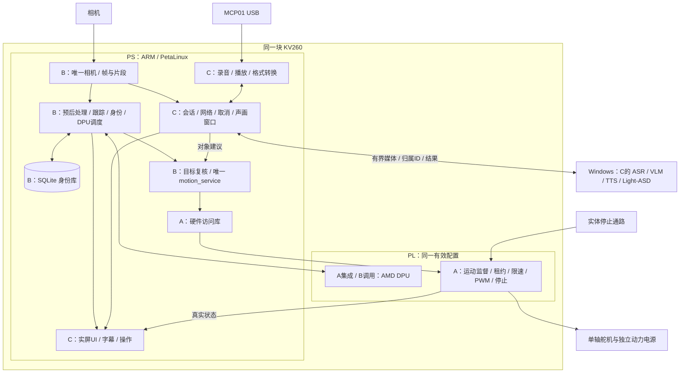

# A 负责人执行手册：FPGA、平台、硬件与共同板端底座


日期：2026-10-02。执行手册版本：`AURA-EXEC-20261002-r3`。这是任务和接口文档版本，不是已经通过的硬件/软件 release。

三人共用范围：单水平轴、KV260 板端视觉/身份/运动/录放音/交互/UI，Windows 首版 ASR/VLM/TTS/Light-ASD，Ubuntu 构建。双 I2S、声学定位、audio_doa_ip 已取消；板端身份和 Light-ASD 保留。

**独立使用约定：**本文件包含执行所需的系统背景、共同接口、本人工作包、具体步骤、配置/诊断、部署、故障、测试和交付。来源链接用于追溯，执行时无需先阅读另一本手册。总负责人和其他成员交付的实际硬件/模型/库仍是工程依赖，不能用文档代替。

本次文档整理没有实际连接板卡或构建机。当前证据到“官方推理历史通过、独立 DPU 4.1 主机构建完成”，候选上板/联合运动/整机仍需验证。代码、配置样例和脚本入口是待实现约定；标 `null`、`待实测` 或参数变量的值必须取得后校验，不能直接用于运动使能。

四份手册里的共同合同必须保持一致。更改 ABI、消息、标定、模型空间或恢复语义时，总负责人组织同步四份执行文件及实际工程源；具体源码/工件仍以统一 release-id 和唯一合同源为准。

本版补充第5.5—5.14节：三人开展板端工作前的共同环境，以及屏幕、相机/视觉/身份、转轴、MCP01/问答、ASD各自所需环境、最小验证、准备责任和开工放行条件。

本手册交给 A 独立执行；本人工作包 A01—A14。总负责人总包与其他两份文件用于跨人同步。

- [总负责人总包：完整系统、三人协作、同板集成与最终交付](00_总负责人_系统集成与交付总包.md)
- [B 负责人执行手册：板端视觉、身份与唯一运动服务](02_B负责人_视觉身份与板端运动服务执行手册.md)
- [C 负责人执行手册：视听交互、主机模型与板端界面](03_C负责人_视听交互主机模型与板端界面执行手册.md)


**章节快速入口**（每份的核心背景和合同均在本文件内）

| 章节 | 章节 | 章节 |
|---|---|---|
| [1. 从当前真实进度继续](#chapter-01) | [2. 本人闭环目标、边界与阅读路线](#chapter-02) | [3. 必须共同部署在 KV260 的完整清单](#chapter-03) |
| [4. 共同板端服务逐项实现合同](#chapter-04) | [5. 板端共同系统、依赖和资源安排](#chapter-05) | [6. 三人共用接口、时间和状态](#chapter-06) |
| [7. A 的 14 个工作包及逐项执行做法](#chapter-07) | [8. 本人实现配置、诊断及启动做法](#chapter-08) | [9. 本人链路的端到端演练](#chapter-09) |
| [10. 三人交接：具体给什么、怎样确认收到](#chapter-10) | [11. 共同上板关卡及同板验收方法](#chapter-11) | [12. 从现状继续的排期和工时分配](#chapter-12) |
| [13. 共同板端验收与测试分工](#chapter-13) | [14. 同板故障、降级与恢复：谁修哪一层](#chapter-14) | [15. 必须冻结的参数和冻结时点](#chapter-15) |
| [16. 工程目录、板端包、启动与发布](#chapter-16) | [17. 本人的第一批执行和阻塞处理](#chapter-17) | [18. 本人的最终验收、交付与每日记录](#chapter-18) |
| [19. 依据与旧方案的采用方式](#chapter-19) |  |  |

**工作包快速入口**

| 工作包 | 工作包 |
|---|---|
| [A01 平台事实与已有成果归档](#task-a01) | [A02 DPU 4.1 独立测试卡与原应用对照](#task-a02) |
| [A03 最小共存探针与放置可行性](#task-a03) | [A04 唯一运动 ABI、状态与恢复合同](#task-a04) |
| [A05 AXI-Lite、影子命令、原子提交和快照](#task-a05) | [A06 参数化 PWM 与正常边界更新](#task-a06) |
| [A07 独立许可、租约、序号和故障监督](#task-a07) | [A08 变化率、脉宽映射、停止输入与恢复参考](#task-a08) |
| [A09 完整 motion 与 DPU 联合实现](#task-a09) | [A10 板端访问库与受控维护诊断](#task-a10) |
| [A11 匹配 Linux、驱动和 SDK/sysroot](#task-a11) | [A12 供电、针脚、实体停止和单轴机构](#task-a12) |
| [A13 并发、资源、故障与最终硬件测量](#task-a13) | [A14 硬件发布、恢复、报告与可复用经验](#task-a14) |

<a id="chapter-01"></a>

## 1. 从当前真实进度继续

### 1.1 本次核对到的现状

| 对象 | 可以确认到哪一层 | 尚不能确认的部分 | 本轮负责人 |
|---|---|---|---|
| 官方 PetaLinux 卡 | 已有启动、登录、ResNet18 分类与短时性能记录 | 本次未连接板卡，不把历史结果当作当前启动状态 | A 记录平台，B 核模型 |
| 2022.2 工具和官方参考 | 后续报告记录器件组件问题已修复，原参考已构建成功 | 不重新安排“先解决旧 Clocking Wizard 阻塞” | A 接续现有成果 |
| 独立 DPU 4.1 工程 | 报告记录 XO、link、实现、包准备完成 | 新包实际加载、VART 推理、恢复仍未通过板端验收 | A/B 共同对照 |
| 架构目标 | 报告中的新架构为 `0x101000056010407`，与原 ResNet18 目标一致 | 静态元数据匹配不能替代实际硬件查询和推理 | A 给架构，B 检验模型 |
| 新 DPU 硬件余量 | 报告中 CLB site 占用 99.50%，setup WNS +0.001 ns | 最小 AXI IP 或完整运动 IP 能否放置/布线/达时序尚未证明 | A 主责，B/C 提供负载 |
| 约束与 DRC | 报告记录 600 条 Warning、0 Error，存在 16 个 I/O delay 方向缺口 | 不可认定全设计约束完整；新增引脚和实际使用接口需逐项处理 | A |
| 自研运动 IP | 有设计框架、接口草案和计划 | 本地未见正式 RTL、仿真及联合上板通过证据 | A |
| 应用代码 | `aura_fpga` 当前可见 5 个设计/模板文件 | 本地未见完整相机、视觉、身份、运动、交互和 UI 应用实现 | B/C 盘点各自外部代码 |
| MCP01 | 已购，方案采用 USB 录放音 | 当前板端输入/输出、格式、重插和并发仍需验证 | C，A 协助驱动/供电 |
| 人脸身份 | 板端目标保留 | Windows 演示不能算板端身份完成；人脸 DPU 子任务需另验 | B |
| Light-ASD | 保留视觉说话人目标 | 本项目实时同步输入、拒判和多人测试尚需交付 | C，B 提供连续片段 |
| 整机 | 方案完整，已具备分步推进依据 | 同板并发、最终负载、两小时长测和独立复现未见通过证据 | 三人共同 |

上述“报告记录”表示本次读到的已有报告内容。本次未取得全部新二进制、routed DCP 和原始构建日志来独立复核，也未连接 Ubuntu/KV260。

### 1.2 当前先做的共同工程验证

1. A/B 在独立测试卡上重新建立原应用与 DPU 4.1 候选应用的**同模型、同图片、同程序/运行时**对照。
2. A 先加入最小版本寄存器，验证它与 DPU 在同一最终完整配置中共存，再扩展运动逻辑。
3. B 同时推进现有官方卡上的相机、模型、跟踪与身份小链；C 同时推进 MCP01 和主机问答小链。
4. 联合硬件未通过前，B/C 可以使用明确标记的模拟运动接口；它只用于软件开发，不能计作真实随动验收。

历史 214.381/238.479 FPS 来自 `dpu_test.jpg`；Samoyed 0.949879 来自另一张犬图。后续正确性、性能分别按固定输入复测，不把两张图拼成一次对照，更不把 ResNet18 FPS 当作 YOLO 整机帧率。

### 1.3 本轮产品范围

必交：单水平轴、人体检测/跟踪、板端身份、受监督视觉随动、MCP01 USB 录放音、按键半双工、Windows ASR/VLM/TTS、Light-ASD 视觉说话人、板端字幕/玩偶/状态、取消、断连、停止和复现。

当前删除：双 I2S 麦克风、INMP441 采集、互相关/GCC-PHAT 声学方向、自研 `audio_doa_ip`、对应采购及原 T13/T14 验收。不从旧文件重新叠加这些工作。

后置：自由语音打断/AEC、ASR/TTS 板端迁移、完整新 ASD 网络训练、完整 LoCoNet 复现、双轴、底盘、复杂外观。后置任务不占首版必交路径；Light-ASD 和板端身份继续保留。


<a id="chapter-02"></a>

## 2. 本人闭环目标、边界与阅读路线

**本人最终结果：**交付可重建、可加载、可恢复的共同 KV260 平台，以及 DPU 与自研运动核同配置工作、受监督 PWM/停止/恢复和可供 B 调用的板端访问库。

建议执行顺序：第 1—6 章取得现状/同板接口，先对照第5.5—5.14节完成本人开工环境和最小验证；第 7 章按工作包操作；第 8 章填写配置和使用诊断；第 9 章逐段验证链路；第 10—11 章交接/过关；第 12—18 章排期、故障、测试和发布。

你负责共同平台的最终有效性：硬件配置、系统描述、DPU运行组件、motion电路、访问库、实际电气/机构和硬件发布。B负责模型及视觉/身份/正式运动请求，C负责音频/交互/UI/主机模型/日常入口。你向两人交底座和诊断，不代写其全部业务。

| 本人要控制的链 | 输入 | 实现位置 | 输出 |
|---|---|---|---|
| DPU平台 | 固定参考/IP/配置/工具 | Ubuntu构建，KV260 PL/PS运行 | 联合硬件/arch/正确推理能力 |
| 运动执行 | B完整命令、外部停止/故障 | PL；PS库提供访问 | 接受/拒绝、独立租约、受限PWM/状态 |
| 系统交接 | 同版硬件、B/C依赖 | PetaLinux/SDK/板端驱动 | 两人程序可在同一目标系统运行 |
| 实际转轴 | PWM/许可、电源、机构 | 电路/舵机/单轴机构 | 标定、停止/失电/最终负载证据 |

先达到最小共存，再完整监督，再无动力波形，再轻载/真实视觉，再最终负载和同板长测。该顺序是前置依赖，不能仅因排到某一天就跳过。

### 2.1 共同板端结构



图示表达职责和数据流，实际针脚、设备、动力停止和地址按工程取得。B 的正式运动服务唯一写入，A 最终监督，C 只建议对象。三人所有板端程序和电路同时进入同一发布版本。


<a id="chapter-03"></a>

## 3. 必须共同部署在 KV260 的完整清单

以下编号 P01—P28 用于交接和联调勾选。角色不是三个独立系统，所有 P 项都要进入同一板端发布包。某个“服务”可合并成一个进程，资源所有者、队列和恢复边界仍需保留。

| 编号 | 板上内容 | 实际运行位置 | 主责/配合 | 必须输入 | 必须输出与验收 |
|---|---|---|---|---|---|
| P01 | 板端 Linux/内核/基础驱动 | PS | A；B/C 给依赖 | 匹配镜像/硬件描述 | 可启动、设备可用、版本可查 |
| P02 | 联合 DPU 硬件 | PL | A；B 验推理 | 固定参考、DPU 参数 | fingerprint/核数/正确模型输出 |
| P03 | 自研运动 IP | PL | A；B 发命令 | AXI-Lite、时钟/复位/停止 | 受监督 PWM、状态、拒绝原因 |
| P04 | 加载描述/设备树/地址映射 | PS＋PL 交界 | A | 同次构建的工件 | BIN/DTBO/XCLBIN/设备节点一致 |
| P05 | XRT/ZOCL/VART/XIR 等运行组件 | PS | A 系统；B 调用 | 所选 Vitis 路线及匹配版本 | DPU 调用成功、软件 ABI 相符 |
| P06 | motion 底层访问库 | PS | A；B 使用 | 唯一 ABI、真实访问方式 | identity/status/submit/disarm 等 API |
| P07 | 相机唯一采集 | PS，平台可涉及 PL | B；A 驱动 | 实际相机模式 | 有编号、时间、代次、有效性的帧 |
| P08 | 图像池与共享接口 | PS RAM | B；C 消费 | P07 帧 | 引用/副本所有权、有界缓存、不读已释放帧 |
| P09 | 人体模型预处理 | PS | B | 原图/模型规则 | 正确颜色/布局/缩放/量化输入 |
| P10 | 人体 xmodel 推理 | DPU，由 PS 提交 | B；A 平台 | 匹配 arch 的编译模型 | 输出张量、耗时和源 frame |
| P11 | 解码/NMS/坐标恢复 | PS | B | 模型输出/缩放信息 | 原图人体框与分数 |
| P12 | 跟踪/人物生命周期 | PS | B | 检测结果/真实 dt | track_id＋generation、可见/丢失/离开 |
| P13 | 人脸/身份处理链 | PS＋适配 DPU 子图 | B；A 平台 | 真实脸/关键点/固定模型 | KNOWN/UNKNOWN/AMBIGUOUS 与模型位置证据 |
| P14 | SQLite 模板/偏好/版本 | PS 持久存储 | B；C 调 API | 已授权登记/删除 | 事务、db_version、重启后正确持久化 |
| P15 | 人体/身份 DPU 调度 | PS | B | 有时限的检测/身份任务 | 检测优先、限频、队列/帧龄日志 |
| P16 | 当前目标管理 | PS | B；C 给建议 | 当前轨迹/人工选择/ASD 建议 | 目标确认、拒绝/切换原因、失效处理 |
| P17 | 唯一 motion_service | PS | B；A 库 | 当前新鲜轨迹/标定/会话 | 毫度目标、租约、序号、接受回读 |
| P18 | 问答快照供应 | PS | B；C 请求 | 本轮时间与目标 | 新鲜图片、frame/hash/目标归属 |
| P19 | 连续人脸片段缓存 | PS RAM | B；C 用 | P07/P12 和质量信息 | 同轨迹连续片段、缺帧及时间标签 |
| P20 | MCP01 USB 录音 | PS/ALSA | C；A 驱动 | 确认的声卡/格式 | PCM、样本计数、时间、音量/异常 |
| P21 | MCP01 真实播放 | PS/ALSA | C | 合法回答音频 | 实际声音、进度、结束/取消结果 |
| P22 | 录放格式转换 | PS | C | 实际设备/模型格式 | 真重采样/混声道、样本数及映射 |
| P23 | 音视频有限窗口 | PS | C 音频/拼窗；B 片段 | 同期音频、脸片段/对齐版本 | 可发送的窗口和质量/失效原因 |
| P24 | 对话状态及主机客户端 | PS | C；B 目标/图像 | 按键/请求/主机事件 | session/request/generation、取消/超时/断连 |
| P25 | ASD 建议整理/板端接收 | PS | C；B 复核 | Windows 分数及源窗口 | 带时效的对象建议，歧义 UNKNOWN |
| P26 | 实屏 UI/玩偶/字幕/操作 | PS，显示依赖平台 | C；A 显示；B 状态 | 真实事件和快照 | 当前状态、可执行按钮、播报对应动画 |
| P27 | 启动/自检/停机/恢复 | PS | C 编排；A/B 探针 | 发布版本与设备健康 | 分项 ready、明确禁能、无旧任务复活 |
| P28 | 日志/指标/配置/发布身份 | PS RAM＋存储 | 三人各产日志，C 采集，A 汇版 | 各服务事件/版本 | 能追溯一次问答与一次运动全过程 |

### 3.1 不进入首版板端的计算

| 内容 | 首版位置 | KV260 仍需做的工作 | 责任 |
|---|---|---|---|
| 中文 ASR 模型 | Windows | 录音、校验、转换、上传、接收当前请求转写 | C |
| VLM 看图问答 | Windows | B 提本轮图，C 上传/绑请求/收回答 | C 模型，B 输入 |
| 中文 TTS 模型 | Windows | 接收合法音频、转换、实际播放和取消 | C |
| Light-ASD 网络 | Windows | B 提连续脸，C 提音频/窗口、收证据，B 再核目标 | C/B |
| Vivado/Vitis/PetaLinux Tools | Ubuntu 构建机 | 只部署构建产物、运行库和应用 | A |
| 量化器/模型编译器 | Ubuntu 固定 Vitis AI 容器 | 只部署匹配 xmodel 和推理程序 | B |

板端不因为问答依赖 Windows 就失去独立视觉、身份、数字停止或租约监督。断 Windows 后自动视听换人暂停；本地视觉跟随是否继续按冻结的 BOARD_ONLY 策略执行，不能用连接恢复自动 ARM。


<a id="chapter-04"></a>

## 4. 共同板端服务逐项实现合同

### 4.1 camera_service：B 负责，所有图像消费者共用

**内部工作：**设备枚举→模式设置→出队→时间/编号→图像池→帧发布→快照/片段请求→断连恢复。记录设备真实能力、USB/UVC 或 MIPI 路线、像素格式、分辨率、实际采集频率和镜头代次。

每帧保留原始 `board_boot_id/camera_epoch/frame_id/capture_mono_us/width/height/pixel_format/valid`。若只能取得驱动出队时间，字段说明写“出队”，不称曝光时间。重连、更换模式或重载相关平台后换 camera_epoch，旧帧立即失效。

**缓存：**预分配小图像池；明确生产者、消费者引用和释放。检测拿最新有效帧，UI 可以拿低频副本，VLM 只要本轮快照，ASD 拿有限的连续片段。任何消费者不能无限持有全部帧或用一个阻塞锁拖住采集。

**验收：**单相机所有者；采集真实而连续；慢 UI/慢模型不造成旧帧无限积压；拔相机产生明确无帧状态；重插不把旧轨迹和旧帧继续绑定。B 向 C 提供真实单帧和连续片段各一份样例。

### 4.2 vision_identity_service：B 负责板端视觉和身份

**人体路径：**原帧→固定预处理→VART/所选运行库→DPU 子图→后处理→原图框→跟踪→轨迹事件。模型张量形状、颜色、量化缩放和 letterbox 逆变换全部固化，不能靠 UI 看起来“有框”判断正确。

**身份路径：**真实人脸→人体归属→质量筛选→关键点对齐→特征→匹配→多帧确认→板端库。每步列 CPU/DPU 实际位置；板端 CPU 基线先通，再推进可适配人脸 DPU 模型。CPU 通过和 DPU 子任务未通过分别报告。

身份结果带 `track_generation/model_id/db_version/evidence_frame_ids/decision/reason`。同一名字不代表同一轨迹；“在说话”不代表身份；库变化时旧结果失效。C 的登记/删除操作调用 B 的接口，B 检查授权、目标唯一性和事务条件。

**验收：**图像、检测、轨迹、身份都可追溯；模型运行真实；UNKNOWN/AMBIGUOUS 有原因；重启和删除正确；识别任务不持续挤占人体检测。

### 4.3 DPU 调度：B 负责，A 保证硬件/运行组件匹配

首版由 B 统一管理人体和人脸的业务提交。在当前报告的单 CU 配置下，不把多个进程各自调用模型当作已经解决并发。

1. 检测任务优先服务新帧；过期任务在提交前丢弃。
2. 身份按当前目标、质量和最小间隔触发；合格新脸才提交。
3. 设置人数上限、身份在途数、队列深度和最大等待。
4. 一次已提交推理是否可取消/抢占以运行库实测为准；不能假定身份任务能被瞬间抢占。
5. 记录等待、DPU 时间、后处理、结果源帧年龄、CPU 子图耗时和过期丢弃。
6. 由人体→人体＋身份→再加 UI/音频/网络逐步测资源；若不达标，先降低身份频率/输入负担，再讨论硬件配置。

**交给 A：**准确的 xmodel/arch/hash/运行程序/输入样例及负载脚本。**交给 C：**当前轨迹和身份结果 API，不开放任意 DPU 操作入口。

### 4.4 motion_service：B 负责，正式运行唯一写寄存器

**输入：**当前目标、最新轨迹帧、目标可见性、标定、A 的硬件状态；C 只提供目标建议。**输出：**受限目标毫度、session/epoch/seq、剩余租约、接受/拒绝记录。

执行顺序：检查服务模式→查当前轨迹和会话→查源帧年龄→应用目标滞回/丢失策略→算实际 dt→滤波/死区/比例角速度→范围与单步/速率约束→扣除已用时效→调用 A 库提交→回读结果→更新已接受指令状态。

不得执行：用旧 ASD 画面中的横坐标直接转轴；用预测/平滑时刻冒充新采集时间；相机停帧后仅更换 cmd_seq 续租；靠 UI 或主机心跳维持运动；收到 VLM 自然语言后直接写 ARM。

新有效帧确认目标仍在死区内，可提交同一目标角和新的合法租约。没有新有效帧时不能续租。被拒绝的目标不更新“已接受角度”；运动硬件没有编码器时，显示“指令角”及许可，不显示虚构的“实测轴角”。

**退出/重启：**主动禁能；异常退出仍由 PL 独立到期；新进程先自检、清队列、建立新会话，运动保持禁能，恢复需明确动作。

### 4.5 hw_access：A 交付库，B 调用，C 只消费状态

最低 API：`read_identity()`、`read_status_snapshot()`、`disarm(reason)`、`ack_fault(expected_epoch)`、`confirm_reference(calib_id)`、`arm(expected_epoch, session)`、`submit_command(command)`。

库负责 ABI/IP/BUILD 检查、实际设备打开、访问权限、单位检查、影子字段完整写入、排序/MMIO 语义、COMMIT、有限时间等待、一致快照和错误枚举。返回“总线失败/命令拒绝/接受/超时/版本错”等区别，不能所有结果只回 true。

实际访问采用平台验证过的驱动/UIO/XRT 路径。物理地址与映射属性由 A 取得，不散落到 B/C 应用，不提前指定未知的 `/dev/mem` 地址。库关闭不替代硬件到期。

### 4.6 音频模块：C 负责 MCP01 的唯一录放控制

内部实现设备定位、硬件格式探测、PCM 环形缓存、样本时间映射、真实格式转换、录音开始/结束、播放进度、取消清缓冲、重插恢复和健康报告。A 处理缺驱动、供电/USB 平台问题。

输入设备和输出设备都以真实身份匹配；不能默认 card 0/1。优先稳定 CARD_ID，必要时结合 VID:PID、序列号或 USB 路径。拔出后显示不可用，不悄悄切到屏幕声卡或别的麦克风。

首版按键半双工：按下先取消旧播报并停缓冲→录音；松开立即结束→发送；播报期间暂停自动新问题和基于自播音的选人。若开展同时录放/AEC 测试，结果单列，未通过保持半双工。

每块音频带样本起止、真实采样率、声道、位宽、设备代次和板端时间。重采样改变真实样本并维护时间映射，只改 WAV 头不算转换。

**验收：**录音确实来自 MCP01、回放确实由 MCP01 发声；相机并发、冷启动、重插、取消都真实通过；音频格式/时长/样本数对应。

### 4.7 interaction_service：C 负责板端会话和网络

管理 `IDLE/LISTENING/PROCESSING/SPEAKING/CANCELLED/ERROR`，同时保留目标、身份、运动和主机的独立状态。声音问答忙时本地视觉仍工作，不持有运动锁等待网络。

按键创建 utterance；松键冻结输入和本轮快照，创建 request；服务校验输入/主机 ready 后上传。Windows 内部完成 ASR→VLM→TTS，板端接收当前请求的转写/字幕/音频，不每一步绕回板卡重新上传。

取消本地优先：推进 generation、废止请求、停播放器、清应用及所选 ALSA 缓冲、拒绝旧音频/字幕/动画，然后通知主机。主机无法立即终止 GPU 计算时，旧输出仍不能显示或播放。

所有重试保持请求语义：同一 request 不重复执行播放；新轮创建新身份；重连不能把历史回答放回当前队列。过期、目标换代、协议失配及主机不 ready 均有具体错误。

### 4.8 板端 ASD 窗口与对象建议：C 主责，B 提供视觉及最终复核

B 从唯一相机输出有限的同轨迹脸片段；C 将 MCP01 音频按统一板端时基拼窗，检查首尾、缺帧、缺样、对齐版本和期限，再发 Windows 的 asd_worker。

每个可见人对应自己的连续脸片段，可以共用同一混合音频；这是视觉说话人判断。窗口不是 VLM 的单张快照，不复制照片当视频，不包含声学 DOA/方位角。

C 接回分数后只处理新增有效证据，平滑、保持、多人竞争和歧义拒判；重叠窗不重复累计“独立确认”。在播报、停止、画面外声音、同时讲话、对齐错误或候选接近时暂停自动切换/返回 UNKNOWN。

建议交 B 后，B 再查当前轨迹和时效；即使窗口里的人说话高分，只要已离开或生命周期改变，也不生成运动。

### 4.9 UI：C 负责板上的真实屏幕

A 交付可用显示通路；C 在实际镜像上选定一个可用渲染后端并冻结。先静态中文图→状态变化→动画/字幕→并发，PC 界面原型只作为开发阶段。

主视图显示当前对象、身份状态、听/想/说、主机/音频状态、运动禁能/故障和操作。调试视图可看 release、帧龄、队列、模型/故障原因，避免把工程细节塞进日常用户流程。

角色动画由真实事件驱动；播放开始才“说话”，结束/取消/设备错误停止口型。能量开合可随实际播放音频 RMS/进度驱动，不能称作精细音素口型。字幕无词级时间戳时按整句呈现。

登记/删除操作调用 B API；手动选人调用 B 目标接口；恢复运动走 A/B 的明确合同。UI 不直接打开相机/声卡/数据库或写运动寄存器。

### 4.10 启动、自检和日志：C 编排，三人分别实现探针

A 的探针查 OS/硬件包/IP/ABI/DPU/标定/停止/设备访问；B 查相机真实更新、模型固定输入、轨迹/身份库/调度；C 查音频输入输出、主机模型 ready、协议、UI 和本轮取消状态。

“进程存在”“端口监听”“设备被枚举”是不同探测层，不代替实际功能。startup 记录 READY/PARTIAL/FAILED 和对应原因，运动保持禁能到显式恢复。

各模块自己产结构化日志；C 的入口收集统一包，A 将硬件构建/波形报告挂入发布清单。日志轮转、有容量上限，媒体与普通状态日志分开，避免逐帧同步写 SD 把系统拖慢。


<a id="chapter-05"></a>

## 5. 板端共同系统、依赖和资源安排

### 5.1 A 向 B/C 交付的系统底座

| 系统项 | A 做什么 | B/C 要给 A 什么 | 验收方法 |
|---|---|---|---|
| OS/内核/镜像 | 固定真实 PetaLinux 2022.2 版本、启动与文件哈希 | 实际应用所需依赖 | 串口启动、系统身份和新卡启动 |
| DPU 运行环境 | 记录 XRT/ZOCL/VART/XIR/库版本、加载身份和访问方式 | 匹配模型/程序/样例 | 同图推理，运行库及实际 XCLBIN 一致 |
| USB 音频 | 核验 USB/声音内核驱动，补确实缺的工具/配置 | C 提设备身份、格式和失败日志 | ALSA 能力、录音/回放/重插 |
| 相机 | 支持实际 UVC/MIPI 路线，保留所需平台功能 | B 提型号、模式、格式和时间能力 | 真实连续采集与异常日志 |
| 显示 | 核验最终 DP/HDMI 路线、设备树和物理转换方向 | C 提屏幕输入、分辨率、后端依赖 | 实屏中文静态图、动画、并发 |
| 运动访问 | 真实映射、权限、ABI、驱动/库 | B 提 API 用例与故障注入 | 无动力正常/拒绝提交及波形 |
| 数据库/图像/网络库 | 纳入实际使用的 ARM64 依赖 | B/C 给版本/包清单，不给候选大全 | 目标板功能探针和动态库检查 |
| SDK/sysroot | 匹配最终 rootfs 的目标构建环境 | B/C 的构建入口/链接依赖 | ARM64 程序在实际系统运行 |
| 服务管理 | 先查本镜像 init/服务管理机制，再选正确启动实现 | B/C 给启动、退出、健康探针 | 冷启动、服务退出及恢复 |

不默认 PetaLinux 是 Ubuntu，不默认有 apt，不默认已有 systemd，不默认 x86 的 pip 二进制能在 ARM64 用。是否采用 systemd unit、init 脚本或受控 supervisor，以实际镜像可用机制冻结。Python 也需核验解释器版本、原生扩展和依赖。

本项目继续固定 2022.2/3.0 路线。[AMD 兼容表](https://xilinx.github.io/Vitis-AI/3.0/html/docs/reference/version_compatibility.html)列出 Vivado/Vitis/PetaLinux 2022.2、DPUCZDX8G 4.1、Vitis AI 3.0 的组合；项目的最终清单仍应填写实际工件及运行组件，不用网页版本直接覆盖实测。

### 5.2 DPU 4.1 与运动 IP 的共同集成决策

当前报告为完整静态 XRT_FLAT，`Pblock=0`、可重配置 cell=0；不能假定已有一块空 RP 直接塞运动 IP。新 BIT 是完整 PL 位流，单独再加载 PWM 完整位流会替换它。

由 A 在**实际最终链接后的设计**中确定 AXI-Lite 接入、独立地址窗口、控制时钟/复位及 PWM/停止引脚。最小只读 ID、ABI、BUILD 和 SCRATCH 探针先走完整综合/布局/布线；B 同配置推理和读回；C 显示真实平台身份。

物理余量分三步评审：

1. 最小探针实现成功：才扩大到运动核。
2. 完整运动核通过但时序/资源不达标：先做小电路、减少不必要平台功能/调试开销、核对布局和约束，所有修改留差异及回归。
3. 必须改变 DPU 规模/频率/平台功能：A/B 先列出对模型 arch、吞吐、人脸调度、相机/显示的影响，再生成新硬件/模型匹配证据。不能静默降配置并沿用旧成绩。

99.50% CLB site 不是逻辑上完全无空 LUT/FF，但也不是新增 IP 必定放得下。此处是需要实测的工程关卡，不能用全芯片 LUT 剩余比例保证集成。

### 5.3 CPU、DDR、DPU、USB、显示和磁盘如何一起分配

| 资源 | 首版安排 | 必记指标 | 负责人 |
|---|---|---|---|
| PS CPU | 相机/运动独立于网络与 UI 阻塞；限制图像编码和身份频率 | 各线程 CPU、运行时间、抖动、帧龄 | B/C；A 查系统 |
| DPU | B 统一检测/身份业务调度；不过量提交旧任务 | 队列等待、运行时、有效检测频率 | B |
| DDR/共享缓冲 | 小预分配帧池、有限脸片段、有限音频、有限网络/播放队列 | RSS、缓冲字节数、峰值、丢弃原因 | B/C |
| CMA/设备缓冲 | 按实际相机/DPU/显示驱动需求核验 | 内核分配失败、驱动日志、可用内存 | A；B/C 提复现 |
| USB | 相机和 MCP01 同时测；稳定设备身份 | 掉设备、带宽/音频 xrun、录音连续性 | B/C；A 供电 |
| 显示 | 状态优先，UI 不以每帧全分辨率复制拖住视觉 | 帧绘制耗时、事件到屏幕时间 | C/A |
| SD/持久存储 | 身份事务和有限日志；不持续保存所有原始媒体 | 写入耗时、空间、日志轮转、数据库错误 | B/C |
| LAN | VLM 单次快照；ASD 有限片段；控制消息与媒体任务分开 | 上传/下载、重连、排队、过期率 | C；B 图像 |

缓存预算必须按实际数据类型计算。例如一个 RGB8 图像池使用 `N×W×H×3` 字节；脸片段使用 `人数×帧数×裁剪宽×裁剪高×通道×每元素字节`；PCM 使用 `秒数×采样率×声道×每样本字节`。这些只是预算公式，最终计入解码副本、浮点张量、编码暂存和运行库内存。

首版队列草案：检测保留最新 1—2 个候选帧；身份等待队列只保留有限合格任务；VLM 在途 1、待处理不无限增长；ASD 保留少量最新窗口；播放按 generation 有界；UI 保留最新状态并保留必要错误事件。数值在第一次并发测量后冻结，不把草案当已实现参数。

### 5.4 板端开发语言与二进制交接

A 的 RTL 用 Verilog/SystemVerilog，平台入口用实际参考允许的 Tcl/脚本。B/C 的板端程序可用已验证的 C++/Python，按可用运行库选定，不为“统一语言”重写成熟代码。

每个板端应用交接：目标架构、依赖、版本、启动参数、配置、输入/输出、健康探针、退出行为、日志位置。C++ 程序从匹配 SDK 构建；Python 的 OpenCV/NumPy 等原生依赖也要在 ARM64 实测。主机 PyTorch/Transformers/ASD 环境不整套搬到板端 rootfs。

### 5.5 三人板端工作开始前：环境层次与责任

本节回答“屏幕、视觉、转轴等工作开始之前，KV260上究竟要有什么”。这里的板端包含PS上的Linux/应用、PL里的电路以及真实外设；三人的程序在同一块板上运行，但依赖的开工条件不同。

前置环境分四层，逐层验证：

| 层次 | 需要具备什么 | 主要准备人 | 接收/验证人 |
|---|---|---|---|
| 实物与连接 | 板/供电/散热/SD/串口/LAN，屏幕、相机、MCP01、舵机及各自连接 | A核公共硬件，B核相机，C核屏幕/音频 | 三人实际检查 |
| 共同运行底座 | 可启动Linux、对应PL/设备描述、正确驱动、网络/权限/存储 | A | B/C跑设备与功能小样 |
| 模块开发环境 | ARM64库/解释器、匹配SDK、模型/接口/资源/配置 | A给系统/SDK；B/C给本模块准确依赖并实现验证 | 本人编译/运行 |
| 最小功能证明 | 静态中文图、真实帧、固定图推理、无动力PWM、录音回放等 | 对应模块作者 | 接收方看真实输出/证据 |

“安装了库”“发现了设备节点”“启动了进程”只是中间状态；相应最小功能真实通过后，才放行依赖它的工作。本节列的是待取得的环境和实测，不表示本次已经配置了板卡。

**责任原则：**A交共同系统与硬件能力，B/C先提交准确依赖和最小样例，随后各自完成模块验证。负责人维护一个共同版本清单；三人不能各换一套系统后把成绩拼成同板通过。

### 5.6 公共底座：所有板端模块都先检查这些

| 编号 | 开工前必须准备 | 具体做法 | 最低证明/交付 |
|---|---|---|---|
| E01 | 板卡、供电、散热与启动介质 | 核载板revision、SOM/SD身份和供电/风扇；保留已验证原卡或恢复包；不在未确认介质上覆盖写卡 | 可追溯的设备/SD清单、串口完整启动日志、可执行恢复步骤 |
| E02 | 固定Linux与对应硬件描述 | 接续PetaLinux2022.2路线，记录实际OS/内核/rootfs/PL/设备树；新增IP后确认描述对应本次设计 | 实际启动/版本输出；硬件包与系统映射一致 |
| E03 | 访问、网络与传文件 | 串口可登录/观察失败，配置实际LAN/IP和选定SSH/传文件方式；板端与Windows互达；验证文件hash | B/C能登录、传样例并查日志；主机服务连接实测，非仅ping |
| E04 | 可用的目标开发环境 | C++用匹配SDK/sysroot编译；Python查板端解释器与ARM64原生依赖；运行本模块最小程序 | 小程序在实际板上运行，动态依赖/原生扩展可加载 |
| E05 | 路径、权限、时间与容量 | 定应用/模型/配置/数据库/日志目录；明确设备与数据写权限；核SD空间/RAM/CMA；约定板端monotonic和boot/epoch | 样例能读配置/写有限日志；没有权限/容量错误；时基语义有记录 |
| E06 | 服务管理与共同版本 | 查真实init/服务机制；明确启动/退出/探针/维护互斥；统一release、ABI/协议和配置索引 | 冷启动能找到入口，各模块默认状态明确，运动默认禁能 |

**主机工具与板端运行环境分开准备：**Vivado/Vitis/PetaLinux Tools在Ubuntu构建机，模型量化/编译在固定Vitis AI工具环境；KV260部署生成的硬件包、运行库和应用。Windows承载首版ASR/VLM/TTS/Light-ASD，板端保存其客户端所需依赖。

不因为开发电脑有OpenCV/Qt/PyTorch就认为板端有；不因为板端是Linux就认为有apt、systemd或完整桌面。缺什么由B/C明确提给A，在实际镜像补齐和验证。

**公共底座的实机检查顺序：**启动并保存串口→记录版本/有效PL→确认登录/文件读写/网络→运行ARM64或Python最小程序→列实际设备/权限→确认日志和恢复入口。原有工具/系统未变化且有有效证据时复用，不重复安装。

### 5.7 屏幕与UI：C开工前要拿到的环境

屏幕先完成“物理连接→有效显示输出→Linux显示驱动→板端渲染小样”，再做玩偶动画、字幕和业务操作。

| 前置项 | A/C具体准备什么 | 怎样验收 |
|---|---|---|
| 屏幕实物信息 | C记录型号、输入、分辨率/刷新率、供电、方向、触控是否存在；A核电源/接线 | 拿到规格与实物照片，供电/视频/触控线各自明确 |
| 有效视频输出路线 | A查最终平台实际保留的DP/HDMI通路、控制时钟/复位/设备描述和相关依赖 | 本次目标配置能给最终屏幕输出，不能只在另一份显示位流上成功 |
| Linux显示环境 | A核内核显示驱动/设备树/输出模式；采用DRM/KMS时，定位实际显示设备/连接器及权限；若选其他后端按其实际要求核验 | 驱动识别、连接器/模式可查，真实设置模式并显示测试图 |
| 一条可用渲染路线 | C选实际镜像支持的一条Qt/SDL/浏览器等路线，给A精确依赖；需要的插件、显示服务器/compositor、libdrm/EGL等按后端确认 | 板端最小程序能运行并出图，缺插件/共享库有明确诊断 |
| 字体/图片/动画资源 | C准备中文字体、角色图、UTF-8文本、正确资源路径，记录来源 | 实屏中文正常，无缺字/乱码/路径错误 |
| 输入与状态 | C核按键/触控实际输入路径；约定I07事件与状态快照 | 最小按键→屏幕状态变化；触控仅在实际要求时列必需 |

[AMD接口说明](https://docs.amd.com/r/en-US/ug1089-kv260-starter-kit/Interfaces)列出载板的DP/HDMI输出；能否出图还要核实际平台/驱动。HDMI屏优先核直接HDMI路线；仅DP已验证时再评估方向正确的转换，不预先强制买转换器。显示设备/权限参考[Linux DRM接口](https://docs.kernel.org/gpu/drm-uapi.html)，具体能力仍按目标内核实测。

**建议的最小放行试验（工程小样，不是最终T25）：**最终屏幕上显示颜色块、中文“板端显示测试”、本地递增计数；再显示移动图标/短字幕并做一次按键切换。核分辨率、方向、文字、真实刷新和权限。加入相机/DPU后重复，检查没有卡屏/明显拖慢视觉。

**谁交给谁：**A给C显示路线/驱动/模式/设备权限与静态出图证据；C给A实际渲染后端和依赖表。显示未过时C可做原型，但实屏工作保持待验证。

### 5.8 视觉：先有真实采集，再有DPU推理和身份

视觉环境按三档准备；相机能采集与人体模型能推理是两项，不互相代替。

| 档位 | 所需环境 | 谁准备 | 开工前最小验证 |
|---|---|---|---|
| 原始相机采集 | 实际相机/镜头/安装方向、USB/UVC或MIPI接口；匹配驱动/设备树；V4L2/实际采集API与格式转换依赖 | B选实物/模式，A保证平台支持 | 真实连续帧/短片、实际格式/分辨率/频率、原时间语义 |
| DPU人体检测 | 有效DPU硬件、匹配运行库、真实arch和已量化编译模型；预后处理及人体类别定义 | A交硬件/runtime/arch，B交模型/程序 | 平台固定分类图先通过，再人体固定图通过，最后接相机 |
| 板端身份/库 | 板端人脸检测/关键点或对齐/特征依赖；模型空间/阈值、SQLite/可写持久目录/迁移 | B，A补精确系统依赖 | 真板端脸→对齐→特征→匹配→空库登记/删除；CPU/DPU分项记录 |

**相机环境取得步骤：**

1. B固定实际摄像头和接口；USB/UVC查实际USB身份与采集驱动，MIPI则核具体传感器/接收/ISP/媒体链及平台电路，不能只接线就默认支持。
2. 查询实际采集设备与能力，确认它是可采集节点；`/dev/videoX`仅是常见节点形态，X不写死，也不把元数据/其他功能节点当相机。
3. 设置模式后读取驱动实际返回值；固定宽高/帧率/像素格式、stride及解码/颜色转换。V4L2允许驱动调整请求格式，须核返回值。[Linux采集接口](https://docs.kernel.org/userspace-api/media/v4l/dev-capture.html)
4. 连续取真实帧，统计间隔/缺帧与时间字段；拔插验证代次与旧帧失效。B提供单一采集服务，C只通过API取图。
5. OpenCV等仅在实际采用时纳入，C++共享库或Python cv2/NumPy原生扩展在ARM64上加载/处理一张真实图。JPEG/MJPEG解码等依赖按实际像素格式补齐。

**DPU环境取得步骤：**

1. A记录有效PL、加载包/实际XCLBIN、DPU身份、XRT/ZOCL/VART/XIR的真实版本与来源；沿已有Vitis路线配套，不混用另一套运行配方。
2. A/B用固定模型/图/程序验证运行库及硬件身份，并保存原应用恢复结果。候选只在主机编译成功仍不算DPU板端ready。
3. A交真实arch/hash；B在固定工具环境量化/编译人体模型，交xmodel/hash、张量/缩放/颜色/坐标恢复/类别/NMS配置。
4. B在板端固定图推理、检查原图框及CPU/DPU子图，然后接相机。跟踪依赖真实检测和时间，但跟踪算法在PS运行。

工具/运行库的角色参照[AMD系统集成说明](https://xilinx.github.io/Vitis-AI/3.0/html/docs/workflow-system-integration.html)；这里保留本项目固定路线，最终版本以实际清单为准。

**身份环境额外检查：**可写数据库目录/权限/容量、schema与迁移、特征维度/空间、板端CPU依赖、可适配DPU子模型、授权/事务/库版本。先用板端CPU通全链可推进，但不能将未完成DPU子任务勾为已完成。

**谁交给谁：**A给B共同硬件/runtime/arch/SDK与设备访问；B给A实际模型/负载，给C当前帧、快照和真实连续脸。视觉检测可在已有可用DPU基线上推进，不必等转轴完成。

### 5.9 转轴：无动力控制环境与真实动作环境分别准备

转轴需要“PL控制电路＋PS访问接口＋电气/机械条件＋标定”。这四项缺任何一项，都不能放行真实视觉随动。

| 层次 | 前置环境/输入 | 具体准备 | 最低放行证据 |
|---|---|---|---|
| PL连接 | 同配置DPU与motion、AXI/地址/clock/reset、PWM/停止IO | A在最终设计接入并约束，确认针脚不与保留功能冲突 | 同配置DPU推理＋IP身份/寄存器可读 |
| PL控制模块 | AXI影子/COMMIT、guard、PWM、profile、stop | A实现原子提交、独立租约、范围/限速、停止/恢复 | 仿真及无动力正常/拒绝/到期/停止波形 |
| PS调用 | 驱动/UIO/XRT等已验证访问路径、权限、唯一ABI和hw_access | A交库/示例，B正式motion_service唯一写入 | 正常/非法命令、接受回读、有限超时/禁能 |
| 电气 | 实物舵机SKU、动力电压/电流能力、PWM电平/接地或隔离、实体停止 | A核供电与线序、独立动力/停止通路、失电默认状态 | 无动力检查→轻载电压/电流/方向/停止 |
| 机械/标定 | 支撑/轴向/负载/线束、脉宽范围/方向/速率/参考 | A/B实测生成calib_id与可用指令范围 | 小范围左右、边界、最终负载及明确恢复 |
| 视觉闭环 | 当前真实框/时间、轨迹/会话、源帧期限、参数 | B核最新目标、dt/死区/增益/lease后提交 | 新帧随动，停帧/离开不续租，恢复不自动ARM |

实际舵机电压、脉宽和针脚由实物/标定取得；50Hz等既有候选值先验证再冻结，不能从某个算例推断实际配置。动力电源不由Pmod信号电源替代，接地/隔离按最终电气方案明确。

**转轴开工分三关：**

1. **软件开发关：**I02字段/状态与A库语义冻结后，B可用明确标记的模拟接口开发；不计真实动作。
2. **无动力实机关：**同配置motion可访问，仿真/约束通过，实际IO测正常/到期/停止；此时不接舵机动力或按已核验方式隔离动力。
3. **真实随动关：**独立供电/停止、轻载标定/方向/范围和B最新帧控制通过，再递进最终负载。没有编码器时显示指令角，参考确认不伪装自动归零。

**谁交给谁：**A给B硬件/库/ABI/标定/停止证据；B给A完整合法/非法命令和当前帧负载；C从服务状态显示禁能/故障并提供明确操作入口。

### 5.10 MCP01、问答和播放：C需要的板端及主机环境

| 部分 | 开工前准备 | 最小功能证明 |
|---|---|---|
| USB实物与驱动 | MCP01真实数据连接/供电、板端USB与音频驱动、稳定输入/输出身份 | 同一MCP01真实录音和回放，重插不误选其他声卡 |
| ALSA/音频库 | 可用音频后端、实际hw能力/格式、所需arecord/aplay或等效诊断工具、设备权限 | 固定中文PCM录回放，格式/样本数/时长对应 |
| 应用转换/缓冲 | 硬件/ASR/TTS三种实际格式、真重采样/混声道、有限队列、sample时间映射 | 转换前后可追溯，xrun/缺样有状态，取消清真实待播缓冲 |
| 板端客户端 | 网络协议库、地址/端口/项目/版本、超时/请求归属、取消与有限重试 | 上传真实PCM，接收当前请求结果，旧轮注入被拒绝 |
| Windows模型服务 | 实际ASR/VLM/TTS权重/后端/依赖、资源能力、本地网络监听/允许连接 | 固定音/图/中文文本样例均通过，板端真实调用 |
| 图文输入 | B本轮快照/尺寸/hash/目标/时间；合法图像编码 | 本轮图到达主机，换图答案可核验，旧图有明确处理 |

首版MCP01走USB/ALSA，不新增双I2S麦采集核。ASR/VLM/TTS模型在Windows；KV260需要录放、转换、传输和状态/UI环境。Windows服务端口存在不代替模型功能ready，音频节点存在不代替真实录放通过。

公共平台、音频驱动和MCP01小样通过后，C可独立做问答/取消，不必等真实转轴；最终仍回到共同配置验证相机/音频/显示并发。

### 5.11 Light-ASD：比单张图问答多出来的前置

Light-ASD实时链需要以下全部输入，不能只凭主机模型已加载放行：

| 前置 | 提供者 | 必须明确的内容 | 最小证明 |
|---|---|---|---|
| 真实连续脸 | B | 同轨迹/代次、逐帧时间/裁剪/质量、缺帧、所有权/释放 | 一段真实脸序列，目标离开/换代正确失效 |
| 同时段真实音频 | C | audio_epoch、原样本索引/格式/时间锚点、缺样/转换映射 | 与脸序列同时间段的PCM |
| 有效声画对齐 | B/C | 固定偏移/波动/漂移、alignment_id、误差/失效条件 | 多次同步事件与短窗/长间隔复测 |
| 固定模型/预处理 | C主机 | 作者版本/权重、真实音频特征/脸输入/上下文/分数语义 | 原参考与本项目fixture可复现 |
| 有限窗口/建议合同 | C/B | L/H、候选人数、队列/期限、新增证据、歧义、当前轨迹复核 | 有效/过期/多人同分/播报样例正确处理 |

离线fixture和协议可先开发；实时选人须连续输入与同步有效。候选人数、帧率/采样率、模型上下文按实际源码/实验冻结，不能预先填通用默认值。C只交对象建议，B用最新轨迹决定是否接受和如何控制。

### 5.12 所有人必须共享的一组接口和基础小程序

板端环境不只包括安装包，也包括队友能够调用的稳定入口。以下名字表达待实现语义，实际可执行名称在工程里冻结后记录：

| 基础小程序/入口 | 作者 | 给谁 | 应证明什么 |
|---|---|---|---|
| 平台身份/功能探针 | A | B/C | 实际OS/PL/ABI/DPU/访问能力与未ready原因 |
| 屏幕测试小样 | C，A支持 | 三人 | 静态中文/计数/动态图、真实模式与后端 |
| 相机采集小样/服务 | B，A支持 | C/A | 连续新帧/时间/格式，快照和片段所有权 |
| DPU固定图小样 | B，A支持 | 三人 | 匹配硬件/模型/runtime、真实输出 |
| 运动无动力小样 | A库/B调用 | 三人 | 版本/完整提交/接受拒绝/到期/停止 |
| MCP01录回放小样 | C，A支持 | B/A | 指定设备真实输入/输出与格式 |
| 身份空库事务小样 | B | C | 授权/提交/取消/删除/库版本与重启 |
| 网络与主机功能探针 | C | B/A | 真实模型调用、请求归属/超时/取消 |
| 统一状态/日志入口 | 各人产探针，C编排 | 三人 | 可解释的部分ready及当前版本，不自动ARM |

I01—I07是这些入口的合同基础。库版本/错误枚举/配置路径和合法/非法例子随入口交付；接收人实际运行后签收，不能仅拿到文件就算环境ready。

### 5.13 按环境放行工作：谁能先开工，谁必须等待

下列标签是开工判定约定，写入自检时须保持含义一致；不取代M/T/U/J最终验收。

| 准备状态 | 必须真实成立 | 可以开始的工作 | 尚不能由此声称完成 |
|---|---|---|---|
| BASE_RUNTIME_READY | Linux启动/身份、访问/路径、所需网络和恢复入口 | 各模块设备诊断/已有小样 | SDK、所有设备/模型和完整整机 |
| BASE_DEV_READY | 对应语言/ARM64库或SDK的小程序实际可用 | B/C目标代码开发/部署 | 模型/屏幕/运动实际功能 |
| DISPLAY_READY | 显示通路/驱动/后端与真实中文小样 | C实屏UI/动画/状态 | 问答/身份/转轴全部已联通 |
| CAMERA_READY | 唯一真实连续采集、模式/时间/所有权 | B采集接口，C快照消费 | 人体模型/连续脸/ASD已通过 |
| VISION_MODEL_READY | 真实DPU/匹配人体模型、固定图与相机链 | B实时检测/跟踪/调度 | 身份/真实随动自动成立 |
| IDENTITY_BASE_READY | 真板端人脸全链、空库事务和模型空间 | B身份/登记删除、C UI对接 | 未完成DPU子任务和最终识别指标 |
| MOTION_LOGIC_READY | 联合PL/IP/库、无动力监督波形/停止 | B实机命令服务联调 | 真实机构/负载和视觉随动 |
| AXIS_READY | 供电/实体停止/轻载标定/方向/范围、明确参考 | A/B小范围真实随动 | 最终负载、长测/整机发布 |
| AUDIO_READY | 指定MCP01录放/格式/有限缓冲与设备状态 | C半双工/播放/取消 | 主机问答/ASD完整通过 |
| HOST_QA_READY | Windows真实三模型与板端请求返回 | C当前图问答/字幕/实际出声 | 与转轴/ASD共同负载通过 |
| ASD_INPUT_READY | 真实连续脸/音/有效对齐和离线适配 | C有限窗/建议，B复核联调 | 实时多人指标已通过 |
| JOINT_DEV_READY | 同一配置/版本下各必需模块小样，ABI/协议一致 | 三人完整流程/故障/负载联调 | M9正式发布与所有最终测试 |

屏幕与音频开发不必等待运动RTL完成；人体检测可在已有可用DPU基线上推进；人脸CPU基线可与DPU适配并行；真实转轴须等motion、电气和标定条件；实时ASD须等连续片段和同步。最后共同联调时，显示/相机所需平台通路、DPU和motion必须同时保留在有效配置中。

### 5.14 负责人怎样取得环境事实、安排第一批验证

**第一批执行顺序：**

1. A记录公共底座/现有平台、B/C提交实际外设与精确依赖；先保留原卡/恢复入口。
2. 在可用基线上并行做屏幕中文出图、相机连续采集、MCP01录回放、Windows三模型固定样例；每项分别给失败层和状态。
3. A/B补候选DPU4.1上板对照；A最小IP共存，同时A/B冻结运动ABI并做RTL/库仿真。
4. B接真实人体模型/跟踪/身份，C接问答/取消/UI；通过各自环境关，不用等待无依赖任务。
5. A完整motion联合实现＋无动力测试，随后A/B供电/标定/小范围随动；C提供真实状态显示。
6. B/C取得连续脸/音及同步再接实时ASD；最终所有功能在同一版本做共同负载/故障验证。

**当前尚需取得的环境事实：**

| 未知/未通过 | 取得者与方法 | 对哪些开工条件有影响 |
|---|---|---|
| 最终屏幕型号/输入/供电、实际出图路线/后端 | C拍实物/读规格，A查最终平台，实屏小样 | DISPLAY_READY |
| 相机型号/接口/驱动、真实模式/时间 | B枚举/查询/连续采集，A支持驱动 | CAMERA_READY/VISION/ASD |
| MCP01真实身份/格式/录放/并发 | C实际能力/录回放/重插，A支持系统 | AUDIO_READY/ASD |
| 候选DPU实际加载/推理/恢复 | A/B测试卡固定输入对照 | 候选平台及后续联合配置 |
| motion实际地址/clock/reset/针脚/ABI/波形 | A最终设计/报告/库/无动力测量 | MOTION_LOGIC_READY |
| 实物转轴供电/停止/标定/最终负载 | A/B无动力→轻载→最终机构实测 | AXIS_READY/真实闭环 |
| SDK/解释器/图形/图像/数据库/音频/网络库 | A查系统，B/C真实目标程序验证 | 各模块BASE_DEV_READY |
| 主机模型/资源/功能ready与LAN协议 | C固定输入/板端调用 | HOST_QA_READY/ASD |

现有历史分类推理和主机构建成果可复用；当前文件中的未知参数不填猜测值。FPGA物理余量/时序问题按A03/A09处理，显示/相机环境也须在改变平台功能后回归。

环境签收记录模板：

```text
环境/模块与准备标签：
提供者/接收者/日期：
实际board/OS/release/有效PL：
设备身份/模式、运行库/后端/依赖：
最小验证输入与hash：
实际输出/日志/屏幕或波形证据：
READY/PARTIAL/FAIL/BLOCKED与原因：
可放行的工作：
仍受阻的工作及需谁补什么：
```

本节检查计入已有A01/A02/A03/A09—A12、B01—B03/B06—B10及C01—C05/C08—C12任务，不另加免费的环境准备人时；首次盘点后按实际缺口重估。


<a id="chapter-06"></a>

## 6. 三人共用接口、时间和状态

### 6.1 七份合同，谁维护

| 合同编号 | 唯一文件约定 | 维护人 | 必须确定的内容 | 接收方 |
|---|---|---|---|---|
| I01 | `contracts/platform_manifest.json` | A，各人补实际信息 | release/系统/硬件/DPU/库/arch/模型引用/证据 | B/C |
| I02 | `contracts/motion_regs.yaml`＋生成定义 | A 主写，B 评审 | 地址、偏移、位宽、访问属性、单位、复位、状态、错误 | B；C 状态枚举 |
| I03 | `contracts/camera_track.schema.json` | B，C 评审 | frame/轨迹/代次/时间/图像池所有权 | C |
| I04 | `contracts/identity.schema.json` | B，C 评审 | 登记、删除、UNKNOWN、model/db_version、事务 | C |
| I05 | `contracts/interaction.schema.json` | C，B 评审 | request/session/generation/快照/取消/音频段 | B/C |
| I06 | `contracts/asd_focus.schema.json` | C 主写，B 评审 | 窗口、生命周期、分数、对齐质量、建议、时效 | B |
| I07 | `contracts/runtime_status.schema.json` | C 汇总，A/B 定状态 | 服务健康、故障、UI 事件、日志关联字段 | 三人 |

旧寄存器表存在同一偏移不同含义，最终 I02 必须只有一个源。生成 RTL 常量、C/Python 定义和说明，不各维护一份最终表。当前 `platform_manifest.json` 的 null/false 保留到真实证据成立后更新；其中旧 audio 字段按范围变更处理，不能填“audio 已通过”。

### 6.2 全部跨模块都要保留的身份

| 字段 | 解决的问题 | 规则 |
|---|---|---|
| release_id / protocol_version | 硬件/应用/接口混版本 | 握手核验；失配不进入完整 ready |
| board_boot_id | 板卡重启后收到旧结果 | 每次启动变化；所有在途媒体/建议都绑定 |
| service_epoch | 单服务重启 | 相机/音频/视觉等按职责生成，不沿用旧缓存 |
| session_id | 交互/控制归属 | 明确建立/结束；主机不能自行恢复运动 session |
| request_id / generation | 取消或新轮后的旧回答 | generation 失效后所有旧字幕/音频/动画丢弃 |
| frame_id / camera_epoch | 旧帧与相机换模式 | 原采集时间不改写；编号与代次共同唯一 |
| track_id / track_generation | 人离开、ID 复用和串人 | 生命周期变化后旧身份/ASD/目标结果失效 |
| model_id / db_version | 特征不兼容、删除后旧结果 | 模型空间不混用；库改动废止旧身份缓存 |
| window_id / alignment_id | 重叠 ASD 与失效同步 | 窗口归属明确；对齐变更使旧窗失效 |
| safety_epoch / cmd_seq | 停止/到期/恢复后旧运动 | 单代次严格递增；旧代次拒绝且不续租 |
| source_time_domain | 跨机时间误算 | 板端期限用板端时钟；不同 monotonic 不直接相减 |

JSON 中较宽整数可用十进制字符串传递，或限制到接收语言的安全整数范围；实际采用哪种写进 schema。硬件命令的 session/seq 位宽及映射由 A/B 单独定义，不把任意 UUID 文本直接写入 32 位寄存器。

### 6.3 帧、轨迹和身份样例

以下为待实现的**格式样例**，时间、尺寸和数字不代表当前实测配置。

```json
{
  "protocol_version": "aura-runtime-1",
  "board_boot_id": "boot-example",
  "camera_epoch": "cam-example",
  "frame_id": 1820,
  "source_time_domain": "board_monotonic_us",
  "capture_mono_us": "5000000",
  "timestamp_semantics": "driver_dequeue",
  "valid": true,
  "tracks": [{
    "track_id": 7,
    "track_generation": 2,
    "state": "CONFIRMED",
    "bbox_xyxy": [120, 80, 320, 430],
    "last_observed_frame_id": 1820,
    "identity": {"decision": "UNKNOWN", "person_id": null, "db_version": 4}
  }]
}
```

B 附图像实际尺寸、bbox 坐标空间、质量、缓冲引用及失效时刻。图像引用不能脱离其拥有者的生命周期。C 用 API 取得快照副本/有限片段，不长期持有即将复用的图像内存。

### 6.4 C 给 B 的对象建议

```json
{
  "protocol_version": "aura-runtime-1",
  "board_boot_id": "boot-example",
  "session_id": "session-example",
  "suggestion_id": "suggestion-example",
  "window_id": "window-example",
  "candidate": {"track_id": 7, "track_generation": 2},
  "decision": "CANDIDATE",
  "score": 0.86,
  "score_semantics": "model_score_not_calibrated_probability",
  "source_time_domain": "board_monotonic_us",
  "evidence_start_us": "4000000",
  "evidence_end_us": "5000000",
  "expires_at_us": "5500000",
  "alignment_id": "alignment-example",
  "model_id": "light-asd-locked-example",
  "quality": {"valid": true, "missing_frames": 0},
  "reason": "unique_candidate_under_frozen_policy"
}
```

不含角度、PWM、ARM 或清故障指令。B 返回 `ACCEPTED/REJECTED/UNKNOWN` 和原因，如 `STALE/TRACK_GONE/EPOCH_MISMATCH/AMBIGUOUS/PLAYBACK_BLOCKED/FAULT`。建议被接受仍只说明选人策略接受，再由 B 用最新坐标计算运动。

### 6.5 运动提交与回读

1. B 在最后提交前检查源帧和轨迹，禁止旧证据续租。
2. 读取 A 的当前 IP/ABI/配置/safety_epoch/停止/故障状态。
3. 计算目标，单位转为 `TARGET_MDEG`；计算有限 `LEASE_US`。
4. 通过 A 库写完整 session/epoch/seq/target/lease/证据字段。
5. 最后 COMMIT，硬件原子取样并接受或拒绝。
6. 检查 ACCEPTED_SEQ 或 REJECT_SEQ/REASON；总线写完成不等于命令接受。
7. 记录源 frame、最后检查时间、提交时间、接受结果及有效输出。

PL 租约从硬件接受计时；PS 相机时钟与 PL 时基不是天然同一计数。A/B 测软件最后复核→硬件接受的延迟边界，必要时扣除提交预算。此机制不能识别任意伪造的新鲜帧，报告中明确监督边界。

### 6.6 一轮问答和音频返回

请求必须包含 boot/session/request/generation、utterance、目标生命周期、音频格式/样本数、图像 frame/hash、源时间和 deadline。主机回复原归属字段、model_id、阶段、段序号、真实格式和各段本机耗时。

板端只给当前有效 request 的音频入播放队列。重复段丢弃，乱序段按有限策略处理，缺段超时错误；迟到字幕不得覆盖新轮。主机发回的“完成”不替代播放器实际完成事件。

### 6.7 状态机、时间和单位统一

运动：`DISARMED/NEEDS_REFERENCE/ARMED/TRACKING/AT_LIMIT/FAULT`；到期为事件，不另用旧 `EXPIRED` 常驻状态。没有真实限位反馈时 AT_LIMIT 只表示指令边界。

交互：IDLE/LISTENING/PROCESSING/SPEAKING/CANCELLED/ERROR；目标：NONE/CANDIDATE/CONFIRMED/LOST/AMBIGUOUS；身份：UNKNOWN/KNOWN/ENROLLING/DELETED，歧义结果另带 decision；主机：OFFLINE/CONNECTING/READY/DEGRADED。

控制中 dt 用秒、角度用度、速率用度/秒；提交时角度用毫度，租约用微秒。PWM 内部 ticks 从真实 ctrl_clk_hz 生成。音频记录实际采样率、样本数、声道和字节编码。

板端期限与端到端首声使用板端时基；Windows 各推理阶段用 Windows 本机时长。跨端关联靠 ID 与回传时长，不直接减两台电脑的 monotonic。相机和 USB 音频还需测物理偏移/漂移，时间戳同在板上不等于已声画同步。

### 6.8 每项数据怎么拒绝

| 数据 | 拒绝条件 | 处理人 | 丢弃之后 |
|---|---|---|---|
| 相机帧 | 无效/旧代次/时间倒退/太旧/缓冲已释放 | B | 不推理、不续运动 |
| 检测/轨迹 | 源帧失效/目标已终止/归属不明 | B | LOST/UNKNOWN，停止新提交 |
| 身份 | 质量不足/模型不兼容/库版本旧/多人歧义 | B | UNKNOWN，禁止错名或入库 |
| ASD 窗口 | 缺输入/失配/轨迹换代/对齐无效/过期 | C | UNKNOWN，不申请自动切换 |
| 对象建议 | 旧会话/目标消失/同分/期限已过/禁止切换状态 | B | 明确拒绝；不会绕过目标管理 |
| 运动请求 | 缺字段/越界/重复倒序/旧代次/无许可/非法租约 | A PL | 拒绝且不续租 |
| 问答返回 | 已取消/换 generation/错目标/超期/错协议 | C | 不播、不显示、不换人 |
| UI 事件 | 旧状态版本/旧 request/断线前缓存 | C | 读当前快照，避免状态倒退 |


<a id="chapter-07"></a>

## 7. A 的 14 个工作包及逐项执行做法

<a id="task-a01"></a>

### A01 平台事实与已有成果归档｜4 h

**操作：**核对实际载板/SOM、SD/QSPI、工具、参考 commit、构建目录和 DPU 4.1 包。列原参考、独立候选、官方卡三条来源，区分平台 XSA 的复用输入与新 link 成果。保留原卡及已有报告，不从旧安装失败重新起步。

**板端责任：**实际连接时读取系统/内核、设备身份、加载应用和库版本；未知保持 UNKNOWN。把历史 IP、PID 和路径当线索，现场核对后再使用。

**产出：**`docs/platform_lock.md`、I01 平台清单、`evidence/platform/inventory/`、已有成果索引和待查参数表。

**交接/验收：**B 知道目标 arch 与运行库；C 知道板端系统及依赖入口。每个“已完成”都有原始依据；每个未知有负责人；新/旧硬件包不混。

**开工输入/前置条件：**现有官方/参考/候选报告、模型和输入来源；B/C提供真实依赖需求。

#### 执行步骤、实现要点与现场判定

1. 建立 `baseline/reference_dpu40/candidate_dpu41` 三条记录。每条写源目录、commit、工具、复用输入、新构建输出、实际加载方法和证据层级。
2. 向B要原ResNet18 xmodel、测试图片/哈希、程序/命令；向C要相机/音频/显示/网络依赖。已有工具/参考成功证据直接收录，未变化不重新安装。
3. 在实际连接的板上采集OS、内核、板卡网络身份、加载应用、DPU查询和运行库。明确记录“这次启动”，不将历史查询粘贴成新结果。
4. 核对候选包来自新DPU4.1而非旧DPU4.0 test_bundle；平台XSA复用输入单列，不计新成果。保存源文件和部署文件哈希。
5. 输出未知表：引脚/clock/reset/基地址/载板revision/相机显示/SDK，每项标取得方法和责任。进入下一包前，让B/C实际签收平台事实表。

**当场判定：**能够指出每个待用文件从哪里来、哪个工具/设计产生、给哪个组件加载。任何来源不明的BIT/DTBO/XCLBIN不进入本轮发布。

<a id="task-a02"></a>

### A02 DPU 4.1 独立测试卡与原应用对照｜8 h

**依赖：**A01；B01 的模型/图片/程序身份。**操作：**接续已有测试包方案，在独立测试卡先跑原 app，再跑候选 app，再验证恢复。核对实际 app、BIN/DTBO/XCLBIN 哈希、UUID、真实硬件 fingerprint、VART 实际选用文件，保存加载和内核日志。

**方案细节：**原脚本硬编码原 app/哈希/配置，不能原样用于候选，也不能删检查绕过。建立 baseline/candidate 两套显式配置。若原 `dpu_test.jpg` 找不到或哈希不一致，使用一张新固定图对两个 app 重建同图基线；Samoyed 正确性与性能分别记录。

**产出：**`scripts/selftest/dpu_compare.*`、`evidence/dpu/baseline/`、`evidence/dpu/candidate/`、恢复记录及测试包 manifest。

**交接/验收：**B 复现同模型同图结果；C 自检能识别正确平台。候选实际推理、加载身份与恢复有证据后才标 BOARD_PASS。只生成包或匹配 arch 仍为 PARTIAL。

**开工输入/前置条件：**A01平台事实、原卡/测试卡和恢复入口；B给同模型/同图/同程序对照包。

#### 执行步骤、实现要点与现场判定

1. 与B固定同图对照配置，提前保存原卡/测试卡标识和恢复步骤。先确认固定图、模型、程序、运行库哈希；性能图片和Samoyed正确性图片分别建编号。
2. 测试卡上先运行原app，读取实际架构/UUID/运行时选用的XCLBIN，并跑固定图和冻结的性能命令。将输出、kernel日志、CU计数和版本保存在同一目录。
3. 根据已有测试卡方案部署候选独立app `kv260-benchmark-b4096-dpu41`。核对 `.bit.bin/.dtbo/.xclbin/shell.json` 匹配、DT固件名准确。候选完整Bootgen BIN按目标加载链测试；raw BIN不是可直接互换格式。
4. 候选加载后再次查实际硬件和VART选用文件，再运行同输入程序。若查到候选app但程序仍引用原XCLBIN，先修配置和记录，不继续把结果当候选成绩。
5. B核对正确性；性能按固定线程/时长/输入分别测。失败保存错误并恢复原app/原卡，确认原样例再次可用。
6. 报告分别给“文件校验、实际加载、硬件身份、正确性、性能、恢复”。只有这些实际结果闭合才将A02标PASS。

**应取得的已知对照身份：**原模型目标和新报告候选arch均为 `0x101000056010407`；新报告候选UUID为 `fffc3c97-c2d3-8e30-acd1-6fc7c367c274`。这些是待上板核对值，不先填成板端查询结果。

<a id="task-a03"></a>

### A03 最小共存探针与放置可行性｜6 h

**依赖：**A02 通过或候选问题已有明确处理路径。**操作：**在最终完整配置中加入 ID/ABI/BUILD/SCRATCH 寄存器子集；从实际设计确定 AXI、地址、控制时钟、复位、设备描述及访问路径。完成综合、布局、布线、时序/DRC，然后上板。

**方案细节：**先不带 PWM 引脚和舵机动力；保存本次 BUILD_ID。报告的 CLB 高占用和极小 setup 余量在本步骤实测验证，不能只读资源比例推断“可以加”。

**产出：**最小 IP 源码、接入补丁/构建入口、`evidence/coexistence/probe/`、接入图和资源/时序差异。

**交接/验收：**B 在同次启动、同一配置下同时读新 BUILD/SCRATCH 和跑 DPU；C 显示平台自检。最小共存失败时完整运动集成不能伪报通过，但 RTL/B/C 小链继续。

**开工输入/前置条件：**可用候选/参考平台、最终linked design和实际控制接入；A02板端状态明确。

#### 执行步骤、实现要点与现场判定

1. 打开最终linked design/HWH/地址报告，定位可接PS控制访问的AXI路径和控制时钟/复位。从真实设计画一张连接图，列出新窗口与DPU窗口，检查不重叠。
2. 加只有ID、ABI、BUILD、SCRATCH的探针。BUILD每次实际构建变化，SCRATCH只测读写/字节行为；此阶段不引入完整运动电路或外部负载。
3. 沿既有XRT_FLAT完整配置流程重建，不只修改一个没参与最终link的局部BD。更新访问描述并保存修改文件/构建差异。
4. 查看布局、route、setup/hold、DRC/CDC/未约束路径。CLB site满度和setup余量很小，检查实际新增单元落在哪里和新最差路径，不以LUT百分比判定。
5. 上板先读本次BUILD/SCRATCH，再同时跑固定DPU图；运行过程中连续读取探针，核对没有切换另一份位流。
6. 若探针放置/时序失败，提取第一失败阶段、关键拥塞/路径、与前版差异和一次待验证修改；A05—08仍可仿真，B/C继续小链。不能跳过探针直接发布完整motion。

<a id="task-a04"></a>

### A04 唯一运动 ABI、状态与恢复合同｜8 h

**依赖：**A/B 首次接口会；不需等全部 RTL。**操作：**合并旧寄存器冲突，冻结身份、配置、状态、影子命令、COMMIT、结果、快照、ARM/DISARM/ACK/reference 和 safety_epoch。规定单位、位宽、复位值、读写属性、byte enable、地址错误和序号边界。

**方案细节：**session 的软件标识与硬件字段映射清楚；首版可采用单会话序号不回绕、接近上限禁能并换会话。提交成功与命令接受分开。清故障不自动 ARM，网络恢复不自动使能；无编码器明确位置确认条件。

**产出：**I02、生成脚本、RTL/C/Python 常量、`docs/motion_api.md`、状态转移/同拍优先级表、合法/非法命令样例。

**交接/验收：**B 能用模拟实现写服务；C 能按同一枚举做 UI。A/B 对每个字段和状态有一致例子，运行时错 ABI 必须拒绝。

**开工输入/前置条件：**现有运动框架/冲突表、实际时钟/地址取得计划；B/C共同评审业务状态。

#### 执行步骤、实现要点与现场判定

1. 建立一份机器可读I02，列每个字段的offset、width、signed、access、unit、reset、合法范围和说明。地址由A03回填；旧两张表不各自保留为最终ABI。
2. 与B用三条命令走查：正常完整命令、半写命令、停止后旧代次命令。逐字段确认软件写值、RTL解释和结果原因。
3. 把全字节写入/部分写、COMMIT后dirty mask清理、快照触发/读出和seq策略写成行为表。建议每次COMMIT尝试后清本次字段写入有效位，避免下一条借用残留字段；具体实现冻结后四份同步。
4. 写六态转移表和优先级。将“故障源释放”“ACK”“参考确认”“ARM”“第一条有效命令”分开，说明每一步何时允许输出。
5. 定义宽session的软件→硬件映射、boot后的初始化、safety_epoch失效、seq近上限换会话策略。字段宽度未定前不把UUID硬塞进32位寄存器。
6. 从同一源生成RTL package、C头/Python定义、文档和简单正常/拒绝向量。B拿生成定义开发，C只用共享状态/故障枚举。

**必须问出并定清的工程问题：**租约起点在哪里；到期与同拍COMMIT谁赢；被拒绝请求是否改变有效目标/旧租约；恢复后旧seq如何失效；多个状态寄存器怎样保证一致。

<a id="task-a05"></a>

### A05 AXI-Lite、影子命令、原子提交和快照｜16 h

**操作：**实现 `motion_axi_regs.sv`。地址/数据通道分别接收并按协议配对；一个已完成响应在背压期间保持稳定；读写/非法地址/复位有定义。不要假设 AW 和 W 同拍。

**方案细节：**WSTRB 按字节生效，影子命令维护“本次完整写入”状态；字段不完整时 COMMIT 拒绝，不使用上次残留字段拼成新命令。COMMIT 将一次完整快照送 guard，接受/拒绝可追溯；状态锁存快照确保多个寄存器来自同次状态。

**产出：**RTL、自检查 AXI/提交 testbench、随机错拍/背压用例、日志和失败波形。

**交接/验收：**B 的库测试完整提交、半写退出、部分字节、重复 COMMIT、非法地址和有限超时。总线响应与业务拒绝区分；错误提交不改有效目标、不延长租约。

**开工输入/前置条件：**A04唯一寄存器与行为合同、复位/总线参数、合法和非法命令fixture。

#### 执行步骤、实现要点与现场判定

1. 先实现单个未完成写事务的AW/W缓存：分别保存地址和数据/byte strobes，两者到齐才形成一条写入。支持AW先、W先、同拍三种激励。
2. B/R响应在对方READY为低时保持VALID与响应数据稳定；不重复执行已接受写。明确非法/只读地址的总线响应，reset丢弃未完成事务并禁能。
3. 影子命令的每个必需字节有写入标记；只有本次完整字段才可COMMIT。合法字段范围检查在guard完成，不让半条命令触碰生效目标。
4. COMMIT原子拷贝完整命令，输出一拍或约定握手的cmd_valid；guard回接受/拒绝以及seq/reason。影子银行和生效银行分离。
5. SNAPSHOT触发锁存状态/故障/接受拒绝/剩余租约/输出到只读银行；B按同一快照序号读多字段。C从B的服务状态获取摘要，避免多读取者互相触发快照。
6. 自检查覆盖所有WSTRB组合、半写/漏写、重复COMMIT、响应背压、读写同时、reset中断和越界地址。testbench自动比较状态/结果，不只人工看PWM形状。

**失败判定：**任一次残留字段被当新完整命令、背压重复执行、无效命令续租或读到撕裂状态，均不通过。

<a id="task-a06"></a>

### A06 参数化 PWM 与正常边界更新｜8 h

**操作：**实现 `servo_pwm.sv`，从真实控制频率生成周期 ticks 和脉宽 ticks，验证计数位宽、取整误差、零/边界/非法值、正常禁能与 reset。

**方案细节：**候选首测 50 Hz/20 ms，仅在实物可用后冻结。正常新脉宽在周期边界装载，避免半周期窄脉冲；停止/到期允许按故障合同优先截断。100 MHz 的算例不是当前实际时钟。

**产出：**RTL、PWM testbench、候选参数计算表、正常/异常分开的波形。

**交接/验收：**逻辑测量周期/高电平长度符合配置；更换仿真参数仍正确；高电平内正常更新无意外窄脉冲。此项通过不等于实际舵机或共存已验收。

**开工输入/前置条件：**真实或仿真声明的ctrl_clk参数、舵机待标定范围；A05可提供原子更新。

#### 执行步骤、实现要点与现场判定

1. 写清 `period_ticks=round(ctrl_clk_hz/pwm_hz)`，计数器范围0到period_ticks−1；计算实际周期误差，位宽按最大ticks确定。
2. 脉宽来自标定，转换为ticks；验证非法宽度大于周期、零值和端点的处理。参数不合法时拒绝使能，不能任由比较器输出长高电平。
3. 正常写新宽度只更新pending，在周期边界装载active；周期内保持active不变。停止/reset/到期路径最终强制输出禁能，是否截断高脉冲按合同测试。
4. 仿真先用缩小计数参数遍历边界，再用真实频率参数确认公式。仿真结束自动给周期/脉宽测量值及差一检查。
5. 实机无动力接测量设备，测默认禁能、正常目标更新、边界、异常截断。DPU负载变化时重复至少对应T10的1000周期采集。

**100MHz仅为算例：**50Hz对应2,000,000 ticks，1500μs对应150,000 ticks。实际频率不同必须重新生成常量，不照抄。

<a id="task-a07"></a>

### A07 独立许可、租约、序号和故障监督｜18 h

**操作：**实现 `motion_guard.sv`，按 A04 六态合同接受命令并用 PL 自己的时基到期。检查 session/epoch/seq、目标范围、租约范围、完整字段、标定版本、停止源和恢复条件。

**方案细节：**优先级明确：复位/外部停止/关键故障→到期→禁能→恢复→新命令。无效请求拒绝且不续租；到期后旧命令不能重开；旧代次清理后需显式恢复。ARMED 无合法运动命令时不自行产生动作。

**产出：**guard RTL、全状态转移 testbench、边界同拍/重复乱序/旧会话用例、可读故障码和时间线。

**交接/验收：**B/C 提供冻帧、失联、退出和迟到场景，A 提数字许可/波形。证明 PS 忙/不再提交时仍独立到期；不把此结论夸大为完整机械安全证明。

**开工输入/前置条件：**A04完整状态/优先级、A05提交接口、A06最终输出门控。

#### 执行步骤、实现要点与现场判定

1. 在状态表旁实现纯合法性函数，逐项产生拒绝原因：版本/配置、许可/故障、session/epoch、seq、范围、租约、完整性。
2. 合法命令被接受时一次更新有效seq/target与deadline或剩余租约；被拒绝时不触碰这些生效字段。PL租约计数不依赖PS线程/网络心跳。
3. 采用固定优先级处理同拍输入。到期与新COMMIT碰撞时按已冻结规则撤销/拒绝，不出现一拍重新使能。
4. DISARMED/NEEDS_REFERENCE输出禁能；ARM只是准备许可；第一条有效命令才进入TRACKING。AT_LIMIT只描述指令边界，FAULT锁存原因。
5. 停止/到期/受控恢复使旧epoch无效，恢复必须清旧shadow/缓存并明确ARM；reset后的软件boot/session也要更新，不能只靠归零硬件计数抵抗旧缓存。
6. 仿真连续有效→无效请求洪流→自然到期，停止与ACK同拍，迟到旧seq，软件半写退出；记录许可、seq、lease和故障状态。

**现场演练：**B提交一条短租约后停止发送。即使PS忙或应用被终止，观察PL在规定边界独立禁能。测数字输出，不称机械立即停止。

<a id="task-a08"></a>

### A08 变化率、脉宽映射、停止输入与恢复参考｜10 h

**操作：**实现 `motion_profile.sv`、`stop_input.sv` 及必要同步/锁存。指令毫度按已冻结标定转脉宽；速率、端点、饱和、符号和算术溢出均测试。

**方案细节：**单比特外部停止采用合适同步；实体动力停止不依赖软件。位置参考确认、calib_id/配置摘要和恢复代次有明确关系。断 PWM、动力失电与机械保持分开设计/记录。

**产出：**RTL、停止同步/锁存和 profile 测试、校准加载说明、恢复 API 行为。

**交接/验收：**小步/大跳变都不越范围/速率；停止松开不自动动；ACK 与 ARM 分离；无编码器时不会把写中位报告成归零。

**开工输入/前置条件：**A07许可/故障机制、速率/单步合同、A12实物标定取得计划。

#### 执行步骤、实现要点与现场判定

1. 选择固定控制更新tick或等效明确时基，变化率以毫度/秒表示。把每tick可前进量计算位宽和小速率取整误差写清；保留余数/定点累计可避免小步长期被整除成0。
2. 对已接受合法target生成平滑command；正负方向、大跳变、达到目标、范围边界和乘加溢出均测试。guard越界拒绝与profile正常限速分开。
3. 从标定表实现指令角→脉宽，验证单调/方向、端点和中间插值。复杂除法/查表结构以资源和时序可行性选择，不在紧路径放未经测量的大算术。
4. 外部停止同步/锁存后覆盖最终PWM和许可。去抖不得偷偷增加超出预算的响应时间；物理动力停止独立于同步逻辑验证。
5. 校准加载/参考确认只能在约定禁能状态；配置变化更新摘要，A/B对同一标定重新初始化。失去位置参考进入需要确认路径。

**应交的三种证据：**指令profile曲线、实际数字PWM/禁能波形、最终负载动作视频。没有编码器时后两者不能推导完整真实轴角反馈。

<a id="task-a09"></a>

### A09 完整 motion 与 DPU 联合实现｜14 h

**依赖：**A03、A05—A08。**操作：**封装/接顶层 `motion_guard_ip.sv`，接入最终设计；确认 AXI/reset/clock、外部 PWM/停止、地址无冲突；重跑整个设计实现、DRC/CDC/时序/约束例外检查。

**方案细节：**报告中未约束 I/O 按实际用途逐条处理；本版删除的业务音频核和参考平台里的音频端口分开理解。保留仍需的显示/相机功能；删除平台功能会影响下游时，先列影响并回归。

**产出：**联合硬件包、匹配设备描述/元数据、时序/资源/IO/CDC/DRC 报告、硬件 BUILD/哈希。

**交接/验收：**同一配置下 DPU 正确推理、IP 版本/状态可读、正常/到期/停止波形正确；DPU 高负载时复测。任何新硬件报告不沿用上一版时序成绩。

**开工输入/前置条件：**A03最小共存通过、A05—08仿真通过、真实IO/clock/reset与完整平台源。

#### 执行步骤、实现要点与现场判定

1. 顶层连AXI、shadow、guard、profile、PWM、stop，逐信号核宽度/符号/reset极性，明确控制域和DPU域关系。
2. 从真实载板和IO报告选PWM/停止针脚，写pin_map和XDC。查参考平台仍占用的音频/显示/相机端口，业务删DOA不自动释放硬件端口。
3. 封装/接入允许的控制路径，Validate Design后整体综合/实现/最终link；保存每阶段退出码和本次工件哈希。
4. 输出timing/check_timing/clock_interaction/CDC/DRC/IO/资源和例外约束检查。对实际使用的外部接口补依据，不能填任意delay或统一false-path消告警。
5. 部署同版完整包，先无动力读版本/推理/库调用，再测正常/停止/到期；B跑实际人体和身份负载，C加音频/显示。
6. 若时序/放置不通过，明确本轮设计与前轮差异；DPU配置或平台功能变更由A/B评估影响并重新匹配模型。通过结果全部对应新BUILD，不能借上一版报告。

<a id="task-a10"></a>

### A10 板端访问库与受控维护诊断｜10 h

**操作：**按第 4.5 节实现库，确定实际设备映射/权限/排序，统一错误与超时。给 B 最小读版本、禁能、ARM、提交、快照示例；给 C 只读状态/健康摘要。

**方案细节：**维护诊断写入需正式 motion_service 明确停止、处于维护模式，防止两个写入者。退出主动禁能，异常仍依赖 PL 到期；禁止没有接受结果就显示执行成功。

**产出：**`board/drivers/hw_access/`、API 示例、库版本、设备权限说明、维护/正式服务互斥记录。

**交接/验收：**B 在无动力实机调用成功；库能发现错 ABI/错地址/超时/拒绝；C 状态来源真实。诊断程序不能在正式运行悄悄接管。

**开工输入/前置条件：**A04冻结ABI、A09访问描述/设备、真实系统权限；B给正式调用样例。

#### 执行步骤、实现要点与现场判定

1. 封装统一句柄，open时读取IP/ABI/BUILD/配置；错误返回具体reason而非仅false。对未知基地址或错误设备拒绝访问。
2. 底层按真实驱动/UIO/XRT处理映射、缓存属性、排序和访问权限；submit隐藏shadow顺序、COMMIT和有限等待，查询隐藏snapshot细节。
3. 函数入参校验类型、符号、单位、session/epoch/seq、正租约和范围。软件检查提高可诊断性，PL检查继续保留。
4. 所有提交返回accepted_seq/rejected_seq/reason/状态；超时状态未知时不假定已执行，不无限重写COMMIT。先查快照和有效seq，再按冻结重试语义处理。
5. 实现维护写入互斥：正式服务停止并禁能确认后诊断才能取权；退出释放访问但不以此替代PL租约。
6. 给B跑读版本、禁能、正常、越界、半写/异常、过期、清故障/ARM的示例；给C只读真实状态示例。

<a id="task-a11"></a>

### A11 匹配 Linux、驱动和 SDK/sysroot｜12 h

**操作：**按第 5.1 节汇总 B/C 的真实依赖，核对实际 rootfs；缺什么补什么。硬件变化更新匹配 DT/驱动和相关系统工件。导出能编译目标板程序的 SDK，记录环境和动态库 ABI。

**方案细节：**当前 Vitis 路线按 XRT/VART 配套，不混 Vivado standalone 配方；已有系统可验证的应用不必先整套重建 rootfs。服务管理和软件包工具现场核验，ARM64 依赖实际加载。

**产出：**`docs/board_dependencies.md`、系统构建配置/补丁、SDK 清单、简单访问/相机/音频目标程序验证。

**交接/验收：**B/C 在同一目标系统跑各自程序，不依赖个人终端隐藏环境；新 SDK 与最终 rootfs 匹配。

**开工输入/前置条件：**同版硬件/设备描述及B/C具体依赖，当前OS/init/runtime与SDK事实。

#### 执行步骤、实现要点与现场判定

1. 先查实际OS/init/库/设备和B/C的可执行依赖表，区分已有可用、缺工具、缺驱动、ABI不匹配。只补实际缺口。
2. 新硬件地址/时钟/设备描述从同版设计导出；核对设备树只是描述，不会自动实现motion驱动。
3. 按当前Vitis路线维护匹配XRT/ZOCL/VART，不同时引入Vivado standalone配方；每个最终库记录来源和版本。
4. rootfs纳入实际需要的相机/音频/SQLite/图像/网络/渲染组件。C给真实UI后端后才补对应依赖，不一次装所有候选。
5. 生成/核验匹配SDK与sysroot。B/C在目标环境构建ARM64程序；用目标file/库加载检查和实机小功能证明，不把x86编译成功当交付。
6. 将环境入口、sysroot、头文件/库、目标程序例子及OS依赖锁交两人。先相机/录放/读寄存器，再完整业务。

**依据：**Vitis与Vivado路线的VART/XRT配套区别以 [AMD系统集成](https://xilinx.github.io/Vitis-AI/3.0/html/docs/workflow-system-integration.html)为准；本项目继续已验证路线，现场仍需运行证据。

<a id="task-a12"></a>

### A12 供电、针脚、实体停止和单轴机构｜16 h

**操作：**核实 DS3230 确切 SKU、线序、电压、控制信号、动力电源能力；按实际载板 revision/原理图/XDC/IO 报告冻结 pin_map。舵机动力独立，接线回流和默认禁能明确。确认显示/相机/MCP01 的安装和线束余量。

**方案细节：**若采用隔离器，供电、通道方向和失电输出按实际器件验证；不把候选器件当已经决定的接法。先无动力测逻辑，再轻载中位附近小幅标定，再接最终负载。标定 PWM 增大→实际转向、机械余量、范围/速率和失电行为。

**产出：**`docs/wiring/`、`board/constraints/`、pin_map、供电/停止图、实物照片、`contracts/calibration.yaml`、轻载/最终负载标定和视频。

**交接/验收：**B 获得极性、指令范围和脉宽映射；C 获得停止/UI 枚举和操作步骤。数字停止、负载电源切断、机械停止分别测量。最终负载必须重测。

**开工输入/前置条件：**实物/载板/电源/机构、A09无动力输出、A07停止合同；B配合控制。

#### 执行步骤、实现要点与现场判定

1. 拍铭牌/线序、载板revision/J2方向、动力电源/降压/接口和机构。供应商附件值只作为核对线索，实际SKU和负载先确认。
2. 画清动力与信号：独立舵机电源/停止通路、逻辑PWM/许可、参考地或正确隔离。确认大电流回流不经Pmod/USB，失电和PL未配置时默认不产生有效动作。
3. 无动力测引脚电平/PWM/停止；随后轻载、中位附近小范围确认正负方向，逐步测脉宽—指令角和机械余量。
4. 接B闭环先中心静止，再慢左右。方向错先改极性，振荡先查dt/延迟/增益/滤波/机械，而非增加增益掩盖。
5. 安装最终屏幕/相机/外壳/线束后重新标定，测电压/电流/温升、线束极限和机构支撑。动力失电后的下垂/惯性行为记录。
6. 实体停止分别记录“输入→数字禁能”“停止电路→动力失电”“真实轴→停稳/支撑”。三种起止和测量手段独立。

**标定记录最少列：**SKU/电源/负载/日期/方向、脉宽点、可用指令范围、最大速率/单步、参考确认方式、仪器、异常和calib_id。

<a id="task-a13"></a>

### A13 并发、资源、故障与最终硬件测量｜10 h

**操作：**按第 13 章与 B/C 同板运行，测 DPU 空闲/中/高负载下 PWM 周期、脉宽、停止、到期；注入服务退出/半写/乱序/PL 重载。记录全设计和自研模块资源、时钟/复位/约束边界。

**产出：**`evidence/motion/`、最终报告、故障注入输入/输出、波形和实际仪器/精度记录。

**交接/验收：**硬件测量对应最终 release；同板并发无违反运动合同的行为；失败修复后重复受影响实验，不用“0 Error”替代告警审阅。

**开工输入/前置条件：**联合完整硬件/库、电气标定；B/C提供最终实际并发负载。

#### 执行步骤、实现要点与现场判定

1. 先冻结最终BUILD/ABI/标定/系统，B/C给固定负载输入，分DPU空闲/中负载/高负载及音频/UI并发采波形。
2. 正常PWM周期/脉宽与异常主动截断分开统计P95/P99/max。记录仪器分辨率，不能给比仪器更精确的结论。
3. 随机和边界协议注入覆盖≥100条；冻帧/暂停/复位/停止对应重复次数按T12执行。失败每次保存状态/输入而非只保存成功波形。
4. 停止/进程退出/主机断连在真实并发期间注入。机械带载遵循已经核验的停止通路，不为对照撤掉保护。
5. 正式长测记录温度/内存/内核错误/队列/帧龄/PWM许可。修关键硬件问题后以新版本重做受影响测量及长测。

<a id="task-a14"></a>

### A14 硬件发布、恢复、报告与可复用经验｜12 h

**操作：**统一包、哈希、源码/工具/参考来源、实际构建入口、上板步骤和恢复说明。提供新卡恢复及平台加载探针。撰写硬件/自研监督章节和大模型协作的真实验证记录。

**产出：**硬件发布 manifest、构建/恢复手册、最终资源时序章节、经本项目验证的命令监督校验经验/Skill 材料。

**交接/验收：**B/C 用该版本完成整机测试；非原作者能按说明加载和运行一组实验。A 汇总完整发布包，B/C 仍提交各自模块、实验和限制。

**开工输入/前置条件：**各人冻结包/配置和原始证据、最终恢复入口；所有未通过项列表。

#### 执行步骤、实现要点与现场判定

1. 收B模型/应用/配置与C板端/主机包，检查共同release、ABI/协议、arch、标定和实际依赖。不用文件夹改名替代内部版本匹配。
2. 生成源码commit/第三方版本、硬件/模型/应用hash、实际安装映射、构建/加载/恢复入口和测试索引。
3. 非作者从声明前提复建/制卡/加载并跑固定实验；执行者遇到隐藏步骤就修文档或依赖，不由作者悄悄代操作。
4. A写硬件章节：DPU复用、motion自研、监督边界、资源时序、数字/动力/机械停止、失败/限制。B/C交其章节，你检查接口一致。
5. 发布前签收T/J相关证据，记录完成/PARTIAL/N/A。实际复现过的调试流程再提炼可复用Skill材料，不补造协作历史。


<a id="chapter-08"></a>

## 8. 本人实现配置、诊断及启动做法

### 8.1 配置必须这样填，缺项不ARM

下面是**待实现配置形状**，不是当前工程已可读取的配置。null表示需取得真实值；加载器应拒绝缺必需值进入motion ready。

```yaml
document_contract_version: AURA-EXEC-20261002-r3
hardware_release_id: null
motion:
  device_access_kind: null
  device_identity: null
  base_address: null
  abi_version: null
  expected_ip_id: null
  expected_build_id: null
  ctrl_clk_hz: null
  pwm_hz: null
  lease_max_us: null
  target_min_mdeg: null
  target_max_mdeg: null
  rate_max_mdeg_s: null
  calibration_id: null
  reference_required: true
  auto_arm_after_restart: false
dpu:
  expected_fingerprint: null
  arch_sha256: null
  runtime_versions: null
  actual_xclbin_uuid: null
```

I02还需给各字段offset/width/access/reset/unit，最终源直接生成RTL和库定义。CRC/摘要若使用，字段顺序、编码、字节序和算法写入合同；它用于配置一致性，不能称机械状态证明。

### 8.2 板端只读首诊断

以下在实际KV260 shell执行，先核工具存在；它们不会证明整机已通过。

```bash
uname -a
cat /etc/os-release
ip addr
command -v xmutil
command -v xdputil
cat /proc/meminfo
cat /proc/asound/cards
```

工具存在时先看本机帮助，再按该版本查询加载应用/架构；输出失败时保留原错误。加载、卸载、写卡与构建使用已验证入口及第11章维护流程，不在未知板上盲目执行通用教程命令。

### 8.3 运动核心的伪代码与分层结果

```text
每个PL控制周期：
    若reset/stop/critical_fault：撤销输出，处理锁存/初始化
    否则若现有租约到期：撤销许可，使旧epoch失效
    否则若disarm：禁能并废止当前运动上下文
    否则处理符合状态的ACK/reference/ARM操作
    最后检查新完整COMMIT：
        非法 -> REJECT，不更新有效seq/目标/旧租约
        合法 -> ACCEPT，原子更新有效目标/seq/有限租约
    在有效许可下按profile更新指令，正常周期边界更新PWM
```

该描述要落实成可综合RTL和自检查仿真；同拍内部副作用按A04表冻结。软件收到总线OK、硬件ACCEPT、PWM生效、机构停稳是四层不同事件。

### 8.4 构建和上板问题怎样定位

| 现象 | 第一层检查 | 下一次单变量实验 | 提供给队友 |
|---|---|---|---|
| DPU调用架构错 | 实际query/arch/model/runtime/XCLBIN | 同图同程序原app/候选各一次 | A02身份/完整错误 |
| BUILD读错/地址无响应 | 最终link是否含IP、地址、DT/句柄 | 无动力只读/写SCRATCH | 本次HWH/map/加载log |
| 波形不对 | 真实clock、tick/位宽、active/pending | 固定脉宽无DPU→加DPU | 参数/测量值/仿真差异 |
| 到期/停止失效 | 最终输出门控、优先级、租约是否误续 | 一条有效后停提交/故障注入 | seq/lease/state/PWM |
| 新增IP时序失败 | 新最差路径、拥塞、clock/reset约束 | 最小探针与完整IP差异 | routed报告/失败阶段 |
| 应用库加载失败 | ARM架构、sysroot、版本/动态依赖 | 最小目标程序 | SDK/依赖清单/完整错误 |

一次只修改一个合理变量，记录预期和实际；无变化时不反复大构建。检查时序余量、未约束接口和600条Warning的具体影响，不能只看0 Error。


<a id="chapter-09"></a>

## 9. 本人链路的端到端演练

### 9.1 最小同配置共存

输入是固定DPU模型/图和本次探针BUILD。A按维护流程加载→B读IP/ABI/BUILD/SCRATCH→B跑固定DPU输出→A核有效配置始终相同→C自检显示两项。缺任何一项则M3 PARTIAL，不能扩展真实动作。

### 9.2 无动力命令到数字输出

输入是一条完整合法命令。先确认stop未触发、标定已加载、参考/ARM合同满足；B库写shadow/COMMIT→A记录ACCEPT及生效目标→测PWM。再依次越界/重复/旧epoch/缺字段，应REJECT且旧许可不延长；停止发送应独立到期。

### 9.3 轻载固定命令到视觉随动

前置为数字波形、供电/停止、轻载标定已过。固定小步确认方向→B真实单人新帧计算目标→库接受→真实轴转向→像素误差缩小。A观察电气/负载，B观察frame/dt/增益，C显示当前目标。遮挡/离开后不产生新的跟随命令。

### 9.4 同板满功能下停止与恢复

B同时人体/身份，C录音或问答/显示，Windows模型在忙；在PWM高/低/周期边界注入停止。记录数字许可、动力和机构，UI真实显示FAULT。释放按钮后保持禁能，废旧epoch，检查机构/参考，ACK与ARM分开；注入旧命令必须仍被拒绝。


<a id="chapter-10"></a>

## 10. 三人交接：具体给什么、怎样确认收到

### 10.1 交接包矩阵

| 交接编号 | 交出人→接收人 | 交付内容 | 接收方实际操作 | 不算交接完成的情况 |
|---|---|---|---|---|
| H01 | A→B | 平台 release/arch/hash、运行库、固定推理入口和硬件查询 | B 同图推理并核 fingerprint/模型身份 | 只有 BIT 或只说“DPU 4.1 已编译” |
| H02 | A→B | I02、访问库、版本/状态/正常和拒绝提交例子 | B 无动力读版本、提交、回读和到期 | 只有一张角度寄存器表，没有恢复/租约 |
| H03 | A→C | 平台/停止/故障状态、显示/音频能力、探针/返回码 | C 自检/UI 显示真实版本和异常 | 状态截图由手工填 PASS |
| H04 | B→C | I03、单帧/快照/连续脸、轨迹/身份、时间和生命周期 | C 一张图跑图文、一段脸＋音跑 ASD | 只给 jpg，无法支持连续说话人 |
| H05 | B→C | I04、登记/删除/查询 API、库版本和失败原因 | C UI 正常、取消、多脸、删除/重启流程 | C 直接改数据库或 ASR 自动入库 |
| H06 | C→B | I06、真实分数/窗口、有效/过期/歧义例子 | B 最新轨迹复核，接受/拒绝并用当前坐标 | 给一个 track_id 就要求舵机动作 |
| H07 | B/C→A | 同板依赖、真实负载、退出/冻帧/迟到/半写输入 | A 重现并给硬件状态/输出波形 | 只有“卡了/不动了”而无输入版本 |
| H08 | A/B→C | 实际启动/退出/健康/恢复入口和配置清单 | C 统一入口冷启动、失败逐项显示 | C 自己猜命令或不查退出码 |
| H09 | 三人→发布包 | 模块版本、源码/工件/模型哈希、实验/限制、复现步骤 | A 汇 manifest，C 编排操作，三人确认 | 个人电脑能跑但缺关键文件 |

每次交接记录：交出版本、日期、交出/接收人、依赖、执行输入、实际结果、证据路径、遗留问题及下次验证。接收人有操作记录才算通过；会议口头说“知道了”不是技术验收。

### 10.2 第一次三人接口会的实际议题

1. 确认板端 Linux、硬件、模型路线和 P01—P28 所有者。
2. A/B 冻结运动状态、session/epoch/seq、目标/租约单位、COMMIT/快照和恢复语义。
3. B/C 冻结 frame/track_generation、采集时间语义、图像池/片段所有权。
4. C/B 冻结 request/generation、当前图、ASD 窗口/建议、取消/目标离开策略。
5. 三人定义 init/服务健康、自检、日志、release 和重启后的旧数据失效。
6. 列出还未测的地址、针脚、相机模式、音频格式、显示路线、模型/阈值，不用会议草案假装物理配置已冻结。

会议交付是 I01—I07 的首版及三份可执行样例，不是会议纪要一页就算全部接口完成。未知量各有取得步骤和责任人。


<a id="chapter-11"></a>

## 11. 共同上板关卡及同板验收方法

保留完整方案 M0—M9 编号；M2 将“原参考构建”和“实际候选上板对照”分开记录，避免覆盖历史状态。

| 关卡 | A 的主操作 | B 的主操作 | C 的主操作 | 三人共同通过条件 |
|---|---|---|---|---|
| M0 事实/范围 | 固定已有平台/包与未知项 | 盘点相机/模型/代码 | 盘点 MCP01/主机/界面 | 范围、版本、责任和未知可追溯 |
| M1 官方对照 | 保留官方卡/加载身份 | 固定同图/模型/程序 | 并行 USB 录放 | 历史基线已证据化；新测试记录本次身份 |
| M2 参考/候选 | 接续已成功主机构建；候选测试卡加载/恢复 | 同模型同图对照与运行库核对 | 现卡/模拟接口继续小链 | 候选实际推理及恢复通过，非只有编译 |
| M3 最小共存 | 完整配置加探针并重实现 | 同配置读 BUILD 并推理 | 自检/UI 显示正确平台 | 本次同一加载配置两项结果均真 |
| M4 完整监督/无动力 | RTL/波形/时序/停止 | 库调用、唯一服务、协议注入 | 真运动状态/UI | 半写/重复/到期/停止/恢复合同通过 |
| M5 真实小范围随动 | 电气/机构/极性/标定 | 新鲜轨迹→唯一服务→真实轴 | 显示目标/运动/错误 | 左右随动，失跟不追旧目标，无自动恢复 |
| M6 USB 全语音问答 | 验 USB/显示与平台并发 | 提本轮图与目标 | 真人录音→主机→实声/字幕/取消 | 当前请求真实出声，取消后旧输出不复活 |
| M7 板端身份 | 平台/模型/库资源 | 登记、重返、陌生、删除/重启 | UI/确认与目标绑定 | 完整身份在板上；CPU/DPU 子任务分别记录 |
| M8 说话人和目标 | 核验建议无法绕过运动 | 连续脸/同步、最新轨迹复核 | 离线→窗口→实时分数/建议 | 多人正确/错误/UNKNOWN及延迟可追溯 |
| M9 同板发布 | 最终硬件/负载/报告/恢复 | 最终视觉/身份/控制指标 | 最终音频/UI/模型/操作入口 | 长测/冷启动/新卡/非作者复现与 release 一致 |

状态采用 NOT_TESTED、PARTIAL、PASS、FAIL、BLOCKED、N/A。BLOCKED 是具体依赖阻塞；N/A 只用于当前取消/不适用项。没有记录不自动 PASS。

### 11.1 一次同板完整使用的时间线

| 顺序 | 在板上真实发生的事情 | 谁实现 | 必须能看见的证据 |
|---|---|---|---|
| 1 | Linux 启动，加载匹配统一 PL，运动默认禁能 | A，C 编排 | OS/PL/ABI/DPU/标定、停止状态 |
| 2 | 相机连续采集、DPU 检测、跟踪开始；数据库可读 | B | 新帧、轨迹/库版本、有效检测 |
| 3 | MCP01/显示/网络 ready；主机模型预热完成 | C，A 外设 | 实际录放探针、实屏、模型 ready |
| 4 | 明确确认机构参考、建立控制会话/代次并 ARM | A/B 的合同；C 提入口 | ARM 与确认结果，不因网络恢复触发 |
| 5 | 单人进入，当前轨迹确认，B 提有限运动命令 | B；A 执行 | frame/track→seq→ACCEPTED→PWM/视频 |
| 6 | 质量合格时板端身份判定，UI 显示 KNOWN/UNKNOWN | B；C UI | 证据帧、模型位置、db_version |
| 7 | 用户按住录音，松开发送，本轮图/目标冻结 | C；B 图像 | audio/frame/request/generation 关联 |
| 8 | Windows ASR/VLM/TTS 工作，板端视觉和许可独立 | C 主机；B/A 板端 | 推理阶段时长及同时有效帧/PWM |
| 9 | 有效音频回来，板端校验后播报/字幕/口型 | C | 实际首声、当前字幕、播放器状态 |
| 10 | 两人轮流说话，ASD 建议经 B 用当前轨迹复核 | B/C；A 执行 | 原窗口→建议→复核→新坐标命令 |
| 11 | 取消/目标离开/故障，旧任务立即失效 | 各主模块 | 声音/字幕/运动分别的停止结果 |
| 12 | 正常停机先禁能，废止请求，保存版本/日志 | C 编排；A/B 退出 | 实际输出禁能与完整日志包 |

### 11.2 共存不能只测“都开起来了”

同板验收至少同时观察：视觉有效更新/帧龄、身份结果和 DPU 队列、运动许可/PWM/租约、音频连续性、当前图/请求、UI 事件、网络/主机任务、CPU/RAM/温度/SD 空间。录音、合成等待和显示动画期间插入实体停止或服务退出，检查独立监督。

本地命令路径不经 VLM：相机→DPU检测/PS跟踪→B motion_service→A PL→舵机。问答慢只影响交互，不允许把一次 VLM 等待挂在运动主循环内。

### 11.3 平台重载专用流程

A 需要卸载/更换 PL 或相关设备树时，三人使用同一维护入口：

1. B 停止新提交，主动禁能并确认；按电气方案处理动力和机构。
2. C 取消请求/播放/ASD，在途 generation 和窗口失效。
3. B 停止并释放 DPU Runner/相关设备；若相机/显示依赖待重载平台，按实际驱动流程停用。
4. A 核验目标包并加载统一新配置，保存完整加载/内核日志。
5. A 查 IP/ABI/BUILD/fingerprint/实际 XCLBIN；B 新建 Runner 并跑固定图。
6. B 相机/视觉重建相关代次，C 重建相关设备/连接，旧媒体不复用。
7. 三人自检，运动仍禁能；位置/标定/会话参考确认后显式 ARM。

不得在 DPU 推理、相机或运动程序仍持有旧映射时，由另一终端私自换位流然后继续沿用原句柄。


<a id="chapter-12"></a>

## 12. 从现状继续的排期和工时分配

### 12.1 容量与假设

原计划容量为每人 164 h、三人 492 h。本书给出一轮剩余任务的**分配参考**：每人 152 h 工程工作包＋8 h 评审＋4 h 未预占机动，共 164 h。联合测试、文档和材料已包含在 A/B/C13—14，不能再算成额外免费的第四个人工作。

尚未得到实际截止日、每人可投入时间、远端已有代码和学习熟练度，所以这不是“还剩 492 h”的事实或 30 天必完承诺。盘点完成后，应从每个包扣除已有通过部分、补入实际缺口，再映射日历。长构建等待与人工作业分开，不把等待全部记成有效人时。

如 A 仍在基础 HDL 学习阶段，项目中的“两周 36 小时学习计划”需与工程练习去重安排；会写基础组合逻辑不等于 AXI、CDC、时序和系统集成已熟练。所需额外学习和复杂平台修复不能默认塞进 4 h 机动。

### 12.2 工作包预算核对

| 人员 | 14 项工作包预算，按编号顺序 | 工程小计 | 评审 | 机动 | 总容量 |
|---|---|---:|---:|---:|---:|
| A | 4、8、6、8、16、8、18、10、14、10、12、16、10、12 h | 152 h | 8 h | 4 h | 164 h |
| B | 4、12、14、10、12、8、8、14、12、10、8、16、14、10 h | 152 h | 8 h | 4 h | 164 h |
| C | 4、12、8、12、16、8、10、12、12、10、12、10、16、10 h | 152 h | 8 h | 4 h | 164 h |

预算达到但退出条件未通过时，记录具体阻塞、已完成证据和下一次验证，不强行标完成。优先缩减外观、附加模型和不必要并发；改变必交身份/ASD/自研运动范围时，单独更新完成清单，不静默删掉。

### 12.3 A 的相对执行安排

R1 为本次接续的第一工作段；评审段 R7/R14/R21/R28 每人约 2 h，其他工作段约 6 h 容量参考。未过前置关卡不按编号强行推进；只记录实际通过成果。

| 工作段 | 本人执行 | 本段共同成果/退出条件 |
|---|---|---|
| R1 | A01，接续已有候选包 | 事实/未知和目标平台同一口径 |
| R2 | A02 原 app 对照；A04 接口 | 固定原输入与设备样本 |
| R3 | A02 候选加载/推理/恢复 | M2 实测状态、模型阻塞透明 |
| R4 | A03 最小探针；A06 PWM | 三条小链各有输出 |
| R5 | A03 共存结果；A05 AXI | 最小共存/人体/问答分别记录 |
| R6 | A05/A07 原子/监督 | 第一轮联调，M3/问答初证据 |
| R7 | 平台/ABI/RTL 评审 | 首周 PASS/PARTIAL/FAIL 和调整 |
| R8 | A07/A08 优先级/恢复 | 协议异常和真实连续片段 |
| R9 | A09 完整 motion 集成 | M4 所需硬件/身份/ASD 小链 |
| R10 | A09/A10 无动力库/波形 | M4 不通过则继续无动力 |
| R11 | A12 电气/轻载标定 | M5，极性/失跟/停止首证据 |
| R12 | A10/A11 库/系统依赖 | 板端接口及同步校准 |
| R13 | A07/A08 边界恢复回归 | 身份事务和有界窗口 |
| R14 | 运动/资源评审 | 中期风险与实际深度冻结 |
| R15 | A11/A13 DPU负载测PWM | 同板资源预算初测 |
| R16 | A13 退出/提交延迟 | 旧结果不续动作/播放 |
| R17 | A12 最终停止/负载 | M7 板端身份正式证据 |
| R18 | A13 建议/停止的硬件边界 | M8，建议与运动分开追溯 |
| R19 | A11 系统/SDK/最终依赖 | 完整操作入口可用 |
| R20 | A13 约束/复位/故障复测 | 故障矩阵第一轮完成 |
| R21 | 整机功能检查 | 一次连续全流程及缺陷清单 |
| R22 | A12 最终机构/线束/电源 | 最终负载和资源/延迟预算 |
| R23 | 修已发现关键硬件问题 | 每个修复带同输入复测 |
| R24 | A14 硬件/ABI/标定冻结 | 统一 release candidate |
| R25 | A13 最终波形/资源时序 | T/U 正式验收记录 |
| R26 | A13 正式故障注入 | 收益、代价、失败和限制 |
| R27 | A 最终负载硬件监测 | 同一版本 2 h 长测 |
| R28 | 长测/工件/恢复评审 | 发布缺项，机动只修具体问题 |
| R29 | A14 新卡/冷启动/恢复 | 三次冷启动及 T30 |
| R30 | 汇总硬件和发布身份 | M9，完成/未通过/N/A 真实分列 |

达到工时预算但退出条件未成立时，记录阻塞并与总负责人重排；已通过工作从预算扣除，不重复安装或验证无变化部分。


<a id="chapter-13"></a>

## 13. 共同板端验收与测试分工

### 13.1 同板专用 J01—J16

这些是为本次同板重点增加的联合检查，不替换原 T 编号。测试输入/预期在执行前固定，结果关联最终 release 和原始日志/视频/波形。

| 编号 | 场景与注入 | A 观察/负责 | B 观察/负责 | C 观察/负责 | 通过条件 |
|---|---|---|---|---|---|
| J01 | 同次加载读IP＋DPU固定图 | 加载身份/BUILD/架构 | 实际推理及版本读回 | 自检当前平台 | 同一有效配置，不是两套位流 |
| J02 | 人体检测＋无动力周期命令 | PWM/租约/状态 | 源帧/接受/频率 | UI当前状态 | DPU运行不破坏运动合同 |
| J03 | 加身份任务和SQLite操作 | 平台/内核/CMA | DPU队列/帧龄/事务 | 登记UI/身份事件 | 身份不持续挤占检测，库一致 |
| J04 | 相机＋MCP01录放＋显示 | USB/显示驱动/供电 | 真实帧/缺帧 | 音频样本/xrun/屏幕 | 实际并发，无误选设备 |
| J05 | VLM长请求同时视觉随动 | 租约/PWM独立 | 更新仍有界，motion不等网 | 排队/PROCESSING | 问答等待不冻结本地控制 |
| J06 | ASD＋VLM同时占主机 | 运动边界不受影响 | 建议有效期和最新轨迹 | 有界窗口/排队/丢弃 | 过期ASD不晚切人，队列不无限 |
| J07 | 停帧但软件尝试新seq | 许可按合同到期 | 检测重复旧证据并停提交 | LOST/错误显示 | 新序号不能绕过源帧检查 |
| J08 | 终止motion/视觉进程 | PL独立到期/状态 | 主动退出与新会话 | 自检/错误/恢复 | 输出禁能，重启不自动ARM |
| J09 | 取消后注入旧音频/字幕 | 停止状态不被误清 | 目标/会话仍正确 | 本地清缓冲/丢旧generation | 不复播、不旧字幕、不旧口型 |
| J10 | 两人交叉/track编号复用 | 不接受越界/旧命令 | generation/身份/目标 | 旧ASD/回答丢弃 | 不串人，不将旧名/答案给新人 |
| J11 | 识别在途时删除身份 | 系统状态 | db_version/缓存/模板 | 删除成功与旧名字废止 | 在途/重启不复活身份 |
| J12 | 拔相机/重插换代 | 驱动/平台恢复 | 新camera_epoch/旧轨迹失效 | UI/窗口失效 | 不追旧目标，恢复有明确合同 |
| J13 | 拔MCP01/重插 | USB/驱动 | ASD缺音拒判 | 停录放/旧请求失效/稳定定位 | 不换别的声卡、不恢复旧音 |
| J14 | 断LAN/主机退出/断公网 | 本地监督有效 | BOARD_ONLY策略 | 主机状态/取消/新请求 | 三类降级区分，连上不ARM/复播 |
| J15 | PWM高/低/更新边界实体停止 | 数字/动力/机械分别测 | 停提交/废止旧epoch | 真实故障UI/明确恢复 | 松开停止不自动动作 |
| J16 | 平台重载＋冷启动＋长测 | 统一新包和硬件身份 | Runner/轨迹/库/模型重建 | 请求/设备/UI代次更新 | 旧句柄/旧结果不复用，发布可复现 |

### 13.2 原 T01—T30 的具体负责人和指标

以下数值来自完整方案的内部验收目标，不是赛事官方评分、已实现成绩或本次新保证。允许在首次基础测量后有理由地修订，但最终测前必须冻结；不在成绩出来后偷偷改标准。

| 编号 | 项目/目标 | 主责 | 配合与证据 |
|---|---|---|---|
| T01 | 固定源码/依赖可复建并上板 | A | B固定图；构建/启动/hash |
| T02 | DPU＋motion同配置正确运行 | A/B | C自检；同次推理/IP/PWM |
| T03 | 校准建议≥200图；独立测试≥200图/≥300 person；短视频≥30段 | B | C多人同步样本；数据分组/标注 |
| T04 | IoU0.5，precision/recall目标均≥90%；INT8 F1下降≤3百分点 | B | A目标arch；TP/FP/FN及浮点对照 |
| T05 | 有效检测目标≥10Hz，至少1000帧 | B | A/C并发负载；采集/推理/结果/帧龄分列 |
| T06 | 相机出队→命令接受P95≤200ms | B/A | 同板时间/seq映射，不称曝光到物理动作 |
| T07 | 左右≥20次；无持续振荡/越界；稳定中心误差P95≤画面宽10% | B/A | C连续视频；指令与像素误差 |
| T08 | 100段人员事件，正确率目标≥95%，重复进入≤2/100 | B | 正常/弱光/远距/遮挡/交叉分列 |
| T09 | 指代/对象可回放，过期/歧义不动作 | B/C | 当前/左右/历史/转镜头/换轨迹 |
| T10 | PWM符合实物标定；空闲/中/高负载各≥1000周期 | A | B/C真实负载；仪器、P95/P99/max |
| T11 | 同步停止边沿→数字禁能目标≤5ms | A | B/C状态；动力/机械另测 |
| T12 | 无效命令拒绝且不续租；≥100条协议故障；冻帧/暂停/复位/停止各≥10次 | A/B | C迟到输入；状态/波形/源帧 |
| T13 | 原双麦采样 | N/A | 已取消，不勾PASS |
| T14 | 原声学粗方向 | N/A | 已取消，不用ASD代替 |
| T15 | ≥30轮两人；仅视觉与视听对照，错选/拒判/耗时 | C/B | A受监督动作；真实音视频/逐人分数 |
| T16 | 中文30句，关键内容目标≥27句正确 | C | B对象/姓名场景；原音/转写/人工标签 |
| T17 | 当前图20题，目标≥16正确且无关键虚构 | C/B | 当前图/问题/答案/评分规则 |
| T18 | ≥30轮松键→实际首声P95≤8s，图像题单列 | C | 同板端到端及主机分段，非API返回时间 |
| T19 | ≥20次跨阶段取消；无旧轮复播；停声P95≤300ms | C | B目标换代；实际声音及generation |
| T20 | 正常登记20次目标≥18成功；未同意/多脸/换人不入库 | B/C | 事务/轨迹/库版本和失败 |
| T21 | ≥3位自愿用户；离场5/30/300s后各返回5次，合格条件总体目标≥90% | B | C问候/字幕；按人/间隔分列 |
| T22 | ≥50段未知/相似，目标无错名问候；串人注入均通过 | B/C | 有限零误认不能称概率为零 |
| T23 | 20次删除/纠错，重启/缓存/在途均生效 | B/C | 不复活姓名/模板/偏好 |
| T24 | 图/请求/对象/时间一致，旧图拒绝或注明历史 | B/C | 冻帧/缓存/换人/迟到 |
| T25 | 本地事件→实屏P95≤200ms，≥50次状态变化 | C/A | 实屏不裁剪，实际播放/错误对应 |
| T26 | 断公网/Windows/板端控制各≥5次，降级恢复真实 | C统筹；A/B各模块 | 各类断前/断中/恢复时间线 |
| T27 | 最终配置2h无关键崩溃/失控/持续泄漏 | 三人 | CPU/RAM/温度/帧龄/队列/音频/PWM |
| T28 | ≥3次冷启动按手册恢复，重新确认运动参考 | 三人；C入口 | ready/版本/参考/ARM/耗时 |
| T29 | ≥20轮完整流程，目标≥18成功 | 三人 | 任一失控/停止失效为关键失败；失败不删分母 |
| T30 | 非作者/声明的干净环境完成启动及至少一组实验 | 三人 | 操作记录、缺步和修订 |

### 13.3 MCP01 的 U 系列

| 编号 | 主责 | 必做内容 |
|---|---|---|
| U01 | C，A协助 | 板端真实USB输入与MCP01输出，固定设备身份 |
| U02 | C | 真实格式/重采样，时长和样本数相符 |
| U03 | B/C，A协助 | 相机与音频并发，不掉设备/掉音；失败留日志 |
| U04 | C/A | 拔插/冷启动稳定定位，误选其他声卡为失败 |
| U05 | C | 半双工，自播音不产生新问题/选人，按键先停播再录 |
| U06 | C，后置 | 同时录放/双讲/AEC单测；未通过不改变半双工交付 |
| U07 | B/C | 短窗偏移/长时间漂移、对齐失效拒判 |

### 13.4 每份报告必须包含的字段

测试编号、负责人/日期、release、系统/硬件/模型/应用/配置版本、输入与哈希、样本数、预期、真实结果、计时起止/时基/仪器、PASS/FAIL/未测、失败样本、修复和复测记录、证据路径。

一次 motion seq 能查到源帧、轨迹、租约、接受、PWM与停止原因；一次 request 能查到音频、图、目标、转写、回答、播放、取消和字幕。日志只用同一结论截图不满足追溯。


<a id="chapter-14"></a>

## 14. 同板故障、降级与恢复：谁修哪一层

| 故障 | 立即行为 | 原负责人修复 | 恢复前必须做 | 禁止的恢复方式 |
|---|---|---|---|---|
| 相机无帧/拔出 | B停止新运动、旧帧/窗口失效；C提示 | B业务；A驱动/平台 | 新camera_epoch、真实新帧/轨迹，运动按合同恢复 | 原目标号仍在就继续追 |
| motion_service退出 | PL独立到期禁能，记录故障 | B；A验证硬件到期 | 新session、自检、参考/显式ARM | supervisor重启后自动ARM |
| 视觉/DPU调用卡住 | 新鲜轨迹停止；许可到期 | B模型/应用；A平台/库 | 定位负载/驱动，固定图回归 | 用定时心跳持续续租 |
| Windows模型退出/断LAN | C废止在途交互，暂停自动ASD换人 | C主机/网络 | 主机ready、新请求；本地模式按策略 | 重连复播旧音频或重建运动许可 |
| 断公网但LAN正常 | 已完整本地模型可继续；记录外部依赖缺失 | C | 证明不需在线下载/鉴权 | 笼统说整个系统断网不可用 |
| MCP01拔出/格式失败 | 停录放、取消本轮、ASD缺音拒判 | C；A驱动 | 稳定身份/格式、真实录回放 | 自动换其他麦/声卡继续 |
| UI卡顿/退出 | 视觉和PL监督仍独立；产品交互不可用需提示/记录 | C；A显示 | 读当前快照，丢旧事件，实屏验证 | UI线程持运动锁等待恢复 |
| 数据库写失败/空间不足 | 不显示登记成功；身份降级具体错误 | B；C展示 | 修存储/库、事务一致性检查 | 自动重建空库抹掉问题 |
| 删除时旧身份返回 | 按db_version丢弃，清当前名字/偏好缓存 | B/C | 确认模板/事件失效及重启结果 | 旧结果再写回姓名 |
| 目标离开/编号复用 | B停新提交；C目标绑定回答/窗口失效 | B/C | 新生命周期和当前目标 | 同编号继承旧名/旧答 |
| 外部停止 | A数字禁能/锁存并走设计动力通路；B废旧命令 | A/B；CUI | 物理源释放、机构检查、ACK、必要参考、显式ARM | 松开按钮或网络恢复即继续 |
| PL重载/板重启 | 旧句柄/命令/媒体失效，默认禁能 | A主平台；B/C重建 | 第11.3节，自检和新代次 | 沿用旧Runner/映射/回调结果 |
| 长测队列/内存增长 | 记录峰值/队列来源，按合同丢旧/限流 | 对应B/C模块 | 同负载再长测 | 只定时重启掩盖泄漏 |

错误归属定位顺序：输入/设备→协议/归属/期限→业务算法→运行库/系统→硬件与电气。拿同一固定输入逐层复现；不因为出错就把全部功能交 A 重做。


<a id="chapter-15"></a>

## 15. 必须冻结的参数和冻结时点

### 15.1 共同配置登记表

| 配置 | 字段/实际待查项 | 主责 | 冻结条件/时点 |
|---|---|---|---|
| 平台 | 板revision、OS/kernel、参考commit、工具/容器、SD/硬件hash、加载方式 | A | A01归档；每次发布更新 |
| DPU | IP/规模/时钟/CU、fingerprint、arch/hash、XRT/VART/XCLBIN/UUID | A/B | A02板测后；任何配置改变重验 |
| 控制接口 | 地址/偏移/位宽/权限/复位值、状态/错误码、seq/session/epoch | A/B | A04首版；正式ABI变更升版本 |
| 运动时间 | ctrl_clk_hz、PWM周期/分辨率、lease上限、提交预算、到期行为 | A/B | 仿真＋波形＋真实更新周期测后 |
| 运动电气 | pin_map、IO电平、停止极性、默认禁能、独立电源/接口 | A | 上动力前必须核验 |
| 机构/标定 | SKU/负载、极性、指令范围/脉宽、速率/单步、参考确认 | A/B | 轻载后首版；最终负载重冻结 |
| 相机 | 设备身份/模式/格式、采集时间语义、池/队列、镜头配置代次 | B/A | B02实采后；换模式重验 |
| 人体/跟踪 | 权重/输入、预后处理、阈值、低分框、关联/丢失/事件时间 | B | 浮点/INT8/真实场景后 |
| 人脸/身份 | 模型空间/维度/对齐、质量门、阈值/margin、模板策略、schema/db_version | B | 独立身份样本测后 |
| DPU调度 | 人数上限、身份频率、在途/队列、帧龄丢弃和预算 | B | 检测＋身份＋其他模块并发后 |
| 音频 | VID:PID/稳定声卡、录放格式、重采样、样本时间、缓存/最长录音 | C/A | U01—05实机后 |
| ASD | 权重/真实输入、L/H、缺失/同步阈值、alignment、score语义/保持/margin | C/B | 离线＋实时＋多人对照后 |
| 交互/网络 | 主机身份/协议、deadline、重试/取消、目标离开/换人策略、队列 | C/B | 实际问答/取消/迟到/断连后 |
| 主机模型 | 版本/后端/权重hash/依赖、GPU/RAM、图像/上下文/回答预算、并发 | C | 固定样例和真实并发后 |
| 显示/UI | 真实路径/转换方向、尺寸/字体/后端/资源、动画/字幕规则 | A/C | 最终平台实屏和播放测试后 |
| 存储/日志 | 文件位置、容量/轮转、库备份、测试媒体用途/保留 | B/C | 长测与恢复验证后 |
| 运行管理 | init机制、探针/超时/重启策略、启动顺序、stop/recovery | C；A/B接口 | 冷启动、失败与非作者复现后 |

每条配置追加：version、取得日期、owner、实际值/UNKNOWN、依据路径、影响模块、复测编号。候选 lease 200—500ms、ASD 1—2s 等只能作初测起点，不作为最终真实值。

### 15.2 变更影响表

| 改动 | 谁发起/确认 | 必须重做 |
|---|---|---|
| RTL/地址/clock/reset/IO | A；B/C确认接口影响 | 仿真、整体实现/报告、DT/库、共存/波形/恢复、相关外设 |
| DPU架构/IP/规模/时钟 | A/B | 硬件/arch/fingerprint、模型匹配或重编译、运行库、精度/性能/并发 |
| 人体/人脸模型/量化/预后处理 | B | 固定图、量化/板测、阈值/坐标/调度；特征空间变更处理模板 |
| 相机模式/安装/镜头 | B/A；C同步 | 采集/坐标/跟踪/控制极性或标定、ASD对齐 |
| 内核/rootfs/运行库/SDK | A；B/C依赖 | 系统/设备/目标程序、模型、启动/恢复 |
| 主机模型/后端/图像预算 | C；B输入 | 固定问答/ASD、资源/热延迟、取消/队列/协议 |
| 音频设备/格式/缓冲 | C/A；B同步 | 真录放/转换、取消/首声、相机并发、声画校准 |
| UI资源/后端/字幕 | C；A显示 | 实屏、真实事件/播放/取消、显示负载 |

普通字幕/按钮修改不默认重建硬件；硬件重载不默认旧应用句柄仍可用。按实际影响复测，避免每改一行都跑四工具，也避免关键变化无回归。


<a id="chapter-16"></a>

## 16. 工程目录、板端包、启动与发布

### 16.1 后续正式工程布局与所有权

下面是**目标结构**，可在现有 `aura_fpga` 下逐项建立；本次没有生成空源码树伪装实现。

```text
aura_fpga/
  hardware/                         A
    rtl/motion/                     axi_regs / guard / profile / pwm / stop / top
    sim/                            自检查正常、异常、恢复仿真
    platform/                       固定来源、补丁、构建入口
    constraints/                    最终clock/reset/IO约束
  board/
    drivers/hw_access/              A
    camera/                         B，唯一相机
    vision/                         B，检测/跟踪/调度/片段
    identity/                       B，质量/特征/匹配/SQLite
    motion/                         B，唯一正式运动服务
    interaction/                    C，音频/请求/网络/窗口/建议
    ui/                             C，真实屏幕/操作
    config/                         三人按模块维护
    services/                       C编排，按真实init机制生成
  host/
    model_service/                  C，ASR/VLM/TTS
    asd/                            C，Light-ASD/有界任务
    config/                         C
  contracts/                        I01—I07及标定
  models/                           B视觉；C主机模型清单
    manifests/quantization/compilation/
  data/                             B/C数据与标注/固定参考
  scripts/
    build/                          A硬件系统；B模型；各自软件
    deploy/                         A平台；B/C应用
    selftest/start/stop/collect_logs/ C统一入口，A/B提供探针
  docs/                             三人模块文档与共同操作
  evidence/                         原始测试/波形/视频/失败
  report/                           三人章节、指标和协作记录
  releases/                         A汇总，三人确认
  skill/                            实际验证过的可复用方法
```

源码、自动生成输出、发布工件、数据和证据分别管理。大型厂商依赖以版本/哈希/获取步骤记录；能否再分发按各自许可，不把第三方模型/IP重新声明为团队自研。

### 16.2 板上安装位置的约定草案

可评估只读应用/模型位于 `/opt/aura/releases/<release-id>/`，当前版本通过明确入口选择；持久身份/配置在受控数据目录，日志有独立轮转，临时音视频放有界 RAM/临时目录。具体路径和存储权限在最终镜像中核验。

该草案不是现有安装路径，也不是让三人直接照抄执行的部署命令。实际 Xilinx 固件目录、`vart.conf`/XCLBIN选择、设备树和平台管理工具以已验证路线为准；发布清单映射“包中文件→板端路径→加载/读取组件”。

### 16.3 一份统一发布包要包含什么

| 内容 | 提供人 | 最少字段/文件 |
|---|---|---|
| 平台/系统 | A | Linux来源/版本、制卡方法或镜像、匹配硬件/DT/驱动/运行库 |
| 联合PL | A | 同次实际需要的BIN/DTBO/XCLBIN/描述、IP/ABI/BUILD、arch、hash |
| 板端B应用/模型 | B | 相机/视觉/身份/运动源码或目标程序、xmodel、预后处理/配置、依赖 |
| 板端C应用 | C | 音频/交互/窗口/UI、资源/字体、配置、依赖 |
| Windows服务 | C | 模型服务/ASD、环境锁、权重/外部来源、ready/取消/启动入口 |
| 共同合同/配置 | 三人 | I01—I07、标定、音频/视觉/身份/交互/服务参数 |
| 实验证据 | 各原负责人 | T/U/J结果、版本、输入/失败、波形/视频/长测 |
| 操作/恢复/复现 | C汇操作，A硬件，B视觉身份 | 接线、启动、参考/ARM、取消、停止、备份、新卡恢复、非作者步骤 |
| 材料/许可 | 三人；C汇展示 | 设计报告、演示/PPT、协作纠错、实际Skill、第三方清单 |
| 统一身份 | A汇总 | release-id、source commits、SHA256SUMS、已通过/未通过/N/A |

不是所有后缀都必须凑齐；按真实加载路线交实际需要的工件。XSA 是硬件描述，xmodel 是模型，image.ub 不等于完整 SD 镜像；新候选元数据 XCLBIN 与其 BIN/DTBO 的关系按报告和实机加载核验。

### 16.4 日常启动/使用/停机的实际顺序

1. **A 的物理检查项：**电源、线束、机构、停止通路、默认禁能、平台版本。
2. **板卡启动/平台自检：**OS/设备树/PL/IP/ABI/DPU/模型目标/标定，出错显示具体层。
3. **B 服务：**唯一相机→视觉/身份/调度→唯一运动服务；运动保持 DISARMED。
4. **C 服务：**音频/网络/交互/UI；Windows 模型常驻预热并返回真实 ready。
5. **共同短探针：**真实新帧、模型固定图、库可读、MCP01录放、实屏、当前主机协议。
6. **运动恢复：**参考确认、停止源和配置检查、新会话/代次，显式 ARM。
7. **实际使用：**进入检测/跟随→身份→按键录音/当前图问答→实际播报/字幕→必要时ASD建议。
8. **取消与停止：**取消由 C 废止问答/停播；实体停止由 A/B 撤销运动并作用于设计动力通路，分别有反馈。
9. **结束：**先禁能并确认→取消/停录放→停止相关服务→一致备份必要数据库/配置→正常关闭系统。

### 16.5 提交与比赛材料的分摊

A 写共同平台、DPU集成、自研运动监督、接口、电气、资源时序、硬件实测；B 写人体/跟踪/身份、模型适配、数据、精度/帧龄/控制；C 写USB交互、ASD/同步/上下文、问答/首声/取消、UI和操作，并汇展示。

三人共同确认架构图、总实验表、复现和限制。大模型协作保存原问题、回答、人工判断、采用/拒绝原因、实际验证和纠错，不补造开发历史。按现有 `submission_matrix.csv` 对照准备；具体赛事新公告、报名字段和日期不在本次重新断言。


<a id="chapter-17"></a>

## 17. 本人的第一批执行和阻塞处理

第一执行段先交平台事实清单、候选测试输入身份、最小IP连接图和A04行为表，独立写PWM testbench。已成功的工具/参考不再安装一遍。

遇到加载兼容、放置或时序阻塞，记录“具体阶段/错误、原输入、一个差异、下一次验证”；对B/C发布可继续的官方卡/模拟接口及不得进入的真实关卡。预算不足向总负责人提出重排与影响，不能把核心监督删成普通PWM。

向B交：同版硬件/arch/SDK/库/正常和拒绝例子；向C交：状态/故障/显示音频系统能力/探针；向总包交：源和工件身份、报告、波形、恢复、标定及限制。


<a id="chapter-18"></a>

## 18. 本人的最终验收、交付与每日记录

### 18.1 本人必须交齐

可重建共同平台、统一联合PL、实际DPU/arch记录、完整motion RTL及仿真、唯一ABI/访问库、时钟复位/地址/IO/DT、最终约束/资源时序、PWM/停止/到期/恢复波形、供电/实体停止/机构标定、构建/加载/恢复及硬件章节。

| 签收对象 | 接收人做法 | 通过标准 |
|---|---|---|
| 平台/DPU | B用固定模型/图和实际运行库 | 架构/结果/恢复证据闭合 |
| motion/库 | B无动力正常/拒绝/到期/停止 | 与唯一I02一致，无旧请求复活 |
| 电气机构 | B/C按标定和操作进行轻载/最终负载 | 极性/范围/停止/参考明确 |
| 系统/探针 | C从统一入口读取真实状态 | 部分失败不显示完整READY |
| 发布/复现 | 非原作者执行构建或声明前提下加载实验 | 无隐藏必需文件，版本/结果可追溯 |

本人至少主交T01/T02/T10—T12和J01/J02/J15/J16；参与T06/T07/T26—T30。每项结果附实际输入和证据，待测保持未测。

### 18.2 共同完成条件

同一 release 在同一块 KV260 同时运行：DPU＋motion电路、PS视觉/身份/运动、PS音频/交互/UI；Windows模型接口真实可用；目标、音频、图像、身份、运动和回答有完整归属/时效；停止/取消/失联/冻帧/删除/重启不让旧动作/旧回答复活；最终负载、长测、冷启动、新卡和非作者复现通过。

未通过的人脸DPU子任务、实时ASD、显示路径等必须单列。可演示单链、模拟接口、CPU基线和最终整机各有价值，但不能互相替代验收状态。

### 18.3 每日记录模板

```text
日期 / 负责人 / 工作包编号 / 有效工时：
本次release、源码、硬件、模型、配置：
输入及哈希 / 预期：
今天实际得到的可测输出：
状态：NOT_TESTED / PARTIAL / PASS / FAIL / BLOCKED / N/A
原始日志 / 波形 / 视频 / 数据路径：
交给谁 / 接收方执行结果：
阻塞：具体哪一层、错误、已尝试差异：
下一步：负责人、一次具体验证、退出条件：
是否影响其他模块 / 哪些测试需重做：
```


<a id="chapter-19"></a>

## 19. 依据与旧方案的采用方式

### 19.1 本次主要依据

| 资料 | 用于本书的内容 | 处理方式 |
|---|---|---|
| [完整无声源定位方案](../AURA_KV260_完整实施方案_无声源定位版_2026-09-30.md) | 产品范围、三端/三人、运动/视觉/身份/语音/ASD、M/T/U、详细模块 | 主体；其旧平台阻塞进度由10-01/10-02后续记录更新 |
| [当前现状三人分工](../AURA_当前现状三人分工_2026-10-02.md) | 从现状继续、责任/唯一写入者、候选尚未板测 | 当前分工基线，本书展开到工作包/同板合同 |
| [三人部署复核](../AURA_三人实施分工与部署位置复核_2026-09-30.md) | 人员与运行位置分开、板端身份和主机语音的历史依据 | 旧双麦项按当前范围删除 |
| [A计划](../aura_plan_a_fpga_hardware_30days.md)、[B计划](../aura_plan_b_vision_identity_30days.md)、[C计划](../aura_plan_c_av_interaction_30days.md) | 原职责、容量、交接、实验和复现 | 保留人责；不继续旧音向任务或机械照抄旧日期 |
| [FPGA框架](../../aura_fpga/docs/fpga_framework.md) | AXI/原子提交/租约/恢复、同片验证和材料 | 旧地址/状态仅参考，I02统一；旧audio核取消 |
| [平台清单模板](../../aura_fpga/contracts/platform_manifest.json) | 实际版本/未知项结构 | 不无证据改null/false |
| [DPU复测补充](../../tmp/KV260_DPU41_复测基线补充_2026-10-01.md) | 两张图片/模型/原应用与候选身份、旧脚本限制 | 避免历史FPS与犬图混测 |
| [DPU 4.1构建报告副本](../三人分工依据_2026-10-02/DPU41_BUILD_REPORT.md)、[部署审阅副本](../三人分工依据_2026-10-02/DEPLOYMENT_REVIEW.md) | 主机构建成功、候选板测未完成、完整静态配置、物理/时序/IO风险 | 本次从Downloads只读核对，[副本来源和哈希](../三人分工依据_2026-10-02/README.md)已保存，非重新实测 |
| [第四轮对齐](../AURA_第四轮与当前项目对齐_2026-09-27.md)、[第四轮目录](../reference_round4_20260926/README.md) | 冲突、接口差异、需求/赛事材料追溯 | 不把附件里的采购/执行要求当本次授权 |
| [外设规格](../AURA_KV260_外设控制与采购规格_2026-09-26.md)、[USB实施步骤](../AURA_方案1_USB一体音频与视觉说话人定位_实施步骤_2026-09-29.md) | 单轴/独立供电/显示、USB半双工与同步 | MCP01当前实物优先，物理参数待核验 |
| [Verilog学习安排](../../Verilog/Verilog两周学习计划_36小时.md)、HDLBits笔记 | 工程熟练度和可能额外学习时间 | 条件性容量参考，不把学习文件当成motion已实现 |

### 19.2 整个项目目录怎样归入本次分工

`方案/` 的当前完整方案/现状分工/三份个人计划是执行依据；第四轮转录与旧雾镜/二十天/FMQL方案用于追溯。`aura_fpga/` 当前是设计/模板，后续按第16章逐模块落代码。`tmp/` 的DPU/镜像审阅、原始日志和备份是证据，旧备份不覆盖新版。`Verilog/` 是学习材料。`参赛资料/` 及提交映射用于材料对照。

本次核对项目文件清单和相关现行内容，未宣称所有历史PPT/Word/PDF/重复备份均逐页复读，也未访问三名成员电脑或远端全部工程。各成员若已有代码，应在A01/B01/C01交真实版本，先扣除已验收工作再排期。

### 19.3 本套手册新增内容与采用边界

本次在原 42 项工作包基础上为 A/B/C 每项补入具体执行步骤、算法/状态逻辑、配置和诊断、端到端演练、交付签收；总包增加项目负责人的实际集成和发布做法。r3新增共同第5.5—5.14节，逐项说明所有板端工作的环境准备与开工条件。步骤示例是工程约定/待实现方法，不是本次已运行代码或板端实测。

四份文件可以独立分发；本章外部来源链接可能需要原项目目录，核心执行步骤和共同合同已写入各文件。官方软件文档用于技术核对，目标 PetaLinux/Vitis AI 固定版本的能力仍以实际运行验证为准。
