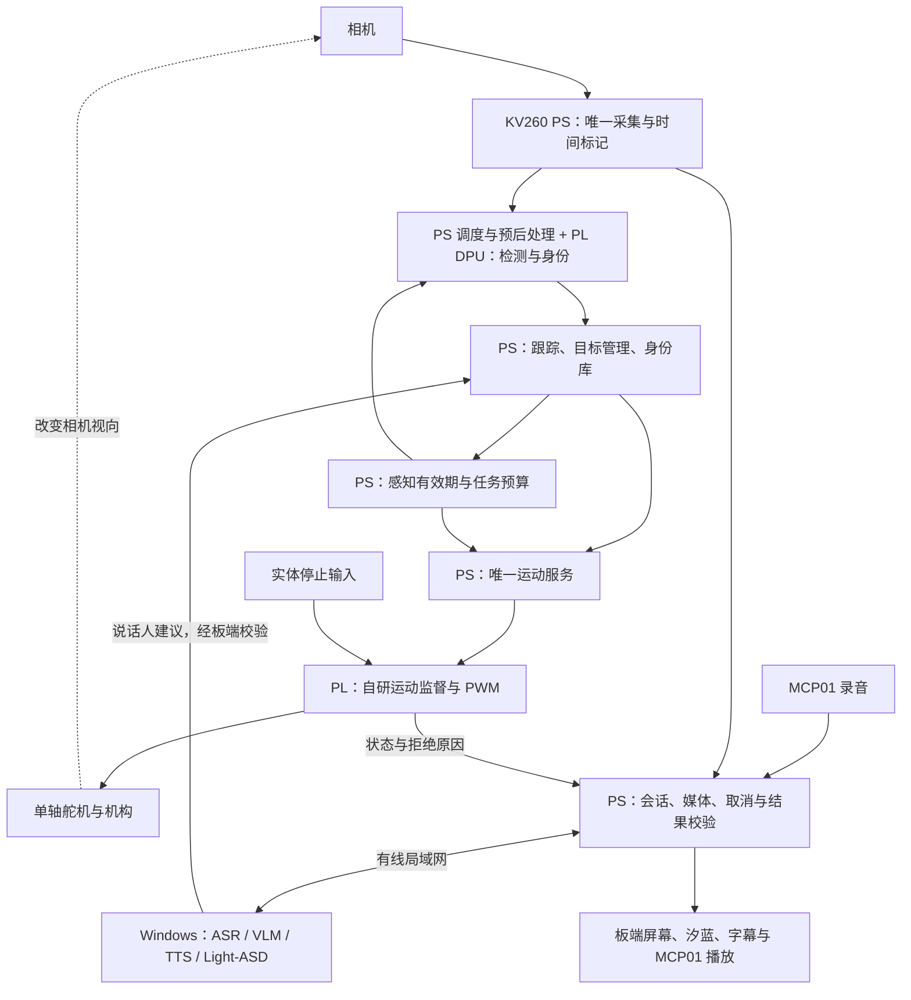

# AURA·汐蓝：AMD 自主选题初级组项目框架

编制日期：2026-10-08。用途：统一参赛定位、系统设计、三人实施与答辩材料。本文是对现有方案的综合建议，不表示新增功能已经实现。本次阅读本地赛题、项目方案、当前代码入口及历史验证报告，未连接 KV260，未复跑板测。

## 1. 推荐项目定位

**项目名称：AURA·汐蓝——基于 FPGA 的可控视觉随动交互终端。**

**技术副标题：面向单 DPU 多任务的感知有效期调度与运动执行监督。**

参赛方向采用指南的正式名称：**AMD 自主选题赛道（初级组）**。现有 KV260、单轴机构、USB MCP01、视觉身份与汐蓝交互共同构成一个桌面终端。

一句话描述：终端能够看到和跟随面前的人，按授权记住身份，进行中文语音与看图问答；系统依据视觉信息还能有效多久安排推理任务，并由自研 FPGA 电路持续检查运动输出许可。

推荐主场景是**桌面多人接待与个性化交互**：实验室、校园展台或桌面助手面对一至数名访客，完成选择对象、转向、识别已登记用户、问答及反馈。先把这个场景做实，再说明其方法可迁移到视觉云台和交互装置。应用价值用操作成功率、响应时间、误选目标和恢复表现验证。

项目叙事保持三个层次：

| 层次 | 要回答的问题 | 对应成果 |
| --- | --- | --- |
| 用户价值 | 它能为面前的人做什么？ | 视觉随动、授权身份、语音问答、汐蓝反馈 |
| 技术问题 | 多个模型争用资源、结果迟到时，如何保持交互与运动合理？ | 感知期限、推理任务调度、结果归属与取消 |
| FPGA 贡献 | 哪些行为由我们设计的硬件负责？ | 原子命令接口、期限监督、限幅限速、PWM、停止与恢复、可测波形 |

建议将 10 月 7 日已提出的创新方向作为全文主线。论文中的控制感知调度、信息时效与运行时监督作为已有研究背景；本队贡献表述为面向本系统的跨层设计、RTL 实现和实测验证。可变期限的收益尚待实验，现阶段不用“首创”“绝对安全”或未测量的提升比例。

## 2. 赛道要求如何落到本项目

依据本地 AMD 指南第 3.3 节，PDF 第 22—25 页、正文第 19—22 页，并核对 AMD 企业赛道仓库入口。[本地指南](E:/项目/参赛资料/全国大学生嵌入式芯片与系统设计竞赛'2026FPGA赛道选题指南-AMD.pdf)；[企业赛道仓库](https://gitee.com/Vickyiii/fpgachina26-amd)。

| 要求 | 项目应采取的做法 |
| --- | --- |
| 初级组面向大学一年级至三年级在读本科生，混合队伍按最高年级/学历归组 | 队长核对三名成员的报名资格；本次没有成员学籍材料，不能代为确认 |
| 初级组允许 UltraScale+ 等系列 | KV260 的 Zynq UltraScale+ MPSoC 属于该器件系列，保留现有板卡；最终填入实际 SOM 与载板型号 |
| 侧重逻辑设计、状态机、时序约束、接口协议等基本能力 | 在报告中完整展示自研运动监督 IP，而不仅展示模型调用与界面 |
| 两组提交要求、评分指标一致 | 初级组也交源码、验证、综合实现、板测、基线对比和复现材料 |
| 推荐 PYNQ，但实现方式不限 | 沿用已有 PetaLinux、DPU、RTL 路线；通用 PYNQ Skill 只有完成对应验证后才主张加分 |
| 推荐 Vivado/Vitis 2026.1 或 2025.2，其他版本须说明并可复现 | 现有 2022.2 路线写明选择理由、完整依赖及重建脚本；本次不建议为了版本号直接迁移整个工程 |
| 提交大模型协作记录与技能包 | 三人从真实失败、修正、验证中各提炼一个可复用工作流 |
| 提交仓库采用英文目录和文件名 | 另行整理英文发布包；现有中文工作资料用于内部追溯 |

KV260 器件系列由 [AMD 产品页](https://www.amd.com/en/products/system-on-modules/kria/k26/kv260-vision-starter-kit.html)核对。上表使用本地指南详细条款；本次在线全文链接未成功获取，因此没有宣称已核完所有后续规则变更。

| 评分项 | 官方权重 | 本项目应拿出的证据 |
| --- | ---: | --- |
| 创新性与应用价值 | 30 | 明确的时效问题、协同方法、真实场景、强基线与消融 |
| 性能与资源优化效果 | 20 | 跟随误差、有效运行覆盖、身份等待、全设计与自研 IP 的资源/时序对比 |
| 功能正确性与设计完整性 | 20 | 同板整机演示、正常与异常用例、恢复、长期运行 |
| 大模型协作与技能包 | 15 | 提示词、可见回答与修正记录、三个可独立复用的包及复用结果 |
| 文档质量与可复现性 | 15 | 固定发布版本、构建部署说明、原始日志、非作者复现 |

这些权重用于安排工作，不是对本项目当前分数的预测。普通 Skill 是正式交付的一部分；通用 PYNQ Skill 的额外加分数值未在本地指南中明确。

## 3. 当前基础与待完成边界

本节按可见证据记录；其他开发机上的最新成果需要回收后更新。

| 项目部分 | 当前可确认的基础 | 参赛版需要补齐 |
| --- | --- | --- |
| 平台与 DPU | M3 报告记录 1 个 B4096 DPU CU、ResNet18 正确推理 | 最终镜像、真实人体/人脸模型和整机负载验证 |
| 自研 PL 接口 | M3 最小 AXI-Lite 模块与 DPU 在同一配置中分别通过有限板测 | 正式运动监督、PWM、停止与恢复、并发及长期测试 |
| 视觉与身份 | 有完整职责、模型适配、跟踪与数据库方案 | 本机可见的共享主仓尚无完整 board/vision、board/motion 目录；回收 B/A 实现并验证 |
| 汐蓝展示 | 当前 README 记录桌面真实音频、音强口型、独立眨眼、暂停/打断与后续素材修复 | 正式板端界面、MCP01 实机录放、与真实会话和运动状态整合 |
| 语义校验 | 当前代码有请求匹配、场景时间和音频代次检查 | 正式模式严格有效期、目标代次、跨协议适配与实际播放取消 |
| 创新方法 | 10 月 7 日已有可变感知有效期、调度与 PL 期限监督设计 | 校准数据、实现、强基线、消融和板测 |
| Skill | 已有三个包的安排及可提炼代码/案例 | 参数化入口、独立说明、陌生使用者复现记录 |

M3 的 ResNet18 分类 FPS 不能当作人体检测帧率。PC 动画和语音回归不能当作 KV260 实机通过。M3 报告同时说明测试后恢复了官方应用，因此不能据此假设今天板上仍加载 M3。

物理实现是早期关卡：M3 报告中的 LUT 为 60.23%，但已占用 CLB site 为 99.45%，setup 余量约 +0.009 ns。CLB site 占用率不等同于所有 LUT 用尽，但足以说明不能靠 LUT 百分比判断还能轻松加入多少逻辑。正式监督 IP 必须尽早完成与 DPU 的联合布局布线。

## 4. 整体结构：三个闭环、一个最终执行入口



1. **视觉运动闭环：**相机 → DPU 检测 → PS 跟踪与有效期 → 唯一运动服务 → PL 监督/PWM → 机构 → 下一帧。
2. **身份交互闭环：**人物轨迹 → 合格人脸 → 板端身份匹配 → 授权登记/重返识别 → 个性化称呼与对象管理。
3. **语音反馈闭环：**MCP01 录音与当前图像 → 主机模型 → 板端归属校验 → 播音、字幕、汐蓝反馈 → 取消或下一轮。

Ubuntu 是开发构建机；运行时是 KV260 加 Windows 模型主机。人体与身份模型、跟踪和运动服务的最终部署位置以板端为目标；ASR/VLM/TTS/Light-ASD 首版在 Windows。网络模型等待不能阻塞本地运动许可到期。

## 5. 八个具体模块

| 编号 / 模块 | 输入 → 输出 | 实现位置与建议做法 | 负责人 / 交付物 |
| --- | --- | --- | --- |
| M1 平台与设备底座 | 镜像/硬件包/外设 → 可核验的运行环境 | KV260 PetaLinux；冻结 DPU 指纹、运行时、地址、设备树、相机、音频、显示和时钟 | A 主责，B/C验各自外设；环境清单、联合工件、启动自检 |
| M2 人体感知与跟踪 | 真实帧 → 人体框、轨迹和源观测信息 | PS 采集/预后处理，DPU 推理，PS 跟踪；沿用已计划的 ByteTrack 式关联；最新帧入口与有界队列 | B；实际 xmodel、精度对照、相机链、轨迹日志 |
| M3 人脸身份与记忆 | 合格人脸、登记操作 → KNOWN/UNKNOWN/AMBIGUOUS | KV260 PS 与适配的 DPU 子图；对齐、质量筛选、特征匹配、SQLite、删除失效 | B，C 提供操作界面；模型、数据库接口、登记/重返/删除测试 |
| M4 时效与共享推理调度 | 真实观测、相对运动、任务耗时 → 有效期与任务启动决定 | PS 上完成；先固定期限基线，再经校准的可变期限；控制检测优先并统计身份最长等待 | B，A 核时间合同；配置、调度日志、误差和等待对比 |
| M5 运动生成与 FPGA 监督 | 当前对象、有效观测 → 经许可的 PWM | PS 唯一运动服务算目标；PL 原子提交、序号/代次、期限、限幅限速、停止与恢复 | A 负责 RTL，B 负责运动服务；接口库、仿真、实现、数字波形及机构测试 |
| M6 语音与看图问答 | MCP01 录音、本轮图像 → 中文回答和声音 | 板端采录/播放，Windows ASR/VLM/TTS；首版按键半双工，模型常驻，阶段计时 | C；真实后端、媒体协议、录放和取消日志 |
| M7 说话人建议与汐蓝 UI | 声画窗口/会话/硬件状态 → 选人建议与可见反馈 | Windows Light-ASD；PS 校验后向目标管理器建议；板端 UI 复用汐蓝素材与播放逻辑 | C 主责，B 接选人；声画同步、拒判、显示与实屏证据 |
| M8 评测、技能与发布 | 各模块记录 → 可重现的结果与工程包 | 统一 release-id、参数、模型/工件哈希、原始日志和分析入口 | 三人共同；评分证据索引、三包、复现记录 |

模型选择按已有权重、量化精度、实际 DPU 可编译性和整链耗时冻结；名称不能代替具体权重与编译结果。人脸 CPU 参考实现可以先用于正确性比较，最终报告逐步列清 CPU/DPU 分工。不得将只有人体检测的实验解释为人体与身份共享 DPU 的完整结果。

MCP01 继续采用 USB 音频。Light-ASD 判断可见人物谁在说话，不等于声学方向估计。沿用已删除的双 I2S 麦克风和 DOA 路线没有必要。

## 6. 核心创新怎样实现

### 6.1 研究问题

人体检测和人脸任务共享一个 DPU CU。排队与推理使位置观测变旧，主机说话人判断和问答还可能更晚返回。系统要同时回答：**下一次检测何时必须完成；现在是否有空闲预算做身份任务；当前观测还能授权运动多久。**

这三个问题使用同一份位置证据期限串起来，形成一个主创新。身份缓存、说话人窗口与问答会话分别保留自己的有效性规则，不能全部套用运动的短期限。

### 6.2 PS：给真实观测确定有效期

每次真实观测记录源帧、源时间、相机代次、轨迹与轨迹代次。采用 10 月 7 日方案中的候选误差模型：

`U(dt) = u0 + (abs(v_hat) + delta_v) * dt + 0.5 * a_b * dt^2`

在允许误差 `e_allow` 与时间上限 `T_cap` 内求允许时长 `T_valid`，得到 `deadline = capture_time + T_valid`。速度使用真实观测间隔估计；相机因舵机转动引入的相对运动纳入校准。

实现分两步：先以固定期限跑通；再将校准结果做成稳定、慢移、快移等少量有效期档位或完整模型。档位边界和时长由数据冻结，不预填任意毫秒数。模糊、遮挡、方向突变、关联歧义或时间不可信时，缩短期限或拒绝许可。

这个模型是候选工程模型，数据中的最大误差不构成现实世界的严格数学上界。独立测试集要报告覆盖率和失配。跟踪预测不能冒充新的相机观测为旧证据续期。

### 6.3 PS：用剩余期限安排身份任务

身份推理启动前，检查剩余预算能否容纳身份任务、下一次检测及必要的预后处理和提交开销：

`C_id_est + C_det_est + C_other + margin < deadline_control - now`

不足时先刷新人体检测；足够时给身份任务机会。单 CU 任务按实际不可抢占条件设计；所有耗时估计来自真实并发负载，同时记录超出估计的事件。身份等待必须统计，不能通过长期饿死身份任务改善视觉指标。

### 6.4 PL：按源证据的期限检查执行许可

自研 `motion_guard_ip` 建议由以下逻辑组成，模块命名是拟议分解，最终按 A 的真实 RTL 冻结：

| 逻辑 | 职责 | 必验现象 |
| --- | --- | --- |
| AXI-Lite 寄存器接口 | 可识别 IP/ABI，影子字段与 COMMIT，规范读写响应 | 写到一半不执行；无效提交不覆盖有效状态 |
| 命令校验 | 会话/恢复代次、序号、目标代次、观测编号与有效性 | 旧代次、重放、乱序不能续期 |
| 单调计时与期限监督 | 原子时钟快照、期限比较、计时代次和到期原因 | PS 暂停后仍在定义的周期界限内撤销数字许可 |
| 范围与变化率限制 | 约束请求角度或脉宽及变化率 | 超范围命令拒绝或按已冻结合同处理 |
| PWM 与输出门控 | 根据有效命令产生输出，确定更新边界 | 正常输出准确；停止/到期与提交同拍时没有意外使能 |
| 停止与恢复状态机 | 停止优先、同步/复位、显式恢复 | 恢复后旧命令不重启，须新有效输入 |
| 状态与事件回读 | 接受/拒绝原因、最后序号、到期与停止统计 | 日志可关联到真实输出波形 |

期限保留源观测已消耗的时间，不能在收到 COMMIT 时重新给完整时长。PS 与 PL 时钟需要保守映射；单元、回绕、时钟复位、字段完整性和误差余量写入合同。同一观测后续使用只允许保留或缩短原期限。

PL 检查的是提交的合同，无法独立证明图像或时间戳内容真实。撤销 PWM 数字许可、切断动力与机构实际停下分别测量；舵机反馈与编码器尚未确认时，不宣传机械角度闭环精度。

### 6.5 面向初级组的实现取舍

误差模型、调度和身份匹配优先放 PS；PL 保持少量计数、比较、状态机和 PWM。先完成自研模块的正确性、时序约束和同板运行。结构化剪枝、新加速器、全模型上板等作为后续研究，不让它们占据当前关键路径。

若可变期限没有优于调好的固定期限，保留其真实结果，并将可复现的监督实现和完整系统作为已完成贡献；题名及摘要随最终证据收敛，不能靠改评价口径宣称创新有效。

## 7. 共同接口与运行流程

### 7.1 必须先冻结的五类数据

| 数据 | 最少包含 | 规则 |
| --- | --- | --- |
| 视觉观测 | camera_epoch、frame_id、源时间及语义、track_id、track_generation、位置/质量 | 源时间由真实采集链提供；记录 USB 缓冲的不确定性 |
| 位置执行证据 | 观测引用、初始期限、目标选择代次 | 同一证据不延长；丢失或切换对象立即失效 |
| 运动命令 | session/恢复代次、seq、目标代次、源证据、PL 期限、角度/脉宽、COMMIT | 只有 B 的唯一服务提交；A 给最终 ABI 与访问库 |
| 说话人建议 | 窗口编号/时间、候选 track key、分数、建议期限 | B 用当前轨迹复核，并用最新位置观测产生动作 |
| 对话与播放事件 | request_id、scene_seq、会话/音频代次、消息序号、音频格式和有效性 | 取消、重启、换轮后旧结果不能重新播放或覆盖界面 |

冻结前不写死寄存器偏移、地址和实物针脚。历史 M3 地址仅属于特定配置。主机与板卡的单调时钟不能直接相减；运动期限在板端完成，跨主机媒体用明确映射或可追溯的窗口归属。

目前 `SemanticValidator` 对 `valid_until_ms == 0` 跳过检查。正式实时模式应拒绝缺失或无效期限，并统一截止点的等号语义；兼容演示输入单独标识。现有 WebSocket `1.0` 与 `aura-runtime-1` 协议应有显式适配和测试。

### 7.2 一次完整交互

1. 启动自检：核对发布版本、硬件身份、DPU/模型、相机、MCP01、显示和运动标定；运动默认无许可。
2. 发现人：更新轨迹，按当前规则或手动确认选择对象。初版多人歧义时允许等待确认。
3. 跟随：以当前有效位置小范围转向，每次动作可追溯到真实源帧。
4. 认人：合格人脸参与匹配；陌生人显示 UNKNOWN；只有明确登记操作才写入身份库。
5. 对话：按键录音，绑定当前图像和会话，主机转写/回答/合成，板端校验后播音并驱动汐蓝。
6. 说话人增强：连续声画条件满足时 Light-ASD 提供建议，B 复核目标；多人同时说话允许拒判。
7. 打断与异常：取消当前播放和在途结果；画面过期、目标丢失、PS 停顿时按各自合同退出运动许可。
8. 恢复：外设/通信恢复后重新自检、获取新观测、建立新许可，不重放旧动作。

交互状态、轨迹生命周期、运动状态、汐蓝动画状态各自管理。界面正常页展示对象、倾听/思考/说话和连接状态；演示调试页展示源帧年龄、任务等待、许可与拒绝原因，便于评委看到技术行为。

## 8. 实施层次与三人交接

这些层次表示验收次序，不自动取消既定功能。

| 关卡 | 完成内容 | 放行依据 |
| --- | --- | --- |
| L1 硬件与单人基线 | 同一配置 DPU + 正式监督/PWM；真实相机、单人跟踪、固定期限随动 | 推理、寄存器、PWM 与机构测试；过期、停止、恢复均有证据 |
| L2 应用完整闭环 | 板端身份、MCP01 实录实放、真实问答、汐蓝板端 UI、取消 | 登记/重返/陌生、语音与当前图、屏幕音频、旧结果拒绝 |
| L3 目标参赛方案 | 可变期限、任务准入、PL 同期限监督、说话人建议、完整对照 | 误差/覆盖/身份等待数据，消融，联合实现，真实演示 |
| L4 发布 | 三个 Skill、报告、视频、重建与新卡/新目录复现 | 非作者从材料完成运行，证据索引完整 |

| 人员 | 对齐原工作包 | 本轮最重要的交付 | 给其他人的接口 |
| --- | --- | --- | --- |
| A 平台/FPGA | A04—A09、A13/A14 等 | 监督 RTL、AXI/时钟/期限合同、DPU 共存、输出波形与电气/机构验收 | B：访问库与 ABI；C：硬件状态/诊断；共同：可部署硬件包 |
| B 视觉/身份/运动 | B02—B05、B07—B13 等 | 相机与时间、检测跟踪、人脸库、期限模型、共享调度、唯一运动服务 | A：真实命令和工况；C：轨迹/身份/快照/脸片段与选人回执 |
| C 交互/模型/UI | C06、C10/C11、C13 等 | MCP01、真实模型、声画窗口、汐蓝板端、取消与整机脚本 | B：带归属的说话人建议；共同：启动自检、会话日志、演示 |

总负责人维护一份版本清单和问题表：每天同步已通过关卡、阻塞、合同变更和可合入工件。三人在同一最终 PL 配置、同一运行时组合验收；分别在三套环境跑通只能算模块进度。

## 9. 建议的 20 天推进框架

沿用既有三人任务，不额外叠加一个独立研究项目。下表按连续推进的开发日划分，D1 为三人确认现有工件后的开工日；实际日期按可投入时间倒排。若从当前开始，须给正式提交预留至少数天整理与上传时间，不能把 20 个工作日机械排到截止日以后。

| 时间段 | A | B | C | 共同验收 |
| --- | --- | --- | --- | --- |
| D1—D3 | 回收最新硬件，冻结 ABI，监督最小实现与联合构建探路 | 真实采集与时间；固定图模型/相机链；定义数据集与基线 | 回收当前模型服务；MCP01 实录实放；板端静态/小动画 | 统一 release、真实设备诊断、接口字段与测量入口 |
| D4—D8 | 固定期限监督、PWM、停止/恢复、联合实现与板测 | 跟踪与固定期限随动；板端身份基础；记录模型耗时 | 实际录音→主机→板端声音/字幕；播放取消 | L1，随后连起 L2 主链；首批板测与日志 |
| D9—D12 | 源期限与时钟映射、故障与边界用例 | 校准可变有效期、身份准入、误差与等待记录 | 说话人声画窗口与建议归属；UI 绑定真实状态 | 可变方案与固定基线均可重复运行 |
| D13—D16 | 数字故障实验、最终资源与时序 | 固定数据对照、真人随动、身份与失配样本 | 多人问答、迟到/取消、失联恢复、演示脚本 | 完成主要 G0—G5 对照；D16 冻结功能 |
| D17—D20 | 硬件包/构建复现与 A Skill | 模型/数据/指标复现与 B Skill | 整机启动/视频/材料与 C Skill | 稳定性、非作者复现、目录/证据/许可检查 |

赛事企业公告列出的作品提交节点为 2026-11-04 18:00，可用作当前倒排参考；正式赛程以组委会最新通知为准。公告时间按赛事发布口径处理，不从本机时区自行推定。[赛程公告来源](https://www.anlogic.com/support/university/competitions/eda/news1/42.html)。

如果 D8 仍未通过 L1，应集中处理真实相机→运动的关键链路，暂缓新增优化与外观打磨。若 D16 没有完整对照，则按完成层级如实提交和命名，保留未完成清单。

## 10. 实验与验收框架

### 10.1 六组对照沿用同一套定义

| 组别 | 有效期 | 调度 | 源期限的最终监督位置 | 验证目的 |
| --- | --- | --- | --- | --- |
| G0 | 校准后的最佳固定期限 | 检测优先 | 软件检查，保留基本硬件保护 | 强软件基线 |
| G1 | 同一固定期限 | 检测优先 | PL | 硬件监督效果 |
| G2 | 可变期限 | 检测优先 | PL | 有效期模型效果 |
| G3 | 固定期限 | 期限准入 | PL | 调度效果 |
| G4 | 可变期限 | 期限准入 | 软件检查，保留基本硬件保护 | 与最终组比较执行位置 |
| G5 | 可变期限 | 期限准入 | PL | 最终方案 |

所有组共享模型、输入、最新帧入口、身份请求负载和共同误差判据。固定期限在独立校准数据上选择，保留多个固定值扫描；不得挑明显不利的固定值。先跑 G0/G1/G5 确认测量链，再补 G2/G3/G4；六组不全时不声称每一组件贡献已分离。

软件监督组涉及 PS 卡顿等故障时，采用仿真或断动力数字输出测试，保留基本保护。实际机构实验单独执行和报告。

### 10.2 应记录的指标与建议测试规模

以下规模是项目建议，具体阈值在 D3 完成基线后冻结，不是官方硬性指标或现有实测结果。

| 指标 | 具体测法 | 判定方式 |
| --- | --- | --- |
| 位置证据误差 | 用独立参考标注比较动作消费时真实目标位置与源观测位置 | 报 P50/P95 与超出共同误差阈值的比例 |
| 实际随动居中误差 | 实机重复左右路径，测目标中心偏离画面中心的归一化距离 | 快慢运动分别统计，同时记录遮挡与失败 |
| 有效随动覆盖率 | 符合可见/质量条件时，满足误差要求且仍提供随动的时间占比 | 防止以一直停止换低误差 |
| 身份质量与等待 | 固定登记库和刷新需求，统计匹配/拒判、P95/最长等待 | 按人划分校准与测试样本；保留未知人员与错认样本 |
| 感知与任务耗时 | 源采集→入队→推理→消费→提交，区分单模型与整链 | 报分布、尾部和超时，注明时间戳语义 |
| PL 期限与停止 | 期限边界、停止与 COMMIT 冲突、PS 暂停、重放、复位 | 定义有限周期界限，以仿真与板端波形验证；观测违规数为 0 不等于无限情形证明 |
| 问答与取消 | 至少 20 个固定问题，包含改变图片的看图问答；至少 30 次不同阶段取消 | 报实际录音结束至首段声音延迟，旧结果回流与取消至静音时间 |
| 说话人 | 两人交替、同时说话、遮挡、画外声音 | 选择准确率与拒判率一起报告；不确定时不强选 |
| 资源与时序 | 自研 IP 与整个设计的 LUT/FF/BRAM/DSP、WNS/TNS、约束覆盖 | 最终联合设计无未解决的时序失败；资源增量与收益配套 |
| 稳定性与复现 | 初步至少 60 分钟整机并发和 3 次冷启动，再按问题扩展 | 报崩溃、重启、失联恢复、温度/内存变化与全部失败 |

建议动作/轨迹工况至少包括站立、慢移、快移、突然转向、多人交叉、短遮挡、离开重返；异常工况包含冻帧、DPU 拥塞、PS 暂停、旧建议、旧命令和主机断连。固定视频每个配置重复多轮；真人路径建议每类至少 5 次，明确输入不可能逐像素相同。

主结论用“共同误差判据 + 有效服务覆盖 + 身份等待 + 数字输出事件”支持。各方法自己的过期率只作辅助指标。提前设定能接受的性能退化范围，不能看完结果才改判据。

## 11. 三个技能包与正式提交结构

| 包名 | 可复用内容 | 必须附带的实际证据 |
| --- | --- | --- |
| command-guard-validation | 从寄存器合同生成正常/过期/重放/复位用例，核对执行输出 | 真实失败、修正前后同输入波形、参数适配示例；A 主责 |
| perception-freshness-benchmark | 根据统一源时间日志评价时效、跟随覆盖与共享推理等待 | 原始日志、分析入口、黄金小样、单位/缺字段失败用例；B 主责 |
| async-result-validation | 验证取消、重复、迟到、目标切换后的结果归属 | 独立协议样例、取消反例与修复、真实播放验证边界；C 主责 |

每包包括适用场景、输入输出、运行步骤、依赖、失败条件、已验证效果、来源案例与非作者复用记录。无需先做成插件。PYNQ 适配是可选增强，未经 PYNQ 和跨题目/板卡验证不标为通用 PYNQ Skill。

建议最终发布包如下。它是待整理结构，不表示本次已经创建或发布该工程；团队按允许再分发的许可证及第三方实际授权整理。现有开发目录不需要直接改名。

```text
aura_junior/
  README.md
  src/
    rtl/
    ps/
    host/
    ui/
  sim/
  build/
    scripts/
    reports/
  board/
    firmware/
    scripts/
    manifest.json
  data/
    fixtures/
    reference/
    metrics/
  skill/
    README.md
    command-guard-validation/
    perception-freshness-benchmark/
    async-result-validation/
  report/
    design_report.pdf
    ai_collaboration.md
    reproducibility.md
    evidence_index.md
    demo.mp4
```

报告建议覆盖八部分：场景与问题、已有研究和创新边界、总体框图、软硬件划分和接口、自研 RTL 与时序、完整应用流程、对照与异常实验、AI 协作/Skill/复现。所有结果均指向原始证据和同一发布版本。

模型权重、图像、音频和角色素材记录来源与许可。不能随工程开源的第三方内容提供合法获取方式与校验值。构建环境、驱动补丁、DPU 指纹、模型哈希、图像预处理、板端配置和启动顺序都进入复现清单。

## 12. 五分钟建议演示与当前第一步

以下为建议脚本，不是官方规定时长。

| 时间 | 现场动作 | 让评委看到的证据 |
| --- | --- | --- |
| 0:00—0:40 | 介绍装置，启动自检，展示 KV260 与连接关系 | FPGA、板端与主机分工；实际版本与外设就绪 |
| 0:40—1:30 | 单人进入、左右移动、停止与离开 | 真实检测/跟随，位置证据与许可状态，失跟后行为 |
| 1:30—2:20 | 已登记人员返回，陌生人进入 | 身份区分，明确 UNKNOWN，选人不串用旧轨迹 |
| 2:20—3:20 | 通过 MCP01 提问，改变手中物体，打断一次回答 | 当前图像影响回答，声音/字幕/汐蓝对应，旧回复不回流 |
| 3:20—4:20 | 两人交替说话，加入推理负载，对照快慢运动 | 建议经过复核；期限与调度变化；同时展示覆盖和身份等待 |
| 4:20—5:00 | 以受控数字演示展示 PS 暂停/迟到提交 | PL 按期限撤销许可；呈现固定/可变方案结果与复现入口 |

**当前最优先的共同任务：回收 A/B 其他机器上的最新成果，形成一个同板闭环版本，让真实相机中的单个人经过 DPU 检测、轨迹复核、固定期限命令和自研 PL 后驱动单轴；同时验证画面失效、停止和恢复。**

这个关卡通过后，身份和语音界面继续整合，可变期限研究才有真实测量对象。C 已有的汐蓝演示继续复用，下一步投入重点放在板端媒体/UI 接口与整机事件绑定。

## 13. 主要依据与追溯

1. [AMD 2026 选题指南](E:/项目/参赛资料/全国大学生嵌入式芯片与系统设计竞赛'2026FPGA赛道选题指南-AMD.pdf)：第 3.3 节，已阅读对应完整页面。
2. [AMD 企业赛道仓库](https://gitee.com/Vickyiii/fpgachina26-amd)：核对赛道入口、初级组定位；在线全文抓取未成功。
3. [KV260 官方产品资料](https://www.amd.com/en/products/system-on-modules/kria/k26/kv260-vision-starter-kit.html)：器件系列及平台信息。
4. [无声源定位完整实施方案](E:/项目/方案/AURA_KV260_完整实施方案_无声源定位版_2026-09-30.md)：当前功能、单轴机构、USB 音频、三端分工。
5. [三人总包入口](E:/项目/README.md)与 [B 执行手册](E:/项目/方案/AURA_三人执行总包_2026-10-02/02_B负责人_视觉身份与板端运动服务执行手册.md)：三人责任、模型与板端部署目标。
6. [单一创新方向](E:/项目/output/aura_single_innovation_direction_20261007.md)：候选误差模型、期限调度、源期限监督及 G0—G5 定义。本次沿用其研究建议，未重新核验其中全部论文。
7. [技能包实施方案](E:/项目/方案/aura_skill_package_plan_and_delivery_20261007.md)：三包方向、交付要求与当前不足。
8. [M3 构建报告](E:/项目/tmp/aura-review-20261003/AURA_KV260_审查报告_2026-10-03/M3_BUILD_REPORT.md)与 [M3 板测报告](E:/项目/tmp/aura-review-20261003/AURA_KV260_审查报告_2026-10-03/M3_BOARD_REPORT.md)：特定历史配置的联合实现与有限板测。
9. [汐蓝当前入口](E:/项目/共享文件夹/aura/README.md)：桌面交互、素材与验证记录；不能替代正式板端验收。
10. [语义校验实现](E:/项目/共享文件夹/aura/board/runtime/validator/semantic_validator.py)：有效期与音频代次的当前行为。
11. [单舵机接线方案](E:/项目/output/hardware/AURA_单舵机完整接线_5V.md)：现有机构与供电设计背景；具体针脚与电气验收仍依实物和最终工程。

