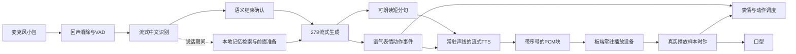

# 汐蓝：Windows / RTX 5090 Laptop 24GB 亚秒语音与动作交互研究

研究日期：2026-10-18。性质：基于现有源码、历史运行证据、GitHub原始仓库及论文的方案研究；候选方案尚未在目标笔记本上实测。本次未替换在线服务、未下载新权重。

## 1. 决策结论

建议主线保留现有 Huihui Qwen3.8-27B IQ4_XS，将整条链路改为流式，并优先解决板端音频设备启动问题。候选组合为：流式中文识别 → 27B流式短句输出 → 可克隆声线的流式TTS → 常驻音频输出；表情和动作使用同一条回复的控制事件，与真实播放时钟对齐。

第二条对照路线是 MiniCPM-o 4.5 的量化 C++ 全双工方案，重点比较中文自然交流和汐蓝声线。它有Windows部署路径，但默认1秒音频块意味着不能直接承诺严格低于1秒。

第三条路线是语音前台加27B推理后台。论文证明这类结构有价值，但中文、显存、训练和信息一致性要求较高，暂列研究支线。

RTX 5090 Laptop 24GB值得验证上述方案，但当前没有该用户设备的实测数据。不能承诺任意问题、任意上下文、冷启动及长时间运行都能在1秒内给出有效回答。将“日常对话、预热状态、规定上下文、声线验收通过时，P95真实有效开口低于1000ms”作为拟议验收目标。

用户已确认：Windows，5090移动端24GB；允许评估替换语音引擎，优先接近现有汐蓝声线。具体笔记本型号、实际功耗、内存与散热表现仍未知。

## 2. 当前瓶颈与证据边界

当前源码和报告位于 `E:\Win共享文件\语音共享文件`。当前主机是RTX 5060 Ti 16GB，不能把其结果写成5090性能。

| 项目 | 已核实情况 | 对目标的影响 |
|---|---|---|
| 27B完整HTTP历史录音测试 | 7.187秒：ASR约156ms、LLM约3984ms、TTS约3032ms | 是历史单次测试，不含实际说完话到声学输出全过程 |
| LLM接口 | `stream=False`，等待完整JSON；fast模式2048上下文、120输出token上限、关闭思考 | 首句要等整条回复完成 |
| TTS接口 | 等完整 `reply_text`，再生成完整WAV | LLM和TTS主要串行 |
| 语气 | emotion没有作为语气指令传入当前TTS | 表情变化不等于声音语气变化 |
| 动作 | 在线fast输出约束动作为空字符串 | 还没有形成语义动作输出 |
| 播放 | 每次前置1秒启动静音 | 单这一项已经占满目标 |
| 记忆 | 主机按boot/session在RAM保留最近8条消息 | 约四轮；没有持久长期记忆 |

板端1秒静音用于修复首字丢失：300/500ms此前不足，1秒已由用户听音确认。因此不能直接删掉或缩短来做漂亮数字；应改为常驻音频设备，启动时预热一次，随后持续维持输出流，再验证首字是否完整。能否同时录音、播放及稳定处理回声，必须在MCP01实机验证。

本地依据：

- `aura/tools/board_model_host.py`：完整回复后调用VoiceWorker；最近8条历史。
- `aura/tools/dialogue_host_ollama.py`：非流式、JSON、fast模式动作约束。
- `aura/tools/gstreamer_audio_engine.py`：`STARTUP_SILENCE_SECONDS=1.0`。
- `deliverables/2026-10-18_board_dialogue/model_27b_verification.json`。
- `deliverables/2026-10-18_voice_clarity/acceptance.json`。

## 3. 验收中的“不到1秒”

起点是用户最后一个有效语音音素结束，终点是扬声器实际发出与问题有关的首段回答。网络首包、LLM首token、TTS首PCM、扬声器有效声音分别记录。

“嗯”“我在”“让我想想”可用于自然互动，但不能单独计作有效回答完成。缓存命中和首次生成分开统计；复杂查询可以先说有事实依据的首句，再继续解释，但不能提前说尚未得到的信息。

动作分为指令发出、物理开始移动、整套动作完成。目标可以是1秒内开始动作与表情，完整机械动作时长取决于行程和速度。口型跟实际播放样本时钟，不能跟文字到达时间。

下表是工程预算，不是目标笔记本实测：

| 末尾发声之后的环节 | 拟议预算 |
|---|---:|
| 结束判断及ASR尾部确认 | 200–300ms |
| 得到可说出的有意义首段文字及所需控制 | 150–250ms |
| TTS首段有效PCM | 150–250ms |
| 传输、缓冲、设备到声学输出 | 50–100ms |
| 合计 | 550–900ms |

识别、记忆检索与稳定前缀预填充尽量在用户说话期间完成；对表中重叠部分用跟踪记录还原，不重复计算加速。若实测首段文本持续超预算，仅换TTS无法达标。

## 4. 主线：保留27B，改变计算与传输方式

### 4.1 流水线

输入建议20ms音频包起步，用实测决定网络与抖动缓冲。中文识别候选为 sherpa-onnx 的流式Paraformer或Zipformer；先比较Windows主机CPU推理，不能仅凭支持ARM就认定KV260 CPU能承担目标性能。[S13]

结束判断组合声学VAD与语义结束判断。用户停顿可能不是说完；例如“不要……转头”不能在中间停顿执行动作。TEN提供相关开源模块；LiveKit中文结束检测可作为参照，但其文档默认最小结束延迟300ms、VAD最小静音至少250ms，不能照搬默认配置再声称全部只花100ms。[S14–S16]

### 4.2 LLM运行时与投机解码

先用Windows CUDA版 llama.cpp建立现有GGUF的流式基线，与当前Ollama同一模型、同一上下文比较。固定人设前缀、复用KV缓存、控制历史长度，保持非思考日常对话模式。不要把推理思维链塞入语音输出。

DFlash2已公开Qwen3.8-27B草稿模型，llama.cpp有合并支持记录；因此保留27B同时提速有可研究的实现基础。[S2–S4]

原理是小草稿模型提出一批token，由27B验证；它提升的是生成阶段，不会自动消除ASR、首次预填充、TTS或播放延迟。针对现有Huihui修改版，需验证架构和分词兼容、草稿接受率、采样正确性与回答质量。不能直接套用原版Qwen的速度。所谓保留目标分布，针对的是所用量化目标及正确实现的采样条件，也不代表恢复全精度质量。

社区仓库报告桌面5090开放式文本114–127 token/s，结构化任务更快；这是作者自己的桌面测试，不是5090 Laptop、中文语音、当前Huihui权重或端到端延迟测试。只把它当作复现线索。[S5]

投机解码增加草稿权重和缓存；先测没有草稿的版本，只有在实际首段延迟改善、显存余量足够时才保留。不能为加速草稿把目标模型挤到CPU，反而增加延迟。

### 4.3 首句与韵律

不等待整句甚至整轮，但也不逐字调用TTS。先比较8、12、20个汉字或自然分句等切分策略，记录首段等待和音质。数字、姓名、否定句和标点未稳定时避免过早切开；后续分句保持同一声线缓存、语速和语气状态。

应生成与问题相关的短首句，后续继续展开。闲聊默认短答，复杂内容按需延展；不能把所有问题强制48字而损害作品能力，也不能让长答案阻塞第一段播放。

## 5. 声线与TTS候选

用户优先接近现有“柔亮俏皮”声线，因此按声线、语气、首包、持续合成速度、稳定性联合选型。

| 候选 | 适用原因 | 必须验证的限制 |
|---|---|---|
| OmniVoice现有引擎及社区omnivoice-fast | 同系列最值得先比较声线保持 | fast作者114ms数字来自H100 80GB实验；依赖栈和现有Windows服务不同，不能直接搬作5090结果 |
| CosyVoice3 0.5B | 官方提供中文、参考音频、风格指令及双流路径 | 必须确认所选调用同时支持克隆、风格控制、文字流入、音频流出 |
| CosyVoice.cpp社区移植 | Windows/CUDA，参考音频预编码复用、指令和音频分块输出 | 文档确认音频流出，尚未确认连续文字流入；可能需分句适配。CUDA测试说明基于Ada，Blackwell需另测，预编译CUDA库有噪声已知问题 |
| Qwen3-TTS 0.6B/1.7B | 中文与声线克隆候选，官方宣传低首包 | Base克隆与CustomVoice指令控制属于不同能力表项，不能拼成任意声线+任意语气的既成能力 |

资料依据：[S6–S10]。官方TTS的97ms、150ms等首包数字属于各自条件下的合成指标，不能写成整个项目从听完到开口只需同样时间。

声线实验固定当前参考、参考转写和音量规范，再比较轻快、安慰、疑问、低声等样本。至少覆盖姓名、数字、中英夹杂、长句和连续多轮。让用户盲听选择，声音相似度模型分数仅作为辅助。不能用换声线取得的速度提升直接宣称已满足声线要求。

常驻预编码声线和TTS模型，避免每轮重新提取参考音频。主线优先原生Windows；若选中引擎的高效实现只在Linux验证，则把WSL2作为独立可选实验，不假设所有Linux性能可以直接迁移到Windows或WSL。

## 6. 端到端对照：MiniCPM-o 4.5

官方提供中文/英文实时交流、参考声线及文本与语音输出；有量化C++及Windows CUDA部署路径。其Python演示要求至少28GB显存，不能直接作为24GB方案；应评估量化C++实现。[S11–S12]

论文的量化C++实验在RTX4090上展示约11GB显存及低于1的实时率，但这是作者条件下的持续处理结果，不等于5090 Laptop的首段延迟。[S12]

关键限制是默认1秒音频块。论文研究过缩短块长造成的能力损失，因此“全双工实时”不能自动推出用户说完后P95低于1秒。客户端每20ms上传也不会自动改变模型内部决策节拍。

本项目中的定位：若中文自然交流、打断和语气明显优于级联，且声线可接受，可以作为语音模式候选；27B继续做复杂推理和记忆整理。但二者同时常驻会增加显存压力，需要单独测量，不能把各自单模型显存简单视为可随意叠加。

对照时还须验证中文发音、长对话稳定性、结构化动作输出和参考声线，不预设其继承当前Huihui27B的人设表现或回答习惯。

## 7. 研究支线：语音前台与27B后台

Context-Spanning / DuetaSpan说明可以用全双工语音前台与异步LLM、记忆和工具协作。其公开实验使用两张RTX Pro 6000分工，不能当作单张24GB证明。其任务完成时间和填充话比例也说明，快速开口与事实答案到达是两件事。[S18]

PersonaPlex能用角色文本和声线提示进行全双工交流，但官方模型卡列明英语，公开性能测试使用A100 80GB。论文低延迟数字不能直接支持中文汐蓝的选择。[S17]

Freeze-Omni的冻结LLM加语音模块思路有助于保留语言能力，但语音模块需要兼容的训练，不能把任意27B GGUF直接接进去就获得原生语音能力。[S19]

因此，这条路线适合作品后期研究：前台负责听说和自然轮替，后台做复杂回答；必须保持信息一致、打断后取消旧结果，并测试真实中文。当前不建议先同时堆多个大模型抢占同一张24GB显卡。

## 8. 一次语义生成，两路消费

用户原设想可行：一条输出可朗读文字，一条输出语气、表情和动作。实现上建议由同一次回复生成共享的语义与控制，服务端分发为文字/音频通道和控制事件通道，无需再串行调用第二个27B来分析自己的完整回答。

控制状态拆开：`tone`控制声音，`expression`控制脸，`action`控制身体；情绪和动作强度另设有界数值。表情笑不代表声音必须很兴奋，同一声线要能轻快、安慰或认真。

拟议事件包含：`session_id`、`turn_id`、`generation`、`seq`、`segment_id`、`start_sample`、`tone`、`expression`、`action`、`intensity`。这些是协议设计，不是当前已部署字段集合。

为避免完整JSON阻塞首句，可用有边界的控制帧加文字片段，或可增量解析的事件流。有限枚举、受约束生成、校验后分发；元数据不送入朗读。控制帧也消耗token，必须纳入首段预算，不能默认它无成本。

每段TTS开始前应确定所需语气；首段控制头要短，后续变化随段更新。若另设小分类器并行预测，只把其结果作为可撤销的候选；不要把额外大模型调用放到关键路径。

表情可在首段播放时切换；口型继续基于实际音频包络/音素时间和播放时钟；点头、摇头等由板端动作模板执行。大模型不生成每一帧舵机角度。机械范围、速度、并发冲突由现有动作层处理。

打断时提升generation，停止旧播放，丢弃旧音频与动作队列，回到相应状态。只取消界面结果、后台继续推理会浪费资源，应在运行时支持时真正取消生成。

## 9. 记忆、人设和作品完整性

固定人设：汐蓝的称呼、说话方式、边界和世界观放在稳定前缀，尽量复用缓存。将虚构角色设定与实际技术模型身份分开，不让角色宣称不真实的设备能力。

短期记忆保留近期有效轮次；长期事实先用本地SQLite和FTS，保存来源、时间、置信度以及用户更正。说话期间开始相关检索，给LLM有限条目；摘要、去重和长期写入放到回复之外。没有必要为记忆额外常驻一个大向量模型。

当前主机在TTS后更新历史，但板端可能还未实际播放；流式改造时应区分已生成、已播放和被打断文本，后续记忆不能假装用户听完了未播放的内容。

作品完整性还包括：听取/思考/说话/被打断/故障状态清楚；表情与语气一致；断网和超时有可理解反馈；多轮不忘称呼；用户插话时动作和口型能一起停止；重启后关键记忆按设计恢复。速度只是其中一个验收维度。

这些是本项目工程建议，不是引用仓库已经替本项目完成的功能。详细人设与记忆规划沿用本目录 `memory_persona_plan_20261018.md`。

## 10. 24GB显存、Windows与持续运行

NVIDIA官方列出5090 Laptop为24GB；桌面5090为32GB，不能用桌面结果直接作笔记本承诺。[S1]

当前GGUF文件为14,403,496,864字节，约13.41GiB。文件体积不等于完整运行显存，仍需KV/循环状态、图缓冲、TTS、驱动桌面和可能的草稿模型。

以24GiB名义容量做初步规划：27B目标与其运行状态优先控制在约15–17GiB，TTS争取约2–3GiB，ASR/检索优先CPU，保留约3GiB系统与峰值余量。这些是预算限制，实际引擎可能不满足。草稿模型只能在测量后分配剩余空间。

每个组合记录常驻、首轮峰值、长对话峰值、被打断后的显存是否释放。发生CPU卸载或Windows共享显存回退时，应标记该次测试，不能只看“模型加载成功”。

记录实际功耗、显存带宽利用、温度、风扇模式及插电状态；至少持续运行30分钟检查降频。固定可复现的驱动、CUDA、后端提交和量化文件指纹。Windows原生C++路径先做基线，Linux专用服务另测WSL，不并行引入多套尚未验证的依赖栈。

## 11. 落地顺序与退出条件

| 阶段 | 具体交付 | 前进条件 |
|---|---|---|
| A：测量与音频 | 统一事件跟踪；外部录音；板端常驻输出原型 | 空闲后第一字完整；录放互不破坏；测得真实设备延迟 |
| B：传输与生成 | LLM文字流；分段PCM传输；取消；现有声线对照 | 首段无需等待整轮WAV；持续播放不欠载；旧generation不串入 |
| C：目标笔记本基线 | 27B无草稿/有草稿；不同TTS同题比较 | 同时满足显存余量、质量、声线与P95延迟；不以TPS单项选型 |
| D：表现与记忆 | 控制事件；语气映射；持久记忆；打断联动 | 表情/动作/口型与播放对齐；更正、重启、取消不污染记忆 |
| E：端到端对照 | MiniCPM-o量化C++中文同题集 | 若自然性或延迟更好且声线通过，再决定是否采用 |

当前16GB电脑可先验证事件协议、音频常驻与流式传输，但27B并发性能结果不能代替未来设备验收。未拿到目标机之前，不给出“5090上已经达到”的结论。

若27B首段延迟仍超预算：先排查重复预填充、上下文膨胀、显存卸载和并发争用；再比较投机解码与TTS选型。若仍不满足，保留27B高质量模式，另评估端到端即时模式；由实测说明质量和延迟取舍，不用通用占位语冒充达标。

## 12. 验证方法

至少100条中文日常、追问、纠正、长停顿、姓名数字、情绪与复杂问题；缓存命中单列。报告P50/P95/P99及失败数，100条的P99很粗，需更多样本后再作稳定性结论。增加50轮连续对话、30分钟热稳、长时间空闲后首句、冷启动、播放中插话与扬声器回声测试。

同一采集设备同时记录用户末尾和玩偶扬声器首段，或以可靠回环/外部同步信号测量，避免把不同机器未同步墙钟直接相减。动作由录像或硬件反馈测起始，表情与嘴型记录实际显示/播放时间。

记录：结束判断延迟与误截率、ASR尾字正确率、LLM首token和首段、TTS有效首PCM和RTF、音频首包及声学首字、欠载次数、声音相似度主观评分、语气辨识、动作起始和同步误差、取消耗时、峰值显存。拟议同步目标±100ms，最终按玩偶机构和观看体验验收。

全双工需把真实播放音频作为回声消除参考；WebRTC提供AEC相关实现，但MCP01录放路径、延迟和已有硬件处理必须先测，不能假定接入一个模块就消除所有回声。[S20]

测试组合与判定见同目录CSV。所有候选仍标记“待实测”。

## 13. 存储与资料

本报告及来源清单、验证矩阵放在 `E:\Win共享文件\语言模型分析`。LLM权重、下载缓存和Ollama模型库继续放项目外本地目录；不得写入共享目录或用目录联接引入。当前使用 `D:\AIModels\qwen3.8-27b-abliterated` 和 `D:\AIModels\Ollama-AURA`。

资料通过GitHub连接器与原始论文/官方页面核查，没有把二手博客或演示视频的数字当作本机实测。仓库会更新；复现时必须固定具体版本。

| 编号 | 原始资料 | 本研究用途 |
|---|---|---|
| S1 | [NVIDIA Laptop规格](https://www.nvidia.com/en-us/geforce/laptops/50-series/)；[桌面5090](https://www.nvidia.com/en-us/geforce/graphics-cards/50-series/rtx-5090/) | 24GB与32GB区别 |
| S2 | [DFlash官方仓库](https://github.com/z-lab/dflash) | Qwen3.8-27B DFlash2草稿 |
| S3 | [DFlash论文](https://arxiv.org/abs/2602.06036) | 投机验证原理 |
| S4 | [llama.cpp PR27342](https://github.com/ggml-org/llama.cpp/pull/27342) | DFlash2实现合并记录 |
| S5 | [社区桌面5090实验](https://github.com/LukasParke/qwen38-27b-5090) | 复现实验线索，非笔记本保证 |
| S6 | [CosyVoice官方仓库](https://github.com/QwenAudio/CosyVoice)；[调用示例](https://github.com/QwenAudio/CosyVoice/blob/main/example.py) | 中文克隆、风格和双流能力 |
| S7 | [CosyVoice.cpp](https://github.com/Lourdle/cosyvoice.cpp) | Windows C++候选和后端限制 |
| S8 | [CosyVoice.cpp接口说明](https://github.com/Lourdle/cosyvoice.cpp/blob/main/docs/TOOLS.md) | 指令、声线与分块HTTP；文字流入未确认 |
| S9 | [Qwen3-TTS官方仓库](https://github.com/QwenLM/Qwen3-TTS) | 区分Base克隆与指令控制型号 |
| S10 | [omnivoice-fast社区实验](https://github.com/pavanyellow/omnivoice-fast) | 保留同系列声线的加速对照 |
| S11 | [MiniCPM-o 4.5文档](https://github.com/OpenBMB/MiniCPM-V/blob/main/docs/minicpm_o4dot5_en.md)；[C++后端](https://github.com/OpenBMB/llama.cpp-omni) | 中文实时和量化部署路径 |
| S12 | [MiniCPM-o 4.5论文](https://arxiv.org/abs/2604.27393) | 1秒块与作者硬件实验 |
| S13 | [sherpa-onnx](https://github.com/k2-fsa/sherpa-onnx) | 本地流式中文ASR候选 |
| S14 | [TEN VAD](https://github.com/TEN-framework/ten-vad) | 声学VAD候选 |
| S15 | [TEN Turn Detection](https://github.com/TEN-framework/ten-turn-detection) | 语义结束候选 |
| S16 | [LiveKit Turn Detector文档](https://docs.livekit.io/agents/logic/turns/turn-detector/) | 中文结束判断及默认等待预算 |
| S17 | [PersonaPlex](https://github.com/NVIDIA/personaplex)；[官方模型卡](https://huggingface.co/nvidia/personaplex-7b-v1)；[论文](https://arxiv.org/abs/2602.06053) | 全双工结构；语言和硬件限制 |
| S18 | [Context-Spanning](https://github.com/mindlogic-ai/Context-Spanning)；[论文](https://arxiv.org/abs/2609.33443) | 语音前台加异步推理后台 |
| S19 | [Freeze-Omni](https://github.com/VITA-MLLM/Freeze-Omni)；[论文](https://arxiv.org/abs/2411.00774) | 冻结语言模型加语音模块的研究方向 |
| S20 | [WebRTC Audio Processing源码](https://webrtc.googlesource.com/src/+/refs/heads/main/modules/audio_processing/) | 回声消除实现入口 |
