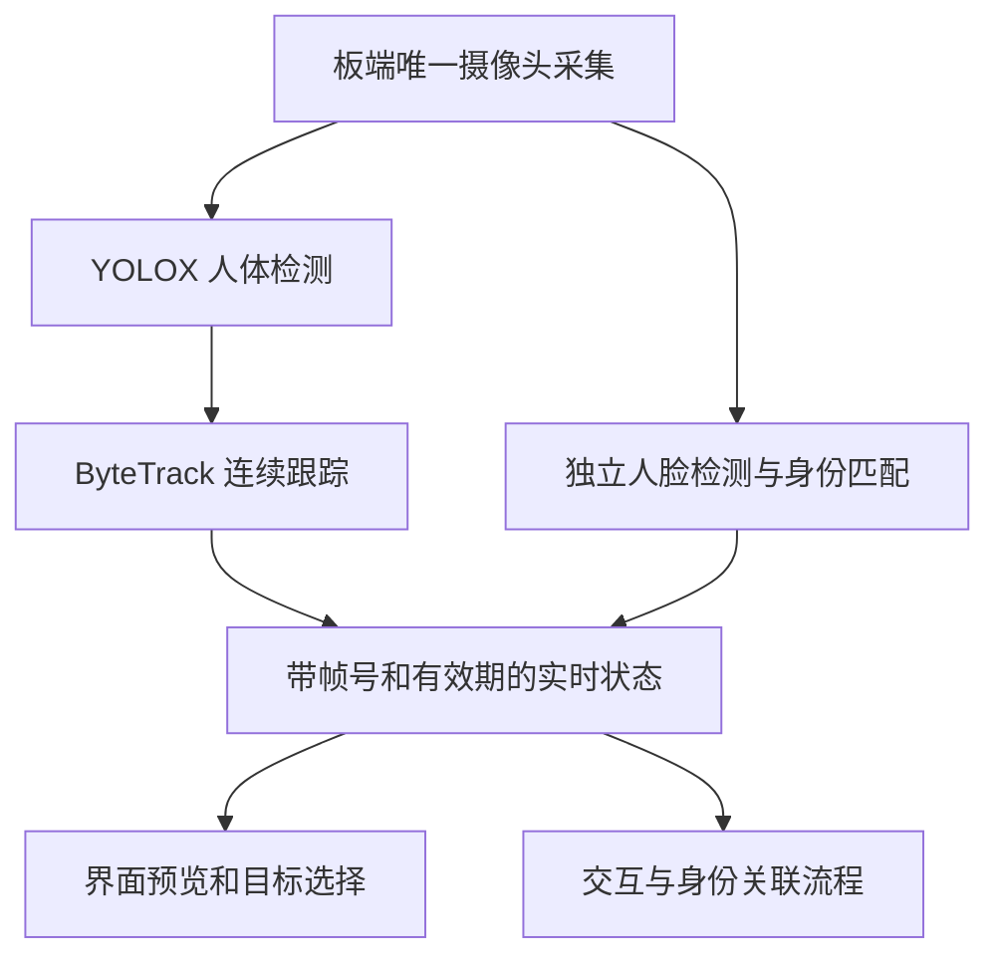
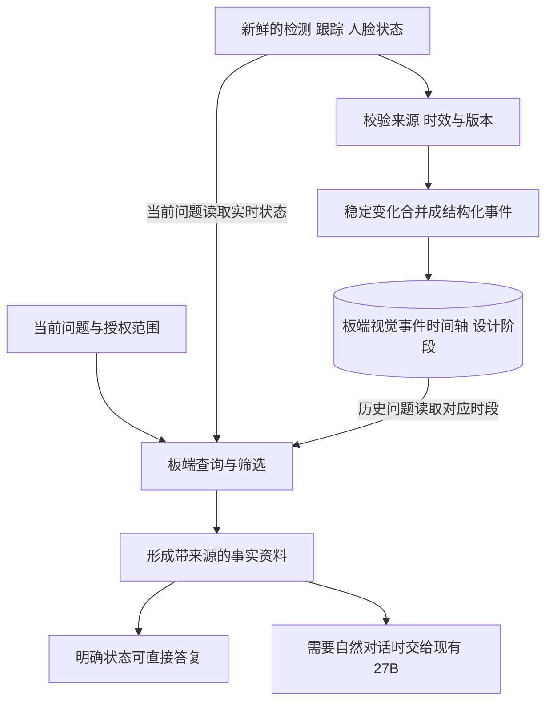

# 板端视觉信息采集记录与处理

2026 年 10 月 30 日。按用户决定移除 Qwen3-VL 视觉模型，将视觉范围收拢到现有板端 YOLO 人体检测、ByteTrack 跟踪和人脸身份匹配。视觉产生可追溯的结构化观测，供交互和记忆使用。

最新边界见 [板端五分钟记忆与 Windows 模型接口方案](统一时间轴记忆与稳定性优先_20261030.md)：业务处理和存储全部归板端，Windows 仅运行大语言模型与 OmniVoice。板端视觉事件、身份管理、时间轴存储和查询按该边界实现；旧“近期保留 Windows 权威库”的安排已被替代。保持简化和稳定，逐项适配验收，不把目标误写成已部署。

本轮移除图片问答、定时图片描述与对应模型服务，保留相机、检测、跟踪、人脸库及历史记录。结构化视觉事件统一落库是下一阶段方案，不能把现有实时状态等同于已经部署完整的视觉时间轴。ASR 和对话记忆迁板端仍按此前讨论另行验证，本轮不迁库。

交接状态：Windows r12 已就绪，8810 已关闭，图片接口已取消；板端停用图片上传器的两次发布因旧运行日志绝对路径校验失败而自动回退，用户要求改由 Ubuntu 接续。板端仍为原入口且监听关闭，权重文件尚未删除。详见本轮交付目录的 handoff_state.json 和 Ubuntu 接续提示词，不能将设计或候选描述为已上线。

## 当前保留的视觉能力

| 模块 | 在哪里运行 | 输出 | 使用边界 |
| --- | --- | --- | --- |
| 相机采集 | 板端唯一相机服务 | 图像、帧号、采集时间、相机代次 | 其他模块复用同一采集源 |
| YOLOX | 板端 DPU | 人体检测框、得分、人数估计 | 当前项目只输出 person 类；既有模型的其他类别未在这条链路启用 |
| ByteTrack | 板端 | 轨迹编号、位置、可见和确认状态、轨迹代次 | 轨迹编号只在相应来源范围内有效，不是一个人的永久身份 |
| 人脸匹配 | 板端现有人脸服务 | 已知、未知、歧义或不可用等状态，以及合格身份候选 | 姓名匹配与说话者归属、个人记忆授权分别处理 |
| 交互程序 | 板端 | 目标选择、入镜事件和当前交互状态 | 语音交谈保持独立；相机失效不阻断普通语音 |

YOLO 可以检测和定位已训练类别，跟踪器可以根据连续观测生成轨迹事件。需要扩展杯子、书等类别时，可先核对现有模型的类别，再单独开启、适配并验证。本轮不增加新模型、不修改类别与阈值。

## 现役信息流

Qwen-VL 移除后，不再上传定时图片让模型生成场景描述，也不再提供任意物品或场景的图片问答。原有模型生成的视觉历史继续保留，明确查询历史时仍按原权限和来源版本处理；普通聊天不再把这类旧观察注入为当前视觉。

## 记录层的设计

实时状态留在内存，供界面和交互即时读取。持久记录只保存经过确认的变化，避免每一帧都生成一条记忆。建议记录以下事件：

| 事件 | 记录条件 | 含义 |
| --- | --- | --- |
| 人数变化 | 新鲜、有效观测的稳定人数发生变化 | 当前画面检测到的人数变化，不代表环境中绝对人数 |
| 新轨迹确认 | 跟踪器确认新的轨迹及代次 | 新的可跟踪人体出现在视野中 |
| 轨迹丢失或恢复 | 原轨迹失去观测，或在有效条件下恢复 | 失去视野不直接表述为某人离开房间 |
| 人脸匹配状态变化 | 来源、身份库版本和当前人脸证据有效 | 记录匹配状态；未知、冲突及过期保持明确状态 |
| 相机中断或恢复 | 来源失效或重新建立 | 时间轴保留观察缺口，不补造缺失期间的事件 |

一条事件至少携带事件 ID、事件类型、来源模块、board boot、相机代次、来源帧范围、轨迹及代次、单调采样时间、入库时间、有效状态和可用范围。人数、检测框、得分等作为对应类型的结构化字段保存。

单调时间用于同一次启动内排序；日历查询使用有时钟质量标记的 UTC 时间。时钟未校准时标明时间不确定，不能据此精确回答昨天或具体时刻。身份索引与模板继续独立管理，时间轴只通过受权限控制的来源引用关联，不把姓名、模板或个人权限混在普通检测记录中。

建议数据位置为实际板端服务账户的数据目录，例如其真实 XDG_DATA_HOME 下的 aura 目录，未配置时按实际 HOME 解析。该位置是设计，不表示已创建数据库或已将 Windows 原记忆库迁移过去。

## 回答问题时怎样使用视觉记录

“现在有几个人”读取新鲜检测状态，并使用“当前画面检测到”等有范围的表达。当前语音入口还需接入结构化查询适配器，不能以已有界面人数代替这项接入已经完成。

“刚才有人出现吗”在权限和时间范围内查询已记录的稳定轨迹事件。历史记录只能说明当时有相关观测，不能自动证明是某个永久身份。

“我是谁”使用既有合格身份流程，保持画面中的人、实际说话者与个人档案授权的区分。视觉候选不自动授予个人长期记忆权限。现有跨设备生物识别摘要验收的授权边界保持。

“桌上的杯子是什么颜色”不属于本轮保留的 person 检测输出范围。只有未来对应类别、属性或其他确定性能力实际接入后，才扩展答复范围。

## 与语音和记忆的关系

视觉只提供来源明确的证据。对话管理程序按会话权限、来源有效性、问题类型、时间与主题挑选资料；普通聊天无需每轮读取视觉，也不因未入镜而中断。

用户输入、助手完整播放、视觉事件、身份线索和记忆变更可以采用统一的时间轴索引，但保留不同类型与权限。更正更新当前有效值；遗忘使对应资料退出召回；原始记录的删除走明确的删除流程。

交接核验时 ASR、对话权威库、27B 和 TTS 仍按原 Windows 运行链处理。按最新硬边界，除 27B 和 OmniVoice 推理外，其余业务处理和存储都需迁到板端并通过适配、负载和一致性验证；这是明确目标，当前尚未全部实施。

## 本轮交付与下一步

本轮操作与验证证据保存在 [视觉简化交付目录](../语音共享文件/deliverables/2026-10-30_visual_simplification/README.md)。原模型与启动位置见历史归档，不能再按旧启动脚本恢复已移除的视觉服务。

下一阶段先实现板端结构化事件合并、受控本地存储和查询接口，再用合成状态及现场观测验证。保留现有相机、YOLO、跟踪、人脸库和机械保护，避免同时改动模型、检测类别、阈值和数据库归属。
