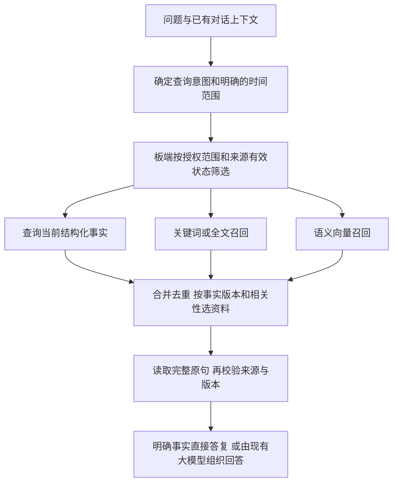

# 板端记忆检索准确性：方案建议

日期：2026-10-30。状态：源码核查与设计建议，尚未实现语义检索或迁库，未修改运行服务。用户本轮提出最终记忆库位于板端、关键词搜索不准确的问题；本文件讨论该目标下的检索设计。

## 结论与当前边界

建议采用“结构化事实查询＋关键词与语义并行召回＋来源及版本校验”。板端存储与检索理解可以分开：未来板端保存权威正文、来源、有效状态和派生向量，Windows 计算查询及新记录的语义向量，板端完成限定范围内的相似度查询，Windows 用少量有效原文回答。

当前已同步方案仍是[统一时间轴记忆与稳定性优先](统一时间轴记忆与稳定性优先_20261030.md)：保留 Windows 权威库，先统一来源、查询和失效规则，不并行引入新模型或迁库。本建议是后续增强候选，不改变该实施顺序，也不把最终板端位置写成当前已部署状态。未读取私人记忆正文或身份模板。

## 本轮确认的问题

- [conversation_context.py](../语音共享文件/aura/common/conversation_context.py)的 `terms()` 使用中文双字片段和有限规则标签，历史排序依赖片段重合。
- [timeline.py](../语音共享文件/aura/common/timeline.py)的 `sql_topic()` 使用片段 `LIKE`，`select()` 在主题非空且片段零重合时丢弃记录。它们是本机可见源码，不能单独证明当前 Windows 内存加载的代码版本。
- 对两组人工合成文本执行原始 `tokens()`，均为零重合：“我平时口味偏什么”／“我喜欢清淡的饭菜”；“下一次工作行程安排是什么”／“下周二要去上海出差”。将第一组作为合成候选交给原始 `select()`，返回 0 条。说明这条路径存在换说法漏召回的机制，不代表整个现有系统必然答错。
- 默认 Python 3.8 缺少 `zoneinfo`，整模块加载失败；随后用 AST 原样提取 `tokens()`、`select()` 在标准库环境复查成功。未测试日期解析、完整请求路由或线上服务，未安装依赖。

## 推荐检索流程

1. **明确事实走结构化查询。** 称呼、偏好和待办用现有事实键与当前有效值；“以前怎样”再查询仍允许读取的历史版本。领域别名可将“口味”“饮食偏好”映射到同一规范键，避免所有问题都依赖全文相似度。
2. **历史回忆双路召回。** 关键词保留专名、编号、数字等精确匹配；语义路处理同义表达及相关描述。两路必须独立，不能先要求关键词命中才允许参加向量搜索，也不能先截取最近少量记录再宣称覆盖全部历史。中文全文检索须验证分词或 n-gram 策略，不能仅添加 FTS5 就视为语义问题已解决。
3. **先满足范围和有效性，再比较相关性。** 授权档案、有效来源、遗忘排除和明确时间条件不可被相似度覆盖。时间轴包含历史，不意味着旧偏好仍是当前事实；用户猜测、引述和未播放完成的助手回复不能直接升级为已确认事实。
4. **少量资料进入上下文。** 可从每路十余条候选起做对照，合并后选少量完整原句；实际数量按上下文预算与效果确定。必要时评估主机重排，不能未经测量就给每轮增加一次 27B 推理。低相关、时间缺失或来源矛盾时说明缺口或澄清，不把最近邻当作确定答案。

## 板端和 Windows 如何分工

| 位置 | 未来职责 |
| --- | --- |
| KV260 | 唯一权威写入者；保存事件原文、事实有效视图、来源和版本；保存可重建向量；执行范围过滤、匹配和取回原文 |
| Windows | 运行现有大模型；可选运行中文嵌入模型，计算新记录和查询的向量；对板端返回的少量原文组织回答 |

写入时板端先提交事件，主机根据该事件计算向量，再按事件 ID 和来源版本提交派生结果。板端拒绝旧版本、已更正或已遗忘来源的迟到结果。查询向量和历史向量必须使用同一嵌入模型、维度、归一化及预处理版本，切换模型需另建索引或重建，不可混用。

向量按完整事实或语义连贯的小段落建立，并引用原文位置；超出模型长度的源记录拆段，不把整场长对话压成一个向量。授权范围在板端确定，不能只信任主机请求中自报的个人 ID。查询与写入经受控接口完成，不跨机共享打开 SQLite 文件，也不通过同步软件让双方同时写运行库。

主机生成向量不要求在主机长期复制全量记忆库，但处理新记录和回答时仍会接触相应文本；“板端保存”并不等于“正文从不离板”。如果未来要求正文完全不离板，需要另行评估板端嵌入和回答链路。

## 开源候选与资源边界

- 已通过 GitHub 插件核查 [FlagEmbedding](https://github.com/FlagOpen/FlagEmbedding/blob/master/README.md)。可将中文 [BAAI/bge-small-zh-v1.5](https://huggingface.co/BAAI/bge-small-zh-v1.5)作为小规模检索对照候选；官方资料给出的向量维度为 512。尚未下载、运行或验证本项目效果，不据模型名称承诺准确率。
- 已通过 GitHub 插件核查 [sqlite-vec](https://github.com/asg017/sqlite-vec/blob/main/README.md)：纯 C 的 SQLite 向量扩展，支持 float/int8/binary 向量，仍处于 pre-v1。可作为板端候选，但 ARM64/PetaLinux、SQLite 版本和扩展加载能力必须实际验证；小规模也可先评估普通向量点积，避免为首轮实验引入独立数据库服务。
- 仅作容量估算：1 万条 × 512 维 × 4 字节 = 20,480,000 字节，约 19.53 MiB。这不含原文、索引元数据、运行内存或模型权重，也不是板端性能实测。
- [Sentence Transformers 官方检索与重排说明](https://www.sbert.net/examples/sentence_transformer/applications/retrieve_rerank/README.html)解释了词面召回与语义召回的区别，以及候选重排的作用；[SQLite FTS5 文档](https://sqlite.org/fts5.html)列有分词与 BM25 能力。技术可行性不替代本项目对照验收。

## 建议实施与验收顺序

先完成现有统一时间轴的来源、当前事实、更正和遗忘规则，补齐可解释的规范键及少量别名。保留当前库位置和模型，在合成库中用真实问法构造关键词基线，记录哪些问题漏召回。核心记忆稳定后，仅对已确认的漏召回评估语义增强；通过效果和延迟对照后，再独立安排板端迁库和单写者交接。

后续验收集应覆盖换说法、指代依赖、专名和数字、否定、过去与当前偏好、更正、遗忘、不同档案、长历史和无答案问题。分别比较关键词基线、规范键/别名、双路召回，记录正确证据是否进入候选、错人/失效来源召回、无答案误答率和 P50/P95 检索耗时，并包含视觉并发时的板端负载。没有这些结果之前，不给准确率或实时性承诺。

本轮只有源码和公开资料核查、三项合成输出检查与文档记录，没有实现新检索器、迁库、板测或 Windows 线上验证。
