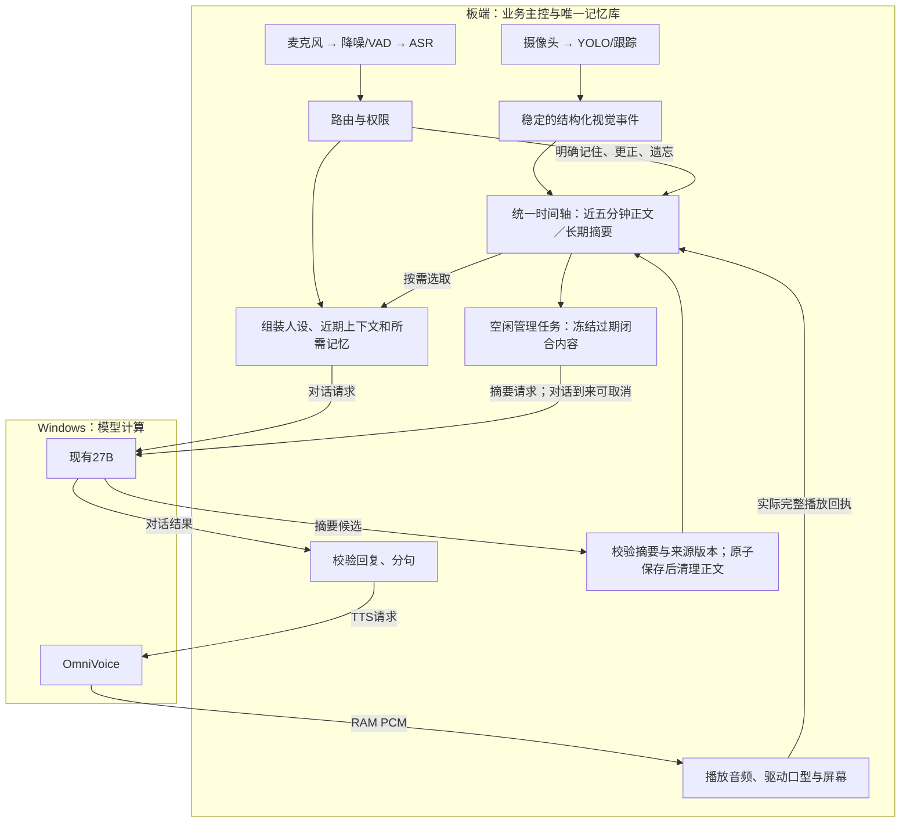

# 板端五分钟记忆与 Windows 模型接口方案

2026 年 10 月 30 日。用户确定近期方案：对话上下文负责连续交流，时间轴记忆用于追问过去的行为和事件。最近五分钟保留详细内容；更早的内容由空闲后台任务按统一格式压缩，摘要核验并保存成功后删除逐字原文。长期只保留摘要和必要的检索、权限及状态索引，不新增逐字原文归档。

用户最新明确的硬边界：所有业务信息的采集、处理、管理和持久存储归板端；Windows 仅通过网线接收模型请求，运行现有大语言模型和 OmniVoice，并返回结果。此前“近期保留 Windows 权威库、ASR 和迁库后置”的安排已被这条边界替代。

用户确认 SSH 接通后，已进入候选实现与隔离验收：板端记忆、模型接口、ASR、降噪/VAD、声纹和结构化视觉记录已有候选；合成时间轴已在 ARM 上通过网线调用真实 27B，验证了摘要成功后再清理正文。现役入口和真实生产数据库尚未切换，多项业务仍运行于 Windows。各项实测、限制与剩余移交条件见[实施状态](../语音共享文件/deliverables/2026-10-30_board_owner/IMPLEMENTATION_STATE.json)，不能将候选通过写成整机迁移完成。

图中为目标职责。人物形象的具体替换方案另作实板配对对比：必须证明同等条件下减少板端性能开销，再由用户决定是否替换；网络流量下降或候选自身运行稳定不能代替这项证据。

## 两端职责

| 职责 | 板端 | Windows |
| --- | --- | --- |
| 输入与前端 | 麦克风、降噪、VAD、ASR、摄像头采集 | 接收模型请求，不承担原始输入处理 |
| 视觉与身份 | YOLO、跟踪、人脸、声纹、身份关联与访问授权 | 不保存身份库，不运行视觉或声纹业务 |
| 对话管理 | 意图路由、选择记忆、上下文组装、输出校验、分句、取消与请求归属 | 按请求运行现有大语言模型，返回模型输出 |
| 记忆管理 | 五分钟详细记录、长期摘要、检索、版本、更正、遗忘、压缩调度和清理 | 按板端请求做语义压缩，返回摘要候选；不查询和写入记忆库 |
| 语音与显示 | 决定播报内容、发起 TTS、播放、口型时钟、动画合成和屏幕显示 | 按请求运行 OmniVoice，返回 PCM 或所需音频输出 |
| 业务持久化 | 对话、摘要、索引、身份模板、设置和业务运行状态 | 不新增聊天、记忆、录音或生成音频的持久归档 |

Windows 保留运行指定模型所需的模型权重和必要配置；大语言模型权重与 Ollama 模型数据继续按现有约定放在项目外 D 盘。模型计算所需的临时上下文、KV 缓存和音频缓冲允许存在于推理进程内，处理结束按请求生命周期释放。模型资源与业务记录分别管理，不能借模型服务继续保存一份业务记忆。

传输校验和模型运行所需的错误处理属于模型接口。用户身份、权限、事件真假、记忆有效性和最终操作决定归板端，不由 Windows 推理服务接管。

## 两条模型请求流程

普通对话：板端完成输入识别、权限和上下文 → 网线发送大模型请求 → Windows 返回文字及模型字段 → 板端校验、确定播报内容与分句 → 网线发送 OmniVoice 请求 → Windows 返回音频 → 板端播放和显示，并登记实际播放状态。需要流水线时由板端组织，保持请求代次和取消归属。

后台记忆：板端管理者判断空闲、冻结待压缩范围 → 网线请求现有大模型按固定格式生成摘要 → Windows 返回摘要候选 → 板端校验来源、版本和关键内容 → 板端入库并清理已覆盖的原文。Windows 不运行拥有记忆库的后台管理者。

当前合并语音接口仍在 Windows 接收 PCM 并处理 ASR、记忆和模型编排，不符合这套最终边界。需要增加或拆分文字模型推理和 TTS 模型接口，不能仅修改服务地址就宣称迁移完成。请求绑定 ID、设备会话、代次、剩余期限和内容，板端拥有结果采纳与实际播放状态。

## 对话连续性和历史检索分开处理

普通聊天的上下文由人设、简短的连续性摘要、最近几轮原话及当前问题组成，受当前上下文容量限制。仅在用户追问过去事件时，再补入检索到的相关历史摘要。数据库中的全部五分钟详细记录不要求每轮都送入模型。

同一段内容的整理结果尽量复用，避免分别为上下文和历史记忆维护两套互相矛盾的总结。历史记忆按时间和主题定位标准摘要块，不把整库摘要逐轮发送给模型。

## 两级时间轴

| 层级 | 保存内容 | 用途 |
| --- | --- | --- |
| 最近五分钟 | 用户输入、助手回复及播放状态、已接入且有效的结构化事件 | 短期精确追溯，并为压缩提供输入 |
| 五分钟前的已整理内容 | 标准摘要、时间范围、主题关键词、归属、有效状态与必要来源编号 | 长期检索过去的讨论、行为、结果和约定 |
| 等待整理的超时内容 | 尚未成功转换为摘要的详细记录 | 仅作临时队列，压缩失败或繁忙时防止丢失 |

五分钟是进入压缩队列的阈值。按稳定优先，未核验、未保存成功的内容不能先删。连续聊天时允许超时内容暂存，空闲后处理完成再清理；这属于队列积压，不是额外的长期原文归档。若要求严格五分钟就必须销毁原文，则不能同时保证仅在空闲做语义压缩，本方案优先保留压缩成功再清理的顺序。

按已结束的轮次、事件和话题分段，不强行切断正在生成或尚未结束播放的轮次。用户输入和助手已播放内容保持不同来源，未播完的回复不被摘要写成用户已经听到。

## 标准摘要保存什么

每个已闭合的时间段形成独立摘要块，首版只保留回答过去事件所需的字段：

| 字段 | 要求 |
| --- | --- |
| 时间范围 | 保留开始和结束时间，区分记录时间与有明确来源的实际发生时间 |
| 归属 | 会话、授权档案或设备范围；说话者未知时明确标注 |
| 主题关键词 | 使用少量可检索词，不引入新的向量模型 |
| 事件和结果 | 谁说了什么、讨论或做了什么、得到什么结果、还有什么未完成 |
| 关键事实 | 准确保留重要名称、数字、否定、更正、约定及任务状态 |
| 来源和有效状态 | 保留必要事件编号、来源类别、修订和遗忘状态，不保留整段原文 |

“计划去买”和“已经购买”必须区分；用户说过一件事、相机曾有相关观测和实际确认完成也分别记录。模型不能把推测补成已发生的行为。

尽量直接从对应时间段的详细记录生成摘要块，减少反复对摘要再压缩造成的信息损失。删除原文后，历史追问以摘要实际保留的信息为界；缺失的逐字台词和细节明确表示没有记录，不声称能够完整还原。

## 空闲记忆管理任务

管理者位于板端，采用板端记忆进程中的轻量后台任务，负责窗口检查、分段、排队、索引、版本校验和清理；需要语义压缩时通过网线调用 Windows 的现有 27B，不新增常驻大语言模型。模型只返回候选，数据库与调度权归板端。

只有没有待答请求、语言模型和 TTS 没有正在处理的对话任务时，才启动新的语义整理。对话或打断请求到来时，停止领取新整理任务，并取消或及时让出正在进行的整理；未提交结果可丢弃并稍后重试，原文仍留在待处理队列。数据库整理不长时间持有写锁，不把整理任务的等待预算转嫁给对话。

这是一项普通后台工作机制，不是新增自主代理、定时通知或 Codex 自动任务。

## 摘要成功后再删除原文

处理顺序如下：

1. 选取五分钟前已结束的内容，冻结范围、权限和来源修订。
2. 在空闲时生成标准摘要，校验格式、时间范围、归属、关键事实及来源引用。
3. 写入候选摘要并检查可读性；提交前再次核对来源版本，排除整理期间发生的更正、遗忘或删除。
4. 在短事务中发布长期摘要，并清理已被该摘要覆盖的逐字正文；提交失败则保留原文，任务可幂等重试。
5. 更新时间和关键词索引，清理仍含有旧正文的活动缓存，避免另一路继续提供原文。

长期清理对象是逐字正文，不是用于授权、版本和事件关联的必要编号、时间、播放状态或修订元数据。当前事实和明确记忆可保留小型有效值及其摘要来源，不能随源正文清理而丢失。

用户已明确长期只留摘要，不新增原文归档。本轮没有删除任何生产原文或既有备份。实施时要列清活动库、正文缓存、日志与既有备份的范围，不能只清一张表就声称所有原文副本均已删除，也不能顺带清理无关历史资源。

## 与现有实现的关键差别

现有 timeline_summaries.py 的 DigestWorker 是无模型的摘录缓存，按来源修订失效；其中 300 秒表示情节分组的间隔条件，不是详细原文只保留五分钟。

新方案中的长期摘要在原文清理后成为历史记录本身，不能直接使用现有“删除来源即清空摘要”的缓存语义。应移植现有可复用模块、SQLite 模式与索引逻辑，在板端建立长期摘要记录和明确生命周期，不继续依赖 Windows 的记忆进程。

现有事实版本、个人事实和来源关系引用 turns 记录。不能直接周期执行删除旧 turns 的 SQL，否则可能触发摘要清除、破坏来源关系或级联删除其他内容。先解决摘要权威、引用元数据和正文生命周期，再启用清理。

## 更正 遗忘和权限

更正更新当前有效值，并使相关摘要中的旧值只能以明确的历史状态出现。遗忘作用于详细记录、相关摘要、当前事实和派生缓存，不能因原文已删除而失去约束。

摘要保留可定位的主题、事实键和来源关系。不能可靠剔除某项已遗忘内容时，使整个相关摘要块退出检索，接受少记一部分，也不依靠模型猜测后继续提供旧值。

匿名会话和授权个人档案继续隔离，摘要不得跨范围合并。人脸、声纹候选不自动授予个人记忆访问权限，身份模板由原模块管理。

## 首版验证与实施顺序

先用合成数据验证五分钟边界、连续对话期间的积压、模型整理失败、保存失败、取消和重启恢复。必须证明摘要成功前不会删原文，成功后活动记忆只保留对应摘要和必要索引，重试不会产生重复或漏失。

验证压缩保留名称、数字、否定、计划与完成状态，以及助手实际播放状态。验证更正、遗忘、档案隔离和摘要查询；未保留的细节不能由模型补造。新对话到来时，后台整理必须让出资源，并核对实际对话时延。

Ubuntu 先核对实际状态并完成旧图片上传器停用和启动路径修复，再按板端业务主控边界拆分协议、适配板端处理与存储，先用合成数据验证记忆语义和生命周期。Windows 协作端提供固定模型的推理接口；新的记忆候选从一开始就以板端存储为目标，不再新增 Windows 业务实现。

现有 Windows 上的 ASR、GTCRN/Silero、ECAPA 声纹、记忆/权限/上下文及动画合成都属于需要收回板端的范围。应逐项验证 ARM 依赖、内存、耗时及整机并发负载，未过板测的能力标为待适配，不能假定移动源码即完成，也不能将 Windows 实现保留为最终方案。保持既有模型和效果要求，必要的适配差异明确记录。

真实库迁移按一致备份、权限与来源校验、唯一写入者切换和失败回退执行。保留较新数据及遗忘结果，不恢复旧快照。过渡服务的存在只代表迁移尚未完成，不改变最终归属，也不应在板端替代尚未就绪时盲目停掉现役依赖。

以简化和稳定为先，每次只切换一个经过验证的边界，避免同时改模型、数据位置、摘要语义和检测类别。分步验收顺序由依赖决定，不能再把板端处理和存储写成可无限期后置的可选项。

[Ubuntu 接续提示词](../语音共享文件/deliverables/2026-10-30_visual_simplification/Ubuntu接续提示词.md)与本方案同步。运行状态仍以既有交接证据和实机重新核验为准，本文不是新功能已经部署的回执。
