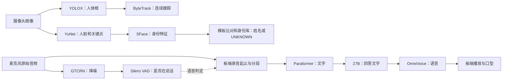

# AURA全部模型：当前配置、用途与历史候选

**最新实施更新（UTC 2026-10-22 07:25后）：YuNet已通过30分钟实时检查并保留DPU配置；SFace真人三模型DPU影子短测也已通过，随后恢复到YOLO＋YuNet常驻，正式SFace身份仍配置WindowsCPU。** YuNet长测平均YOLO9.95/YuNet2.37Hz、CPU53.93%，0 MCP01告警/0 YuNet真正超限，保留1次YOLO周期超时和1次预算估计偏差。SFace真人影子20秒完成10次，调用平均14.48ms、零失败，未判身份/写库，目前关闭；不是三模型长期常驻或现场准确率验收。直接身份候选21项、影子候选16项回归与3项部署准备检查通过，独立INT8登记/阈值仍待验。当前部署与限制见[实时交付](../2026-10-21_dpu_live_baseline/README.md)及[真人短测](../2026-10-21_dpu_live_baseline/SFace_真人影子短测.md)，最初公开精度/适配见[首轮交付](../2026-10-21_dpu_vision_start/README.md)。下文“本轮只读/无推理”等指03:21初版盘点。

更新：2026-10-21 America/Los_Angeles，UTC 2026-10-22 03:21后。用户要求重新仔细解释全部模型。本轮核对完整ZIP入口、旧模型总清单、当前权重和服务源码，并通过三次独占UART查询实际活动语音前端源码、配置、界面状态及无音频健康接口。

**此前“六项主线模型”清单不完整：漏列了最新活动版本已配置的GTCRN和Silero VAD v5。当前应按8项已选定/已配置的功能模型解释，另列OmniVoice内部音频tokenizer、2类待接能力及历史/研究候选。** 这不是“8个模型现在全部在线、同时成功推理”的结论。Windows8795本轮健康查询超时，Windows8791/8792此前本次会话也超时；本轮没有发送音频、人脸或新推理请求。

## 当前8项功能模型

| 编号 | 模型/实际身份 | 输入→输出 | 职责 | 配置的处理位置 | 磁盘大小及状态 |
| --- | --- | --- | --- | --- | --- |
| 1 | YOLOX-Nano，person适配xmodel | 相机图像→人体框/置信度 | 找出画面中的人，给跟踪提供检测 | KV260 B4096 DPU | 2,127,303 B≈2.13MB；本会话实板检测约9.91Hz |
| 2 | YuNet 2022mar，INT8 CNN部署 | 图像→人脸框/五点关键点 | 找到人脸，为对齐、身份和脸部目标提供位置 | KV260 B4096 DPU卷积＋ARM预后处理 | 活动xmodel576,254 B≈0.576MB；30分钟平均2.37Hz；原ONNX345,478 B保留作CPU回退 |
| 3 | SFace 2021dec | 对齐112×112人脸→128维特征 | 把人脸变成可比较的身份特征；与登记模板比较后才得到已知姓名/UNKNOWN | Windows CPU / ONNX Runtime，板端远程请求8792 | 当前参考ONNX38,696,353 B≈38.70MB；远程后端已配置，当前请求成功未验；10.80MB DPU工程候选为另一个部署版本 |
| 4 | GTCRN，gtcrn_simple.onnx | 20ms连续音频→降噪音频 | 为当前语音活动检测提供降噪输入 | Windows CPU / sherpa-onnx服务8795 | 活动代码固定SHA；本Ubuntu共享镜像未找到权重，大小未实读；配置enabled=true，当前服务健康超时 |
| 5 | Silero VAD v5，silero_vad_v5.onnx | 降噪音频→speech真假 | 判断是否正在说话，配合板端起止/静音持续时间切分录音 | Windows CPU，同一8795服务 | 活动代码固定SHA；大小未实读；配置enabled=true，当前服务健康超时 |
| 6 | Paraformer INT8，sherpa-onnx-paraformer-zh-2023-09-14 | 一段语音PCM→中文文字 | ASR：识别用户说的内容 | Windows CPU，现有配置2线程 | 243,371,218 B≈243.37MB；既有语音链有实录证据，当前Windows未在线确认 |
| 7 | 当前27B对话模型，本地标签aura-qwen3.8-27b-abliterated:iq4_xs | 转写文字/文本上下文→回答文字、表情/动作字段 | LLM：理解和组织回答 | Windows GPU / Ollama11435 | 保存元数据27.3B、IQ4_XS、size13,885,180,476 B≈13.89GB；当前Windows未在线确认 |
| 8 | k2-fsa/OmniVoice，revision c5fdb5ccb189668d56333f77ba2629f4cd7535f4，16步 | 回答文字+参考声线→语音音频 | TTS：把要说的文字合成为汐蓝声音 | Windows GPU，现有运行代码float16/SDPA | 主网2.45GB+内部音频tokenizer0.806GB，两份权重合计3.256GB；已有接受语音记录，当前Windows未在线确认 |

MB/GB按十进制计，均为文件体积或已标注的保存运行元数据，不是峰值内存/显存。当前8项可按职责记为：3项视觉＋2项语音前端＋语音识别、文本对话、语音合成各1项。

## 实际链路与模型边界

图展示数据和控制关系，不表示每个节点都是神经网络，也不表示当前远程服务已连通。

当前GTCRN并没有直接替换发送给Paraformer的音频：活动`RemoteSpeechGate`文档明确不改变endpoint/ASR使用的PCM，8795协议仅返回speech判定和样本计数，不返回降噪PCM。因而应描述为“GTCRN降噪后辅助Silero进行语音检测”，不能写成“Paraformer已识别GTCRN降噪音频”。板端仍负责连续有声/700ms静音等时长规则。

YuNet负责找脸；SFace只输出特征，姓名依靠登记库和相似度/歧义规则；YOLO负责人体检测。跟踪ID是同一段轨迹的标识，不能等同永久身份。当前没有证据表明这三者本身能判断哪张脸正在说话。

语音内容由Paraformer转写；回答由27B生成；发声由OmniVoice合成。Silero判断“有没有语音”，不识别词语、不做声纹身份、不决定画面中的说话者。声线参考是TTS条件，不能视作新增一个“汐蓝身份识别模型”。

## 两类尚未接通的能力

| 能力 | 对应模型/候选 | 解决的问题 | 当前状态 |
| --- | --- | --- | --- |
| 画面内主动说话人判断 | Light-ASD | 人脸视频片段+同步音频→每张脸正在说话的分数，辅助选人 | 原方案首版Windows；旧manifest为port_defined_model_not_integrated，无更新完成证据 |
| 看图问答 | VLM，原方案候选Qwen2.5-VL-3B-Instruct | 相机图片+问题→与图像内容有关的回答 | 当前共享对话请求仅文本messages，未接images；最终后端和型号未冻结验收 |

这两项是待接的功能角色，不能机械地说“最终必定还要新增两个独立权重包”。未来VLM能否复用当前语言模型或采用其他视觉编码器，须依据实际模型来源、视觉组件和图像请求验收决定。

## 内部组件、部署版本和名称的解释

- OmniVoice的`audio_tokenizer/model.safetensors`（805,665,628 B）是单独权重组件，承担语音表征/编解码，按功能归属于TTS。按独立权重组件细分应另列它，按业务功能仍把OmniVoice算1项。
- OmniVoice内部`llm_config`含Qwen3骨干，是TTS内部架构；不能因此把它与外部27B对话服务混成同一个网络，也不能再多算一个外部对话模型。
- SFace的浮点ONNX、INT8量化和编译xmodel属于同一身份任务的不同部署产物；DPU候选有板测不等于生产已切换，也不表示多出一个业务功能。
- OmniVoice“16步”是生成迭代设置；float16是运行数值精度。二者不是模型个数，也不是同一个概念。
- 27B表示约270亿参数的量级，保存元数据为27.3B；不表示文件27GB。IQ4_XS是量化格式，文件大小、参数量和推理显存分别看。
- 当前27B本地标签中含“qwen3.8”，但保存的Ollama家族元数据是`qwen35`。本轮没有Windows原始GGUF/download_manifest，因此只以本地标签标识实际配置，不把它当成已核验的官方型号，也不据家族名自动认定已接通视觉能力。
- 旧语言模型分析README还记录原始下载文件14,403,496,864 B（约14.40GB），而保存Ollama size为13.89GB。两者来源/对象不同，本轮无法用Windows文件及blob逐一比对，不合并为同一个已实读大小。

## 历史、候选与研究提及的其他名称

| 类别 | 出现过的名称 | 在当前清单中的地位 |
| --- | --- | --- |
| 旧文本对话 | Qwen3 4B；huihui_ai/qwen3-abliterated:14b；历史goonsai/Qwen2.5 3B标签 | 旧测试/回退，不认定与27B同时常驻 |
| 旧TTS/声线实验 | Qwen3-TTS 1.7B的Base/CustomVoice/VoiceDesign；VITS AISHELL3；Kokoro INT8 | 旧方案或试听。共享仍见VITS约30.48MB、Kokoro主网约114.30MB及53.79MB voices.bin；当前主线选择OmniVoice |
| 旧ASR候选 | SenseVoiceSmall | 方案候选，当前文本转写主线是Paraformer |
| 历史关键词唤醒 | Zipformer KWS 3.3M | 有PC模型卡和代码；encoder/decoder/joiner是同一KWS系统的组件，当前活动版本未发现真实KeywordSpotter加载入口/权重。自动检测说话不等于关键词唤醒已启用 |
| 身份/人脸候选 | MobileFaceNet、SCRFD、RetinaFace、MagFace相关路线 | 未见当前已部署证据，不能推断每个权重都下载了 |
| 平台验证/旧检测 | ResNet18；SSD等 | ResNet18是DPU分类基准；其他是历史路线，不是当前人体业务默认模型 |
| 语音/性能研究中的候选 | OmniVoice-fast、CosyVoice3/CosyVoice.cpp、Qwen3-TTS0.6B/1.7B、MiniCPM-o4.5、PersonaPlex、Freeze-Omni、DFlash2草稿、Context-Spanning/DuetaSpan路线 | 仅在5090/延迟研究材料出现；本轮未验证部署或权重，也不把论文性能写成项目实测。实现/研究路线本身不都等于一个新增模型 |

以上按项目材料归类，不是要求将所有候选下载或同时运行。与当前主线没有部署关系的研究引用只保留追溯。

## 这些名称不另计为神经网络模型

ByteTrack及旧SORT/BoT-SORT是跟踪路线；EnergyVad是能量/时长规则（当前类也可注入Silero远程分类结果）；图像对齐、余弦比较、SQLite、界面/口型和转轴控制是算法、数据或程序。DPU/B4096/FPGA是硬件，VART/Ollama/ONNX Runtime/sherpa-onnx/llama.cpp是运行时或框架。ArcFace是训练损失/方法；Streaming ASD、LoCoNet、Neural Simplex在旧方案中借鉴其思想，不证明额外部署了这三个完整网络。

旧`config/model_manifest.json`只列一部分候选，仍有YOLO pending等历史状态，也没有新增语音前端。不能单独拿它统计全部当前模型；本轮没有改生产配置来补清单。

## DPU相关结论及未验证项

当前YOLO和YuNet两项业务模型使用DPU。YuNet活动xmodel576,254B，新校准SFace候选10,796,375B；两者均通过固定输入实板对照，YuNet另通过30分钟实时检查。SFace已补256身份校准、独立公开配对及真人三模型影子短测，但正式身份仍配置WindowsCPU、影子已关闭；独立INT8登记/现场阈值及较长三模型验证待做。MCP01本次播放告警已通过重开原应用恢复、长测未复发，首次触发根因未定。GTCRN/Silero仍WindowsCPU，未做本板DPU适配。

前一轮CPU75%～83%、DPU驱动忙时4%～5%是短时负载；SFace当前在Windows，迁回不会自动卸掉ARM上的SFace计算。不能据DPU空闲比例承诺任意模型可直接部署。

三次本轮UART均响应校验通过并恢复回显，无业务源码/配置/模型/服务/硬件改动，未录音/传音频/采集人脸/执行新推理。GTCRN/Silero模型文件大小、本轮Windows驻留、原始27B准确上游身份及端到端新实录均未验证。过滤证据见[全模型概览_证据.json](全模型概览_证据.json)；此前大小详见[原六项盘点](README.md)，负载与DPU建议详见[实测报告](../2026-10-21_dpu_cpu_load/README.md)。
