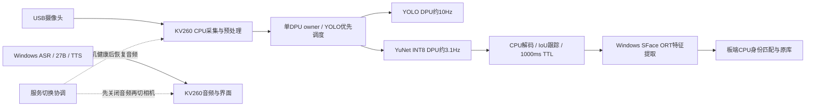

# 当前模型与数据流

两种板载DPU模型共享同一owner，CPU保留图像准备、解码、跟踪和控制。失败轮次恢复缩短无结果后的空等，成功发布节拍保持；逐发布计数与保守gap上下界用于区分新鲜结果、拒绝和过期。正式SFace依旧使用Windows，不把历史已编译的DPU SFace候选算作当前已上线模型。

DPU任务忙碌率约5%说明这个实时负载还有硬件余量，不表示FPGA资源只使用5%。后续利用SFace等实际业务继续提高DPU参与度，需要真人业务与对应INT8身份域校准/验收，不能用重复空任务替代业务收益。
