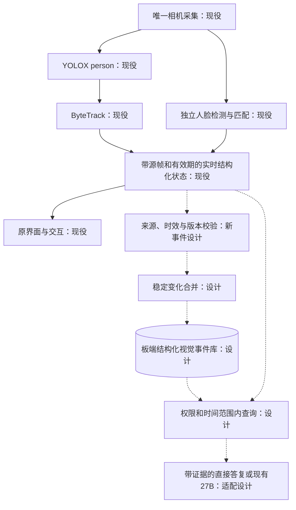

# 视觉流程与结构化事件契约

2026-10-30，Ubuntu 接续设计。部署事实以本目录 `handoff_state.json` 和 `Ubuntu执行回执.md` 为准。本文件中的新事件合并器、表结构和查询接口均为设计，尚未实现或部署；不得将下述流程图整张标为现役。

## 能力与部署位置

| 层 | 当前能力及位置 | 状态与限制 |
| --- | --- | --- |
| 唯一采集 | KV260 现有相机服务，消费者复用原帧和来源元数据 | 现役；本次不增加采集进程 |
| 检测 | KV260 DPU YOLOX，当前链只输出 `person` | 现役；不是杯子、颜色或任意场景理解 |
| 人体跟踪 | KV260 PS ByteTrack | 现役；轨迹号必须带来源和生命周期，不是永久身份 |
| 人脸 | 独立人脸检测/跟踪，板端 DPU SFace 特征及原库匹配 | 现役；保持模型、实验阈值、歧义拒绝和登记规则；人脸不需要先绑定人体才能登记 |
| 实时状态 | 原相机/API/界面状态，包含代次、源帧和有效期 | 现役；缓存状态不等于事件已经落库 |
| 定时图片上传 | `DeviceObserver` 兼容停用实现 | 本次单文件发布项；最终是否提交见回执；旧 tick 不能重新启用 |
| 图片语义模型 | Windows 原 Qwen-VL 服务和图片推理调用已移除 | r12 已就绪；8810 关闭，旧图片接口 410；D 盘权重清理由 Windows 完成 |
| 稳定事件/结构化查询 | 事件合并、本地 SQLite、查询适配器 | 本文件设计；尚未部署 |
| 历史视觉 | Windows 原有模型生成的文字历史 | 保留原来源和权限；不注入普通聊天作为当前画面 |
| 语音与记忆 | ASR、27B、TTS、声纹及对话权威库仍在 Windows | 现役；本轮不迁移、不回滚私有库 |

## 采集与实时处理

1. 相机所有者生成原始 `frame_id`、`camera_epoch`、板端 boot、采集出队单调时间及图像尺寸。没有曝光时间戳时明确写“出队时间”，不将推理完成或 UI 轮询时间重写为采集时间。
2. YOLO 使用同一采集帧；ByteTrack 只关联有效检测。队列有界、优先新帧，已过期结果不得重新标为当前。
3. 人脸检测与匹配独立消费相机帧，保留模型版本、库修订和原判断条件。其更新节奏可以与人体检测不同，不能按人体帧率宣称人脸处理帧率。
4. 实时状态至少区分 `valid`、`stale`、`unavailable`、`unknown`、`ambiguous`。只有有效观测才能回答“当前画面检测到几个人”；检测无效时不能填人数 0。
5. 人体轨迹、人脸轨迹、姓名候选、实际说话者和个人记忆权限分别维护。发现熟悉人脸不自动认定当前说话者，也不解锁个人历史。语音不以入镜为前提。

## 新事件类型：设计

| `event_type` | 触发依据 | 允许的表述 |
| --- | --- | --- |
| `person_count_changed` | 有效、连续新帧中的确认可见人数稳定改变 | “画面检测到的人数由 1 变为 2” |
| `track_confirmed` | 原跟踪器确认一个新的有来源轨迹 | “出现一条新的已确认人体轨迹” |
| `track_lost` | 原跟踪器确认丢失，且事件去抖窗口内未恢复 | “该轨迹暂时不在可见范围” |
| `track_recovered` | 同一跟踪器生命周期内，经原关联规则恢复 | “原轨迹恢复可见”；不能跨来源猜同一人 |
| `face_match_state_changed` | 原合格人脸匹配状态稳定变化，库/模型/源均有效 | “人脸状态由未知变为已匹配”；身份引用留板端受限分区 |
| `source_unavailable` | 相机失联、源过期、服务/相机换代 | “这段时间没有有效视觉观测” |
| `source_recovered` | 新鲜帧重新建立，绑定新的来源范围 | “视觉观测恢复”；缺口期间不补造活动 |

不设计 `person_left_room`。离开视野、遮挡、漏检、换轨均不足以证明某人离开房间。相机重启后产生新的来源范围，不拼接旧轨迹号。

## 字段、时钟与来源

事件公共字段建议如下；这些字段尚不是现役 API 协议。

| 字段 | 约束 |
| --- | --- |
| `schema_version`、`event_id`、`event_type` | 固定协议版本；事件 ID 用规范化来源/类型/证据范围生成，重传保持不变 |
| `device_ref` | 配置中的设备引用；不能用姓名或人脸 ID 充当设备标识 |
| `board_boot_id`、`camera_epoch`、`service_instance` | 完整来源范围；服务重启或相机换代使旧状态失效 |
| `source_module`、`source_revision` | 检测/跟踪/人脸生产模块和已校验版本 |
| `first_frame_id`、`last_frame_id`、`distinct_frame_count` | 递增的原始证据帧；重复轮询同帧不累计稳定证据 |
| `first_source_monotonic_ms`、`last_source_monotonic_ms` | 同 boot 内排序/去抖；跨机或跨 boot 数值不能相减 |
| `received_utc`、`event_utc`、`clock_quality`、`uncertainty_ms` | 接收时间与估计事件时间分开；无可信映射时 `event_utc=null`、质量为未校准 |
| `track_id`、`track_generation` | 仅轨迹事件需要；必须与全部来源字段联合使用 |
| `payload`、`validity`、`reason` | 类型专属人数/位置/状态等；不得伪造为模型未输出的物品属性 |
| `identity_scope`、`access_scope` | 匿名检测与受限身份分开；默认不包含真实姓名、模板、图片或可跨机关联的身份摘要 |
| `expires_utc`、`forget_revision` | 新事件自己的保留策略与遗忘版本；不改旧历史记录的策略 |

板端当前日期不能仅因存在 UTC 字符串就被信任。应记录时钟映射来源、采样锚点和不确定度；跳时后开始新映射段。时钟未校准时，同 boot 可回答受界限的“刚才”，但“昨天/几点”查询必须说明时间不确定，不把 Windows 接收时间当作精确发生时刻。本轮不改系统时钟或 NTP。

## 稳定变化、合并与幂等

以下是新合并器的起始设计值，**没有修改现役 ByteTrack、人脸阈值或时效配置**。

- 人数变化/新事件候选至少获得 3 个不同且递增的源帧，证据跨度不少于 800 ms；只累计新鲜有效的源帧。采用候选状态与已提交状态分离，短时抖动取消候选，不逐帧入库。
- 轨迹确认、丢失和恢复先遵守原跟踪器判断。事件层再合并短缺口；不能以事件窗口延长实时授权、继续跟随或复用过期身份。
- 相同来源、相同语义状态持续存在时只更新内存区间；合并器提交稳定变化一次。长时间持续状态可按有界检查点记录，不能每个 UI tick 写一条。
- SQLite 对 `event_id` 建唯一约束。重传同 ID/同规范化载荷返回同回执；同 ID/不同载荷拒绝。记录每个来源最后接收帧和序号，拒绝回退序号及旧来源在当前状态中复活。
- 来源中断只记录一个有界缺口；恢复明确另起证据区间。服务崩溃/数据库繁忙时使用有界队列，满队列记录丢失计数与观测缺口，不阻塞采集/语音，也不补造遗漏事件。

## 本地存储、保留与遗忘：设计

建议新建独立 `visual_events.sqlite3`，位置由**实际服务账户**的 `XDG_DATA_HOME` 或实际 `HOME` 推导，显式配置绝对路径并记录所有者。已观察到监督器的 HOME 与代码根并不相同，不照抄 `/home/root` 为数据目录。不得迁入或覆盖 Windows 对话权威库、人脸模板库或旧视觉表。

建议新表为 `visual_events`、`visual_event_sources`、`visual_forget_revisions`；索引覆盖来源/帧范围和可信事件 UTC。身份引用独立放在板端受限表或使用原身份服务，不进入匿名事件载荷。原始图像/视频不随事件保存；既有明确授权的人脸登记照片档案继续按原规则保留，本次不删除。

新通用事件可从最多 30 天/10000 条开始评估；这是新库候选策略，不自动清理旧 Windows 视觉历史。时钟未校准时用有界接收保留策略并注明其依据，不按错误板端日历立即过期。先评估容量与索引，再正式冻结保留值。

遗忘预览列明库、时间/主题/类型及匹配数量，确认令牌绑定设备、授权、筛选条件和修订，并限时失效。确认后在同一事务中排除源事件及派生摘要/索引的召回、推进修订并拒绝迟到写回。物理删除与备份删除需原明确授权；本次不执行任何新视觉或历史数据删除。

## 查询接口草案：尚未实现

| 接口 | 行为 |
| --- | --- |
| `GET /v1/visual/current` | 返回新鲜有效实时状态、原源帧/年龄/能力范围；无效返回具体原因，不能用旧事件填当前状态 |
| `POST /v1/visual/events/query` | 按设备/时间/类型/权限分页查询；有界页大小和时段；返回证据范围、缺口、时钟质量 |
| `POST /v1/visual/events/forget/preview` | 只预览当前授权范围内的排除结果及限时确认令牌 |
| `POST /v1/visual/events/forget/confirm` | 核对令牌、授权和修订，提交遗忘并返回新修订 |

普通聊天继续走原语音链，不每轮读取视觉。“现在有几个人”未来走实时适配器；“刚才有人出现吗”未来走事件查询；“我是谁”保持原严格身份流程。任意物品、颜色、主观场景解释仍不在 `person` 输出范围。27B 只接收筛选后的来源资料，不获得直接写库、运动或授权权限。

真实人脸 ID/模板指纹向 Windows `192.168.50.1:8792` 发送的既有待授权边界继续有效。身份事件首先在板端设计和合成数据上验证；不能通过新事件接口、日志、哈希字段或测试脚本绕过该限制。

## 下一阶段验收

先以合成状态验证重复帧、抖动、人数 0 与不可用、换源、乱序、断连、幂等冲突、时钟跳变和迟到写回，再评估板端并发/写入上限。然后在授权范围内验证真实匿名检测事件；身份跨机、真人重返与说话者归属另行验收。

结构化当前问答、事件落库与查询接入完成后，才能宣称“YOLO/跟踪事件可供语音时间轴查询”。已有界面显示人数和已有旧视觉历史均不能替代这项验收。
