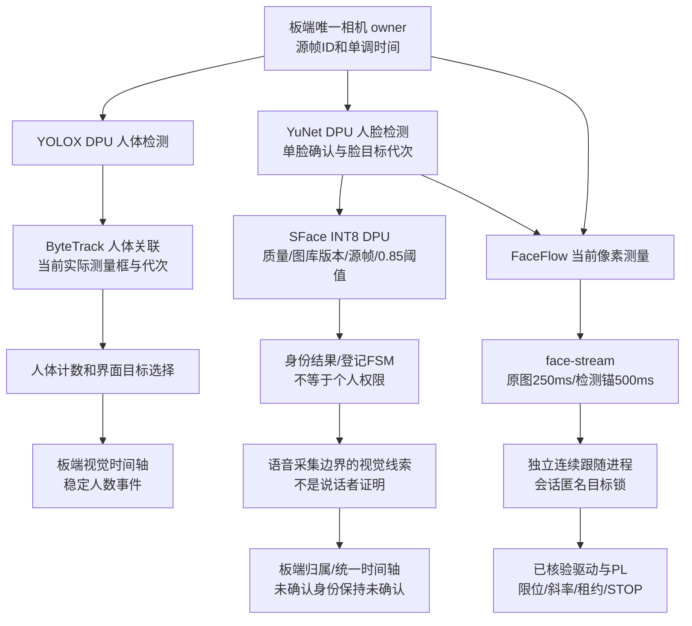

# 已核查的数据流

这份核查区分v23业务组件、旧启动相机快照和wide控制器归档，三者都有独立指纹。代码结论不扩展为当前现场验收。

## 人体定位与选择

实际相机快照配置为`dpu_yolox`及`bytetrack_numpy`。YOLOX只输出person；ByteTrack用预测辅助关联，但发布的是当前检测的实际框。人体轨迹连续确认2帧、源时间丢失界限500ms，重新可见会增加代次；历史配置中的阈值属于人体检测/关联，不是人脸身份阈值。

`PersonByteTracks.selected_key`保留手动模式；自动模式仅在单个已确认人体目标时选中。失去已选目标即清空选择，不以丢失框继续输出。另有通用`fusion/targets.py`，不能把它当本次相机实际使用的唯一选择实现。

人体选择、人数和人脸随动是分开的链路。界面“选择当前对象”操作人体目标，不会把此人体ID直接当作当前人脸身份或使真实人脸随动进程改跟该ID。

## 人脸定位、识别与连续性

相机拥有YuNet/SFace DPU与共享调度，不新增Windows视觉推理。`FaceTargetService`要求实际可见、已确认的单张合格脸；多人、过期或错误不提供身份目标。短暂未检出时只允许同一仍存活轨迹及其私有连续性恢复；不能选择最大脸替代。

身份分支从对应实际帧对齐人脸并提取特征；`IdentityService`在提交和返回时检查目标、源龄、图库版本。`IdentityStore.match`分别执行阈值及歧义分差。v23配置的0.85及分差0.10未改；不是所有共享目录的旧副本都具有相同阈值，尤其业务根仍有0.50旧配置。当前相机运行配置须独立复读。

运动分支的`FaceFlow`使用当前帧对固定检测锚的模板/NCC及受限LK仿射测量；匹配图不更新锚的原时间。检测短暂漏检时，必须有足够新的实际像素、仍有效的原锚及同一连续性键，才可发布运动观测。`motion key`可在实际像素确认后跨检测键抖动保留，因此它不必逐字等于身份检测键。

多人、不健康、锚过期、缺少锚帧或实际匹配失败会清除运动绑定/拒绝观测。即使匿名键保持，也只能说明源码规定的局部视觉连续性，不能证明生物身份；相似脸交叉、遮挡后误关联的现场性能尚未验证。

## 跟随与停止

`FacePanProcess`验证独立控制器发布清单，关闭手动owner后启动子进程。子进程独占运动锁；退出未确认前不创建替代手动owner。候选保留此顺序和STOP重试。

真实入口`run_face_motion.py`选择`HardwareSlewSession`，确认2个源图后才ARM，且只有ARM之后的新实际图像能启动/续期输出。人体观测或重复旧图不能提供新许可。图像250ms和检测锚500ms两者取早，故障及控制tick过晚停止；图像丢失使用QUIESCE结束当前脉冲，未知协议/硬件故障仍立即STOP。

wide电子能力为500..2500µs、build0x10282601、最小租约4ms；首个PWM提交另须覆盖23ms帧及提交余量。输出每20ms最多推进4µs，寄存器目标可以是端点，输出脉宽不会瞬间跳到端点。当前源码是越线触发后向画面中间回正，原区域内保持；不是持续以每个像素误差微调。是否获得足够清晰正面脸仍需现场观察。

旧`stop_segment()`重建控制器时会丢失目标上下文，离线反例证实可随后换人重新ARM。本候选在会话层保留匿名目标和源序列，已接纳目标ID/代次或相机/服务变化会STOP并将会话置FAULT；重新开始须由用户显式启动新进程。同目标短时恢复仍需新图重新确认和新ARM，不带回旧租约或运动状态。

## 时间轴与权限

`VisualTimelineWorker`从现有相机`/health`投影稳定人体计数，`VisualTimelineCollector`要求源帧推进、原始源龄及稳定期，默认至少3帧/600ms且源龄小于750ms；摄像头不可用不会被解释为人数变为0或人已离开。

视觉人数事件进入板端统一时钟和device作用域，带原始源帧引用与发生时间。它不记录人名或声纹身份。`build_visual`只在语音采集边界核对同一脸/图库生命周期，明确标记不是活动说话者证明。已核查的业务实现向时间轴写入归属线索时仍是`attribution=unconfirmed`、`speaker_known=false`。

转轴命令/停止报告属于控制证据，不自动成为认证身份事件。本次没有把运动ID接入个人记忆，也没有添加持续人脸身份时间轴写者、声纹授权、Qwen视觉模型或Windows业务写者。

## 主要源码依据

- v23组件：`board/vision/person_bytetrack.py`、`board/fusion/targets.py`、`board/identity/{live,store}.py`、`board/visual_timeline.py`、`board/runtime/{board_business,visual_memory}.py`、`common/{speaker_visual,profile_access}.py`、`tools/{board_avatar_pan,face_pan_controls}.py`及`board/motion`。
- 真实相机旧启动快照：本目录`audit_sources/camera`，逐项来源/原SHA在`evidence/baseline_manifest.json`。特别是`r17_face_flow.py`、`r17_face_observation.py`及`actual_board/identity/face_targets.py`与GUI树同名文件不能混为一份。
- wide归档：`baseline/controller`，来自`协作任务/2026-10-28_整机联动与舵机范围/offline_wide/SOURCE_AND_EVIDENCE_MANIFEST.json`。真实板上控制器部署清单SHA由v23配置记为`5c8206ee626c91c9f311ee870245813e169ac14e554e2579554c74489066f562`；本窗口没有取得该清单当前内容及板端逐文件匹配结果。
